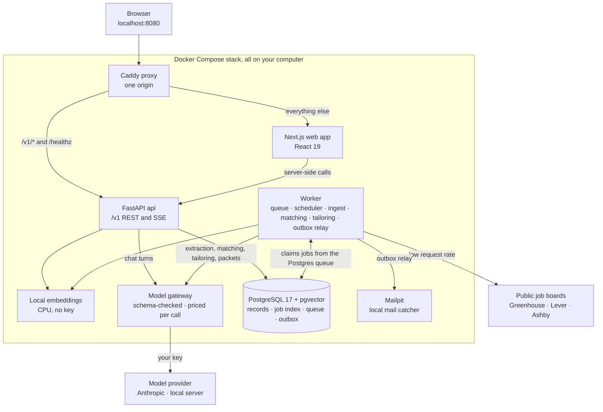

<p align="center">
  
</p>

<h1 align="center">OpenElip</h1>

<p align="center">
  <b>Open-Source, Self-Hosted Agent Job Search & Hiring</b>
</p>

<p align="center">
  <i>The searching, matching and drafting is done for you, with the evidence shown. You make every decision.</i>
</p>

<br/>

<p align="center">
  <b>If OpenElip is useful to you, <a href="https://github.com/jaiswal-naman/openelip">please consider giving it a star.</a> It helps the open-source project grow.</b>
</p>

<p align="center">
  Built by <a href="https://github.com/jaiswal-naman"><b>Naman</b></a>
</p>

<p align="center">
  <a href="LICENSE"></a>
  <a href="https://github.com/jaiswal-naman/openelip/actions/workflows/ci.yml"></a>
  <a href="https://fastapi.tiangolo.com"></a>
  <a href="https://nextjs.org"></a>
  <a href="https://github.com/pgvector/pgvector"></a>
</p>

<p align="center">
  <a href="#-quick-start"><b>Getting Started</b></a> ·
  <a href="docs/OVERVIEW.md"><b>Docs</b></a> ·
  <a href="docs/TESTING.md"><b>Testing</b></a> ·
  <a href="https://github.com/jaiswal-naman/openelip/issues"><b>Issues</b></a>
</p>

<br/>

---

## 🎯 What is OpenElip?

OpenElip is a job-search and hiring app that runs **on your own computer**, with your own model key. It imports real postings from employers' public job boards, matches them to your career record with the evidence shown, tailors your resume without inventing anything, and drafts an application packet. The same install has a hiring side: describe a role, and see a shortlist of candidates who said yes.

**One database. One `docker compose up`. Nothing about you goes anywhere without your yes.**

```bash
git clone https://github.com/jaiswal-naman/openelip.git
cd openelip
cp .env.example .env
docker compose up -d        # then open http://localhost:8080
```

```text
  Public job boards ──► job index ──► matches with cited evidence ──► you decide
                                                   │
                                                   ▼
                          tailored resume · application packet ──► you submit
```

> **Status: phases 1 to 6 are built and on `main`.** That is the platform, the job index, the career record, matches with the morning brief, the chat agent with resume tailoring and applications, and the hiring desk. Almost all of it is tested on invented data and recorded model answers. **No model's accuracy has been measured, and this page claims none.** Campaigns under a Guardian, a local mode with no sign-in, a one-command installer and a redesigned interface are in development and are **not** on `main` ([see below](#-next-release-not-on-main)). The [known issues](#-known-issues) are listed below.

## 🌟 Why OpenElip?

- **Evidence you can check.** Every match is a requirement-by-requirement table that points at the exact sentence in the posting and the exact line in your resume. Missing evidence says "No evidence"; an unknown value says "Unknown", never a guess.
- **Dealbreakers are rules, not suggestions.** A job that breaks a hard constraint you stated is removed by one database function before any model sees it, and an independently written checker re-tests every job a run records. It is listed under "Why not" with the reason.
- **Nothing is invented.** A resume edit may only reorder, remove, or add from your confirmed facts, and passes two checks (code, then a model check that fails closed) or is removed and counted.
- **Local first, bring your own key.** The database, your record and your history live on your machine. Model calls use your own key or a model server you run. Search works with no key at all.
- **Honest about limits.** Numbers come only from recorded runs. A replay of recorded answers is called a wiring check, never model quality.

<br/>

---

## ✨ Core Features

### 🧑‍💼 For job seekers

| Feature | What it does |
| --- | --- |
| 🔎 **Real jobs only** | Postings come from the public Greenhouse, Lever and Ashby APIs, refreshed every 6 hours. A job that leaves its board is closed. Same-company duplicates fold into one job. An apply link is re-checked before a job goes into a brief. |
| 🧠 **Search by meaning** | A plain-English query fuses a keyword ranking with a vector ranking from a local embedding model (`BAAI/bge-small-en-v1.5`, 384 dimensions): no key needed. Country and remote filters apply. Each result shows its board and when it was last seen open. |
| 📋 **Requirements, cited** | Each open job's requirements are listed as required or preferred, with the exact words marked in the posting. *Needs a model; see [Model providers](#-model-providers).* |
| 🗂️ **Career record** | Upload a resume (PDF or Word). Hidden text is stripped and flagged; three model calls read it and return line numbers; code copies the quotes, and a database trigger rejects a fact whose quote is not the text at its span. Only facts you confirm are used. Add facts, hard constraints and preferences by hand (no model needed), see every change in a log, export your data, or delete your account. *Reading a resume needs a model.* |
| 🎯 **Matches and "Why not"** | At most five matches a day, each shown only at a final score of at least 0.6 with at least half of its required items met or partly met. Everything held back has a reason. Save or dismiss with a reason; a dismissal can propose a record change that changes nothing until you confirm. *Scoring needs a model.* |
| ☀️ **Today and the morning brief** | Today shows the decisions waiting for you, then what was done since last time. The brief comes by email and in the app, daily or weekly (or paused), in your time zone, with a one-click unsubscribe. |
| 💬 **Chat agent** | A side panel that answers about your record, matches, jobs and applications and cites what it used. Each reply streams per sentence, with its tool steps visible. It can only **propose** a record change; nothing changes until you confirm. *Needs an Anthropic key.* |
| ✍️ **Tailored resumes** | The model proposes edits to your confirmed facts. Each passes a code check and a `verify.entail` model check, or is discarded and counted. Approve edit by edit; export DOCX or PDF. *Needs an Anthropic key.* |
| 📦 **Application packets and tracker** | A packet is a short note plus six common application questions. Two (why this role, relevant experience) are drafted from your confirmed facts, every sentence cited or removed. Four (work authorisation, expected pay, notice period, start date) are never drafted and are left for you. You submit; OpenElip records where each application stands (applied, interview, offer, rejected, no response). |

### 🏢 For hiring

| Feature | What it does |
| --- | --- |
| 📝 **Roles** | Paste a role description; its requirements are read out with the exact words marked, and you confirm them. A role cannot open without a pay range. *Reading a description needs a model.* |
| 🕶️ **Anonymous preview** | See how many candidates fit a role before anyone is asked. Counts under 5 are hidden. |
| 🤝 **Consent-first introductions** | A candidate is asked privately and sees exactly what would be shared before accepting. Silence for seven days counts as no. Nothing about a candidate reaches an employer without that action. |
| ✅ **Said-yes shortlist** | Candidates who accepted, each with the evidence for the role's requirements. |
| ⏱️ **Answer clock** | The employer answers each accepted introduction yes or no, always with a reason, within five business days. An overdue answer pauses new asks until it is given. Team members can be invited. Each side has three "serious interest" signals a week. |

### 🛡️ Trust and control

| Feature | What it does |
| --- | --- |
| 🗄️ **Rules live in the database** | Four database roles: `app_api` (row-level security keeps it to the signed-in person's rows), `app_worker`, `app_match` (which cannot read documents or chat), and `app_owner`, which owns the schema and cannot log in. The audit, decision and evidence tables are append-only. |
| 🚪 **One model gateway** | Callers name a task, never a model. [`backend/config/models.toml`](backend/config/models.toml) routes 11 tasks. Two in-house adapters (Anthropic; OpenAI-compatible, which covers Ollama) plus a fake one for tests. Answers must match a strict JSON schema; every call is a priced row in an `llm_calls` ledger that holds no prompt text; a model with no known price is refused; no key means `503 ai_disabled`. |
| 💰 **Costs page** | `/control/costs` shows every model call and what it cost on your own key. |
| 🔐 **Trust page** | `/trust` lists what this server sends data to. An AI-processing consent names the provider before anything identified is sent. |
| 🔁 **Nothing sent twice** | Writes carry idempotency keys, and email goes through an outbox with a unique key per message. |
| 📦 **Your data is yours** | Export everything, or delete the account and everything the system stores for you. |

<details>
<summary><b>What is not built, and what is not measured</b></summary>
<br/>

- **No model's accuracy is measured.** The gold sets exist (resumes, postings, match evidence, tailoring, role descriptions, chat), but no live gold-set run has been made. Their labels were drafted by an agent and have not been reviewed by the maintainer. The CI gate replays recorded answers, which shows the code path works and says nothing about a model.
- **On `main`, four model features stay switched off with a real model** until a passed live gold-set run for that model and prompt is recorded: resume reading, requirement extraction, match scoring and role intake. Only one live command exists on `main` (`python -m app.evals run evidence_faithfulness --live`, for match scoring). With a real key, those four answer `503 ai_disabled`, or are skipped, until their gate opens. The chat agent, tailoring and packets are not gated.
- **Campaigns, the Guardian, the Twin and the MCP agent interface are not built on `main`.** The Caddy proxy forwards `/mcp` to the API, but the API has no route there.
- **No search-quality gold set exists**, so no search quality is claimed.
- **Real providers.** `main` routes every model task to Anthropic. OpenAI has a route only for the `ping` connectivity check, and a local model has routes only for resume reading, match scoring and `ping`. The Anthropic adapter and the local-model route have no recorded live run.
- **No batch API and no token-level streaming.** Chat streams one sentence at a time.
- Morning-brief delivery times and several limits are assumptions to tune on real mornings.

</details>

<details>
<summary><b>What has been measured</b></summary>
<br/>

| What | Result |
| --- | --- |
| First run on public boards (22 November 2026, a laptop, from 185 candidate board names) | 71 live boards, 11,357 open postings, 9,996 unique jobs after folding same-company duplicates; one keyword search with a country filter took about 0.1 s (a single measurement) |
| Location parser (a 400-row labelled sample; labels drafted by an agent, review pending) | 258 of 260 test rows read correctly (0.9923, 95% interval 0.9724 to 0.9979); a place it cannot read is stored as unknown, never guessed. See [evals/location](evals/location/README.md) |
| Matching benchmark (758 public postings, 20 invented profiles, 366 pairs; labels drafted by an agent, review pending, so indicative only) | Mean nDCG@5: keyword 0.598, vector 0.684, hybrid 0.777, hybrid plus rules 0.795, with wide intervals and no detectable difference between the last two; no method returned a job that breaks a hard constraint. See [the report](evals/matching_benchmark/REPORT.md) |
| One real-model run (OpenAI key, 28 November 2026, one machine, a development build that is not on `main`) | 57 model calls, 0 failures, USD 0.106; it found two problems. See [docs/TESTING.md](docs/TESTING.md#real-model-run-on-a-development-build) |

</details>

<br/>

---

## 🚀 Quick Start

> **Requires:** [Docker](https://docs.docker.com/get-docker/) with Docker Compose v2. Running the tests also needs [uv](https://docs.astral.sh/uv/) (Python 3.11) and Node 22 with pnpm.

```bash
git clone https://github.com/jaiswal-naman/openelip.git
cd openelip
cp .env.example .env
docker compose up -d
```

The first start builds two images, so it takes a few minutes. `.env.example` holds development-only keys and passwords that are public in this repository; the server refuses them as soon as `APP_BASE_URL` is not a localhost address.

### What starts

| Service | Port | Purpose |
| --- | --- | --- |
| **proxy** (Caddy) | `127.0.0.1:8080` | The one address for the app and the API: open http://localhost:8080. `/v1/*`, `/mcp` and `/healthz` go to the api, everything else to web |
| **web** (Next.js 16) | internal `3000` | The web app |
| **api** (FastAPI) | internal `8000` | REST under `/v1`, server-sent events for chat |
| **worker** | none | Queue, scheduler, job ingest, embeddings, resume reading, matching, tailoring, packets, outbox relay |
| **migrate** | none | Runs once: brings the schema up to date, then exits |
| **db** (PostgreSQL 17 + pgvector) | `127.0.0.1:5433` | The system of record, the queue and the vector index |
| **mail** (Mailpit) | `127.0.0.1:8025` | Local mail catcher, started by the `dev` profile that `.env.example` enables |
| **llm** (Ollama) | internal `11434` | Only with the `local-llm` profile, see [Model providers](#-model-providers) |

The api and the worker never call each other; they share PostgreSQL. Chat turns, record proposals and role-description reading run in the api; the rest of the model work runs in the worker. Change a port in `.env` (`APP_HTTP_PORT`, `APP_DB_PORT`, `APP_MAIL_PORT`) if one is taken. `docker compose stop` pauses everything and `docker compose down` removes the containers; both keep your data in the `pgdata` volume. `docker compose down -v` deletes it.

### 🧭 First run

1. **Sign in.** Open http://localhost:8080/sign-in, enter any email address and choose Send code. Open the mail catcher at http://localhost:8025, read the six-digit code and type it in. Nothing is sent to the outside; the catcher keeps the email in memory. For real mail, put your provider's URL in `SMTP_URL`.
2. **Fill the job index.** An empty index fills itself: the worker's six-hourly sweep finds live boards from the candidate names in `data/seed_candidates.txt`, then fetches them in the next slot. To start now:

   ```bash
   docker compose exec worker python -m app.cli sources discover
   docker compose exec worker python -m app.cli queue list     # wait until ingest.discover shows succeeded
   docker compose exec worker python -m app.cli ingest run
   ```

   Jobs appear at `/jobs` as the fetches finish. A pass over 71 boards took under two minutes when this was checked on 22 November 2026. New and changed jobs get their search vectors in batches of 500 every five minutes, so a large index takes time to become searchable by meaning; keyword search works from the start.
3. **Search.** `/jobs` needs no key.
4. **Add a model** (optional, see below) to read a resume, extract requirements, score matches, chat and tailor.
5. **Agree to AI processing.** The consent names the provider and what is sent to it before anything is.
6. **Build your record.** Upload a resume and confirm or correct each fact, or add facts, hard constraints and preferences by hand, then set your time zone.
7. **Land on Today.** Decisions first, then what was done since last time.

Only public, documented job-board endpoints are read, at a low request rate. OpenElip does not scrape sites behind a sign-in and does not collect people's profiles.

### 🔌 Model providers

OpenElip talks to models only through its own gateway. **Which task uses which model, and at what price, is in [`backend/config/models.toml`](backend/config/models.toml)**; the gateway re-reads it on every call. The cost is whatever your own key is billed.

| Provider | Settings | What works on `main` |
| --- | --- | --- |
| **None** (default) | `LLM_PROVIDER=fake` | A fake provider that replays recorded answers: no network, no cost, and an answer only for a task that has a recording. Search, sign-in and the screens work; a model task with no recording answers `503 ai_disabled`. Refused in production |
| **Anthropic** | `LLM_PROVIDER=anthropic`, `ANTHROPIC_API_KEY` | Every task has a route |
| **OpenAI** | `LLM_PROVIDER=openai`, `OPENAI_API_KEY` | Only the `ping` check has a route. Every other task answers `503 ai_disabled` with this provider |
| **A local model through Ollama** | `COMPOSE_PROFILES=dev,local-llm`, `LLM_PROVIDER=openai_compatible`, `LLM_BASE_URL=http://llm:11434/v1`; put the model's real name in `models.toml` (it holds the placeholder `local-model`) and pull it with `docker compose exec llm ollama pull <name>` | Resume reading, match scoring and `ping` only |

Set these in `.env`, then run `docker compose up -d`. Nothing falls back from one provider to another.

**Not checked against a live provider yet.** The Anthropic adapter and the local-model route have no recorded live run. To check a key: `docker compose exec worker python -m app.platform.llm ping --email you@example.com`, then sign in as that address, open `/control/costs` and confirm a row for the task `ping` with a cost above zero.

**Four features also need a passed live gold-set run** (resume reading, requirement extraction, match scoring, role intake; see [what is not built](#-core-features)), so a real key alone does not turn them on in this release.

<br/>

---

## 🏗️ Architecture



OpenElip is a **modular monolith on one PostgreSQL**. One Python package is built into one image and run as two processes: the **api** answers the browser, and the **worker** does most of what takes time. They never call each other; they communicate through rows (queue jobs, outbox rows, domain tables). The database is the system of record, the keyword and vector index, the job queue and the email outbox, so the rules that matter (a hard constraint filters a job, nothing is sent twice, deletion is complete) are enforced where the data lives.

- **Search.** One SQL statement: an exact vector scan over the constraint-filtered set, the 200 best `ts_rank_cd` keyword rows, and the 200 nearest vectors, fused by Reciprocal Rank Fusion with k = 60. An HNSW partial index exists but search does not use it. A model change is not re-embedded: search ignores vectors made by another model, so those jobs are found by keywords only.
- **Matching.** SQL constraints first; unknown fields never exclude a job. At most 40 jobs per run are scored against their requirements, each verdict citing facts. Required items weigh 2 and preferred 1. An independent checker re-tests the constraints on everything a run records.
- **Chat.** A two-node LangGraph loop. The model returns schema-validated JSON steps rather than native tool calls. It has seven tools (six read-only lookups and one that only proposes a record change) and stops at 6 model turns, 8 tool calls, 45 seconds or 40,000 tokens.
- **Not built.** The proxy sends `/mcp` to the api, which has no route there.

The full design is in [docs/ARCHITECTURE.md](docs/ARCHITECTURE.md). That design set also describes the later phases; its first lines say which parts are built.

<br/>

---

## 🗂️ Project Structure

```
openelip/
├── backend/            # Python package `app`: the FastAPI api and the worker
│   ├── app/            #   platform, trust, ingest, profile, match, brief, chat, tailor, apply, hiring, evals
│   ├── config/         #   models.toml: which model answers which task, and its price
│   └── tests/          #   pytest, mirrors app/
├── web/                # Next.js 16 and React 19 app (CSS Modules); Vitest tests; Playwright specs in tests/e2e
├── db/                 # Alembic migrations: the only source of the schema
├── evals/              # gold sets, recorded answers, floors, the matching benchmark
├── data/               # candidate job-board names that discovery starts from
├── docs/               # the design set and the test plan
├── scripts/            # ci-local.ps1, fresh-clone-check.ps1 (PowerShell)
├── .github/workflows/  # ci.yml, e2e.yml
├── docker-compose.yml  # the whole stack; docker-compose.demo.yml is a throwaway demo stack
├── Caddyfile           # the one-origin proxy
└── .env.example        # development configuration
```

<br/>

---

## 🛠️ Development

> For contributors. Most users only need the [Quick Start](#-quick-start).

```bash
# Backend: the tests need the database
docker compose up -d db
cd backend
uv sync --frozen
uv run pytest tests -q                      # uses a database named app_test; refuses any name not ending in _test
uv run ruff check app tests ../db && uv run mypy app && uv run lint-imports

# Web
cd web
pnpm install
pnpm typecheck && pnpm lint && pnpm test --run      # tsc, eslint, vitest
```

| Layer | What it checks | How to run it |
| --- | --- | --- |
| Backend unit and integration | Logic, SQL, row-level security and HTTP routes on a `_test` PostgreSQL | `uv run pytest tests -q` in `backend/` |
| Web unit | Components and helpers (Vitest, Testing Library) | `pnpm test --run` in `web/` |
| Browser | User journeys and axe accessibility scans, light and dark (Playwright) | `pnpm exec playwright test` in `web/`, against a running throwaway stack |
| Eval suites | **Replay checks of the wiring**: recorded answers go through the real code path. They show the code works, **not** how good a model is | `uv run python -m app.evals run <suite>` then `gate`, see [evals/README.md](evals/README.md) |
| Live accuracy run (opt-in) | Measures a real model on a gold set. It spends your key | `python -m app.evals run evidence_faithfulness --live` (the only suite with a live mode on `main`) |

[docs/TESTING.md](docs/TESTING.md) has the full test plan, a feature-by-feature coverage matrix and the real-model run. A demo of the whole flow on invented data is `docker-compose.demo.yml`, a second throwaway stack; its commands are at the top of that file. On Windows, `powershell -File scripts/ci-local.ps1` runs every gate of `ci.yml` and prints one PASS or FAIL line each.

**How it is built.** Specifications were written first, then AI coding agents implemented them phase by phase, each phase shipping with tests. The maintainer directs the design and reviews the output.

<br/>

---

## 🔒 Privacy

- **Local first.** Your record, resumes, matches, chat and history live in a PostgreSQL database in a Docker volume on your computer. There is no server run by anyone but you.
- **What leaves the computer:** calls to the **model provider you configure** (only the text a task needs; nothing with a local model), requests the worker makes to **public job boards**, which carry nothing from your record, and **email only if you set `SMTP_URL`** to a real provider. By default mail goes to the local Mailpit.
- **Consent first.** Before anything that identifies you goes to a provider, the AI-processing consent names that provider and what it receives. The `/trust` page lists where data goes.
- **Nothing is exported.** Tracing records ids and timings and exports nowhere unless you add an exporter. The embedding model is baked into the image and loaded offline, so it is not downloaded at runtime. The proxy writes no access log, and a test fails if resume, chat, contact or query text reaches a log, a metric or a trace.
- **Delete and export.** Export your data as an archive, or delete your account and everything the system stores for you. `docker compose down -v` removes the database itself.

<br/>

---

## 🐞 Known issues

- **PDF export cannot draw characters outside Latin-1.** A tailored resume or an application packet exported as PDF is refused with `pdf_unsupported_characters` when it contains a character such as an en dash, a curly quote or many accented letters, rather than being drawn without it. The DOCX export of a tailored resume carries every character. A fix is made for the next release and is not on `main`.
- **A model change is not re-embedded.** Jobs embedded with another model are ignored by vector search until they change. There is no command to re-embed them.
- **First-run slowness.** The worker loads a local embedding model and embeds new jobs in batches on the CPU while the index first fills. No minimum memory has been measured.

## 🔭 Next release (not on `main`)

These are built or being built on other branches and are not in this release. They are listed so that nothing above is mistaken for them.

- **Campaigns under a Guardian.** A durable LangGraph campaign (a thread checkpointed in PostgreSQL) run by a crew of agents: Scout, Researcher, Analyst, Writer, Chaser, Coach and Operator. Outward actions need two keys, a policy decision and six Guardian checks. An autonomy dial, approvals that expire after 7 days, and budgets of USD 0.75 per campaign and USD 5 a month are part of that design. One known problem there: the Guardian re-ran a model citation judge after approval and could block an approved action when the verdict flipped; this is fixed on that branch.
- **Local mode:** one owner, no sign-in, and the model key encrypted at rest; server mode keeps the emailed code.
- **A one-command installer**, OpenAI routes for every task, and a redesigned interface.
- **Not built anywhere yet:** the Twin (an agent that answers employers for you) and the MCP agent interface.

<br/>

---

## ❓ Troubleshooting

| Problem | Solution |
| --- | --- |
| A port is already in use | Set `APP_HTTP_PORT`, `APP_DB_PORT` or `APP_MAIL_PORT` in `.env` and run `docker compose up -d` again |
| Containers restart, or the first minutes are very slow | The worker loads a local embedding model and embeds new jobs in batches while the index first fills. Give Docker more memory (Docker Desktop, Settings, Resources) and run `docker compose up -d` |
| A feature says AI is off (`503 ai_disabled`) | No usable model is set for that task. See [Model providers](#-model-providers): the four gated features also need a passed live run |
| An uploaded resume is refused as `ai_disabled` | Reading a resume needs a model and a passed live run for it. Facts, constraints and preferences can be added by hand without one |
| `/jobs` is empty | The worker is still finding or fetching boards. Check `docker compose logs worker`, or run the commands under [First run](#-first-run) |
| Search says it fell back to keywords | No job has a vector yet, or the embedding model could not load. Keyword search keeps working; vectors arrive in batches |
| Something else | `docker compose logs --tail 50`, then open an [issue](https://github.com/jaiswal-naman/openelip/issues) |

<br/>

---

## 🤝 Contributing

See [CONTRIBUTING.md](CONTRIBUTING.md) for the full guide. The short version: run the tests above, keep a change small and covered by a test, never commit a secret, and do not state a quality number unless a recorded run produced it. To report a vulnerability, follow [SECURITY.md](SECURITY.md).

<br/>

---

## 📜 Licence

[MIT](LICENSE): free to use, modify and distribute. Third-party data and software notices are in [NOTICE](NOTICE).

---

<p align="center">
  <a href="https://github.com/jaiswal-naman/openelip">Star on GitHub</a> · <a href="https://github.com/jaiswal-naman/openelip/issues">Report a bug</a> · <a href="https://github.com/jaiswal-naman/openelip/issues">Request a feature</a> · <a href="CONTRIBUTING.md">Contribute</a>
</p>

<p align="center"><sub>Independent open-source project. Not affiliated with Elip.</sub></p>
