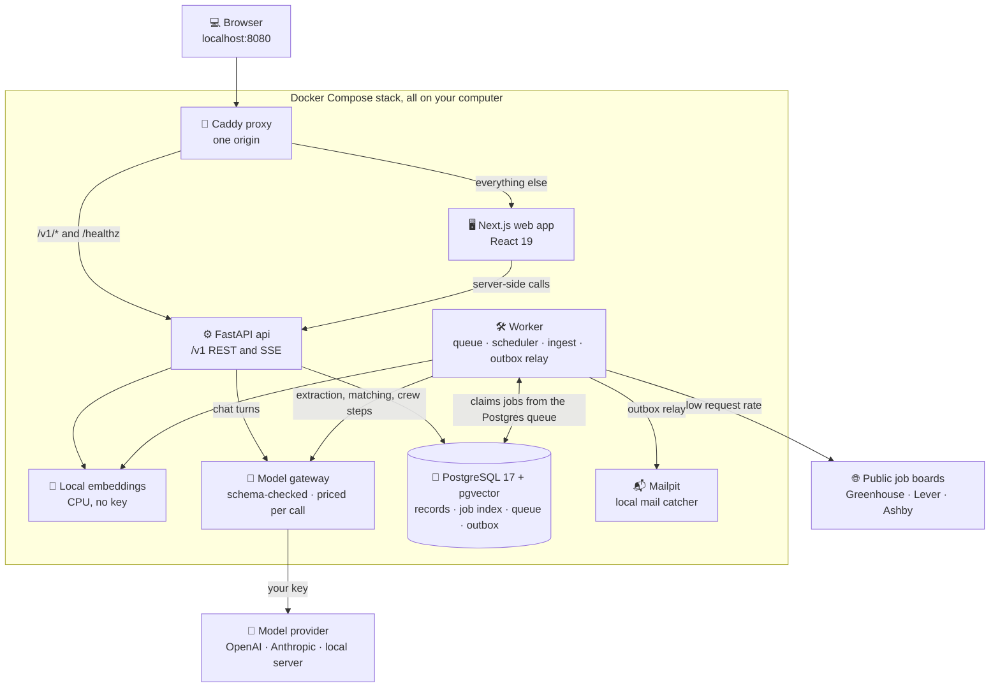

<p align="center">
  
</p>

<h1 align="center">🧭 OpenElip</h1>

<p align="center">
  <b>Open-Source, Self-Hosted Agent Job Search & Hiring</b>
</p>

<p align="center">
  <i>A crew of agents does the searching, researching and drafting. You check the evidence and make every decision.</i>
</p>

<br/>

<p align="center">
  <b>⭐️ If OpenElip is useful to you, <a href="https://github.com/jaiswal-naman/openelip">please consider giving it a star!</a> It helps the open-source project grow. ⭐️</b>
</p>

<p align="center">
  Built by <a href="https://github.com/jaiswal-naman"><b>Naman</b></a>
</p>

<p align="center">
  <a href="LICENSE"></a>
  <a href="https://github.com/jaiswal-naman/openelip/actions/workflows/ci.yml"></a>
  <a href="https://github.com/jaiswal-naman/openelip/pkgs/container/openelip-backend"></a>
  <a href="https://fastapi.tiangolo.com"></a>
  <a href="https://nextjs.org"></a>
  <a href="https://github.com/pgvector/pgvector"></a>
</p>

<p align="center">
  <a href="#-quick-start"><b>Getting Started</b></a> ·
  <a href="docs/OVERVIEW.md"><b>Docs</b></a> ·
  <a href="docs/TESTING.md"><b>Testing</b></a> ·
  <a href="https://github.com/jaiswal-naman/openelip/issues"><b>Issues</b></a>
</p>

<br/>

---

## 🎯 What is OpenElip?

OpenElip is a job-search and hiring app that runs **on your own computer**. It imports real postings from employers' public job boards, matches them to your career record, tailors your resume without inventing anything, and runs campaigns in which a crew of agents researches the company, prepares the application and drafts follow-ups. The same install has a hiring side: describe a role, and see a shortlist of candidates who said yes.

**One command. One person. One computer. Nothing goes out without your yes.**

```bash
curl -fsSL https://raw.githubusercontent.com/jaiswal-naman/openelip/main/install.sh | sh
# open http://localhost:8080, paste a model key, upload a resume
```

```text
  Public job boards ──► job index ──► matches with cited evidence ──► you decide
                                                   │
                                                   ▼
        tailored resume · application packet · campaign crew ──► your approval ──► you submit
```

> **Status: first public release.** Most of the app is built and tested against recorded and invented data. A real model has been run through one scripted scenario ([docs/TESTING.md](docs/TESTING.md#real-model-scenario-run)); **no model's accuracy has been measured**, and this page makes no accuracy claim. What is not built yet is said under [Core features](#-core-features).

## 🌟 Why OpenElip?

- **Evidence you can check.** Every match is a requirement-by-requirement table that points at the exact sentence in the posting and the exact line in your resume. Missing evidence says "No evidence"; unknown values say "Unknown", never a guess.
- **Dealbreakers are rules, not suggestions.** A job that breaks a hard constraint you stated is removed by the database before any model sees it, and listed under "Why not" with the reason.
- **You approve, nothing else sends.** Agents research, draft and follow up. Every outward action waits for your approval, a follow-up email has an undo window, and OpenElip never submits an application for you.
- **Local first, bring your own key.** The database, your record and your history live on your machine. Model calls use your own key or a model server you run. Search works with no key at all.
- **Honest about limits.** Numbers come only from recorded runs. A replay of recorded answers is called a wiring check, never model quality.

<br/>

---

## ✨ Core Features

### 🧑‍💼 For job seekers

| Feature | What it does |
| --- | --- |
| 🔎 **Real jobs only** | Postings come from employers' public Greenhouse, Lever and Ashby boards, refreshed every 6 hours. A job that leaves its board is closed. Same-company duplicates fold into one. |
| 🧠 **Search by meaning** | A plain-English query fuses keyword and vector ranking, with country and remote filters, using a local embedding model: no key needed. Each result shows its board and when it was last seen open. |
| 📋 **Requirements, cited** | Each open job's requirements are listed as required or preferred, with the exact words marked in the posting (needs a model key). |
| 🗂️ **Career record** | Upload a resume (PDF or Word). Every fact read from it is tied to the resume line it came from, and only facts you confirm are used. Add facts, hard constraints and preferences yourself. Every change is in a log. Export your data or delete your account. |
| 🎯 **Matches and "Why not"** | At most five matches a day, each a requirement-by-requirement table with citations on both sides. Everything held back is listed with its reason. Save or dismiss with a reason. |
| ☀️ **Today and morning brief** | Today shows the decisions waiting for you, then what was done since last time. The brief arrives daily or weekly (or is paused), in your time zone, with a one-click unsubscribe. In local mode you read it in the app; email needs server mode. |
| ✍️ **Tailored resumes** | The model proposes edits; each must cite your confirmed facts and pass a code check and an entailment check. Edits that fail are removed and counted, so a tailored resume cannot add experience your record does not have. Export as DOCX or PDF. |
| 📦 **Application packets and tracker** | Drafted answers to common questions plus a short note, built only from your confirmed facts and the job's requirements. Pay, notice period, start date and work authorisation are never drafted. You submit; OpenElip records where each application stands. |

### 🏢 For hiring

| Feature | What it does |
| --- | --- |
| 📝 **Roles** | Paste a role description; its requirements are read out with the exact words marked, and you edit and confirm them before the role can be published (needs a model key). |
| 🕶️ **Anonymous preview** | See how many candidates fit a role before anyone is asked. |
| 🤝 **Consent-first introductions** | A candidate is asked privately and sees exactly what would be shared before accepting. Nothing about a candidate reaches an employer without that action. |
| ✅ **Said-yes shortlist** | Candidates who accepted, each with the evidence for the role's requirements. |
| ⏱️ **Answer clock** | The employer answers each accepted introduction yes or no, always with a reason, on a visible clock; an overdue answer holds back further asks until it is given. Team members can be invited. |

One install has one owner, who can use both sides.

### 🤖 The agent and the crew

| Feature | What it does |
| --- | --- |
| 💬 **Agent page** | A chat agent that reads your record, matches, applications, campaigns and the job index, and cites what it used. Answers stream, with its tool steps visible. It can only **propose** a change to your record; nothing changes until you confirm. |
| 🔬 **Researcher** | Reads the company's own public pages and keeps a claim only when its quote is an exact substring of the page it fetched. The result is a dossier: each claim with its source and time. |
| ✉️ **Writer, Chaser, Coach** | The Writer drafts the packet; the Chaser drafts at most two follow-ups per campaign; the Coach prepares likely interview questions tied to the job's requirements and your facts. Every sentence is checked against its cited sources before you see it. |
| 🚀 **Campaigns** | A board of campaigns and a per-campaign timeline: dossier, packet, prep, follow-ups, crew. Durable: a campaign survives a restart and picks up where it stopped. |

### 🛡️ Control and trust

| Feature | What it does |
| --- | --- |
| 🧱 **The Guardian** | Policy and checks that every outward action must pass, once when it is cleared and again when it runs. Blocked attempts are logged too. A posting with scam signals (a fee, documents before an interview, moving off-platform) pauses the campaign. |
| ✅ **Approvals and undo** | Approve or reject each action. An approved follow-up waits in the outbox through an undo window (ten minutes by default, 1 to 60 in settings). |
| 🎚️ **Autonomy settings** | Set what each kind of outward action may do. Application packets are always "ask first"; follow-up emails are "ask first" or "never". No setting lets either go out without your approval. The undo window is set here too. |
| 🎞️ **Flight recorder** | Every agent step, including blocked ones, is recorded and can be stepped through. |
| 💰 **Costs and budgets** | Every model call is a priced row on the Costs page. A campaign is metered against a budget (USD 0.75 by default, USD 5 per person per month) and pauses with a reason when it reaches it. |
| 🔐 **Trust page** | `/trust` lists what this server sends data to. An AI-processing consent names the provider before anything identified is sent. |
| 📦 **Your data is yours** | Export everything, or delete the account and everything the system stores for you. |

<details>
<summary><b>What is not built yet, and what is not measured</b></summary>
<br/>

- **The Twin** (answering an employer's screening questions from your record) and the **MCP interface for outside agents** are designed in [docs/](docs/OVERVIEW.md) and have database tables, but no routes or screens yet.
- The **evaluation scoreboard** and the simulated-market evaluation ("wind tunnel") exist as an API and a replay harness, with no screen.
- **No model's accuracy is measured.** The gold sets exist (resumes, postings, match evidence, role descriptions), but no live gold-set run has been made. Their labels are drafted by an agent, review pending.
- **No search-quality gold set exists**, so no search quality is claimed.
- The local-model route (Ollama) and the Anthropic adapter have no recorded live run.
- Morning-brief delivery times and several limits are assumptions to tune on real mornings.

</details>

<details>
<summary><b>What has been measured</b></summary>
<br/>

| What | Result |
| --- | --- |
| First run on public boards (22 November 2026, a laptop, from 185 candidate board names) | 71 live boards, 11,357 open postings, 9,996 unique jobs after folding same-company duplicates; one keyword search with a country filter took about 0.1 s (a single measurement) |
| Location parser (a 400-row labelled sample; labels drafted by an agent, review pending) | 258 of 260 test rows read correctly (0.9923, 95% interval 0.9724 to 0.9979); a place it cannot read is stored as unknown, never guessed. See [evals/location](evals/location/README.md) |
| Matching benchmark (758 public postings, 20 invented profiles, 366 labelled pairs; labels drafted by an agent, review pending) | Mean ndcg@5: keyword 0.598, vector 0.684, hybrid 0.777, hybrid plus rules 0.795, with wide intervals; no method returned a job that breaks a hard constraint. See [the report](evals/matching_benchmark/REPORT.md) |
| Real-model runs (OpenAI key, a real resume, 16 invented postings and one live public board, 27 and 28 November 2026) | Every built agent ran: resume reading, requirement extraction, matching, tailoring, packet, chat and its record proposals, the Researcher, the Guardian, the Chaser and the Coach. 131 model calls, 0 failures, USD 0.24 in total. See [docs/TESTING.md](docs/TESTING.md#real-model-scenario-run) |

</details>

<br/>

---

## 🚀 Quick Start

> **Requires:** [Docker](https://docs.docker.com/get-docker/) with Docker Compose v2. Nothing else for Options A and B.

### Option A: One-Line Install

```bash
# Linux / macOS
curl -fsSL https://raw.githubusercontent.com/jaiswal-naman/openelip/main/install.sh | sh

# Windows (PowerShell)
irm https://raw.githubusercontent.com/jaiswal-naman/openelip/main/install.ps1 | iex
```

The installer checks that Docker is running, puts `docker-compose.yml`, `Caddyfile` and a `.env` with **freshly generated keys** in `~/openelip` (`%USERPROFILE%\openelip` on Windows), pulls the published images, starts everything and opens http://localhost:8080. Run it again to update to the newest images; your data and your `.env` are kept. Everything is bound to `127.0.0.1`.

Optional settings, as environment variables: `OPENELIP_HOME` (where the files go), `OPENELIP_PORT` (default 8080), `OPENELIP_VERSION` (image tag, default `latest`), `OPENELIP_PROJECT` (Compose project name, default `openelip`), `OPENELIP_PULL=0` (use images already on this machine).

### Option B: Pre-built Docker Images

Images are published to GitHub Container Registry for `linux/amd64` and `linux/arm64` by [`.github/workflows/images.yml`](.github/workflows/images.yml): `latest` and `main` on every push to `main`, and `1.2.3` and `1.2` for a `v1.2.3` tag.

```bash
docker pull ghcr.io/jaiswal-naman/openelip-backend:latest
docker pull ghcr.io/jaiswal-naman/openelip-web:latest
```

Then start the stack on those images instead of building them:

```bash
git clone https://github.com/jaiswal-naman/openelip.git
cd openelip
cp .env.example .env
# add these two lines to .env
#   OPENELIP_BACKEND_IMAGE=ghcr.io/jaiswal-naman/openelip-backend:latest
#   OPENELIP_WEB_IMAGE=ghcr.io/jaiswal-naman/openelip-web:latest
docker compose up -d --no-build
```

### Option C: Clone & Build from Source

```bash
git clone https://github.com/jaiswal-naman/openelip.git
cd openelip
cp .env.example .env
docker compose up -d
```

The first start builds two images, so it takes a few minutes.

> `.env.example` holds development-only keys and passwords that are public in this repository. The server refuses them as soon as `APP_BASE_URL` is not a localhost address. Option A generates its own.

### What starts

| Service | Port | Purpose |
| --- | --- | --- |
| **proxy** (Caddy) | `127.0.0.1:8080` | The one address for the app and the API: open http://localhost:8080 |
| **web** (Next.js) | internal `3000` | The web app |
| **api** (FastAPI) | internal `8000` | REST under `/v1`, server-sent events |
| **worker** | none | Background queue, scheduler, job ingest, embeddings, outbox relay |
| **migrate** | none | Runs once: brings the schema up to date, then exits |
| **db** (PostgreSQL 17 + pgvector) | `127.0.0.1:5433` | The system of record, the queue and the vector index |
| **mail** (Mailpit) | `127.0.0.1:8025` | Local mail catcher, started by the `dev` profile that `.env.example` enables |
| **llm** (Ollama) | internal `11434` | Only with the `local-llm` profile, see [Model providers](#-model-providers) |

Change a port in `.env` (`APP_HTTP_PORT`, `APP_DB_PORT`, `APP_MAIL_PORT`) if one is taken. `docker compose stop` pauses everything and `docker compose down` removes the containers; both keep your data in the `pgdata` volume. `docker compose down -v` deletes it.

### 🧭 First run

1. **Open http://localhost:8080.** In local mode (the default) opening the app signs you in as its owner: no account, no password, no sign-in page. It answers only to `localhost`, `127.0.0.1` and `[::1]`.
2. **Set up your model.** Choose Anthropic or OpenAI and paste your key (it is sealed in the local database; only its last four characters are shown again), or use a local model ([below](#-model-providers)). You can skip this: job search works with no key, and anything that needs a model says so until you add one.
3. **Agree to AI processing.** The consent names the provider and what is sent to it before anything is.
4. **Upload a resume** (PDF or Word) and check what was read. Each fact comes with the line it came from; confirm, edit or discard.
5. **Set your rules.** Hard constraints (dealbreakers) and softer preferences, then your time zone. The first matches appear.
6. **Land on Today.** Decisions first, then what was done since last time. Ask the Agent page anything about your record, matches or applications.

The job index fills itself. On the first start the worker finds the live boards from the candidate names in `data/seed_candidates.txt`, fetches them, and then refreshes every 6 hours. Jobs appear at `/jobs` as the fetches finish, and get their search vectors in batches.

<details>
<summary><b>Local mode and server mode</b></summary>
<br/>

Local mode (`APP_MODE=local`, set by `.env.example`) is for one person on their own computer. The one owner account is both a job seeker and an employer, so the hiring desk is in the same menu. The server refuses to start in local mode when `APP_BASE_URL` is not a localhost address.

Server mode (`APP_MODE=server`, also what an unset `APP_MODE` means) is for a server other people can reach: sign in at `/sign-in` with a six-digit code sent by email. In development the email lands in Mailpit at http://localhost:8025. Putting TLS in front for a public server is not done for you.

</details>

<details>
<summary><b>Fill the job index by hand</b></summary>
<br/>

```bash
docker compose exec worker python -m app.cli sources discover
docker compose exec worker python -m app.cli queue list     # wait until ingest.discover shows succeeded
docker compose exec worker python -m app.cli ingest run
```

Only public, documented job-board endpoints are read, at a low request rate. OpenElip does not scrape sites behind a sign-in and does not collect people's profiles.

</details>

### 🔌 Model providers

OpenElip talks to models only through its own gateway: schema-checked answers, one priced row per call, and `503 ai_disabled` when no provider is configured. **Which task uses which model, and at what price, is in [`backend/config/models.toml`](backend/config/models.toml)**; the gateway re-reads it on every call. The cost is whatever your own key is billed.

| Provider | How to set it |
| --- | --- |
| **OpenAI** | Paste the key in the app, or set `LLM_PROVIDER=openai` and `OPENAI_API_KEY` in `.env` |
| **Anthropic** | Paste the key in the app, or set `LLM_PROVIDER=anthropic` and `ANTHROPIC_API_KEY` in `.env` |
| **A local OpenAI-compatible server (for example Ollama)** | Set `COMPOSE_PROFILES=dev,local-llm`, `LLM_PROVIDER=openai_compatible` and `LLM_BASE_URL=http://llm:11434/v1` in `.env`. Put the model's real name in `backend/config/models.toml` (it holds the placeholder `local-model`) and pull it: `docker compose exec llm ollama pull <name>` |

What is in `.env` wins over a key saved in the app. Nothing falls back from one provider to another. `LLM_PROVIDER=fake` replays recorded answers with no network and no cost; it is for tests and for looking around the screens that show model use, and the server refuses it in production.

OpenAI keeps API calls in abuse-monitoring logs for up to 30 days, and zero data retention needs its approval, so the AI-processing consent shows that note before anything is sent; switching provider asks you to agree again. `models.toml` records the terms as read on 2026-11-28.

To check a key, run `docker compose exec worker python -m app.platform.llm ping --email owner@example.test`, then open `/control/costs` and look for a row for the task `ping`. The scenario run in [docs/TESTING.md](docs/TESTING.md#real-model-scenario-run) used OpenAI and cost USD 0.24 for 131 model calls across every agent; yours will differ.

<br/>

---

## 🏗️ Architecture



OpenElip is a **modular monolith on one PostgreSQL**. One Python package is built into one image and run as two processes: the **api** answers the browser, and the **worker** does everything that takes time. They never call each other; they communicate through rows (queue jobs, outbox rows, domain tables). The database is the system of record, the keyword and vector index, the job queue and the email outbox, so the rules that matter (a hard constraint filters a job, nothing is sent twice, deletion is complete) are enforced where the data lives. Campaigns are a LangGraph graph checkpointed in PostgreSQL. Models are reached only through the gateway, and embeddings run locally, which is why search needs no key. The full design is in [docs/ARCHITECTURE.md](docs/ARCHITECTURE.md).

<br/>

---

## 🗂️ Project Structure

```
openelip/
├── backend/            # Python package `app`: the FastAPI api and the worker
│   ├── app/            #   platform, trust, ingest, profile, match, brief, chat, tailor, apply,
│   │                   #   hiring, campaigns, guardian, twin, agentnet, evals
│   ├── config/         #   models.toml: which model answers which task, and its price
│   └── tests/          #   pytest, mirrors app/
├── web/                # Next.js 16 and React 19 app; Vitest tests; Playwright specs in tests/e2e
├── db/                 # Alembic migrations: the only source of the schema
├── evals/              # gold sets, recorded answers, floors, the matching benchmark, wind-tunnel scenarios
├── data/               # candidate job-board names that discovery starts from
├── docs/               # the design set and the test plan
├── scripts/            # ci-local.ps1, fresh-clone-check.ps1 (PowerShell)
├── .github/workflows/  # ci.yml, e2e.yml, images.yml
├── docker-compose.yml  # the whole stack; docker-compose.demo.yml is a throwaway demo stack
├── Caddyfile           # the one-origin proxy
├── .env.example        # development configuration
└── install.sh, install.ps1
```

<br/>

---

## 🛠️ Development

> For contributors. Most users should use the [Quick Start](#-quick-start).

**Prerequisites:** Docker with Compose, [uv](https://docs.astral.sh/uv/) (Python 3.11), Node 22 and pnpm.

```bash
# Backend: the tests need the database
docker compose up -d db
cd backend
uv sync --frozen
uv run pytest tests -q                      # uses a database named app_test; refuses any name not ending in _test
uv run ruff check app tests ../db && uv run mypy app && uv run lint-imports

# Web
cd web
pnpm install
pnpm typecheck && pnpm lint && pnpm test --run      # tsc, eslint, vitest
```

| Layer | What it checks | How to run it |
| --- | --- | --- |
| Backend unit and integration | Logic, SQL and HTTP routes on a `_test` PostgreSQL | `uv run pytest tests -q` in `backend/` |
| Web unit | Components and helpers (Vitest, Testing Library) | `pnpm test --run` in `web/` |
| Browser | User journeys and axe accessibility scans, light and dark (Playwright) | `pnpm exec playwright test` in `web/`, against a running throwaway stack |
| Eval suites | **Replay checks of the wiring**: recorded answers go through the real code path. They show the code works, **not** how good a model is | `uv run python -m app.evals run <suite>` then `gate`, see [evals/README.md](evals/README.md) |
| Live accuracy runs (opt-in) | Measure a real model on a gold set. They gate nothing and spend your key | `python -m app.evals run <suite> --live` |

[docs/TESTING.md](docs/TESTING.md) has the full test plan, a feature-by-feature coverage matrix and the real-model scenario run. On Windows, `powershell -File scripts/ci-local.ps1` runs every gate of `ci.yml` and prints one PASS or FAIL line each.

**How it is built.** Specifications were written first, then AI coding agents implemented them phase by phase, each phase shipping with tests. The maintainer directs the design and reviews the output.

<br/>

---

## 🔒 Privacy

- **Local first.** Your record, resumes, matches, chat and history live in a PostgreSQL database in a Docker volume on your computer. In local mode there is no account and no server run by anyone but you.
- **What leaves the computer:** calls to the **model provider you configure** (only the text a task needs; nothing with a local model), requests the worker makes to **public job boards and company web pages**, which carry nothing from your record, and **email only if you set `SMTP_URL`** to a real provider. By default, mail goes to the local Mailpit.
- **Consent first.** Before anything that identifies you goes to a provider, the AI-processing consent names that provider and what it receives. The `/trust` page lists where data goes.
- **No vendor telemetry.** The local embedding library's vendor telemetry is switched off (ONNX Runtime would otherwise send usage events; see "Vendor telemetry" in [docs/AI_SYSTEM.md](docs/AI_SYSTEM.md)). The embedding model is baked into the image, so it is not downloaded at runtime. The proxy writes no access log, and a test fails if resume, chat, contact or query text reaches a log, a metric or a trace.
- **Delete and export.** Export your data as an archive, or delete your account and everything the system stores for you. In local mode, `docker compose down -v` removes the database itself.

<br/>

---

## ❓ Troubleshooting

| Problem | Solution |
| --- | --- |
| A port is already in use | Set `APP_HTTP_PORT`, `APP_DB_PORT` or `APP_MAIL_PORT` in `.env` and run `docker compose up -d` again. For the installer, set `OPENELIP_PORT` before the first install |
| The installer says a Docker project called `openelip` already runs from another folder | It will not take over another copy. Set `OPENELIP_PROJECT=openelip2` and run it again |
| "Docker is installed but not running" | Start Docker Desktop and run the command again |
| Containers restart, or the first minutes are very slow | The worker loads a local embedding model and embeds new jobs in batches on the CPU while the index first fills, which takes noticeable memory and processor time. Give Docker more memory (Docker Desktop, Settings, Resources) and run `docker compose up -d`. No minimum has been measured |
| A feature says AI is off (`503 ai_disabled`) | No usable model key is set. Paste one at `/setup`, or set it in `.env`. Job search and the rest of the app work without one |
| An uploaded resume is refused as `ai_disabled` | Reading a resume needs a model. Add a key, then upload again |
| `/jobs` is empty | The worker is still fetching boards. Check `docker compose logs worker`, or run the [commands above](#-first-run) to fetch by hand |
| Search says it fell back to keywords | No job has a vector yet, or the embedding model could not load. Keyword search keeps working; vectors arrive in batches |
| Something else | `docker compose logs --tail 50`, then open an [issue](https://github.com/jaiswal-naman/openelip/issues) |

<br/>

---

## 🤝 Contributing

See [CONTRIBUTING.md](CONTRIBUTING.md) for the full guide. The short version: run the tests above, keep a change small and covered by a test, never commit a secret, and do not state a quality number unless a recorded run produced it. To report a vulnerability, follow [SECURITY.md](SECURITY.md).

<br/>

---

## 📜 Licence

[MIT](LICENSE): free to use, modify and distribute. Third-party data and software notices are in [NOTICE](NOTICE).

---

<p align="center">
  <a href="https://github.com/jaiswal-naman/openelip">⭐ Star on GitHub</a> · <a href="https://github.com/jaiswal-naman/openelip/issues">🐛 Report Bug</a> · <a href="https://github.com/jaiswal-naman/openelip/issues">💡 Request Feature</a> · <a href="CONTRIBUTING.md">🤝 Contribute</a>
</p>

<p align="center"><sub>Independent open-source project. Not affiliated with Elip.</sub></p>
