# System Architecture

**Project:** OpenElip (working name; the public name is an open decision in OVERVIEW.md)
**Date:** 2026-11-22, revised the same day to apply the design review
**Status:** Design. Only the foundation slice exists and has been measured: job ingestion from public Greenhouse, Lever and Ashby boards, closure detection, same-company duplicate folding and keyword search. Everything else is a proposal.
**Sibling documents:** DATA_MODEL.md (DDL, constraints, triggers, row-level security), API.md (endpoints, payloads, errors), AI_SYSTEM.md (prompts, agent internals, models, evaluation), FRONTEND_UI.md (screens). This document owns the runtime shape: processes, modules, flows, background work, security, privacy, operations and testing.

**Conventions.** "Target" marks an unmeasured goal; "assumption" marks a value awaiting a measurement or decision. Every library, version or vendor behaviour carries "(checked 2026-11-22)" next to its official source; anything not checked says "unverified". Names, enums and statuses are DATA_MODEL.md section 1.3's, used unchanged.

**Three terms.** An **outside action** is something an agent does that reaches anyone other than the candidate; v1 has three, `submit_application` (prepared only; the candidate submits), `send_follow_up` and `twin_answer`, each an `agent_actions` row that passes both keys. **The candidate's own action** is a click by the candidate (accepting or declining an introduction, sending a signal, replying to a Twin question), recorded in `consents` and `audit_log` and never proposed by an agent. The **instance operator** runs an installation through the shell (`python -m app.cli`) and environment configuration only, with no flag, no web screens and no access to candidate content. The crew member is always "the Operator role".

---

## 1. Summary and architectural stance

- One Python package (`app`) is built into one image and run as two process types: the **API process** (FastAPI: REST under `/v1`, server-sent events, and the MCP server at `/mcp`) and the **worker process** (queue consumer, scheduler, graph threads, outbox relay). A Next.js container serves the web app, which is only a client of `/v1`. A reverse proxy puts everything behind one origin.
- One **PostgreSQL 17** database with pgvector is the system of record, the keyword and vector index, the job queue, the email outbox and the file store. No second store holds personal data.
- The code is a **modular monolith** of the fifteen canonical modules. Each module owns its tables and exposes a small interface; modules sit in layers, imports point only downward, and CI fails the build on an upward import.
- **Correctness lives in the database where it can:** unique keys, triggers, append-only tables, row-level security and foreign keys that make deletion complete.
- **Agents run inside a deterministic harness.** A campaign is a LangGraph graph, one thread per campaign, checkpointed in PostgreSQL and resumed by queue jobs; its routing reads our tables, which stay the source of truth (5.9). Every outside action passes two keys (the policy engine and the Guardian checks) when it is cleared and again when it runs, and is written to the flight recorder. An approved follow-up email waits ten minutes in the outbox so it can be undone.
- **Models are reached only through the gateway** in `platform`, which records every call and enforces budgets. Embeddings run locally, so search works with no API key.

### 1.1 Why a modular monolith on one PostgreSQL

| What the invariants need | What one database and one codebase give | What a split would cost |
|---|---|---|
| Invariant 6: nothing is sent twice | Decision, brief and outbox row commit in one transaction under unique keys | A distributed transaction or a saga |
| Invariant 1: constraint safety | One SQL constraint filter shared by matching, search, the hiring desk and `/mcp` | The rule re-implemented or called over the network |
| Invariant 5: two keys, always logged | Policy decision, checks, recorder row and outbox row commit together | An action sent while its log write fails elsewhere |
| Invariant 7: deletion is complete | `erase_user` deletes one `users` row; files and embeddings go with it | A deletion protocol across stores |
| One-command install a maintainer can explain | Six containers, one deploy, one migration stream | A broker, a workflow server, a network boundary per feature |

The expected bottleneck is model latency and cost (assumption). A bad release or slow query affects everything, mitigated by statement timeouts per role, separate API and worker pools, and separate queues.

### 1.2 What would trigger a split

| Trigger (measured) | First response | Only then |
|---|---|---|
| Hybrid search p95 above 500 ms, or retrieval recall below its floor | Tune HNSW and full-text settings; a search read replica | A dedicated search engine |
| Worker CPU above 70% through the nightly window | A second worker bound to some queues | Nothing further |
| Open event streams above 60% of the API's connection limit | A second API container (the per-IP sign-in counter moves into PostgreSQL, 6.1) | Nothing further |
| Queue claim p95 above 1 s, or `queue_jobs` dead tuples above 20% after pruning | Prune harder, partition; revisit 5.1 | Move the queue |
| Compensation logic in more than two places, or waits that park-and-resume cannot express | Factor the shared node code | Re-evaluate the workflow engine (5.2) |
| A market's law requires data to stay in a region | A second full stack in that region | Cross-region features |
| Write load beyond one database node after all of the above | Move `ingest` (no personal data) to its own database | Further splits by measured hot spot |

---

## 2. System context and containers

### 2.1 Context

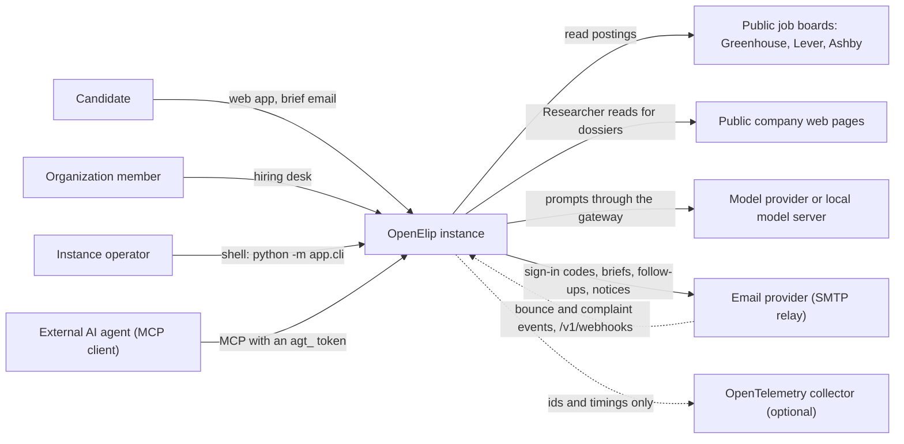

Personal data leaves the instance in three ways: text sent to the model provider (none with a local model), email through the provider, and what a candidate's own action releases (an accepted introduction, Twin answers within their settings, their own agent token). Section 8.5 lists each flow.

### 2.2 Containers

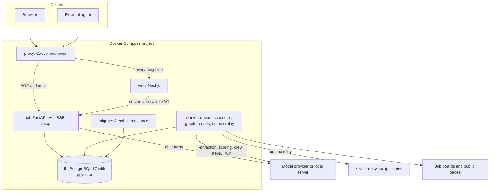

- The API and the worker share code and the database and never call each other; they communicate through rows (queue jobs, outbox rows, domain tables).
- The proxy routes `/v1/*` and `/mcp` to the API and everything else to the web app, so the cookie is first-party, with no cross-origin setup and no Next.js rewrite. Caddy flushes `text/event-stream` responses immediately ([Caddy reverse_proxy](https://caddyserver.com/docs/caddyfile/directives/reverse_proxy), checked 2026-11-22); Phase 1 verifies this on the running stack. Proxy access logging is off, as it would record IP addresses and URLs.
- Blocking route handlers are plain `def`, so FastAPI runs them in its thread pool and the event loop stays free for streams. Parsing, bulk embedding, rendering and graph threads run in the worker; query embeddings run in the API.

### 2.3 Docker Compose services

| Service | Image | Profile | Purpose | Notes |
|---|---|---|---|---|
| `db` | `pgvector/pgvector:pg17` (already in use) | default | PostgreSQL 17 with pgvector | Bound to `127.0.0.1`; volume `pgdata` |
| `migrate` | backend image | default | `alembic upgrade head`, role setup, model registry sync, then exits | Bootstrap login that is a member of `app_owner`; `api` and `worker` wait for it |
| `api` | backend image | default | `uvicorn app.main:app` | Role `app_api` |
| `worker` | backend image | default | `python -m app.worker` | Roles `app_worker`, and `app_match` for the match module |
| `web` | web image | default | Next.js server | Reaches `api` on the internal network |
| `proxy` | `caddy` | default | One origin | Automatic TLS when `APP_DOMAIN` is public |
| `mail` | `axllent/mailpit` | `dev` | Catches outgoing mail; UI on port 8025 | ([Mailpit](https://github.com/axllent/mailpit), checked 2026-11-22) |
| `llm` | `ollama/ollama` | `local-llm` | Local model server, OpenAI-compatible API on port 11434 | ([Ollama Docker](https://docs.ollama.com/docker), checked 2026-11-22) |

Services without `profiles` always start; profiled ones start only when named with `--profile` or `COMPOSE_PROFILES` ([Compose profiles](https://docs.docker.com/compose/how-tos/profiles/), checked 2026-11-22). There is no eval service or eval database: evals run as a command in the worker image against the main database with synthetic accounts (section 10.2).

---

## 3. Repository layout and module map

### 3.1 Repository layout

```
backend/
  pyproject.toml
  app/
    main.py          # API composition root: builds FastAPI, mounts module routers and /mcp
    worker.py        # worker composition root: job handlers, scheduler, relay
    cli.py           # the instance operator's tools: seed, sources, queue, outbox, graphs, keys, erase-replay, suspend
    platform/ trust/ ingest/ profile/ match/ brief/ chat/ tailor/ apply/
    hiring/ campaigns/ guardian/ twin/ agentnet/ evals/
  config/models.toml # task-to-model routing (section 5.8)
  tests/             # mirrors app/
web/                 # Next.js App Router (FRONTEND_UI.md)
evals/               # gold sets, wind tunnel scenarios, thresholds (AI_SYSTEM.md)
db/                  # Alembic environment and versions
docs/                # public design documents
data/                # seed lists (existing seed_candidates.txt)
docker-compose.yml
Caddyfile
```

### 3.2 Inside a module

```
app/<module>/
  api.py       # the only file other modules may import
  events.py    # names and payloads of the domain events it publishes
  models.py    # SQLAlchemy definitions of the tables it owns
  service.py   # internals
  jobs.py      # queue job handlers
  routes.py    # FastAPI router for its API group
  prompts/     # prompt files, if it calls models (AI_SYSTEM.md)
```

### 3.3 Dependency layers and the rule that prevents cycles

| Layer | Modules (siblings on one line may not import each other) |
|---|---|
| 8 | `evals` |
| 7 | `chat`, `brief`, `agentnet` |
| 6 | `campaigns`, `twin` |
| 5 | `hiring`, `apply` |
| 4 | `guardian`, `tailor` |
| 3 | `match` |
| 2 | `ingest`, `profile` |
| 1 | `trust` |
| 0 | `platform` |

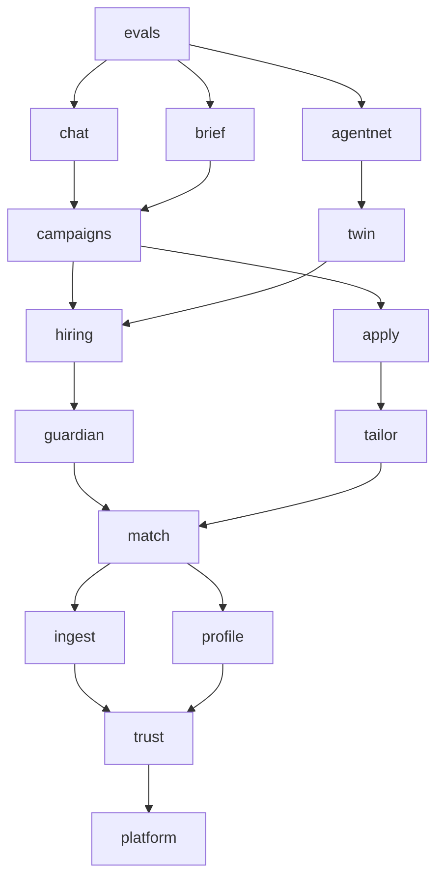

The diagram shows only the edge to the next layer; any downward import is allowed.

**The rule.** (1) A module imports only the `api.py` and `events.py` of modules in lower layers. (2) No module reads or writes another module's tables; deletion is the exception, done by `erase_user` in the database. (3) Only `app.platform.llm` imports a model provider SDK, and only `app.platform.db` creates engines. (4) The composition roots (`app.main`, `app.worker`, `app.cli`) sit above every layer. Because imports point down an ordered list, no cycle can form.

**Reaching a higher layer without importing it.** *Domain events:* `platform.events.publish(conn, name, payload)` inserts one queue job per subscriber in the caller's transaction, so delivery happens if and only if the change committed (`introduction.accepted` starts a campaign; `introduction.answered` and `application.status_changed` resume one). *Registries* (`queue.handler`, `scheduler.every`, `trust.privacy.register`) fill at start-up. *Routes live in the higher module:* `POST /v1/campaigns` belongs to `campaigns`, which calls `match.api.get_decision`.

**Enforcement in CI.** Import Linter 2.17 (BSD-2-Clause, released 2026-11-18) checks a `layers` contract and supports independent siblings with the `|` separator ([PyPI](https://pypi.org/project/import-linter/), [layers contract](https://github.com/seddonym/import-linter/blob/main/docs/contract_types/layers.md), both checked 2026-11-22). A `forbidden` contract keeps the `anthropic` and `openai` packages inside `app.platform.llm`; another keeps `langgraph` inside the four modules 5.9 names and `langchain_core` and `langgraph_sdk` out of `app`. Rule 1's "only `api.py` and `events.py`" is a 40-line pytest using the standard library `ast` module.

### 3.4 Module map

Function names are indicative; API.md and the code fix exact signatures and DATA_MODEL.md fixes the tables. Every module may use `platform` and `trust`, so "Uses" lists only the others.

| Module (layer) | Responsibility | Tables owned | Uses |
|---|---|---|---|
| `platform` (0) | Sign-in, sessions, API shell, model gateway and cost ledger, queue, scheduler, events, outbox, encryption, safe outbound HTTP, telemetry | `users`, `sessions`, `login_codes`, `llm_calls`, `model_registry`, `queue_jobs`, `idempotency_keys`, `outbox` | PostgreSQL, SMTP, providers |
| `trust` (1) | Consents, audit log, export and deletion, the table ownership registry | `consents`, `audit_log`, `data_requests` | |
| `ingest` (2) | Job index: sources, fetchers, normalizer, deduplicator, liveness, requirement extraction, embeddings | `job_sources`, `jobs`, `job_requirements`, `fetch_runs`, `skills` | |
| `profile` (2) | Career Record: documents, cited facts, hard constraints, preferences, change log | `documents`, `profile_facts`, `constraints`, `preferences`, `profile_events` | |
| `match` (3) | Constraint filter, retrieval, evidence scoring, ranking, decision ledger, independent checker, feedback; connects as `app_match` | `match_runs`, `match_decisions`, `match_evidence`, `feedback_events` | `ingest`, `profile` |
| `guardian` (4) | Agent runtime on LangGraph (checkpointer, `park`, loop builder), policy engine, autonomy, six checks, approvals, recorder, undo, budgets, `/v1/control` | `agent_runs`, `agent_actions`, `approvals`, `autonomy_settings`, `guardian_checks`; the library's tables in schema `langgraph` | `match`, `profile`, `ingest` |
| `tailor` (4) | Resume edit proposals, verifier, per-edit approval, PDF and DOCX rendered on demand | `tailored_resumes`, `resume_edits` | `match`, `profile`, `ingest` |
| `apply` (5) | Application tracker and packets | `applications`, `application_events`, `application_packets` | `tailor`, `match`, `ingest` |
| `hiring` (5) | Organizations and members, roles, preview, introductions, shortlist, answer clock, signals | `organizations`, `org_members`, `roles`, `role_requirements`, `introductions`, `shortlist_entries`, `interest_signals` | `guardian`, `match`, `profile` |
| `campaigns` (6) | Campaign graph (one thread per campaign) and crew steps | `campaigns`, `campaign_steps`, `company_dossiers` (one per campaign) | `hiring`, `apply`, `guardian`, `tailor`, `match` |
| `twin` (6) | Twin question graph: grounded answers inside the candidate's topic settings | `twin_scopes` (per candidate), `twin_sessions`, `twin_messages` | `hiring`, `guardian`, `profile` |
| `chat` (7) | Conversation agent: reads through interfaces, writes only proposals | `chat_sessions`, `chat_messages` | `campaigns`, `apply`, `match`, `profile`, `ingest`, `guardian` |
| `brief` (7) | Morning brief by email and in the app, frequency, unsubscribe, `/v1/webhooks` | `briefs`, `brief_items` | `campaigns`, `hiring`, `guardian`, `match`, `ingest` |
| `agentnet` (7) | MCP server at `/mcp`; candidate and organization agent tokens | `agent_tokens` | `twin`, `hiring`, `match`, `guardian` |
| `evals` (8) | Gold sets, judges, matching benchmark, wind tunnel, scoreboard | `eval_runs`, `eval_items`, `sim_scenarios`, `sim_runs`, `sim_results` | Any lower `api.py` |

| Module | Main interface |
|---|---|
| `platform` | `db.transaction`, `queue.enqueue`, `events.publish`, `outbox.add`, `llm.complete`, `llm.stream`, `llm.embed`, `crypto.seal`, `http.fetch_public`, `log.event` |
| `trust` | `consent.require` (raises), `consent.record`, `audit.log`, `privacy.register`, `privacy.request_deletion` |
| `ingest`, `profile` | `search` (no fit claims), `get_job`, `verify_live`; `get_record`, `compiled_constraints`, `propose_change`, `confirm` |
| `match` | `run`, `get_decision`, `why_not`, `explain`, `score_requirements`, `violations` (pure checker) |
| `guardian` | `propose_action`, `recheck`, `approve`, `reject`, `undo`, `autonomy.get/set`; `runtime.resume_thread`, `runtime.agent_loop` |
| `hiring`, `campaigns`, `twin` | `open_role`, `preview`, `accept`, `answer`; `start`, `pause`, `cancel`, `board`; `set_topic`, `ask` |

Failure rules stated only here: `consent.require` and every Guardian check fail closed; a failed resume extraction offers manual entry; with the tailoring verifier down no edits are shown, and edits it rejects are `discarded` and counted (TLR-02). The chat agent's only state-changing tool is `propose_record_change`; a provider failure ends its stream with `error` and keeps the message.

The agent runtime lives in `guardian` because the harness and the recorder are the same code: every node writes `agent_runs` and `agent_actions`, and every outside action goes through `propose_action`. It wraps LangGraph under 5.9. A role is a configuration of it (prompt, tools, step and cost limits; AI_SYSTEM.md).

### 3.5 The crew in the module map

| Role | Module | Kind in v1 | Writes |
|---|---|---|---|
| Scout | `match` | The nightly match run; shown only in `/control/runs` | `match_decisions` |
| Analyst | `match` | Fixed pipeline: evidence scoring; the campaign's `fit` node calls it | `match_evidence`, step output |
| Researcher | `campaigns` | LangGraph agent loop without a checkpointer, run inside the `research` node | `company_dossiers` |
| Writer | `campaigns` | Node `packet_draft`, through `tailor` | Proposed edits and packet text |
| Operator role | `campaigns` | Node `packet` | `application_packets` and a `submit_application` action |
| Chaser | `campaigns` | Node `follow_up`, for steps `follow_up:1` and `follow_up:2` | `send_follow_up` actions |
| Coach | `campaigns` | Node `interview_prep` | Preparation in the step output |
| Twin | `twin` | Twin question graph, one thread per question | `twin_messages` and `twin_answer` actions |
| Guardian | `guardian` | Code: policy engine and six checks; a model check can only veto | `guardian_checks` |

Only the Researcher and the chat agent run a free tool loop. The campaign crew shown in the app is Researcher, Analyst, Writer, Operator role, Chaser and Coach, with Guardian results. Roles share the campaign board: each node reads the campaign's rows, writes its output and returns to `route`, which chooses the next node from the tables (5.9).

### 3.6 Pinned libraries

The stack OVERVIEW.md fixes (FastAPI, Pydantic, SQLAlchemy 2, Alembic, psycopg 3) is pinned by `uv.lock`. Libraries this document prescribes, with the version checked on 2026-11-22:

| Library | Version | Section |
|---|---|---|
| `langgraph`, `langgraph-checkpoint-postgres` | 1.2.24, 3.2.1 | 5.9 |
| `mcp` | 2.3.0 | 4.7 |
| `openai` (OpenAI-compatible adapter) | 3.57.0 | 5.8 |
| `fastembed` | 0.9.1 | 4.1 |
| `prometheus-client`, `opentelemetry-instrumentation-fastapi` | 0.26.0, 0.66b2 | 9.1 |
| `import-linter`, `hypothesis`, Playwright (development only) | 2.17, 6.170.17, 1.65 | 3.3, 11 |

---

## 4. Runtime flows

**API** is the API process, **Worker** the worker, **PG** PostgreSQL, **GW** the model gateway.

### 4.1 Index refresh

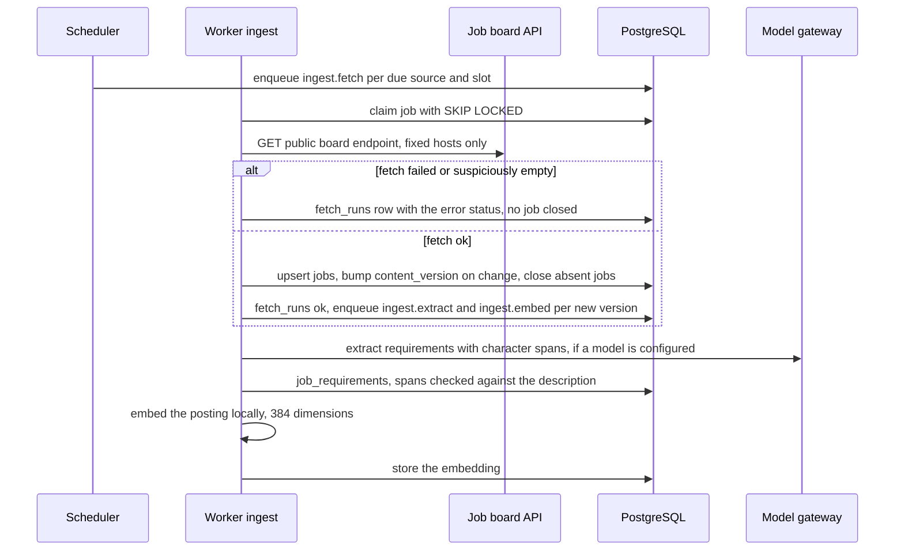

1. The existing fetch, store and close code (`ats.py`, `ingest.py`) becomes the `ingest.fetch` handler, one job per source per slot (every six hours, assumption). Only a successful fetch closes jobs; an empty feed from a source with more than five open jobs is recorded as `suspicious_empty` (IDX-02).
2. Requirements are extracted and the posting embedded once per `(job_id, content_version)` (IDX-08). fastembed 0.9.1 (Apache-2.0, released 2026-10-24) runs on ONNX Runtime without PyTorch, and its default model produces 384-dimensional vectors, matching the `vector(384)` column ([fastembed](https://pypi.org/project/fastembed/), checked 2026-11-22). One embedding model serves an instance; changing it is a migration that re-embeds every row.
3. Before a job enters a brief, `ingest.verify_live` checks its apply link through `fetch_public` (7.6) and closes it on 404 or 410 (IDX-07). Every job shows its source and `last_verified_at` (IDX-05). `python -m app.cli sources import` registers only boards answering with live postings (IDX-09).

### 4.2 Onboarding: resume to first matches

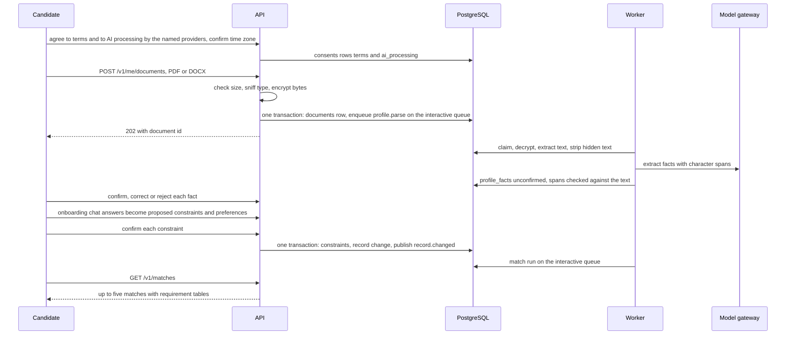

1. No model sees candidate data before the `ai_processing` consent naming the providers (TRU-05); without it AI features return `403 consent_required` while search and the record work. The file is stored as a Fernet token in `documents.content`, at most 10 MB (assumption). Hidden text is removed and the candidate is told (REC-06); contact details are masked before text reaches a model (AI_SYSTEM.md).
2. Each fact cites its span (REC-01); status is derived from timestamps (`unconfirmed`, `confirmed`, `rejected`, `superseded`) and only confirmed facts are used (REC-02). Proposals become `profile_events` that only the candidate's confirmation applies (REC-03 to REC-05).
3. The first run uses real-time calls and counts toward that day's five (MAT-02).

### 4.3 Nightly match and morning brief

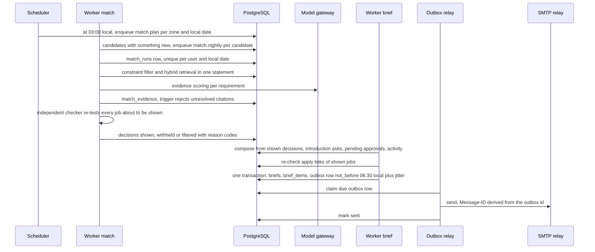

1. A candidate is planned only if the record changed, an eligible job opened or changed, or the cap withheld jobs last time; weekly and paused frequencies apply here (BRF-03). In v1 any edit to a posting counts as a change and may re-show it with a "what changed" note (owner decision G5, recommended default applied).
2. Constraints compile to one SQL predicate fused with keyword and vector ranking (IDX-04). The second lock on invariant 1 is `match.api.violations`, a separately written checker run on every job about to be shown; a disagreement withholds the job with `hard_constraint` and raises an alert (MAT-01). Outcomes are `shown`, `introduced`, `withheld` and `filtered`; reasons are DATA_MODEL.md's `match_reason` values, including `citation_unresolved` (MAT-05) and `injection_suspected`.
3. Brief item kinds are `match`, `approval`, `introduction` and `activity` (BRF-02). Never twice: one brief per user, local date and channel, and outbox `dedupe_key` `brief:{brief_id}` (BRF-01). Email needs the `brief_email` consent and expires at local noon. Unsubscribe is a signed, expiring link; `POST /v1/briefs/unsubscribe` is also the one-click target.

### 4.4 Campaign lifecycle

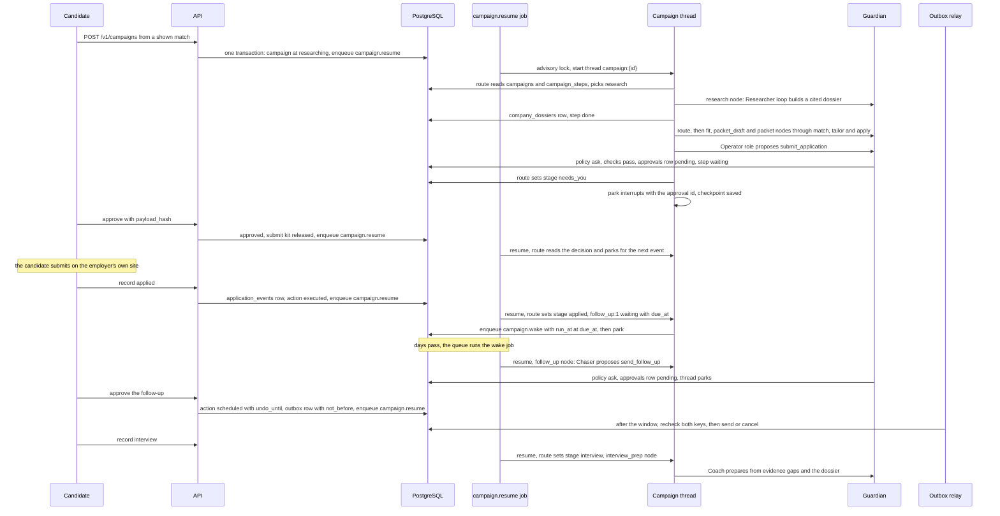

1. The thread drives the work and the tables decide it. Every node returns to `route`, the only code that changes a stage (5.2); every wake-up commits its cause and enqueues `campaign.resume` in the same transaction (5.9).
2. The Researcher reads only through `fetch_public` (7.6). Every dossier claim cites a confirmed fact, job text, or a quote stored with its URL and fetch time and checked against the fetched text before storing (CMP-02, invariant 2).
3. The packet is the approval of a `submit_application` action, fixed at `ask_first` (CMP-03). Approval releases the submit kit; the action is `executed` when the candidate records `applied`; the system never submits.
4. Follow-ups (owner decision G1, default applied): at most two, `send_follow_up` at `ask_first` or `never`, sent only after approval and the undo window, only to an address the candidate typed, `Reply-To` the candidate (CMP-04); first chase after 7 days (assumption).
5. Interview preparation uses requirements marked `partly_met`, `not_met` or `no_evidence` and the dossier (CMP-05).
6. Cancel closes the campaign with `closed_reason` `cancelled`; pending approvals become `expired` with a note, their actions `cancelled`, scheduled follow-ups `cancelled` (CMP-07). A linked introduction is unchanged.
7. An accepted introduction starts a campaign at `applied` with only `research` and `interview_prep` (4.5); an employer yes moves it to `talking`, a no closes it as `rejected`. A linked application's `interview` or `offer` moves it to that stage; `rejected` or `no_response` closes it with that reason.

### 4.5 Introduction handshake with the answer clock

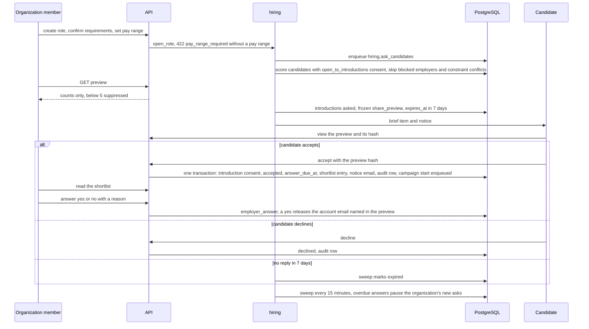

1. A role opens only with a pay range (HIR-02). The preview is a `SECURITY DEFINER` function returning counts, with counts below 5 suppressed (HIR-03; owner decision G6, recommended default applied); employers have no row access to `introductions` before acceptance.
2. Asks go only to candidates with the `open_to_introductions` consent. Blocked organizations (HIR-07) and hard-constraint conflicts are excluded before scoring; the decision is recorded as outcome `introduced` with reason `selected_for_role`.
3. Accepting is the candidate's own action, with no undo window; it requires the hash of the preview shown (`409 preview_changed` otherwise). One transaction records the `introduction` consent, status `accepted`, `answer_due_at = add_business_days(now, 5, organization time zone)`, a shortlist entry equal to `share_preview`, the notice email and the audit row (HIR-04, HIR-05), and enqueues the `introduction.accepted` event that starts the campaign at `applied`, so the campaign exists if and only if the acceptance committed.
4. `share_preview` holds name, headline, the evidence table and confirmed role and education facts; a yes releases the account email, as the preview says. The answer (HIR-06) is `employer_answer` plus a required reason. Business days are Monday to Friday in `organizations.timezone`. While any answer is overdue, the database refuses new asks (`409 conflict`, state `answers_overdue`).
5. Closing a role moves its open asks to `withdrawn`; an unanswered ask becomes `expired` after 7 days (counts as no).
6. Signals (HIR-08): 3 per side per UTC week starting Monday, counted in the insert transaction. A candidate signals on a role they were asked about, seen by the employer after acceptance; an organization signals only on its accepted introductions (owner decision G7, recommended default applied).

### 4.6 A Twin question with the ask-the-candidate fallback

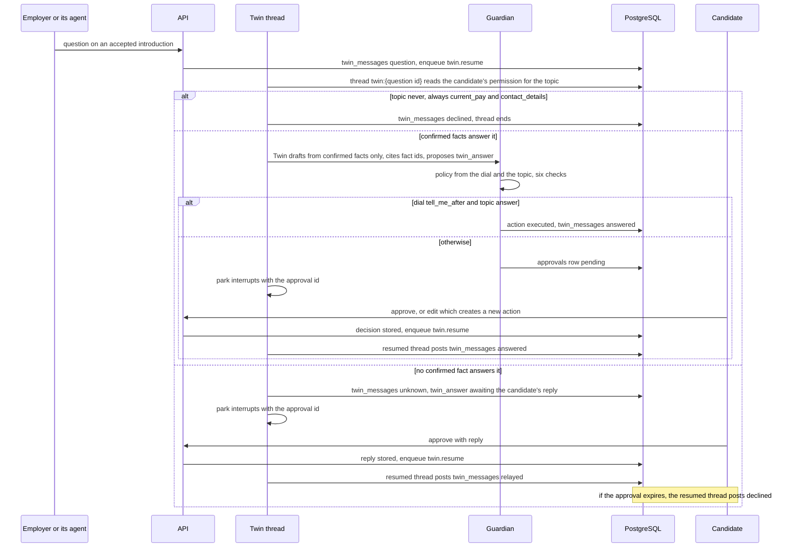

1. The Twin works only inside an accepted introduction (TWN-01). The `twin_answer` dial (`ask_first` default, `tell_me_after`, `never`) says whether the candidate approves each answer; `twin_scopes` holds one permission per candidate and topic (`answer`, `ask_me`, `never`; no row means `ask_me`). `current_pay` and `contact_details` are always `never` and are declined before any model call (TWN-03). The standing yes is an accepted introduction plus dial `tell_me_after` plus topic `answer`.
2. The `citations` check rejects any claim without a confirmed fact. When the record lacks the answer, the Twin posts `unknown` and the question becomes a pending `twin_answer` approval on which the thread parks (an interrupt, 5.9); the candidate approves it by writing a reply, stored by the API and never carried in the resume value (TWN-02). With dial `never` every question goes this way.
3. Delivery is the `twin_messages` insert, guarded by triggers: no outbox and no undo window. Each session is capped at 40 questions and $0.50, attributed to the organization (`rate_limit` check). The candidate reads every question and answer at `/app/twin` (TWN-04). Onboarding offers one switch that sets the dial to `tell_me_after` and four record topics to `answer` (owner decision G2, recommended default applied; FRONTEND_UI.md).

### 4.7 An external agent request over MCP

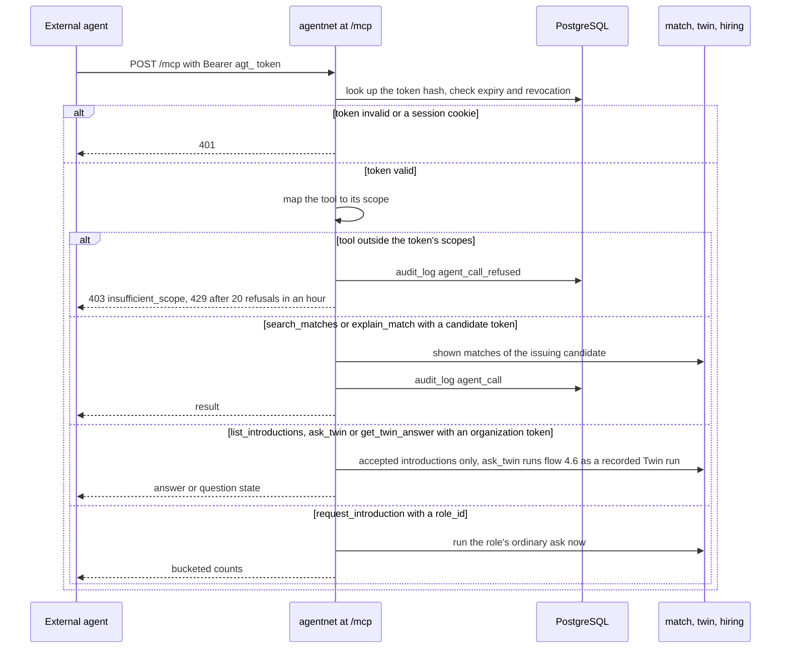

1. The server is the official MCP Python SDK 2.3.0 (released 2026-10-02) with the Streamable HTTP transport ([PyPI](https://pypi.org/project/mcp/), checked 2026-11-22). `streamable_http_app()` is mounted inside FastAPI, whose lifespan must enter the SDK's session manager ([SDK ASGI guide](https://github.com/modelcontextprotocol/python-sdk/blob/v2.3.0/docs/run/asgi.md), checked 2026-11-22). Tokens are checked through the SDK's `TokenVerifier` interface ([SDK authorization guide](https://github.com/modelcontextprotocol/python-sdk/blob/v2.3.0/docs/run/authorization.md), checked 2026-11-22). Bad input returns JSON-RPC `-32602`.
2. Read calls write `audit_log` only (`agent_call`, `agent_call_refused`); `ask_twin` creates a Twin run, which the recorder keeps. `request_introduction` is limited to 3 per day per token (API.md).
3. Agent-originated requests never release data; candidates decide through the ordinary introduction (NET-02, NET-03).

### 4.8 Account deletion

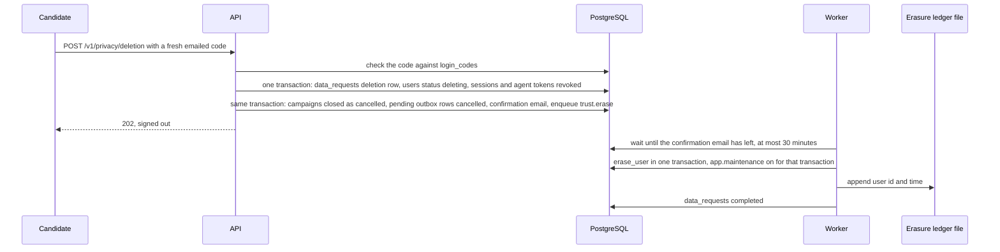

1. A fresh emailed code is required, so a stolen session alone cannot delete an account. From then on, sign-in fails and every selection skips it.
2. `erase_user(user_id, request_id)` runs in the worker as `app_worker`, the only role allowed to call it, and sets `app.maintenance` for its own transaction so append-only rows can go. Rows cascade or lose their reference as DATA_MODEL.md section 7.2 lists; file bytes are columns and go with their rows, and the person's graph checkpoints go through delete triggers (5.9) (TRU-02, invariant 7). There is no keyed-hash tombstone.
3. `data_requests.subject_user_id` keeps the bare id to record the request. The ledger file on its own volume lets a restore of an older backup re-run erasure (10.5). Copies made outside the system are beyond reach, and `/trust` says so (owner decision G3, needs legal advice).

---

## 5. Background processing

### 5.1 Decision A: the queue

| Option | For | Against |
|---|---|---|
| **Hand-written queue on `queue_jobs` using `FOR UPDATE SKIP LOCKED` (chosen)** | Enqueue in the caller's transaction; a key unique for the job's whole life; one table in our Alembic history; about 250 lines | We own lease, retry and stalled-job logic |
| Procrastinate 3.12.0 (MIT, released 2026-11-19) | Mature retries, periodic tasks, stalled-job recovery, defer on the caller's connection | Its `queueing_lock` is unique only while a job is `todo`, not for its lifetime. Its tables migrate through its own SQL scripts, outside Alembic |
| Celery or RQ with a broker | Familiar | A second stateful service; enqueue no longer commits with the data change |

Procrastinate sources, checked 2026-11-22: [PyPI](https://pypi.org/project/procrastinate/), [external connection](https://procrastinate.readthedocs.io/en/stable/howto/production/external_connection.html), [queueing lock index](https://github.com/procrastinate-org/procrastinate/blob/main/procrastinate/sql/schema.sql), [periodic tasks](https://github.com/procrastinate-org/procrastinate/blob/main/docs/howto/advanced/cron.md), [migrations](https://github.com/procrastinate-org/procrastinate/blob/main/docs/howto/production/migrations.md).

**Decision: a small hand-written queue in `platform.queue`.** PLT-06 asks for keys such as `match.nightly:{user_id}:{local_date}` that stay unique after the job ran.

| Property | How (columns are DATA_MODEL.md's) |
|---|---|
| Transactional enqueue | `queue.enqueue(conn, ...)` inserts on the caller's connection |
| No duplicate work | `unique_key` is unique; a repeat is `ON CONFLICT DO NOTHING` |
| Claim | `status = 'queued' AND run_at <= now()` ordered by `priority, run_at`, `FOR UPDATE SKIP LOCKED`; polled every second (assumption) |
| At-least-once | A claim sets `status = 'running'`, `locked_by`, `locked_at`; the lease is `locked_at + lease_seconds`; long jobs renew `locked_at`; a reaper returns expired leases to `queued`. Handlers are idempotent |
| Retries and dead letters | `attempts` up to `max_attempts`, then `dead` (5.7) |
| Named queues | `interactive` (parsing, onboarding runs, Twin threads), `llm` (extraction, scoring, campaign threads), `ingest`, `default` |
| Visibility | `python -m app.cli queue list` and metrics |

**Cost of being wrong.** A lease bug could run a job twice, which idempotent handlers and unique keys make harmless. Swapping in Procrastinate later touches `platform.queue` and one migration (1 to 2 days, assumption). **Revisit** after an incident Procrastinate would have prevented, past 400 lines of queue code, or at claim latency p95 above 1 s.

### 5.2 Decision B: how multi-day campaigns stay durable

Owner decision (2026-11-22): LangGraph, used in a bounded way. It replaces this section's earlier choice, a hand-written state machine.

| Option | For | Against |
|---|---|---|
| **LangGraph 1.2.24 with its PostgreSQL checkpointer (chosen by the owner)** | Durable resumption from the last completed node; one waiting primitive (the interrupt) for approvals, timers and events; the same library builds the two agent loops; MIT | A second persistence layer to migrate, grant and delete; library-defined DDL; nodes run at least once; no durable timers in the open-source library; frequent releases; brings `langchain-core` (5.9) |
| Hand-written state machine in `campaigns` and `campaign_steps` (the earlier choice) | No new dependency; all state in our tables | We write waiting and resumption ourselves |
| DBOS Transact 3.6.0 (MIT, released 2026-11-17) | Durable workflows in Postgres, as a library; durable sleep | Recovers only workflows whose application version matches the running code, so weeks-long workflows need blue-green deploys or `DBOS.patch`; a self-hoster upgrades one worker in place |
| Temporal | Mature durable execution | A separate server, its own persistence and a visibility store (Elasticsearch still recommended in production) |
| Hatchet | Durable tasks with a Python SDK | A separate engine plus its own Postgres, with RabbitMQ unless configured otherwise |

Sources, checked 2026-11-22: [DBOS on PyPI](https://pypi.org/project/dbos/), [DBOS upgrading workflows](https://docs.dbos.dev/python/tutorials/upgrading-workflows), [Temporal visibility](https://docs.temporal.io/self-hosted-guide/visibility), [Hatchet Docker Compose](https://docs.hatchet.run/self-hosting/docker-compose); LangGraph's are in 5.9. DBOS, Temporal and Hatchet stay rejected.

**Design (columns are DATA_MODEL.md's; mechanics in 5.9).**

- `campaigns`: `stage`, `paused_at` (NULL while running), `closed_reason`, `closed_at`, `lock_version`, `budget_microusd`, and the match decision or introduction that started it.
- `campaign_steps`, written by nodes: `step_key` (`research`, `fit`, `packet_draft`, `packet`, `follow_up:1`, `follow_up:2`, `interview_prep`), `status` (`pending`, `running`, `waiting`, `done`, `failed`, `skipped`, `cancelled`), `due_at`, `attempts`, `waiting_for_approval_id`, `output`, unique `(campaign_id, step_key)`.
- A thread parks for three things: **the candidate** (a step `waiting` with `waiting_for_approval_id`), **a human event** (an application status or an introduction answer), or **time** (a step `waiting` with a future `due_at` and a wake job due then).
- `needs_you` is a stage only before `applied`; afterwards a pending approval is a badge and the stage stays.
- The Guardian pauses a campaign at its budget or on signs of a scam posting: `paused_at` is set and the state-change recorder row's `outcome_code` is `budget_exhausted` or `scam_suspected` (GRD-07), or `candidate` for the candidate's own pause. Raising the budget, resuming or cancelling resumes the thread.

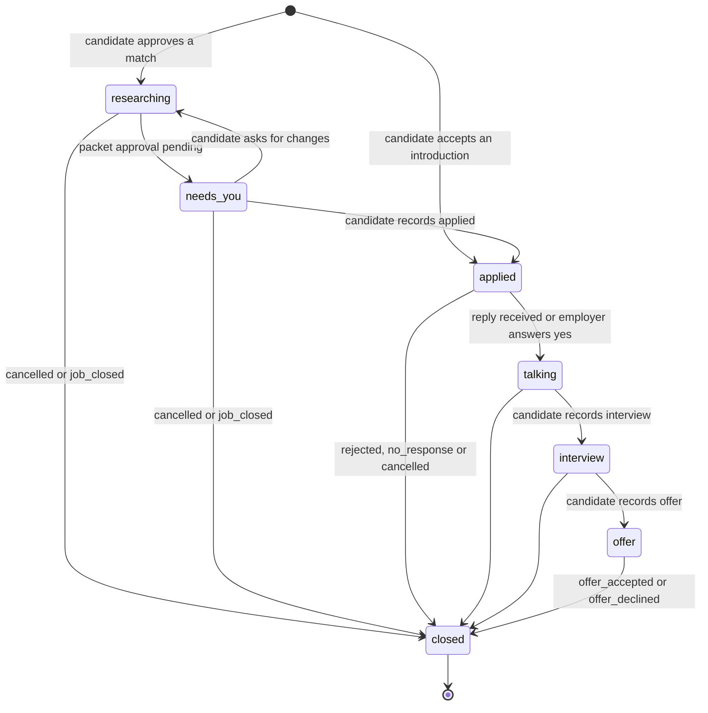

**Cost of being wrong.** If a LangGraph upgrade cannot resume parked threads, open campaigns are re-seated from the tables (5.9, rule 9); the same path leads back to a hand-written driver, because nodes are ordinary functions over tables.

**Trigger to revisit.** A release that cannot resume parked threads, compensation logic in more than two places, or waits park-and-resume cannot express. Then evaluate DBOS first, because it keeps Postgres as the only store.

### 5.3 Scheduling by the user's time zone

- `users.timezone` is an IANA name, browser-detected at onboarding, confirmed and editable; `organizations.timezone` drives the answer clock. Local dates use the standard library `zoneinfo`.
- The scheduler runs every minute in the worker and enqueues each due slot with key `{name}:{slot}`, so two workers cannot double-schedule. Once local time passes 03:00 in a zone with active users it enqueues `match.plan:{zone}:{local_date}`, so a day that skips 03:00 still runs.

| Local time | Step | At the cut-off |
|---|---|---|
| 03:00 to 05:30 | Plan, filter, retrieve, score, check, decide | Unscored jobs carry to the next day |
| 05:30 to 06:15 | Compose briefs, re-check apply links | Summaries fall back to template text from the evidence table |
| 06:30 to 06:55 | Outbox sends with per-user jitter | |
| 07:00 | Target: all briefs handed to SMTP | |
| 12:00 | Outbox `expires_at` | An unsent brief stays in the app; the miss is counted |

Every time above is an assumption to tune after measuring.

- Batch scoring is off by default (owner decision G9, default applied). If the instance operator enables it, only de-identified text is sent and `/trust` says so. Anthropic's Message Batches mostly finish within an hour, expire after 24 hours and cost half ([batch processing](https://platform.claude.com/docs/en/build-with-claude/batch-processing), checked 2026-11-22); the worker submits at 03:00 and at 05:00 cancels the rest and finishes in real time.
- Other periodic jobs: index fetch slots (6 hours), queue reaper (1 minute), answer-clock and ask-expiry sweep (15 minutes), outbox reconcile (1 minute), `purge_expired` and queue pruning (daily).

### 5.4 Idempotency keys

| Work | Key or constraint | Effect of a repeat |
|---|---|---|
| Source fetch | `ingest.fetch:{source_id}:{slot}` | No second job |
| Extraction and embedding | `ingest.extract:{job_id}:{content_version}`, `ingest.embed:{job_id}:{content_version}` | No second model call or embedding |
| Nightly plan and run | `match.plan:{zone}:{local_date}`; `match.nightly:{user_id}:{local_date}` and `match_runs_one_nightly` | No second run |
| Brief | `briefs_one_per_day`; outbox `dedupe_key` `brief:{brief_id}` | No second brief or email |
| Campaign thread | `campaign.resume:{campaign_id}:{cause_id}`, `campaign.wake:{campaign_id}:{due_at}`; `campaign_steps_once` on `(campaign_id, step_key)`; stage writes under `lock_version` | One resume per cause; a re-run node finds its step done |
| Outside action | `approvals_one_per_action`; outbox `action:{agent_action_id}` and `outbox_one_per_action` | No second approval or send |
| Introduction ask | `introductions_once` | Asked once per role |
| Twin thread | `twin.resume:{twin_message_id}:{cause_id}` | One resume per cause; delivery is one insert |
| Finished thread | `graph.delete:{thread_id}` | Checkpoints deleted once |
| Sign-in email | Outbox `signin:{login_code_id}` | One email per code |
| Erasure | `trust.erase:{data_request_id}` | Safe to rerun |
| API writes | Required `Idempotency-Key` stored in `idempotency_keys` per principal for 24 hours (assumption); the first response is replayed; missing is `400 idempotency_key_missing`, reused with another body `422 idempotency_key_reused` | PLT-03 |

### 5.5 The transactional outbox

The outbox carries email only: sign-in codes, briefs, notices and approved follow-ups; in-app deliveries are inserts guarded by triggers. A row is inserted in the transaction that causes it, holds ids only, and is resolved to recipient and body at send time. The relay claims due rows (`pending`, `not_before <= now()`) with `SKIP LOCKED` every two seconds (assumption).

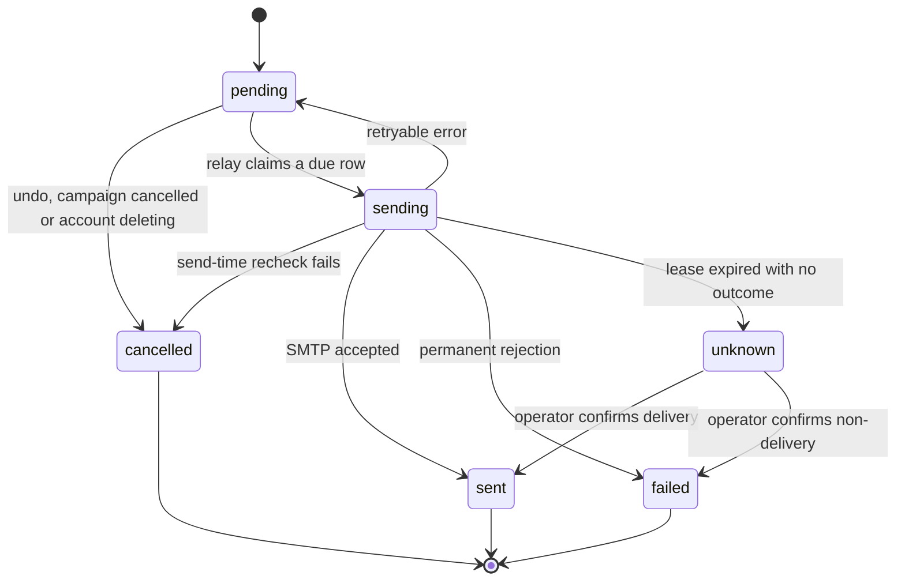

- **Send-time recheck.** For an outside action the relay re-reads the action and calls `guardian.recheck`: action not cancelled, campaign not paused or closed, account not deleting, consent and scope still valid, both keys passing again (invariant 5). A failure sets the row `cancelled` with `last_error_code`, visible in the recorder.
- **SMTP has no idempotency key.** A row left in `sending` past its lease becomes `unknown` and is never retried automatically; the instance operator checks the provider log (the outbox id is in `Message-ID`) and runs `python -m app.cli outbox resolve`. A rare missing email is accepted, a duplicate is not (invariant 6); the app shows "May have sent".
- **Provider events.** `/v1/webhooks` receives email provider events: a bounce or complaint withdraws the `brief_email` consent (actor `system`) with an audit row; a delivered event changes nothing.
- **Synthetic accounts.** The relay never delivers to a synthetic account or an `example.test` address; the wind tunnel's simulator consumes those rows.

### 5.6 The undo window

- Only approved follow-up emails have an undo window (GRD-04). Approval sets the action `scheduled` with `undo_until = now() + users.undo_window_minutes` (default 10) and inserts the outbox row with `not_before = undo_until`.
- Undo sets the action `cancelled` and the outbox row `cancelled` where it is still `pending`. The relay claims only rows past `not_before`, so undo either succeeds or reports already sent.
- Twin answers, accepting an introduction and messages to the candidate have none. The safeguard on acceptance is the preview hash.

### 5.7 Retries and dead letters

- Retryable failures (network errors, 429, 5xx, lock timeouts, serialization failures) back off exponentially with jitter: 30 s, 2 min, 10 min, 30 min, 2 h (assumption), up to `max_attempts`.
- Non-retryable failures (validation errors, output failing its schema twice, permanent rejections) go to `dead` at once with a content-free `last_error_code`.
- `dead` jobs are the dead-letter queue: listed with `python -m app.cli queue list` and re-queued with `queue retry <id>`. API responses show long-running work as `queued`, `running`, `succeeded` or `failed` (a `dead` job shows as `failed`).
- When a campaign job exhausts its attempts, the handler marks the running step `failed`; the candidate's retry or skip is an event that resumes the thread.
- While a provider's circuit is open, model-bound jobs are pushed back without using an attempt (5.8). Succeeded jobs are pruned after 7 days, dead ones after 30 (assumption); a person's jobs also go with erasure.

### 5.8 The model gateway and backpressure

The gateway's internals are AI_SYSTEM.md's; its shape is fixed here.

- **One entry point.** Callers name a task, never a model. Calls carrying candidate data require the `ai_processing` consent (`403 consent_required`).
- **Routing by configuration (PLT-05).** `config/models.toml` maps each task to a provider, model, capability flags and prices; `migrate` syncs it into `model_registry` (`is_active`). A model may serve a task only when a passed gold-set run for that task and model exists; CI checks the routing file against `eval_runs`.
- **Two adapters.** `anthropic` uses the official SDK (the default). `openai_compatible` uses the official `openai` package 3.57.0 (Apache-2.0) with a configurable `base_url` ([PyPI](https://pypi.org/project/openai/), checked 2026-11-22), for OpenAI and local servers such as Ollama, which serves `/v1/chat/completions` and `/v1/embeddings` ([Ollama OpenAI compatibility](https://docs.ollama.com/api/openai-compatibility), checked 2026-11-22). Output is always validated against its Pydantic schema, with one retry.
- **Cost ledger (PLT-04).** Every call writes one `llm_calls` row: task, `prompt_version`, provider, model, tokens, cost, latency, attribution and `outcome` (`ok`, `schema_invalid`, `timeout`, `provider_error`, `refused`), never prompt or response text. With no configured provider the API returns `503 ai_disabled`.
- **Budgets.** Per campaign `APP_CAMPAIGN_BUDGET_USD` (default 0.75, in `campaigns.budget_microusd`; reaching it pauses the campaign); per user per month `APP_MONTHLY_BUDGET_USD` (default 5); per Twin session $0.50 and 40 questions, charged to the organization; an optional instance daily cap (AI_SYSTEM.md 2.8). The `budget` check enforces them; a refused API write returns `409 budget_exhausted`.

| Backpressure | Behaviour |
|---|---|
| Queue separation | `interactive`, `llm` and `ingest` have separate concurrency |
| Concurrency caps | A per-provider semaphore; 30% reserved for interactive work (assumption) |
| Circuit breaker | Per provider and model: opens above 20% failures in a minute or p95 latency three times its 7-day baseline; half-opens after 60 s (assumption) |
| Reschedule, do not fail | While open, model-bound jobs move 1 to 5 minutes forward without using an attempt |
| Fallback | Only to a configured fallback with a passed gold-set run for the task |
| Deadline shedding | After 05:30 local, unscored jobs move to tomorrow and summaries use template text; constraint, citation and liveness checks are never shed |
| Enqueue pacing | `match.plan` pauses while the oldest `llm` job is older than 20 minutes (assumption) |

### 5.9 LangGraph integration contract

This contract binds this document, AI_SYSTEM.md, DATA_MODEL.md and the code. Unchanged by LangGraph: tables are the source of truth, every database invariant holds, the two keys gate every outside action, models are reached through the gateway, and the queue, outbox and undo window work as above. Unique keys and triggers guard every effect, so a crash, a re-run node or a lost checkpoint cannot send twice or skip an approval.

**Verified behaviour.**

- `langgraph` 1.2.24 (MIT, released 2026-11-20) depends on `langchain-core`, `langgraph-checkpoint`, `langgraph-prebuilt` and `langgraph-sdk` ([PyPI](https://pypi.org/project/langgraph/), [pyproject](https://github.com/langchain-ai/langgraph/blob/main/libs/langgraph/pyproject.toml), checked 2026-11-22).
- `langgraph-checkpoint-postgres` 3.2.1 (MIT, released 2026-11-14): `PostgresSaver` needs a connection with `autocommit=True` and `row_factory=dict_row` ([PyPI](https://pypi.org/project/langgraph-checkpoint-postgres/), checked 2026-11-22). `setup()` applies the migrations not yet recorded in `checkpoint_migrations`; they create `checkpoints`, `checkpoint_blobs`, `checkpoint_writes` and `checkpoint_migrations` under unqualified names, with three indexes built `CONCURRENTLY`, and the saver has no schema parameter ([source](https://github.com/langchain-ai/langgraph/tree/main/libs/checkpoint-postgres/langgraph/checkpoint/postgres), checked 2026-11-22). `delete_thread(thread_id)` removes a thread's rows ([reference](https://reference.langchain.com/python/langgraph.checkpoint.postgres/PostgresSaver/delete_thread), checked 2026-11-22).
- `interrupt(value)` pauses a node; `Command(resume=...)` under the same thread id resumes it, re-running the node from its start ([interrupts](https://docs.langchain.com/oss/python/langgraph/interrupts), checked 2026-11-22). Durability `"sync"` writes each checkpoint before the next step ([checkpointers](https://docs.langchain.com/oss/python/langgraph/checkpointers), checked 2026-11-22). A graph compiled with `checkpointer=False` runs like a plain function ([subgraphs](https://docs.langchain.com/oss/python/langgraph/use-subgraphs), checked 2026-11-22).
- Interrupted threads survive new nodes and changed edges, but not a renamed or removed node they are about to enter; added or removed state keys are compatible, a renamed key loses its value, and a narrowed type can break old threads ([graph migrations](https://docs.langchain.com/oss/python/langgraph/graph-api), checked 2026-11-22).
- We found no durable timer in the open-source library; scheduled runs belong to the hosted LangSmith Deployment ([cron jobs](https://docs.langchain.com/langsmith/cron-jobs), checked 2026-11-22). Traces go to LangSmith when `LANGSMITH_TRACING` and an API key are set ([observability](https://docs.langchain.com/oss/python/langgraph/observability), checked 2026-11-22); that nothing else is sent by default is unverified.

**Rules.**

1. **Scope.** Durable graphs: campaigns (in `campaigns`, thread `campaign:{campaign_id}`) and Twin questions (in `twin`, thread `twin:{twin_message_id}`, the question's id). Agent loops compiled with `checkpointer=False`: the Researcher inside the `research` node, and chat per turn in the API. Resume parsing, requirement extraction, evidence scoring, the checker, the tailoring verifier, briefs and the Guardian checks stay plain functions.
2. **Ownership and state.** LangGraph owns where a thread is (schema `langgraph`). Our tables own what happened, what is pending and what is allowed; the API, web app, stream, exports and invariant tests read only them. Graph state holds the campaign or question id, the next node and the latest resume cause, never resume, chat, contact, dossier or job text, nor model output. Loops keep messages in memory and write only results. Thread ids contain UUIDs only; the canary test (8.4) scans schema `langgraph`.
3. **`campaign_steps` stays** as the audit trail, the routing input and the source of `/control/runs`. Nodes open a row per `step_key` before the work and close it in the transaction that stores the output; no fact lives only in a checkpoint.
4. **Routing.** Every node returns to `route`, which reads `campaigns`, `campaign_steps` and `approvals`, writes `stage` under `lock_version` (no other code does) and names the next node: `research`, `fit`, `packet_draft`, `packet`, `follow_up`, `interview_prep`, `park` or the end. A fresh thread for an open campaign therefore lands where the tables say.
5. **Nodes run at least once.** Checkpoints commit on the saver's own connection, so a crash after a node's commit re-runs it. Each node first reads its step row and current action and skips committed work; `campaign_steps_once`, `approvals_one_per_action` and `outbox_one_per_action` make re-runs harmless. Durability is `"sync"`.
6. **Interrupts.** Only the runtime's `park` node calls `interrupt`, with `{"waiting_for": "approval" | "time" | "event", "ref": <id>}`. A node whose `propose_action` returns `awaiting_approval` leaves its step `waiting` with `waiting_for_approval_id`, and `route` parks the thread: one pending `approvals` row, one parked thread. Decisions, edits and replies are stored in tables; the resume value is only `{"cause": <id>}`. A resumed `park` returns to `route`, which parks again if nothing was decided.
7. **Resumption.** Only queue jobs run threads. Every wake source (an approval decided or expired, an application status, an introduction answer, pause, resume, cancel, a raised budget) commits its cause and enqueues `campaign.resume:{campaign_id}:{cause_id}` or `twin.resume:{twin_message_id}:{cause_id}` in one transaction. The handler takes an advisory lock on the thread id (a second job retries in 30 s), reads `get_state`, and resumes a parked thread, continues a crashed one with `invoke(None, ...)` or starts a missing one.
8. **Timers are queue jobs.** The node sets the step `waiting` with `due_at`, enqueues `campaign.wake:{campaign_id}:{due_at}` with `run_at = due_at`, and parks. If `due_at` moved later, `route` parks again.
9. **Graph changes in flight.** New nodes, changed edges and new state keys with defaults ship freely. Renaming or removing a node or key, or narrowing a type, is expand then contract: the old node stays a pass-through to `route` until `python -m app.cli graphs check` finds no thread parked before it. Otherwise `python -m app.cli graphs reseat` deletes the affected checkpoints and starts fresh threads that `route` places from the tables; approvals and timers survive as rows. `agent_runs.config_version` records the graph version.
10. **Tables and migrations.** The four tables live in schema `langgraph`, reached by the saver's own pool as `app_worker` with `search_path=langgraph`. The objection to library-run migrations (5.1) stands, so the library's DDL runs only from Alembic: a revision creates the schema and calls `setup()` as `app_owner` on an autocommit connection (`CONCURRENTLY` cannot run in a transaction). Runtime roles have no `CREATE` there and never call `setup()`. CI compares the installed migration list with the one the latest such revision recorded, so an upgrade that adds DDL fails until a new revision applies it; the worker refuses to start if `checkpoint_migrations` is behind. Only `app_worker` reads or writes the schema, so row-level security is off there.
11. **Deletion.** A finished thread's last node enqueues `graph.delete:{thread_id}`, which calls `delete_thread`. For erasure, `AFTER DELETE` triggers on `campaigns` and on question rows of `twin_messages` call a `SECURITY DEFINER` function that deletes the thread's rows from the three data tables inside `erase_user`'s transaction; the catalogue test (8.4) fails on a `thread_id` whose campaign or question is gone.
12. **Models, tools, recorder.** Nodes and loops call `platform.llm`, never a LangChain model class, and no `langchain_*` provider package is installed. Loop tools are module functions run as the run's principal; anything reaching another person goes through `guardian.propose_action`. Nodes write `agent_runs` and `agent_actions`; checkpoint history is not the recorder. Chat's stream events are built by our code from gateway chunks.
13. **No hosted platform, no tracing.** LangSmith Deployment, its Agent Server and cron jobs are not used. Traces would carry prompts and state, against 9.2, so the API and worker refuse to start if `LANGSMITH_TRACING` or `LANGCHAIN_TRACING_V2` is true or a LangSmith or LangChain API key is set. The end-to-end stack runs on an internal-only network, so an unexpected outbound call fails it.
14. **Imports and versions.** Only `app.guardian.runtime`, `app.campaigns`, `app.twin` and `app.chat` import `langgraph` (3.3); everything else stays framework-free. Both packages are pinned exactly; an upgrade is its own pull request that must pass kill-and-resume and upgrade-resume (11).

---

## 6. Authentication and authorization

### 6.1 Email one-time code

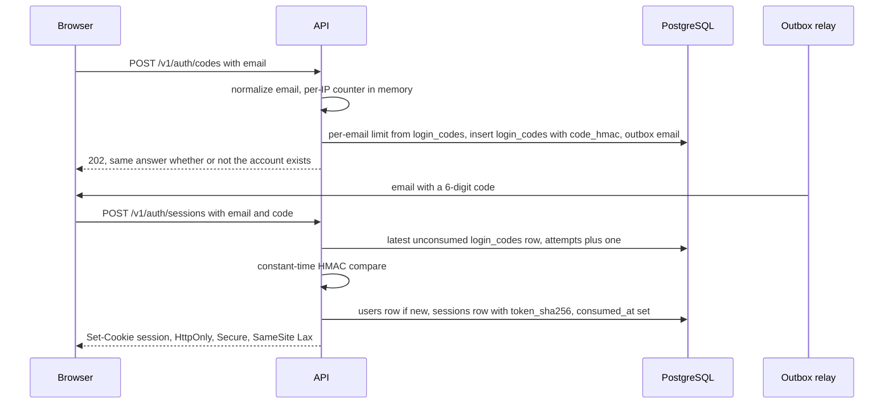

1. The email is normalized and stored as plain text (DATA_MODEL.md). `login_codes` holds `code_hmac`, `attempts`, `expires_at` and `consumed_at`; the HMAC is keyed by `APP_LOOKUP_KEY`, because a plain SHA-256 of six digits is reversed in microseconds by anyone who can read the table.
2. Limits: at most 5 codes per email per hour, counted from `login_codes`, and 20 per client IP per hour, counted in the API process's memory (assumptions). The in-memory counter is correct only with one API process; a second one moves it into PostgreSQL. Codes live 10 minutes and allow 5 attempts. The code is `secrets.randbelow(10**6)` and verification uses `secrets.compare_digest` ([Python secrets](https://docs.python.org/3/library/secrets.html), checked 2026-11-22). The attempt limit, not hashing cost, bounds guessing.
3. The first sign-in creates the `users` row just in time; onboarding then asks for the `terms` and `ai_processing` consents.

### 6.2 Sessions

- The session token is `secrets.token_urlsafe(32)` (same source), sent as an `HttpOnly`, `Secure`, `SameSite=Lax`, `Path=/` cookie; the server stores only `sessions.token_sha256`. Each request is one indexed lookup plus a check that `users.status` is `active`.
- Sessions end after 30 days idle or 90 in total (assumption). Sign-out sets `sessions.revoked_at`; deletion and suspension revoke every session. Stateless JSON Web Tokens were rejected: revoking them at once needs a deny list, a session table by another name.
- **Cross-site request forgery.** `SameSite=Lax` keeps the cookie off cross-site POSTs; every write must also be `Content-Type: application/json` and carry the required `Idempotency-Key` header, which a cross-site form cannot send without a preflight; the API sends no CORS headers.
- The web app's `EventSource` streams use the cookie. `Authorization: Bearer` is accepted only for agent tokens at `/mcp`, where cookies are refused. Next.js server rendering forwards the cookie on the internal network.

### 6.3 Roles and principals

| Principal | Representation | May |
|---|---|---|
| Candidate | Every account (`users` row) | Own data only |
| Organization member | `org_members.role` `member`, status `active` | The organization's roles, shortlists, conversations and answers; a candidate's data only after that candidate accepted an introduction to that organization and role |
| Organization admin | `org_members.role` `admin` | As member, plus invite and remove members and issue organization agent tokens |
| Organization owner | `org_members.role` `owner` | As admin; the last owner cannot be removed |
| Instance operator | No column. Shell access; `python -m app.cli` and environment configuration; audit rows use `actor_type` `operator` | Board import, model routing, eval runs, queue and outbox repair, suspending an account. No web screens, no candidate content |
| Agent token | `agent_tokens` row, principal `candidate` or `organization` | Only its scopes, as its issuer |
| Worker | Database roles `app_worker` and `app_match` | Background work |

API caller codes (API.md): P public, U signed-in, C candidate, E organization member of any role, EA owner or admin, T agent token at `/mcp`. A person can be a candidate and an organization member at once.

### 6.4 Where authorization is checked

Each check is sufficient for what it protects, and all three run:

1. **The route** declares its caller code through a FastAPI dependency.
2. **The module function** takes the principal and checks ownership and consent (`trust.consent.require`). Agent tools call module functions as the run's principal, so an agent never has more authority than the person it works for, and every outside action goes through `guardian.propose_action`.
3. **The database** applies row-level security (7.2) and triggers (two-key, consent, scope, answer clock), whose errors map to API codes as API.md section 1.11 lists.

### 6.5 MCP agent tokens

| | Session cookie | Candidate token | Organization token |
|---|---|---|---|
| Issued by | Signing in | The candidate, with an `agent_access` consent, at `/v1/me/agent-tokens` | An owner or admin at `/v1/orgs/{org_id}/agent-tokens` (`/hire/team`) |
| Scopes | Everything the person may do | `matches:read`, `explanations:read` (read-only) | `twin:ask`, `introductions:request`, under the same accepted-introduction rules as the hiring desk |
| Where accepted | `/v1` | `/mcp` only | `/mcp` only |
| Lifetime | 30 days idle, 90 total | 1 to 90 days, default 30 | 1 to 90 days, default 30 |
| Storage | Hash | Hash; plaintext with prefix `agt_` shown once | Same |
| States | Active or revoked | Derived: `active`, `revoked`, `expired` | Same |

There is no audience field: tokens work only at `/mcp`, and cookies are refused there. After 20 refusals in an hour a token gets `429 rate_limited` until the hour ends. MCP makes authorization optional and says HTTP transports SHOULD follow its OAuth 2.1 profile ([MCP authorization](https://modelcontextprotocol.io/specification/latest/basic/authorization), checked 2026-11-22); pre-issued tokens deviate from that SHOULD, and OAuth is deferred to v2 (DEF-01 in REQUIREMENTS.md).

### 6.6 Libraries

- **No third-party authentication library.** The flow is the standard library (`secrets`, `hmac`, `hashlib`), FastAPI dependencies and about 150 lines, with no external vendor, as self-hosting requires.
- **FastAPI Users was rejected:** its README states maintenance mode, security fixes only ([fastapi-users on GitHub](https://github.com/fastapi-users/fastapi-users), checked 2026-11-22). A self-hosted identity service was rejected as a container and a second user store for a flow this small.
- **Mail** is the standard library `smtplib` in the relay; Mailpit catches it in development.

---

## 7. Security architecture

### 7.1 Database roles

| Role | Used by | Rules (DATA_MODEL.md section 5) |
|---|---|---|
| `app_owner` | Migrations only (`NOLOGIN`; `migrate` uses a bootstrap login that is a member) | Owns every object |
| `app_api` | API process, including `/mcp` | `NOBYPASSRLS`; policies by `app.user_id` and the agent token id; `statement_timeout` 5 s (assumption) |
| `app_worker` | Queue workers except matching | `NOBYPASSRLS`; serves every person, so its policies are `USING (true)`, still bound by grants and triggers; the only role allowed to call `erase_user` and `purge_expired`, and the only one with access to schema `langgraph`; `statement_timeout` 60 s (assumption) |
| `app_match` | The match module in the worker | Reads the job index, confirmed facts, active constraints and preferences and a column-limited `users` view; writes runs, decisions and evidence; nothing else |

Fifteen tables are append-only: a trigger rejects UPDATE and DELETE and the runtime roles are not granted them. The only exception is `app.maintenance`, which `erase_user` and `purge_expired` set for their own transaction. In the worker, module checks protect data; row-level security protects the request path, where an id from a URL could otherwise reach the wrong row.

### 7.2 Row-level security

- `platform.db.transaction(principal)` runs `set_config('app.user_id', :id, true)` at the start of every API transaction, so the setting dies with the transaction and a pooled connection cannot carry it into the next request. When row security is enabled and no policy admits a row, PostgreSQL denies by default; table owners and `BYPASSRLS` roles are exempt ([PostgreSQL 17 row security](https://www.postgresql.org/docs/17/ddl-rowsecurity.html), checked 2026-11-22), which is why no runtime role owns tables or bypasses.
- Candidate tables admit rows where the user is `app.user_id`. Organization tables admit rows only when `org_members` has an active row for that user and organization, read inside the policy, so a wrong organization id still returns nothing. Employers see `introductions` only once accepted.
- HIR-01's test: two organizations; a member of A queries every organization-owned table through `app_api`, directly and by B's ids, and must get zero rows of B.

### 7.3 Encryption

| Data | Protection |
|---|---|
| Traffic | TLS at the proxy; a database on another host must use TLS with certificate verification |
| Resume files (`documents.content`) and export archives (`data_requests.export_archive`), which hold unmasked contact lines | Fernet tokens in PostgreSQL |
| Email addresses and the Career Record | Plain text, protected by roles and row-level security; one encrypted column would add a lookup column and key rotation for little protection when the record sits in the same database |
| Sign-in codes | HMAC keyed by `APP_LOOKUP_KEY` |
| Disks and backups | The operator's disk encryption; documented, not enforced |

Fernet uses AES-128 in CBC mode with HMAC-SHA256; `MultiFernet` encrypts with the first key and decrypts with any, `rotate()` re-encrypts, and Fernet suits data that fits in memory ([cryptography Fernet](https://cryptography.io/en/latest/fernet/), checked 2026-11-22), as the 10 MB cap ensures. Keys: `APP_DATA_KEYS` (primary first), `APP_LOOKUP_KEY`, `APP_LINK_KEY` (unsubscribe links). Rotation: new key first, `python -m app.cli keys rotate`, remove the old key. Losing the data keys loses the files, so first run tells the operator to back up `.env`.

Files live in PostgreSQL so deletion, backup and access control cover one store; they move to object storage if file bytes pass half the database or backups pass an hour (assumption).

### 7.4 Secrets

Secrets come from a git-ignored `.env` file. The example file ships development-only keys, and the application refuses them when `APP_BASE_URL` is not a localhost address. `web` gets no keys; `api` and `worker` get the data keys, provider keys and their database credentials; `migrate` gets the bootstrap credential. Start-up fails if a required secret is missing; model keys are optional. Secrets are never logged (9.2). CI runs a secret scanner on every push (tool unverified; to be fixed in the CI plan).

### 7.5 Untrusted text and prompt injection (summary)

Untrusted text enters from job descriptions, resumes, company pages, employer questions and external agents. **No code path lets model output alone commit, send or share anything:** record changes need the candidate's confirmation; outside actions need the policy engine, the six Guardian checks (including `injection`, which blocks on flagged inputs or on URLs, emails or phone numbers not from the record) and, per autonomy, an approval; follow-ups wait out the undo window; constraint and citation checks are deterministic. A posting flagged as manipulated is withheld with `injection_suspected`. Prompt construction, tool exposure and the injection suite (CHT-04) are in AI_SYSTEM.md.

### 7.6 Outbound fetching

Board fetchers keep the foundation rule: three fixed hosts, tokens validated by pattern, response size capped. Everything else (the Researcher, apply-link checks) goes through `platform.http.fetch_public(url)`: HTTP or HTTPS only; refused if any resolved address is private, loopback, link-local or a cloud metadata address; every redirect re-checked, at most 5; at most 5 MB and 15 s (assumption); only HTML, plain text and JSON.

### 7.7 Threat model

| Threat | Control |
|---|---|
| Reading another person's or organization's data by id | Module ownership check, row-level security, random UUIDs, HIR-01 test |
| An employer infers who was asked | Counts only, below 5 suppressed; no row access before acceptance |
| Session theft, cross-site request forgery | 6.2; content security policy (FRONTEND_UI.md) |
| Code guessing, account discovery, mail flooding | 6.1; identical responses |
| A leaked agent token | 6.5; agent calls never release data |
| Injected text makes an agent send or share | 7.5; two keys again at send time; undo on follow-ups |
| A message sent twice; runaway spend | 5.4, 5.5; budgets and pause (5.8) |
| Server-side request forgery | 7.6; board import only through the CLI |
| The Twin discloses pay or contact details | `never` without a row (DATA_MODEL.md DDL-5), checked before any model call |
| A deleted person lingers | 8.4; ledger replay after restore |
| A malicious upload or dependency | Size cap, type sniffing, parsing in a limited child process (assumption); `uv.lock` with hashes, images pinned by digest, dependency scanning |
| The instance operator reads candidate content | No web views of it; direct database access can read anything, inherent to self-hosting and stated on `/trust` |

---

## 8. Privacy architecture

### 8.1 Consent records

`consents` is append-only; a grant is active while no withdrawal points at it.

| Purpose | Scope | Checked by | When missing |
|---|---|---|---|
| `terms` | None | `platform` after first sign-in | The app cannot be used |
| `ai_processing` | The configured providers, named | The gateway before any call with candidate data | `403 consent_required`; search, the record and the ledger still work (TRU-05) |
| `brief_email` | None | `brief` and the relay | The brief is in the app only; a bounce or complaint withdraws it |
| `open_to_introductions` | None | `hiring` before asking | The candidate is never asked |
| `introduction` | One organization and role | Written at acceptance; checked before any release | Nothing is shared |
| `agent_access` | One candidate token and its scopes | `agentnet` on issue and every call | 401 or 403 |

Twin topics are settings (`twin_scopes`), not consents. When the operator changes providers, the `ai_processing` text changes and each person is asked again before their next AI feature runs.

### 8.2 Data map

| Store | What it holds about a person | How deletion reaches it |
|---|---|---|
| PostgreSQL | Everything the modules own (3.4), including encrypted files and archives, the recorder, chat, Twin messages, queue and outbox rows, `llm_calls` metadata and graph checkpoints (ids only) | `erase_user` and its triggers (5.9), within minutes |
| Backups | A copy at backup time | Expire on the operator's schedule; ledger replay after a restore |
| Erasure ledger file (volume `erasure`) | User id and deletion time | Kept so deletions can be replayed |
| Application logs | Ids, keyed hashes, timings; no content | Docker log rotation |
| OpenTelemetry collector (optional) | Spans with ids and timings | The collector's retention |
| Model provider | Prompt and response text | Not deletable by us; disclosed (8.5) |
| Email provider | Addresses and message content | The provider's policy; disclosed |
| Browser | The session cookie | Sign-out or expiry |

Not stored: protected characteristics in the Career Record (REC-07). Raw chat and resume text stay as written, visible only to the person, exported and deleted with the account (owner decision G4, default applied).

### 8.3 Export

`POST /v1/privacy/exports` creates a `data_requests` row and enqueues `trust.export`, which calls every module's registered exporter and writes a ZIP (one JSON file per module, the original files from `documents.content`, a manifest). The archive is stored Fernet-encrypted in `data_requests.export_archive`, downloadable only by the signed-in candidate, and `purge_expired` clears it after 7 days (TRU-01). Ready within minutes (target).

### 8.4 Deletion and the registry tests

Three tests keep `erase_user` complete (TRU-02):

1. **Catalogue test.** Reads `pg_constraint` and fails if any foreign key to `users` is neither `CASCADE` nor `SET NULL`, if a `SET NULL` column is missing from DATA_MODEL.md section 7.2's list, or if a column named like a user reference has no foreign key (the one exception is `data_requests.subject_user_id`, kept by design). It also fails on a checkpoint `thread_id` whose campaign or question is gone (5.9).
2. **Ownership test.** Every table is registered by exactly one module through `trust.privacy.register`, so a new table without an exporter fails CI.
3. **Canary test.** Seeds one person through every module with a unique canary in every free-text field, erases the account, then scans every text, `jsonb` and `bytea` column of every table, schema `langgraph` included (decrypting Fernet columns), and fails if the user id or any canary remains, apart from `data_requests.subject_user_id`.

What survives by design: the `data_requests` row with the bare id, references set to NULL on rows that must outlive the person (cost ledger, audit actor, organization authorship), and the ledger entry.

### 8.5 What leaves the machine, and how it is disclosed

| Leaves to | What | When | Control |
|---|---|---|---|
| Model provider | Job text; confirmed facts and record text with contact masked; chat; employer questions and Twin drafts; dossier sources | Each AI call | `ai_processing` consent; a local model keeps everything on the machine |
| Job boards and public sites | Requests from a fixed user agent; no personal data | Index refresh, dossiers | None needed |
| Email provider | Addresses, codes, briefs, notices, approved follow-ups | Sends | `brief_email` consent; unsubscribe; follow-ups only after approval |
| Organizations on this instance | `share_preview`, the account email on a yes, Twin answers | After the candidate's own action or their Twin settings | `introduction` consent; dial and topics |
| External agents | Data within the token's scopes | Each call | Token scopes |

Anthropic retention to state on `/trust` ([API and data retention](https://platform.claude.com/docs/en/manage-claude/api-and-data-retention), checked 2026-11-22): batches are not eligible for zero data retention and are kept 29 days; structured-output schemas are cached up to 24 hours, so they never contain personal data; flagged content may be kept up to 2 years; no training without express permission. Other providers' terms are unverified.

**Disclosure (TRU-04).** `/trust` is generated from the running configuration (`/v1/privacy/subprocessors`): active providers and their tasks, whether batch is on, the email host, the data map, and the limit on outside copies (G3).

---

## 9. Observability

### 9.1 Logs, metrics and traces

- **Logs.** JSON lines on standard output through `logging` and one formatter; every line carries time, level, event name, request or job id, module, duration, outcome and a keyed-hash user reference when there is one. All application logging goes through `platform.log.event`.
- **Metrics.** Prometheus text at `/metrics` on the API and the worker, internal network only, using `prometheus-client` 0.26.0 ([PyPI](https://pypi.org/project/prometheus-client/), checked 2026-11-22). Queue, outbox and pipeline gauges are SQL.
- **Traces.** OpenTelemetry spans for requests, jobs, gateway calls and agent steps, exported only when `OTEL_EXPORTER_OTLP_ENDPOINT` is set. The FastAPI instrumentation is a beta pre-release (0.66b2, [PyPI](https://pypi.org/project/opentelemetry-instrumentation-fastapi/), checked 2026-11-22), so it is pinned, with manual middleware spans as the fallback. LangSmith tracing is off and enforced at start-up (5.9).
- **Model calls and agents.** `llm_calls` is the record of model cost and latency; `agent_runs` and `agent_actions` are the flight recorder (GRD-03). Recorder rows are user data covered by export and deletion; PLT-07 governs logs and traces.

### 9.2 The content-free rule and its test (PLT-07)

**Rule.** Logs, metric labels, span attributes and error reports carry ids, enumerations, counts, durations and keyed hashes, never resume, chat, Twin, contact, dossier or job-description text.

**Enforcement.** `log.event` accepts numbers, booleans, UUIDs, enumerations, datetimes and strings only under allow-listed identifier keys (`route`, `task`, `status`, `error_code`); anything else raises in tests and is dropped with `redacted=true` in production. Exceptions record their class and a fixed message, never `str(exc)`, in logs and spans. **Canary test:** on every pull request, a candidate seeded with unique canaries in resume, email, chat, Twin question and campaign notes goes through onboarding, a match run, a chat turn, a campaign node and a Twin answer against a fake provider; the test fails if any canary appears in logs, `/metrics` or spans.

### 9.3 Dashboards

Mission control shows the signed-in person's own work: `/control/runs` (each agent's live status per campaign, GRD-06), `/control/recorder` (replay of inputs, evidence, cost and outcome per step, GRD-03) and `/control/costs` (cost per campaign and month, GRD-05). `/control/evals` (the scoreboard, read only from `eval_runs`) is readable by any signed-in user (EVL-04, EVL-05). Instance-wide views are deferred to v2 (owner decision G8, recommended default applied).

Live updates come from one per-user stream, `GET /v1/control/stream`, built from table rows, never from graph state: `snapshot`, `campaign.stage`, `step.status`, `recorder.step`, `approval.status`, `action.status`, `cost.updated`, `introduction.status`, `twin.message`, `error`. Event ids are `agent_actions.id` for recorder-backed events; a reconnect gets `snapshot`. Chat replies stream on their own endpoint (API.md). Brief ready, match run finished, extraction progress, export ready and eval finished are polled.

The instance operator's view is `python -m app.cli health`: ingestion per source, queue depth, oldest and dead jobs, outbox `pending` and `unknown` rows, the brief funnel per zone, invariant monitors and open deletion requests, with counts and ids only.

### 9.4 Alerts

A self-hosted instance has no pager. Alerts are computed by SQL, logged as `alert.raised`, listed by `python -m app.cli health`, and exported as metrics with a shipped Prometheus rules file.

| Alert | Condition | Effect |
|---|---|---|
| Constraint check failure | The independent checker withheld any job | Brief sends pause instance-wide until `python -m app.cli alerts ack` |
| Citation rejections | Above 2% of evidence rows in an hour (assumption) | Alert |
| Outbox `unknown` | Any row older than 30 minutes | Alert |
| Outbox stuck | Oldest due `pending` row older than 15 minutes | Alert |
| Brief late | Under 99% of a zone's briefs handed to SMTP by 07:00 local | Alert |
| Dead jobs, failing sources, open circuit | New dead job; no successful fetch in 24 hours; circuit open over 5 minutes | Alert |
| Budget | A campaign or user paused for budget, or an instance cap near its limit | Alert |
| Deletion slow | A deletion request open longer than 1 hour | Alert |
| Thread mismatch | An open campaign with no thread, or a parked thread with nothing pending in the tables | Alert; `python -m app.cli graphs reseat` |
| Eval regression | The latest scheduled eval run is below a floor | Shown on `/control/evals` |

---

## 10. Configuration and deployment

### 10.1 Environment variables

The `APP_` prefix stays neutral while the public name is undecided; user-facing text reads `APP_PRODUCT_NAME` (and one `PRODUCT_NAME` constant in the web app).

| Variable | Required | Read by | Meaning |
|---|---|---|---|
| `DATABASE_URL_MIGRATE`, `DATABASE_URL_API`, `DATABASE_URL_WORKER`, `DATABASE_URL_MATCH` | Yes | `migrate`, `api`, `worker` | One credential per role |
| `APP_BASE_URL`, `APP_DOMAIN` | Yes, No | all, `proxy` | Public URL (links, cookie `Secure` flag); automatic TLS |
| `APP_DATA_KEYS`, `APP_LOOKUP_KEY`, `APP_LINK_KEY` | Yes | `api`, `worker` | 7.3 |
| `SMTP_URL`, `MAIL_FROM` | Yes (`dev` points them at Mailpit) | `worker` | Outgoing mail |
| `LLM_PROVIDER`, `ANTHROPIC_API_KEY`, `OPENAI_API_KEY`, `LLM_BASE_URL` | No | `api`, `worker` | Default `anthropic`; with no usable provider, AI features return `503 ai_disabled` |
| `APP_CAMPAIGN_BUDGET_USD`, `APP_MONTHLY_BUDGET_USD` | No; 0.75 and 5 | `api`, `worker` | 5.8; returned by `GET /v1/autonomy` |
| `EMBEDDING_MODEL` | No; local, 384 dimensions | `api`, `worker` | 4.1 |
| `WORKER_QUEUES` | No; all | `worker` | Bind a worker to some queues |
| `APP_PRODUCT_NAME` | No | `api`, `worker` | User-facing name |
| `OTEL_EXPORTER_OTLP_ENDPOINT` | No | `api`, `worker` | Trace export |

The undo window is a per-user setting (`users.undo_window_minutes`, default 10), not an environment variable.

### 10.2 Compose profiles

| Command | Starts |
|---|---|
| `docker compose up` | `db`, `migrate`, `api`, `worker`, `web`, `proxy`. The example `.env` sets `COMPOSE_PROFILES=dev`, so a fresh checkout also starts Mailpit and sign-in codes appear at `http://localhost:8025` (PLT-01) |
| `docker compose --profile local-llm up` | Adds Ollama; set `LLM_PROVIDER=openai_compatible` and `LLM_BASE_URL=http://llm:11434/v1` |
| `docker compose run --rm worker python -m app.evals run <suite>` (or `windtunnel <scenario>`) | Runs gold sets or the wind tunnel in the worker image against the main database, using synthetic accounts on `example.test` that the relay never delivers to |

### 10.3 First run and seeding

1. `migrate` applies migrations, sets up roles and syncs `config/models.toml` into `model_registry`.
2. On an empty `job_sources` table the worker discovers boards from `data/seed_candidates.txt` and runs the first fetch.
3. `python -m app.cli seed demo --email you@example.com` creates a labelled demo candidate from a synthetic resume, a demo organization it owns and an open role, with the Twin dial at `tell_me_after`, so the whole loop runs in under ten minutes (DOC-02, target).

### 10.4 Running with no model key

| Works | Off, with `503 ai_disabled` |
|---|---|
| Index fetch, closure, duplicate folding; local embeddings; keyword and semantic search with filters; sign-in; manual Career Record entry; hard constraints and search with them applied; MCP search tools | Requirement and fact extraction, ranked matches with evidence, briefs, chat, tailoring, campaigns, Twin, introductions with evidence tables, the wind tunnel |

A missing `ai_processing` consent is a different error, `403 consent_required` with `details.purpose`. The app shows one plain message for each (FRONTEND_UI.md).

### 10.5 Upgrades, migrations and backups

- `migrate` runs Alembic before new code starts. Every schema change is expand then contract; migrations set `lock_timeout` so blocked DDL fails fast, and large indexes are built `CONCURRENTLY`. Campaigns survive upgrades because their truth is rows; graph changes follow 5.9, rule 9.
- Backups: `python -m app.cli backup` wraps `pg_dump` to the `backups` volume. Restore: restore the dump, run `python -m app.cli erase-replay` (re-runs `erase_user` for every id in the ledger file), then start `api` and `worker`.

---

## 11. Testing strategy

| Level | Tooling | What it covers | Protects |
|---|---|---|---|
| Unit | pytest | Normalization (the existing 9 tests), constraint compilation, the checker, the policy engine, `route`, `add_business_days`, codes and tokens | IDX-01 to 03, MAT-01, GRD-01, HIR-06 |
| Property | Hypothesis 6.170.17 (MPL-2.0, [PyPI](https://pypi.org/project/hypothesis/), checked 2026-11-22) | 10,000 or more record and job pairs: SQL filter and checker agree and pass no violation. Random event sequences through `route`: no outside action without approval at `ask_first`, one outbox row per action, cancel always ends the thread. No `never` topic answered | Invariants 1, 4, 5, 6 |
| Integration | pytest on `pgvector/pgvector:pg17`, plus DATA_MODEL.md's proof script | Citation and two-key triggers, two-organization row-level security, the three deletion tests, double send (two relays; a crash between SMTP accept and mark), lease reclaim, idempotency replay, the content-free canary | Invariants 2, 4, 6, 7; MAT-05, HIR-01, TRU-02, PLT-03, PLT-06, PLT-07 |
| Kill and resume | Crash points, a fake clock, the real checkpointer | SIGKILL the worker before, inside and after every node, including between a node's commit and its checkpoint; restart; advance the clock so wake jobs fire. Same final tables, one row per `step_key`, one outbox row per action, every thread parked or deleted. Upgrade resume: threads the previous release parked at each `park` reason resume under the new graph | CMP-06, invariant 6 |
| End to end | Playwright 1.65 ([release notes](https://playwright.dev/docs/release-notes), checked 2026-11-22), Compose stack on an internal-only network, stub model server | Sign-in through Mailpit, onboarding, a match, packet approval, a follow-up with undo, an acceptance, a Twin question | PLT-01, PLT-02 |
| Injection suite, eval gate | AI_SYSTEM.md | CHT-04; gold sets on every prompt or model change; wind tunnel replayed on pull requests, live five-attempt runs before release and weekly | EVL-01, EVL-03, EVL-04, invariant 8 |

**CI gates (PLT-08), in order:** lint and types (tools unverified); import contracts; unit and property; integration; migration from empty and from the previous head, plus the checkpointer migration-list check (5.9); kill and resume with upgrade resume; secret and dependency scanning; the eval gate when prompts or `config/models.toml` change (pending for forks without a key until a maintainer runs it); end to end on the main branch and nightly.

---

## 12. Migration plan from the current slice

Every step keeps the nine tests in `tests/test_index.py` passing with only import lines changed.

| Step | Change | Check |
|---|---|---|
| 0 | Run the nine tests | 9 passed |
| 1 | Create `backend/`; move `ats.py`, `normalize.py`, `ingest.py` and `discover.py` into `app/ingest/` (as `adapters`, `normalize`, `fetch`, `discover`) and `db.py` to `app/platform/`; split `api.py` into `platform/api.py` (envelope, `/healthz`) and `ingest/routes.py` (`/v1/jobs`, `/v1/stats`); move the tests to `backend/tests/ingest/` | 9 passed; a fixture feed reproduces the previous counts |
| 2 | Add Alembic in `db/`; revision `0001` reproduces `db/schema.sql`. If `pg_dump --schema-only` of the local database matches a fresh build, `alembic stamp 0001`. Remove `apply_schema()` and `db/schema.sql`; DATA_MODEL.md's DDL follows as later revisions, the `langgraph` schema among them (5.9) | 9 passed; the dumps match |
| 3 | `platform.db` creates a SQLAlchemy 2 engine on psycopg 3; ingest SQL moves to `text()` | 9 passed; identical `fetch_runs` counts |
| 4 | Add `platform.queue` and the scheduler; `ingest.fetch` and discovery become jobs; the CLI calls the same functions | 9 passed; one job per source per slot |
| 5 | Extend `docker-compose.yml` with the services in 2.3; keep `db` on `127.0.0.1:5433` | `/v1/jobs` served through the proxy |
| 6 | Add CI gates 1 to 5 | Green |

Behaviour that must not change: a failed or suspicious fetch never closes jobs; unknown locations stay `NULL`; only the three fixed hosts are contacted; search carries no fit claims.

---

## 13. Performance targets and scalability note

**Reference deployment (assumption):** one host with 4 vCPU, 8 GB of memory and an SSD, running the default Compose project.

| Area | Target |
|---|---|
| Hybrid search with filters, p95 server time | Under 300 ms at 200,000 open jobs (measured so far: keyword-only search, about 0.1 s over 9,996 jobs; OVERVIEW.md) |
| API reads for Today, Record and the board, p95 | Under 300 ms |
| Chat first token, p95 | Under 3 s; bound by the provider |
| Upload to extracted facts, p95 | Under 60 s |
| Constraints confirmed to first matches, p95 | Under 120 s |
| Morning brief | At least 99% handed to SMTP by 07:00 local; zero duplicates |
| Follow-up delivery after the undo window | Within 2 minutes |
| Queue claim latency, p95 | Under 2 s |
| Index refresh | 300 sources in under 15 minutes, every 6 hours |
| Capacity of the reference host | 1,000 active candidates, 200,000 open jobs, 50 organizations, 200 concurrent campaigns |

**Scalability note.** Storage and model cost grow with candidates times jobs scored, so the levers are the cascade and skipping candidates with nothing new. pgvector's HNSW index supports up to 2,000 dimensions, and since 0.8.0 iterative index scans keep returning rows when a filter removes many, as constraint filters do in our shared query ([pgvector](https://github.com/pgvector/pgvector), checked 2026-11-22; current release 0.8.7). CPU embedding throughput is unmeasured. Beyond the reference host, 1.2 applies.

---

## 14. Alternatives considered

Not repeated here: service splits (1.2), the queue (5.1), durable execution, where LangGraph is adopted and DBOS, Temporal and Hatchet rejected (5.2), JSON Web Tokens and FastAPI Users (6.2, 6.6), MCP authorization (6.5) and object storage (7.3).

| Option | What it would buy | Why not | What would change the decision |
|---|---|---|---|
| **LangGraph as the agent system (adopted, owner decision 2026-11-22)** | Durable threads, one waiting primitive, a standard shape for the two agent loops | Honest cost: checkpoint tables whose DDL we gate but do not write, nodes that run at least once, graph-change discipline, frequent releases, `langchain-core`, no timers. Bounded by 5.9 | Revisit per 5.2 |
| A vector database or search engine | Scale | A second store for deletion and a second index to keep consistent; breaks filter-and-rank in one query; excluded by OVERVIEW.md | Search p95 or recall fails after tuning |
| An authentication vendor or identity service | More sign-in methods | Self-hosting needs no vendor; a container for a 150-line flow | Passwords, social or enterprise sign-in required |
| A multi-agent chat framework | Agents that message each other | Excluded by OVERVIEW.md. LangGraph is one runtime over a shared board, not agents in conversation | Not applicable |
| WebSockets | Two-way streaming | Server-sent events fit request-then-stream | Voice or collaborative editing |
| A schema per module | Visible ownership | `search_path` complexity; the ownership test suffices. Schema `langgraph` exists only because its DDL is the library's | Many contributors on the same tables |
| Bundled Prometheus and Grafana | Ready dashboards | Mission control and the health command cover v1 | Demand for long-term metric history |
| A local model by default | Nothing leaves the machine | Quality unmeasured; offered as a profile | It passes the gold-set floors |
| A separate eval database | Hard wind-tunnel isolation | Synthetic accounts and the relay rule suffice | A wind-tunnel run touches a real account |

---

## 15. Requirement traceability

| Requirement | Module | Section |
|---|---|---|
| PLT-01 | Compose project | 2.3, 10.2, 10.3 |
| PLT-02 | `platform` | 6.1, 6.2 |
| PLT-03 | `platform` | 5.4 |
| PLT-04, PLT-05 | `platform` | 5.8, 10.1 |
| PLT-06 | `platform` | 5.1, 5.3, 5.7 |
| PLT-07 | `platform` | 9.1, 9.2, 5.9 |
| PLT-08 | CI | 11 |
| IDX-01, IDX-02, IDX-03 | `ingest` | 4.1, 12 |
| IDX-04 | `ingest`, `match` | 4.1, 4.3 |
| IDX-05, IDX-06, IDX-08 | `ingest` | 4.1, 5.4 |
| IDX-07 | `ingest`, `brief` | 4.1, 4.3 |
| IDX-09 | `ingest`, CLI | 4.1, 10.3 |
| REC-01 to REC-06 | `profile` | 4.2 |
| REC-07 | `profile` | 3.4, 8.2 |
| MAT-01, MAT-02, MAT-05, MAT-07 | `match` | 4.2, 4.3, 11 |
| MAT-03, MAT-04, MAT-06, MAT-08 | `match` (screens in FRONTEND_UI.md) | 3.4, 4.3 |
| BRF-01, BRF-02, BRF-03 | `brief`, `platform` | 4.3, 5.3, 5.5 |
| CHT-01 to CHT-03 | `chat` | 3.4, 5.9 |
| CHT-04 | `chat`, `guardian` | 7.5, 11 |
| TLR-01 to TLR-03 | `tailor` | 3.4 |
| APP-01, APP-02 | `apply`, `campaigns` | 3.4, 4.4 |
| HIR-01 | `hiring` | 7.2, 11 |
| HIR-02 to HIR-08 | `hiring` | 4.5, 5.3 |
| CMP-01 | `campaigns`, `hiring` | 4.4, 4.5, 5.2, 5.9 |
| CMP-02 to CMP-05, CMP-07 | `campaigns` | 4.4, 5.9 |
| CMP-06 | `campaigns`, `guardian`, `platform` | 5.2, 5.9, 11 |
| GRD-01, GRD-02 | `guardian` | 4.4, 4.6, 5.5, 5.9, 6.4 |
| GRD-03, GRD-05, GRD-06 | `guardian` | 5.8, 9.1, 9.3 |
| GRD-04 | `guardian`, `platform` | 5.6 |
| GRD-07 | `guardian`, `campaigns` | 5.2, 5.8 |
| TWN-01 to TWN-04 | `twin` | 4.6, 5.9 |
| NET-01 to NET-03 | `agentnet` | 4.7, 6.5 |
| EVL-01, EVL-03, EVL-04 | `evals` | 10.2, 11 (design in AI_SYSTEM.md) |
| EVL-02 | `evals` | AI_SYSTEM.md |
| EVL-05 | `evals` | 9.3 |
| TRU-01 | `trust` | 8.3 |
| TRU-02 | `trust` | 4.8, 5.9, 8.4 |
| TRU-03 | `trust` | 3.4 |
| TRU-04 | `trust` | 8.5 |
| TRU-05 | `trust`, `platform` | 4.2, 8.1, 5.8 |
| UI-01 to UI-03 | `web` | FRONTEND_UI.md; stream in 9.3 |
| DOC-01, DOC-02 | Repository, CLI | 10.3 |

---

## 16. Open questions and resolutions

Each issue this document raised, with its resolution from the design review or a later owner decision. Types: resolved (design decision), owner decision with the recommended default applied, needs legal advice, deferred to v2.

| # | Issue | Type | Resolution applied here |
|---|---|---|---|
| I1 | Where pending sign-in codes live | Resolved | `login_codes` with a keyed HMAC (6.1) |
| I2 | Which messages the system may send itself | Owner decision G1, default applied | Follow-ups only after approval and undo, to a typed address, `Reply-To` the candidate, at most two (4.4) |
| I3 | Whose agent requests an introduction | Resolved | Two token principals; `request_introduction` runs the ordinary ask (4.7) |
| I4 | What a Twin answer and a shared profile consent to | Resolved | Acceptance releases the frozen `share_preview`; the Twin's standing yes is defined in 4.6 |
| I5 | Outside copies and retention duties | Needs legal advice (G3) | Delete everything on the instance; `/trust` states the limit (4.8) |
| I6 | Invariant 8 read literally forbids costs | Resolved | It covers quality and performance claims only |
| I7 | Source of a user's time zone | Resolved | Browser-detected, confirmed, editable (5.3) |
| I8 | Calendar for business days | Resolved | Monday to Friday, no holidays (4.5) |
| I9 | Model calls send candidate text out | Resolved | `ai_processing` consent, TRU-05 (8.1) |
| I10 | API embeddings versus a fixed column | Resolved | One model per instance; changing it re-embeds (4.1) |
| I11 | The working name in identifiers | Resolved | Neutral identifiers plus `APP_PRODUCT_NAME` (10.1) |
| I12 | Which crew roles are agents | Resolved | As 3.5 states |
| I13 | `/control` serves two audiences | Resolved; instance views owner decision G8, default applied | Own data only; instance-wide views in v2 (9.3) |
| I14 | Wind tunnel isolation | Resolved | Synthetic accounts in the one database (5.5, 10.2) |
| I15 | Admin authority had no representation | Resolved | No flag, no web surface; the CLI (6.3) |
| I16 | A model Guardian could approve what code refuses | Resolved | Model checks only veto (3.5) |
| I17 | Dossiers keyed by company | Deferred to v2 | Per campaign (3.4) |
| I18 | No file store named | Resolved | Fernet bytes in PostgreSQL (7.3) |
| I19 | Campaigns versus introductions | Resolved | Acceptance starts a campaign at `applied` (4.5) |
| I20 | Which agent system drives campaigns, the Twin and agent loops | Owner decision (2026-11-22) | LangGraph within the contract in 5.9 (5.2). Replaces this document's hand-written state machine and AI_SYSTEM.md's rejection of agent frameworks |

The review's other resolutions are applied too, among them OAuth for outside agents in v2 and the defaults for G2, G5, G6, G7 and G9.

Names, enums and statuses are fixed in DATA_MODEL.md section 1.3.
