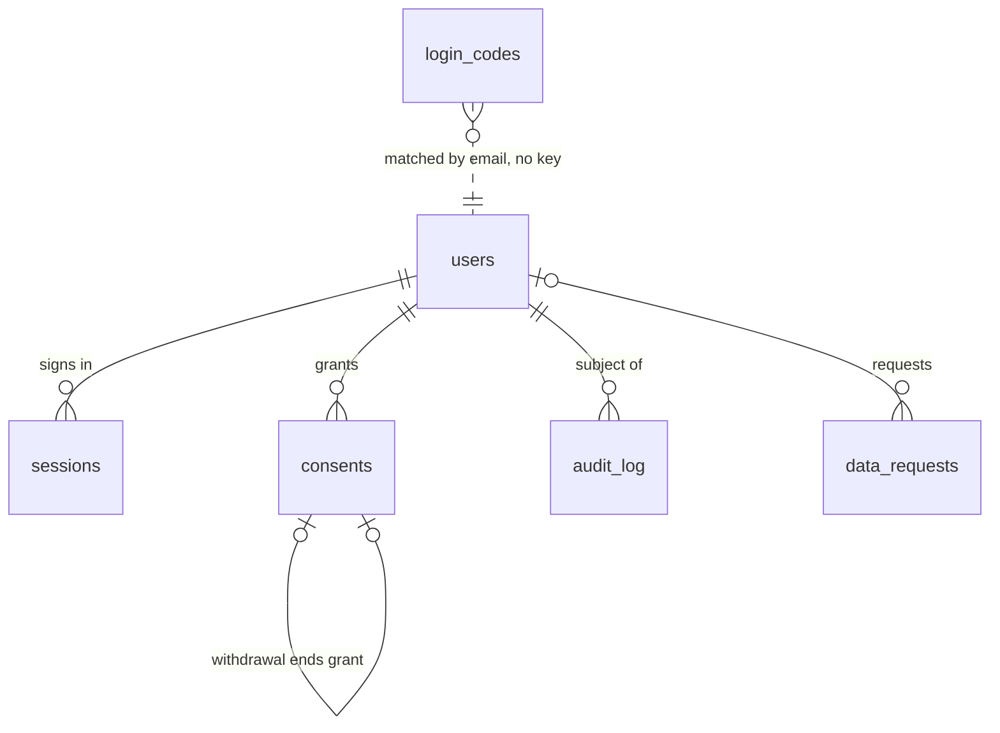
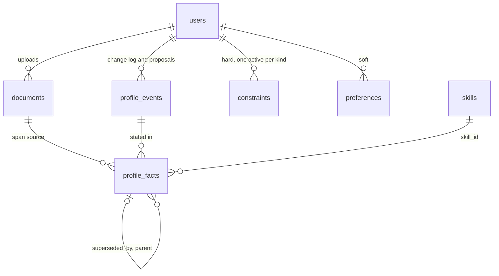
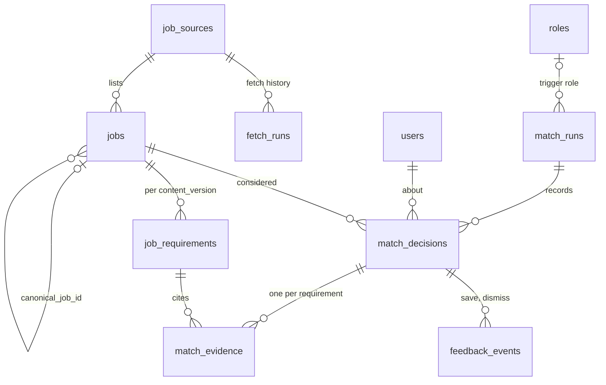
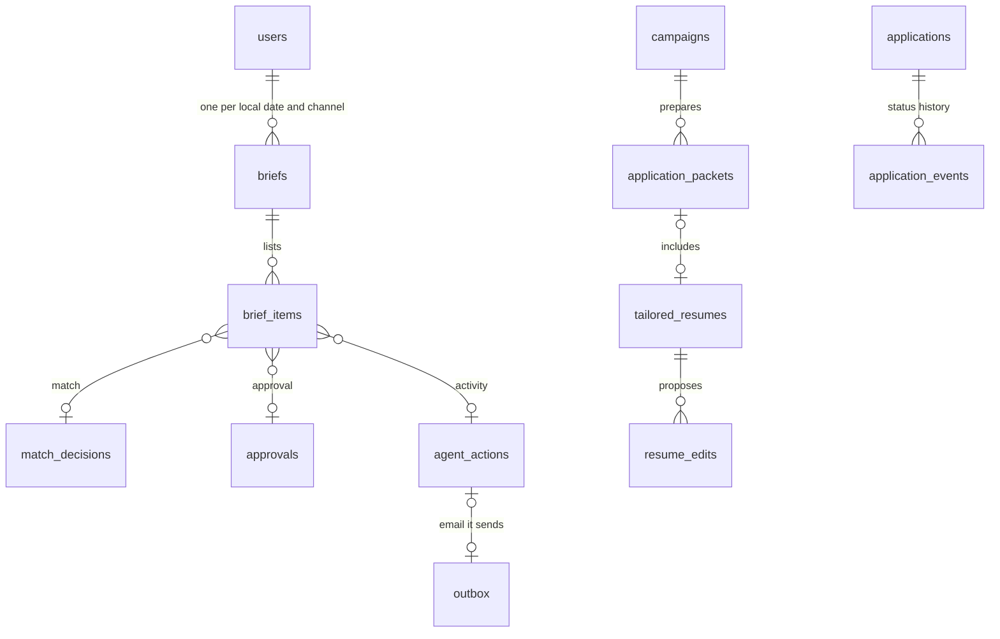
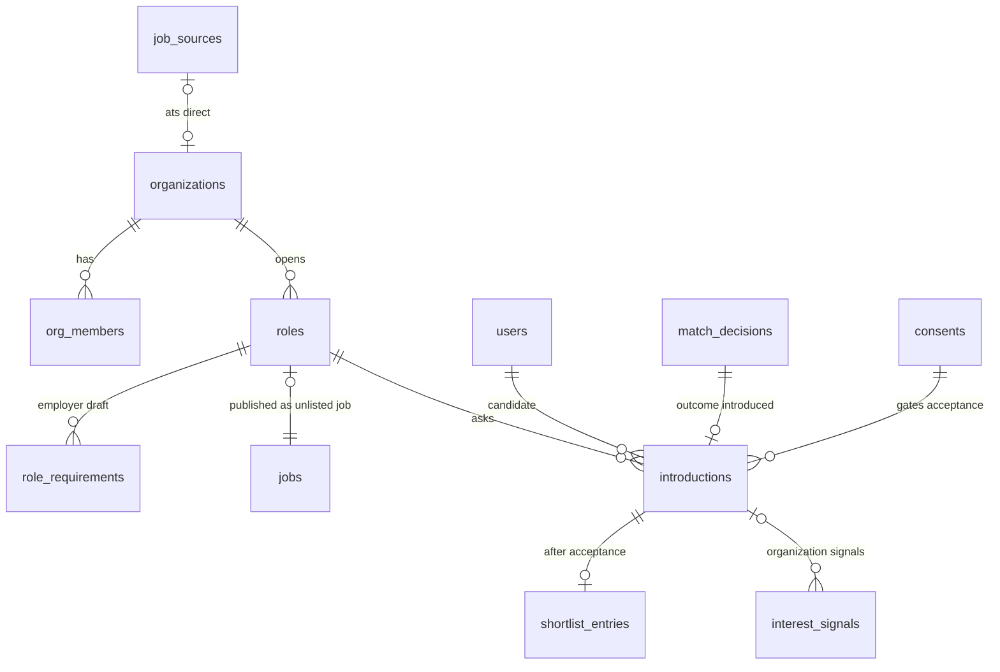
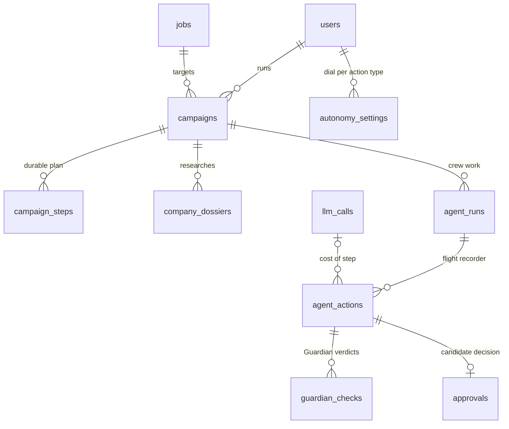
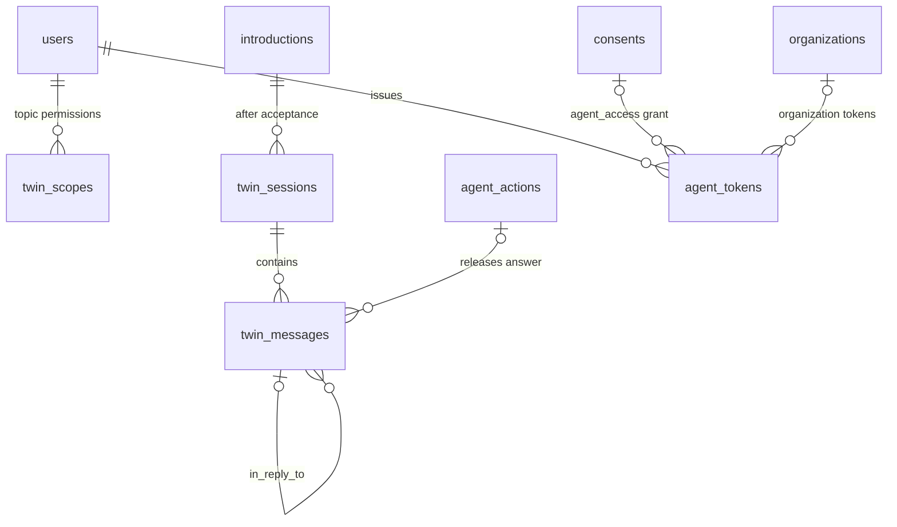
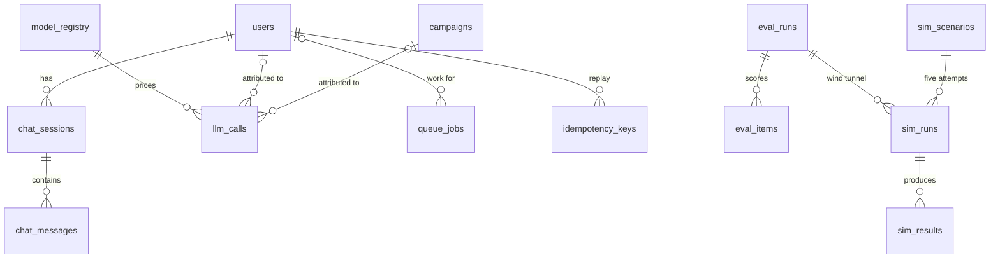

# OpenElip data model

This document is the database design for OpenElip: every table, the constraints that carry the product's eight invariants, the database roles and row-level security, the key queries, the data lifecycle, and the path from today's `db/schema.sql` to Alembic migrations.

It covers PostgreSQL only. Endpoints and payloads are in [API.md](API.md), module interfaces and flows in [ARCHITECTURE.md](ARCHITECTURE.md), prompts and agent internals in [AI_SYSTEM.md](AI_SYSTEM.md), and screens in [FRONTEND_UI.md](FRONTEND_UI.md). Entity and module names follow [OVERVIEW.md](OVERVIEW.md). Where this document had to add or reinterpret something, section 11 says so.

All SQL in sections 3, 4, 5 and 7 was applied, in the order printed, to an empty PostgreSQL 17 database with pgvector (and section 8 to a copy of the existing schema), and the invariants were exercised with statements that must be rejected. Section 12 records exactly what ran and what happened.

## 1. Summary and conventions

### 1.1 At a glance

| Item | Value |
|---|---|
| Database | PostgreSQL 17 with pgvector (verified on 17.12 with pgvector 0.8.7) |
| Tables | 58: the 57 entities named in OVERVIEW.md plus `login_codes` (section 11, issue 1). The LangGraph checkpointer adds four tables of its own in schema `langgraph` (section 3.15). |
| Views | 1: `sim_scenario_verdicts` |
| Enum types | 78 (section 3.1), plus one composite type `compiled_constraints` (section 4) |
| Database roles | `app_owner` (owns everything), `app_api`, `app_worker`, `app_match` (section 5) |
| Existing data | `job_sources`, `jobs`, `fetch_runs` are converted in place, never recreated (section 8) |

### 1.2 Conventions

| Topic | Rule |
|---|---|
| Names | `snake_case`, plural table names, singular enum type names. Foreign keys are `<entity>_id`. Booleans start with `is_` or `has_` only where the name would otherwise be unclear. |
| Primary keys | `uuid` (default `gen_random_uuid()`; the application may supply UUIDv7 for better index locality) for rows owned by a person or an organization. `bigint GENERATED ALWAYS AS IDENTITY` for the public job index (the existing tables) and for high-volume logs: `audit_log`, `llm_calls`, `job_requirements`, `match_evidence`, `agent_actions`, `guardian_checks`, `queue_jobs`, `eval_items`, `sim_results`. |
| Ownership column | Every table that holds one person's data carries `user_id`, even when it could be reached through a parent. Row-level security and erasure both key on it. Where a person writes a reference to another of their rows, a composite foreign key `(child_id, user_id) -> parent(id, user_id)` makes it impossible to point at someone else's row. |
| Time | Every timestamp is `timestamptz`, stored in UTC. A candidate's day is `local_date`, computed in `users.timezone` (an IANA name, validated by the application). An organization's business days are counted in `organizations.timezone`. |
| Money | Model cost is an integer `cost_microusd` (millionths of a US dollar), so sums are exact. Salaries are whole currency units per year in `integer`, with an ISO 4217 `char(3)` currency. There is no currency conversion anywhere: a salary in another currency is "not comparable", never converted. |
| Text spans | A span is an `int4range`, zero-based and half-open (`[start, end)`), into a named text column (`documents.extracted_text`, `jobs.description`, `roles.description`). The quoted text is stored beside it and a trigger checks on insert that the quote is the text at the span. A text column that spans point into never changes in place: jobs get a new `content_version` instead (section 4.2). |
| Enums | Closed vocabularies are PostgreSQL `ENUM` types, so a typo fails at insert. Adding a value is `ALTER TYPE ... ADD VALUE` in a migration; after the first release values are never removed or renamed. |
| Embeddings | `vector(384)` from a local model, cosine distance. Every embedding column has a sibling `*_embedding_model` / `embedding_model` text column, and a CHECK keeps both NULL or both set, so mixed models can be detected and rebuilt. |
| Delete | No soft delete of personal data. Deletion is a hard delete of the `users` row; every foreign key to `users` either cascades or sets NULL (section 7.2). Records that must keep history are versioned instead of edited (below). |
| Append-only | 15 tables accept INSERT only: a trigger rejects UPDATE and DELETE, and the runtime roles are not granted them. The only exception is the maintenance flag `app.maintenance`, which `erase_user` and `purge_expired` set for their own transaction. |
| Versioned rows | `profile_facts`, `constraints` and `preferences` are never edited. A change inserts a new row and fills the old row's write-once lifecycle columns (`confirmed_at`, `rejected_at`, `superseded_at`, `superseded_by`), each settable once. |
| Guarded rows | `agent_actions`, `introductions`, `approvals` and `eval_runs` may change only along defined transitions, enforced by triggers. |

### 1.3 Names other documents must use

These values are fixed by this schema. API payloads, agent code and screens should use them verbatim.

| Concept | Column | Values |
|---|---|---|
| Campaign stage | `campaigns.stage` | `researching`, `needs_you`, `applied`, `talking`, `interview`, `offer`, `closed`. Pause is `paused_at` (NULL means running); pause reasons are the `outcome_code` of the state-change recorder row: `candidate`, `budget_exhausted`, `scam_suspected`. `closed_reason`: `cancelled`, `rejected`, `no_response`, `job_closed`, `offer_accepted`, `offer_declined`. Approving a match starts at `researching`; accepting an introduction starts at `applied` |
| Campaign steps | `campaign_steps.status`, `step_key` | `pending`, `running`, `waiting`, `done`, `failed`, `skipped`, `cancelled`; keys `research`, `fit`, `packet_draft`, `packet`, `follow_up:1`, `follow_up:2`, `interview_prep` (introduction campaigns: `research` and `interview_prep` only) |
| Approval status | `approvals.status` | `pending`, `approved`, `rejected`, `expired`; `decided_via`: `app` |
| Introduction status | `introductions.status` | `asked`, `accepted`, `declined`, `expired`, `withdrawn`; employer answer `employer_answer`: `yes`, `no`, with `employer_answer_reason`, `answer_due_at` |
| Agent action | `agent_actions.status` | `recorded`, `proposed`, `awaiting_approval`, `scheduled`, `executed`, `blocked`, `rejected`, `expired`, `cancelled`, `failed` |
| Outside action types | `agent_actions.action_type`, `autonomy_settings.action_type` | `submit_application`, `send_follow_up`, `twin_answer` |
| Autonomy dial | `autonomy_settings.level` | `ask_first` (default when no row), `tell_me_after`, `never`. `submit_application` and `send_follow_up` can never be `tell_me_after`; profile sharing is not a setting (it happens only when the candidate accepts an introduction) |
| Policy verdict | `agent_actions.policy_decision` | `allow`, `ask`, `deny` |
| Guardian checks | `guardian_checks.check_kind`, `reason_code` | `citations` (`citation_unresolved`, `unsupported_claim`), `consent` (`consent_missing`), `scope` (`constraint_conflict`, `employer_blocked`, `topic_not_open`, `restricted_data`), `budget` (`budget_exhausted`), `injection` (`injection_suspected`), `rate_limit` (`limit_reached`) |
| Crew | `agent_runs.agent_role` | `scout`, `researcher`, `analyst`, `writer`, `operator`, `chaser`, `coach`, `twin`, `guardian` |
| Match outcome | `match_decisions.outcome` | `shown`, `introduced`, `withheld`, `filtered` |
| Match reasons | `match_decisions.reason_codes` | `top_ranked`, `material_change`, `selected_for_role`, `weak_fit`, `required_not_met`, `below_daily_cap`, `citation_unresolved`, `already_shown`, `job_closed`, `liveness_unverified`, `not_scored`, `not_retrieved`, `hard_constraint`, `injection_suspected` |
| Evidence verdict | `match_evidence.verdict` | `met`, `partly_met`, `not_met`, `no_evidence` |
| Hard constraints | `constraints.kind` | `location`, `remote_policy`, `work_authorization`, `salary_floor`, `employment_type`, `seniority`, `excluded_company` |
| Twin topics | `twin_scopes.topic` | `experience`, `skills`, `education`, `projects`, `availability`, `work_authorization`, `location`, `expected_pay`, `motivation`, `current_pay`, `contact_details`, `other`; permission `answer`, `ask_me` (default when no row), `never`. `current_pay` and `contact_details` are always `never`, with or without a row. `answer_kind`: `answered`, `unknown`, `declined`, `relayed` |
| Agent token scopes | `agent_tokens.scopes` | Principal `candidate` (issued with an `agent_access` consent): `matches:read`, `explanations:read`. Principal `organization` (issued by an owner or admin): `twin:ask`, `introductions:request` |
| Brief | `users.brief_frequency`, `brief_items.kind` | `daily`, `weekly`, `paused`; item kinds `match`, `approval`, `activity`, `introduction` |
| Wind tunnel | `sim_scenarios.persona`, `sim_results.code` | Personas `cooperative` (control), `silent`, `lowball`, `scam`, `hidden_instruction`. Violation codes `constraint_break`, `invented_claim`, `privacy_leak`, `unauthorized_action`, `duplicate_send`, `followed_hidden_instruction`; outcome codes `goal_reached` plus names defined in each scenario |
| Eval suites | `eval_runs.suite` | `resume_extraction`, `requirement_extraction`, `evidence_faithfulness`, `tailoring_integrity`, `matching_benchmark`, `injection`, `constraint_property`, `wind_tunnel`, `record_proposals`, `chat`, `dossier`, `twin`, `guardian`, `agent_drafts`, `harness_smoke` (the harness's own smoke suite: it proves the runner and the gate, never product quality), `location_accuracy` (share of labelled postings whose country and city are read correctly, IDX-06; added in Phase 2 because no other suite fits it), `role_intake` (share of an employer's role description read into the right requirements, HIR-02; added in Phase 6 because no other suite fits it) |
| Instance operator | (no column) | Acts through the command line; audit rows use `actor_type` `operator` |
| Application | `applications.status` | `applied`, `interview`, `offer`, `rejected`, `no_response` |
| Consent purposes | `consents.purpose` | `terms`, `ai_processing`, `brief_email`, `open_to_introductions`, `introduction` (per organization and role), `agent_access` |
| Database error prefixes | trigger messages | `citation_unresolved`, `span_unresolved`, `evidence_incomplete`, `consent_missing`, `two_key`, `hard_constraint`, `answer_clock`, `scope_denied`, `unsupported_edit` (SQLSTATE `23514`); append-only and immutability violations use SQLSTATE `42501` |

## 2. Entity relationship diagrams

One diagram per domain. Attributes are omitted; section 3 has them. Every table that holds a person's data also has a direct `user_id` link to `users`, drawn only where it is the main relationship.

### 2.1 Identity and trust



### 2.2 Career Record



### 2.3 Job index and matching



### 2.4 Delivery, tailoring and applications



### 2.5 Hiring desk



### 2.6 Campaigns, flight recorder and Guardian



### 2.7 Twin and agent network



### 2.8 Conversation, platform and evals



## 3. DDL by module

### 3.0 Table inventory

The module is the OVERVIEW.md module that owns the table and is its only writer. The category says how rows may change.

| Module | Tables | Category |
|---|---|---|
| platform | `users`, `sessions`, `login_codes`, `model_registry`, `queue_jobs`, `idempotency_keys` | mutable |
| platform | `llm_calls` | append-only |
| trust | `consents`, `audit_log` | append-only |
| trust | `data_requests` | mutable |
| ingest | `job_sources`, `jobs`, `skills` | mutable (`jobs` text is versioned, section 4.2) |
| ingest | `fetch_runs`, `job_requirements` | append-only |
| profile | `documents` | mutable |
| profile | `profile_events` | append-only |
| profile | `profile_facts`, `constraints`, `preferences` | versioned (write-once lifecycle) |
| match | `match_runs` | mutable |
| match | `match_decisions`, `match_evidence`, `feedback_events` | append-only |
| brief | `briefs`, `brief_items`, `outbox` | mutable |
| chat | `chat_sessions`, `chat_messages` | mutable |
| tailor | `tailored_resumes`, `resume_edits` (content fixed, decision once) | mutable |
| apply | `application_packets`, `applications` | mutable |
| apply | `application_events` | append-only |
| hiring | `organizations`, `org_members`, `roles`, `role_requirements`, `shortlist_entries`, `interest_signals` | mutable |
| hiring | `introductions` | guarded |
| campaigns | `campaigns`, `campaign_steps`, `company_dossiers` | mutable |
| guardian | `agent_runs` | mutable |
| guardian | `agent_actions` (the flight recorder) | guarded |
| guardian | `approvals` | guarded |
| guardian | `autonomy_settings` | mutable |
| guardian | `guardian_checks` | append-only |
| guardian | `langgraph.checkpoints`, `langgraph.checkpoint_blobs`, `langgraph.checkpoint_writes`, `langgraph.checkpoint_migrations` | library-managed (section 3.15): the agent runtime in `guardian` writes them through the checkpointer; deleted with their campaign or Twin question |
| twin | `twin_scopes`, `twin_sessions` | mutable |
| twin | `twin_messages` | append-only |
| agentnet | `agent_tokens` | mutable |
| evals | `eval_runs` | guarded (frozen when finished) |
| evals | `eval_items`, `sim_scenarios`, `sim_results` | append-only |
| evals | `sim_runs` | mutable |

### 3.1 Bootstrap and types

Run once by a database administrator. Roles are cluster-wide.

<!-- ddl: 00_bootstrap.sql -->
```sql
-- Run once by a database administrator. Roles are cluster-wide; the extension needs superuser.
CREATE EXTENSION IF NOT EXISTS vector;

CREATE ROLE app_owner  NOLOGIN;              -- owns every object; migrations run as this role
CREATE ROLE app_api    LOGIN NOBYPASSRLS;    -- the FastAPI process, including /mcp
CREATE ROLE app_worker LOGIN NOBYPASSRLS;    -- queue workers: ingest, brief, tailor, campaigns, guardian, twin, evals
CREATE ROLE app_match  LOGIN NOBYPASSRLS;    -- the match module's connections inside the worker

GRANT USAGE, CREATE ON SCHEMA public TO app_owner;
GRANT USAGE ON SCHEMA public TO app_api, app_worker, app_match;
-- The LangGraph revision (section 3.15) creates schema langgraph as app_owner.
DO $$ BEGIN EXECUTE format('GRANT CREATE ON DATABASE %I TO app_owner', current_database()); END $$;
```

<!-- ddl: 01_types.sql -->
```sql
-- Identity and trust
CREATE TYPE user_status         AS ENUM ('active', 'suspended', 'deleting');
CREATE TYPE brief_frequency     AS ENUM ('daily', 'weekly', 'paused');
CREATE TYPE consent_purpose     AS ENUM ('terms', 'ai_processing', 'brief_email', 'open_to_introductions',
                                         'introduction', 'agent_access');
CREATE TYPE consent_action      AS ENUM ('granted', 'withdrawn');
CREATE TYPE actor_type          AS ENUM ('system', 'candidate', 'employer', 'agent', 'outside_agent', 'operator');
CREATE TYPE data_request_kind   AS ENUM ('export', 'deletion');
CREATE TYPE data_request_status AS ENUM ('open', 'in_progress', 'completed', 'failed');

-- Career Record
CREATE TYPE document_status     AS ENUM ('uploaded', 'parsing', 'parsed', 'failed');
CREATE TYPE fact_kind           AS ENUM ('role', 'achievement', 'education', 'skill', 'certification',
                                         'project', 'other');
CREATE TYPE record_source       AS ENUM ('resume', 'candidate_edit', 'confirmed_proposal');
CREATE TYPE constraint_kind     AS ENUM ('location', 'remote_policy', 'work_authorization', 'salary_floor',
                                         'employment_type', 'seniority', 'excluded_company');
CREATE TYPE preference_kind     AS ENUM ('target_title', 'target_skill', 'industry', 'company_size', 'location',
                                         'remote_policy', 'salary_target', 'seniority', 'untyped_dealbreaker',
                                         'other');
CREATE TYPE profile_entity      AS ENUM ('fact', 'constraint', 'preference');
CREATE TYPE profile_operation   AS ENUM ('create', 'update', 'remove', 'confirm', 'reject');
CREATE TYPE profile_event_type  AS ENUM ('proposed', 'applied', 'declined', 'expired');
CREATE TYPE proposal_origin     AS ENUM ('onboarding', 'chat', 'feedback', 'agent');

-- Job index
CREATE TYPE ats_type            AS ENUM ('greenhouse', 'lever', 'ashby', 'direct');
CREATE TYPE fetch_status        AS ENUM ('ok', 'http_error', 'parse_error', 'suspicious_empty', 'network_error');
CREATE TYPE job_status          AS ENUM ('open', 'closed');
CREATE TYPE work_arrangement    AS ENUM ('onsite', 'hybrid', 'remote');
CREATE TYPE employment_type     AS ENUM ('full_time', 'part_time', 'contract', 'internship', 'temporary',
                                         'unknown');
CREATE TYPE seniority           AS ENUM ('intern', 'entry', 'mid', 'senior', 'staff', 'principal', 'manager',
                                         'director', 'executive', 'unknown');
CREATE TYPE visa_sponsorship    AS ENUM ('offered', 'not_offered', 'unknown');
CREATE TYPE requirement_importance AS ENUM ('required', 'preferred');
CREATE TYPE requirement_kind    AS ENUM ('skill', 'experience', 'education', 'certification', 'authorization',
                                         'location', 'other');

-- Matching
CREATE TYPE match_trigger       AS ENUM ('nightly', 'onboarding', 'on_demand', 'role');
CREATE TYPE match_run_status    AS ENUM ('running', 'completed', 'failed');
CREATE TYPE match_outcome       AS ENUM ('shown', 'introduced', 'withheld', 'filtered');
CREATE TYPE match_reason        AS ENUM ('top_ranked', 'material_change', 'selected_for_role',
                                         'weak_fit', 'required_not_met', 'below_daily_cap',
                                         'citation_unresolved', 'already_shown', 'job_closed',
                                         'liveness_unverified', 'not_scored', 'not_retrieved',
                                         'hard_constraint', 'injection_suspected');
CREATE TYPE unverified_flag     AS ENUM ('location_not_stated', 'arrangement_not_stated',
                                         'arrangement_ambiguous', 'salary_not_stated',
                                         'salary_currency_differs', 'employment_type_not_stated',
                                         'seniority_not_stated');
CREATE TYPE evidence_verdict    AS ENUM ('met', 'partly_met', 'not_met', 'no_evidence');
CREATE TYPE feedback_kind       AS ENUM ('save', 'unsave', 'dismiss');
CREATE TYPE dismiss_reason      AS ENUM ('not_interested_role', 'not_interested_company', 'seniority_mismatch',
                                         'compensation', 'location', 'skills_mismatch', 'already_applied',
                                         'explanation_wrong', 'duplicate', 'job_closed', 'other');

-- Delivery
CREATE TYPE brief_channel       AS ENUM ('email', 'in_app');
CREATE TYPE brief_status        AS ENUM ('composed', 'suppressed', 'queued', 'sent', 'failed');
CREATE TYPE brief_item_kind     AS ENUM ('match', 'approval', 'activity', 'introduction');
CREATE TYPE outbox_status       AS ENUM ('pending', 'sending', 'sent', 'failed', 'cancelled', 'unknown');

-- Tailoring and applying
CREATE TYPE tailored_status     AS ENUM ('generating', 'ready', 'failed');
CREATE TYPE edit_verifier_status AS ENUM ('passed', 'discarded');
CREATE TYPE edit_discard_reason AS ENUM ('new_entity', 'changed_number', 'changed_date', 'changed_title',
                                         'changed_employer', 'not_entailed', 'no_supporting_fact');
CREATE TYPE edit_decision       AS ENUM ('pending', 'approved', 'rejected');
CREATE TYPE application_status  AS ENUM ('applied', 'interview', 'offer', 'rejected', 'no_response');
CREATE TYPE packet_status       AS ENUM ('draft', 'ready', 'approved', 'superseded');

-- Hiring
CREATE TYPE org_role            AS ENUM ('owner', 'admin', 'member');
CREATE TYPE member_status       AS ENUM ('invited', 'active', 'removed');
CREATE TYPE role_status         AS ENUM ('draft', 'open', 'closed');
CREATE TYPE introduction_status AS ENUM ('asked', 'accepted', 'declined', 'expired', 'withdrawn');
CREATE TYPE employer_answer     AS ENUM ('yes', 'no');
CREATE TYPE signal_side         AS ENUM ('candidate', 'organization');

-- Campaigns and control
CREATE TYPE campaign_stage      AS ENUM ('researching', 'needs_you', 'applied', 'talking', 'interview', 'offer',
                                         'closed');
CREATE TYPE campaign_closed_reason AS ENUM ('cancelled', 'rejected', 'no_response', 'job_closed',
                                            'offer_accepted', 'offer_declined');
CREATE TYPE step_status         AS ENUM ('pending', 'running', 'waiting', 'done', 'failed', 'skipped',
                                         'cancelled');
CREATE TYPE agent_role          AS ENUM ('scout', 'researcher', 'analyst', 'writer', 'operator', 'chaser',
                                         'coach', 'twin', 'guardian');
CREATE TYPE agent_run_status    AS ENUM ('running', 'succeeded', 'failed', 'cancelled');
CREATE TYPE action_kind         AS ENUM ('model_call', 'tool_call', 'state_change', 'outside_action');
CREATE TYPE action_type         AS ENUM ('submit_application', 'send_follow_up', 'twin_answer');
CREATE TYPE action_status       AS ENUM ('recorded', 'proposed', 'awaiting_approval', 'scheduled', 'executed',
                                         'blocked', 'rejected', 'expired', 'cancelled', 'failed');
CREATE TYPE policy_decision     AS ENUM ('allow', 'ask', 'deny');
CREATE TYPE autonomy_level      AS ENUM ('ask_first', 'tell_me_after', 'never');
CREATE TYPE approval_status     AS ENUM ('pending', 'approved', 'rejected', 'expired');
CREATE TYPE guardian_check_kind AS ENUM ('citations', 'consent', 'scope', 'budget', 'injection', 'rate_limit');

-- Twin and agent network
CREATE TYPE twin_topic          AS ENUM ('experience', 'skills', 'education', 'projects', 'availability',
                                         'work_authorization', 'location', 'expected_pay', 'motivation',
                                         'current_pay', 'contact_details', 'other');
CREATE TYPE twin_permission     AS ENUM ('answer', 'ask_me', 'never');
CREATE TYPE twin_author         AS ENUM ('employer', 'twin', 'candidate');
CREATE TYPE twin_answer_kind    AS ENUM ('answered', 'unknown', 'declined', 'relayed');
CREATE TYPE twin_session_status AS ENUM ('open', 'closed');
CREATE TYPE token_principal     AS ENUM ('candidate', 'organization');
CREATE TYPE token_scope         AS ENUM ('matches:read', 'explanations:read', 'twin:ask', 'introductions:request');

-- Conversation
CREATE TYPE chat_session_kind   AS ENUM ('onboarding', 'open');
CREATE TYPE chat_role           AS ENUM ('user', 'assistant', 'tool');

-- Platform and evals
CREATE TYPE model_kind          AS ENUM ('chat', 'embedding');
CREATE TYPE llm_outcome         AS ENUM ('ok', 'schema_invalid', 'timeout', 'provider_error', 'refused');
CREATE TYPE queue_status        AS ENUM ('queued', 'running', 'succeeded', 'dead');
CREATE TYPE eval_suite          AS ENUM ('resume_extraction', 'requirement_extraction', 'evidence_faithfulness',
                                         'tailoring_integrity', 'matching_benchmark', 'injection',
                                         'constraint_property', 'wind_tunnel', 'record_proposals', 'chat',
                                         'dossier', 'twin', 'guardian', 'agent_drafts', 'harness_smoke',
                                         'location_accuracy');  -- location_accuracy: share of labelled postings whose country and city are read correctly (IDX-06)
CREATE TYPE eval_status         AS ENUM ('running', 'passed', 'failed', 'error');
CREATE TYPE sim_persona         AS ENUM ('silent', 'lowball', 'scam', 'hidden_instruction', 'cooperative');
CREATE TYPE sim_run_status      AS ENUM ('running', 'passed', 'failed', 'error');
CREATE TYPE sim_result_kind     AS ENUM ('outcome', 'violation');
```

### 3.2 Shared helper functions

<!-- ddl: 02_helpers.sql -->
```sql
-- A company name reduced to a comparison key: lower case, common legal suffixes removed, letters and digits only.
-- Used wherever two company names must be compared (excluded companies, employer blocks).
CREATE FUNCTION company_key(p_name text) RETURNS text
LANGUAGE sql IMMUTABLE PARALLEL SAFE AS $$
  SELECT regexp_replace(
           regexp_replace(lower(coalesce(p_name, '')),
             '\m(incorporated|inc|llc|llp|ltd|limited|corp|corporation|co|company|gmbh|plc|pvt|private)\M', '', 'g'),
           '[^a-z0-9]+', '', 'g')
$$;

CREATE FUNCTION company_keys(p_names text[]) RETURNS text[]
LANGUAGE sql IMMUTABLE PARALLEL SAFE AS $$
  SELECT array_agg(DISTINCT company_key(n)) FROM unnest(p_names) AS n
$$;

-- Five business days means Monday to Friday in the given time zone. No holiday calendar (assumption).
CREATE FUNCTION add_business_days(p_start timestamptz, p_days integer, p_timezone text) RETURNS timestamptz
LANGUAGE plpgsql STABLE AS $$
DECLARE
  local_ts timestamp := p_start AT TIME ZONE p_timezone;
  added    integer   := 0;
BEGIN
  WHILE added < p_days LOOP
    local_ts := local_ts + interval '1 day';
    IF extract(isodow FROM local_ts) < 6 THEN
      added := added + 1;
    END IF;
  END LOOP;
  RETURN local_ts AT TIME ZONE p_timezone;
END;
$$;

-- Append-only guard. Rows leave these tables only through erase_user and purge_expired,
-- which set app.maintenance for their own transaction.
CREATE FUNCTION forbid_mutation() RETURNS trigger
LANGUAGE plpgsql AS $$
BEGIN
  IF current_setting('app.maintenance', true) = 'on' THEN
    RETURN CASE WHEN TG_OP = 'DELETE' THEN OLD ELSE NEW END;
  END IF;
  RAISE EXCEPTION '% is append-only (% rejected)', TG_TABLE_NAME, TG_OP
    USING ERRCODE = 'insufficient_privilege';
END;
$$;

-- Versioned rows: content is immutable; only the named lifecycle columns may change, and only from NULL.
CREATE FUNCTION write_once_columns() RETURNS trigger
LANGUAGE plpgsql AS $$
DECLARE
  allowed text[] := TG_ARGV;
  o jsonb := to_jsonb(OLD);
  n jsonb := to_jsonb(NEW);
  col text;
BEGIN
  IF current_setting('app.maintenance', true) = 'on' THEN
    RETURN NEW;
  END IF;
  IF (n - allowed) IS DISTINCT FROM (o - allowed) THEN
    RAISE EXCEPTION '% rows are immutable except for %', TG_TABLE_NAME, allowed
      USING ERRCODE = 'insufficient_privilege';
  END IF;
  FOREACH col IN ARRAY allowed LOOP
    IF (o -> col) <> 'null'::jsonb AND (n -> col) IS DISTINCT FROM (o -> col) THEN
      RAISE EXCEPTION '%.% can be set only once', TG_TABLE_NAME, col
        USING ERRCODE = 'insufficient_privilege';
    END IF;
  END LOOP;
  RETURN NEW;
END;
$$;

CREATE FUNCTION touch_updated_at() RETURNS trigger
LANGUAGE plpgsql AS $$
BEGIN
  NEW.updated_at := now();
  RETURN NEW;
END;
$$;
```

### 3.3 platform and trust: identity, sessions, consent, audit

<!-- ddl: 10_identity.sql -->
```sql
CREATE TABLE users (
  id                     uuid PRIMARY KEY DEFAULT gen_random_uuid(),
  email                  text            NOT NULL CHECK (position('@' IN email) > 1),
  display_name           text,
  status                 user_status     NOT NULL DEFAULT 'active',
  is_synthetic           boolean         NOT NULL DEFAULT false,  -- demo or wind-tunnel account, never a real person
  timezone               text            NOT NULL DEFAULT 'UTC',  -- IANA name, validated by the application
  brief_frequency        brief_frequency NOT NULL DEFAULT 'daily',
  brief_weekday          smallint        CHECK (brief_weekday BETWEEN 1 AND 7),  -- ISO weekday, weekly briefs only
  undo_window_minutes    smallint        NOT NULL DEFAULT 10 CHECK (undo_window_minutes BETWEEN 1 AND 60),
  -- Career Record header, written only by the profile module
  record_version         bigint          NOT NULL DEFAULT 0,      -- +1 on every applied record change
  record_confirmed_at    timestamptz,                             -- first confirmation; NULL = nothing to match yet
  record_embedding       vector(384),                             -- built from confirmed facts only
  record_embedding_model text,
  last_active_at         timestamptz,
  created_at             timestamptz     NOT NULL DEFAULT now(),
  updated_at             timestamptz     NOT NULL DEFAULT now(),
  CHECK ((brief_frequency = 'weekly') = (brief_weekday IS NOT NULL)),
  CHECK ((record_embedding IS NULL) = (record_embedding_model IS NULL))
);
CREATE UNIQUE INDEX users_email_key ON users (lower(email));
-- Nightly selection: candidates who can receive a brief, by time zone.
CREATE INDEX users_due_idx ON users (timezone)
  WHERE status = 'active' AND brief_frequency <> 'paused' AND record_confirmed_at IS NOT NULL;
CREATE TRIGGER users_touch BEFORE UPDATE ON users FOR EACH ROW EXECUTE FUNCTION touch_updated_at();

-- A signed-in browser. The session token (sent as a cookie) is never stored, only its SHA-256.
CREATE TABLE sessions (
  id           uuid PRIMARY KEY DEFAULT gen_random_uuid(),
  user_id      uuid        NOT NULL REFERENCES users(id) ON DELETE CASCADE,
  token_sha256 bytea       NOT NULL UNIQUE,
  created_at   timestamptz NOT NULL DEFAULT now(),
  expires_at   timestamptz NOT NULL,
  last_seen_at timestamptz,
  revoked_at   timestamptz,                -- sign-out
  CHECK (expires_at > created_at)
);
CREATE INDEX sessions_user_idx ON sessions (user_id) WHERE revoked_at IS NULL;

-- One emailed sign-in code (PLT-02). Not tied to a user: the address may not have an account yet.
CREATE TABLE login_codes (
  id          uuid PRIMARY KEY DEFAULT gen_random_uuid(),
  email       text        NOT NULL,
  code_hmac   bytea       NOT NULL,   -- HMAC-SHA256 keyed by APP_LOOKUP_KEY
  attempts    smallint    NOT NULL DEFAULT 0 CHECK (attempts BETWEEN 0 AND 5),  -- assumption: 5 tries per code
  expires_at  timestamptz NOT NULL,
  consumed_at timestamptz,
  created_at  timestamptz NOT NULL DEFAULT now()
);
CREATE INDEX login_codes_email_idx ON login_codes (lower(email), created_at DESC);

-- Grants and withdrawals, append-only. A grant is active while no withdrawal row points at it.
CREATE TABLE consents (
  id              uuid PRIMARY KEY DEFAULT gen_random_uuid(),
  user_id         uuid            NOT NULL REFERENCES users(id) ON DELETE CASCADE,
  purpose         consent_purpose NOT NULL,
  action          consent_action  NOT NULL,
  withdraws_id    uuid,                         -- withdrawal rows: the grant they end
  organization_id uuid,                         -- purpose 'introduction': the employer
  role_id         uuid,                         -- purpose 'introduction': the role
  text_version    text            NOT NULL,     -- version of the wording the person saw
  created_at      timestamptz     NOT NULL DEFAULT now(),
  UNIQUE (id, user_id, purpose),
  -- A withdrawal can only end the same person's grant for the same purpose.
  FOREIGN KEY (withdraws_id, user_id, purpose) REFERENCES consents (id, user_id, purpose) ON DELETE CASCADE,
  CHECK ((action = 'withdrawn') = (withdraws_id IS NOT NULL)),
  CHECK (action = 'withdrawn'
         OR (purpose = 'introduction') = (organization_id IS NOT NULL AND role_id IS NOT NULL))
);
CREATE UNIQUE INDEX consents_one_withdrawal ON consents (withdraws_id) WHERE withdraws_id IS NOT NULL;
CREATE INDEX consents_lookup_idx ON consents (user_id, purpose, organization_id, role_id) WHERE action = 'granted';

-- Every automated decision and every privileged or outside access, append-only (TRU-03, NET-03).
CREATE TABLE audit_log (
  id              bigint GENERATED ALWAYS AS IDENTITY PRIMARY KEY,
  created_at      timestamptz NOT NULL DEFAULT now(),
  event_type      text        NOT NULL CHECK (event_type ~ '^[a-z_]+\.[a-z_]+$'),  -- 'match.run_completed'
  actor_type      actor_type  NOT NULL,
  actor_user_id   uuid        REFERENCES users(id) ON DELETE SET NULL,
  subject_user_id uuid        REFERENCES users(id) ON DELETE CASCADE,   -- the person the event is about
  organization_id uuid,
  agent_token_id  uuid,                    -- set when an outside agent made the call
  entity_table    text,
  entity_id       text,
  details         jsonb       NOT NULL DEFAULT '{}'   -- ids, counts and codes; never resume, chat or contact text
);
CREATE INDEX audit_log_subject_idx ON audit_log (subject_user_id, created_at DESC);
CREATE INDEX audit_log_event_idx   ON audit_log (event_type, created_at DESC);

CREATE TABLE data_requests (
  id                 uuid PRIMARY KEY DEFAULT gen_random_uuid(),
  user_id            uuid                REFERENCES users(id) ON DELETE SET NULL,
  subject_user_id    uuid                NOT NULL,   -- no foreign key: kept after erasure so a restore can be re-erased
  kind               data_request_kind   NOT NULL,
  status             data_request_status NOT NULL DEFAULT 'open',
  due_at             timestamptz         NOT NULL,
  export_archive     bytea,                          -- export: the archive as a Fernet token; NULL after 7 days
  export_expires_at  timestamptz,
  store_results      jsonb               NOT NULL DEFAULT '{}',  -- per store: what was exported or removed
  created_at         timestamptz         NOT NULL DEFAULT now(),
  completed_at       timestamptz,
  CHECK ((status = 'completed') = (completed_at IS NOT NULL))
);
CREATE UNIQUE INDEX data_requests_one_open_deletion
  ON data_requests (subject_user_id) WHERE kind = 'deletion' AND status IN ('open', 'in_progress');
```

### 3.4 profile: the Career Record

<!-- ddl: 20_record.sql -->
```sql
CREATE TABLE documents (
  id                uuid PRIMARY KEY DEFAULT gen_random_uuid(),
  user_id           uuid            NOT NULL REFERENCES users(id) ON DELETE CASCADE,
  content           bytea           NOT NULL,            -- the uploaded file as a Fernet token
  original_filename text,
  mime_type         text            NOT NULL CHECK (mime_type IN (
                      'application/pdf',
                      'application/vnd.openxmlformats-officedocument.wordprocessingml.document')),
  byte_size         integer         NOT NULL CHECK (byte_size BETWEEN 1 AND 10485760),  -- assumption: 10 MB cap
  sha256            bytea           NOT NULL,
  status            document_status NOT NULL DEFAULT 'uploaded',
  extracted_text    text,                                -- visible text only; fact spans point into this
  hidden_text_chars integer         NOT NULL DEFAULT 0,  -- hidden or off-page characters stripped (REC-06)
  parse_error_code  text,
  created_at        timestamptz     NOT NULL DEFAULT now(),
  parsed_at         timestamptz,
  CHECK ((status = 'parsed') = (extracted_text IS NOT NULL AND parsed_at IS NOT NULL))
);
CREATE INDEX documents_user_idx ON documents (user_id, created_at DESC);

-- The change log and the proposal queue, append-only (REC-05, CHT-03).
CREATE TABLE profile_events (
  id                   uuid PRIMARY KEY DEFAULT gen_random_uuid(),
  user_id              uuid               NOT NULL REFERENCES users(id) ON DELETE CASCADE,
  event_type           profile_event_type NOT NULL,
  entity               profile_entity     NOT NULL,
  operation            profile_operation  NOT NULL,
  entity_id            uuid,                 -- the row created or affected; NULL while only proposed
  before               jsonb,                -- NULL for a create
  after                jsonb,                -- NULL for a remove
  source               record_source,        -- 'applied' rows: who made the change
  origin               proposal_origin,      -- 'proposed' rows: where the proposal came from
  origin_ref           text,                 -- chat message id, feedback event id or agent action id
  proposal_event_id    uuid REFERENCES profile_events(id) ON DELETE CASCADE,  -- the proposal this row resolves
  reason               text,                 -- shown in the change log
  record_version_after bigint,               -- 'applied' rows: users.record_version after the change
  created_at           timestamptz NOT NULL DEFAULT now(),
  CHECK ((event_type = 'proposed') = (origin IS NOT NULL)),
  CHECK (event_type <> 'applied' OR (source IS NOT NULL AND record_version_after IS NOT NULL)),
  CHECK (source IS DISTINCT FROM 'confirmed_proposal' OR proposal_event_id IS NOT NULL),
  CHECK (event_type NOT IN ('declined', 'expired') OR proposal_event_id IS NOT NULL),
  CHECK (before IS NOT NULL OR after IS NOT NULL)
);
-- A proposal is resolved at most once (applied, declined or expired).
CREATE UNIQUE INDEX profile_events_one_resolution ON profile_events (proposal_event_id)
  WHERE proposal_event_id IS NOT NULL;
CREATE INDEX profile_events_log_idx ON profile_events (user_id, created_at DESC);

CREATE TABLE profile_facts (
  id               uuid PRIMARY KEY DEFAULT gen_random_uuid(),
  user_id          uuid          NOT NULL REFERENCES users(id) ON DELETE CASCADE,
  kind             fact_kind     NOT NULL,
  statement        text          NOT NULL CHECK (length(statement) BETWEEN 1 AND 2000),
  attributes       jsonb         NOT NULL DEFAULT '{}',  -- typed per kind: employer, title, start_date, end_date ...
  skill_id         integer,                            -- taxonomy id for kind 'skill'
  parent_fact_id   uuid          REFERENCES profile_facts(id) ON DELETE CASCADE,  -- an achievement under a role
  source           record_source NOT NULL,
  document_id      uuid          REFERENCES documents(id) ON DELETE CASCADE,
  source_span      int4range,                          -- half-open character range in documents.extracted_text
  source_quote     text,                               -- the text at that range, checked on insert
  profile_event_id uuid          REFERENCES profile_events(id) ON DELETE CASCADE,  -- non-resume facts: where stated
  created_at       timestamptz   NOT NULL DEFAULT now(),
  -- write-once lifecycle columns
  confirmed_at     timestamptz,
  rejected_at      timestamptz,
  superseded_at    timestamptz,
  superseded_by    uuid          REFERENCES profile_facts(id) ON DELETE CASCADE,
  CHECK ((source = 'resume') = (document_id IS NOT NULL AND source_span IS NOT NULL AND source_quote IS NOT NULL)),
  CHECK (source = 'resume' OR profile_event_id IS NOT NULL),
  CHECK (source_span IS NULL OR (NOT isempty(source_span) AND lower(source_span) >= 0)),
  CHECK (NOT (confirmed_at IS NOT NULL AND rejected_at IS NOT NULL))
);
-- The facts anything may use: confirmed, not rejected, not superseded (REC-02).
CREATE INDEX profile_facts_usable_idx ON profile_facts (user_id, kind)
  WHERE confirmed_at IS NOT NULL AND rejected_at IS NULL AND superseded_at IS NULL;

-- Hard constraints (REC-03). One active row per kind; a change supersedes the row.
CREATE TABLE constraints (
  id               uuid PRIMARY KEY DEFAULT gen_random_uuid(),
  user_id          uuid            NOT NULL REFERENCES users(id) ON DELETE CASCADE,
  kind             constraint_kind NOT NULL,
  statement        text            NOT NULL,     -- the sentence the candidate confirmed
  country_codes    char(2)[],                    -- location, work_authorization: ISO 3166-1 alpha-2
  cities           text[],                       -- location, optional, lower case canonical names
  arrangements     work_arrangement[],           -- remote_policy: what the candidate accepts
  employment_types employment_type[],            -- employment_type
  seniorities      seniority[],                  -- seniority
  salary_floor     integer,                      -- salary_floor: annual, whole currency units
  salary_currency  char(3),
  company_names    text[],                       -- excluded_company, as the candidate typed them
  source           record_source   NOT NULL CHECK (source <> 'resume'),  -- never inferred from a resume
  profile_event_id uuid            NOT NULL REFERENCES profile_events(id) ON DELETE CASCADE,
  created_at       timestamptz     NOT NULL DEFAULT now(),
  superseded_at    timestamptz,                  -- write-once; NULL means active
  superseded_by    uuid            REFERENCES constraints(id) ON DELETE CASCADE,
  -- coalesce matters: a CHECK that evaluates to NULL passes
  CHECK (kind NOT IN ('location', 'work_authorization') OR coalesce(cardinality(country_codes), 0) > 0),
  CHECK (kind = 'location' OR cities IS NULL),
  CHECK (kind <> 'remote_policy'    OR coalesce(cardinality(arrangements), 0) > 0),
  CHECK (kind <> 'employment_type'  OR coalesce(cardinality(employment_types), 0) > 0),
  CHECK (NOT 'unknown' = ANY (coalesce(employment_types, '{}'))),
  CHECK (kind <> 'seniority'        OR coalesce(cardinality(seniorities), 0) > 0),
  CHECK (NOT 'unknown' = ANY (coalesce(seniorities, '{}'))),
  CHECK (kind <> 'salary_floor'     OR (coalesce(salary_floor, 0) > 0 AND salary_currency IS NOT NULL)),
  CHECK (kind <> 'excluded_company' OR coalesce(cardinality(company_names), 0) > 0)
);
CREATE UNIQUE INDEX constraints_one_active_per_kind ON constraints (user_id, kind) WHERE superseded_at IS NULL;

-- Soft preferences (REC-04). A dealbreaker that cannot be typed is stored here at weight -3.
CREATE TABLE preferences (
  id               uuid PRIMARY KEY DEFAULT gen_random_uuid(),
  user_id          uuid            NOT NULL REFERENCES users(id) ON DELETE CASCADE,
  kind             preference_kind NOT NULL,
  value            text            NOT NULL,     -- normalized token, for example 'staff engineer'
  skill_id         integer,
  weight           smallint        NOT NULL CHECK (weight BETWEEN -3 AND 3 AND weight <> 0),
  statement        text            NOT NULL,
  source           record_source   NOT NULL CHECK (source <> 'resume'),
  profile_event_id uuid            NOT NULL REFERENCES profile_events(id) ON DELETE CASCADE,
  created_at       timestamptz     NOT NULL DEFAULT now(),
  superseded_at    timestamptz,
  superseded_by    uuid            REFERENCES preferences(id) ON DELETE CASCADE,
  CHECK (kind <> 'untyped_dealbreaker' OR weight = -3)
);
CREATE INDEX preferences_active_idx ON preferences (user_id, kind) WHERE superseded_at IS NULL;
```

### 3.5 ingest: the job index

`job_sources`, `jobs` and `fetch_runs` keep every existing column (one is renamed, one is replaced; section 8). The `search` column is byte-for-byte the existing definition.

<!-- ddl: 30_index.sql -->
```sql
-- One public job board (or, for ats 'direct', one organization publishing its roles).
CREATE TABLE job_sources (
  id                   bigint GENERATED ALWAYS AS IDENTITY PRIMARY KEY,
  ats                  ats_type     NOT NULL,
  token                text         NOT NULL,           -- the board's name at the ATS; the organization id for 'direct'
  company_name         text         NOT NULL,
  organization_id      uuid,                            -- 'direct' only
  is_active            boolean      NOT NULL DEFAULT true,
  last_fetched_at      timestamptz,
  last_status          fetch_status,
  consecutive_failures integer      NOT NULL DEFAULT 0,
  created_at           timestamptz  NOT NULL DEFAULT now(),
  UNIQUE (ats, token),
  CHECK ((ats = 'direct') = (organization_id IS NOT NULL))
);

-- One posting. A duplicate posting points at its canonical row through canonical_job_id (IDX-03).
CREATE TABLE jobs (
  id                    bigint GENERATED ALWAYS AS IDENTITY PRIMARY KEY,
  source_id             bigint           NOT NULL REFERENCES job_sources(id),
  external_id           text             NOT NULL,      -- the ATS's own id; the role id for 'direct'
  title                 text             NOT NULL,
  company_name          text             NOT NULL,
  location_raw          text,
  country               char(2),                        -- ISO 3166-1 alpha-2 when recognised, else NULL (never guessed)
  city                  text,                           -- canonical city name when recognised, else NULL
  work_arrangements     work_arrangement[] NOT NULL DEFAULT '{}',  -- what the posting permits; empty = not stated
  employment_type       employment_type  NOT NULL DEFAULT 'unknown',
  employment_type_raw   text,                           -- the ATS's own wording
  seniority             seniority        NOT NULL DEFAULT 'unknown',
  salary_min            integer,                        -- annual, whole currency units; NULL = not stated
  salary_max            integer,
  salary_currency       char(3),
  visa_sponsorship      visa_sponsorship NOT NULL DEFAULT 'unknown',
  department            text,
  description           text             NOT NULL,      -- plain text of the current content version; spans point here
  apply_url             text             NOT NULL,
  posted_at             timestamptz,
  content_hash          text             NOT NULL,
  content_version       integer          NOT NULL DEFAULT 1,     -- +1 whenever the text changes
  change_note           text,                           -- what changed in this version (MAT-07)
  materially_changed_at timestamptz      NOT NULL DEFAULT now(), -- set at first sight and on every version change
  dedupe_key            text             NOT NULL,
  canonical_job_id      bigint           REFERENCES jobs(id),    -- NULL = this row is canonical
  is_listed             boolean          NOT NULL DEFAULT true,  -- false for employer roles (ats 'direct')
  status                job_status       NOT NULL DEFAULT 'open',
  first_seen_at         timestamptz      NOT NULL DEFAULT now(),
  last_verified_at      timestamptz      NOT NULL DEFAULT now(), -- last successful fetch that listed it (IDX-05)
  closed_at             timestamptz,
  apply_checked_at      timestamptz,                    -- IDX-07: apply link re-checked before a brief
  apply_check_ok        boolean,
  requirements_version  integer,                        -- content_version whose requirements exist; NULL = none yet
  search                tsvector GENERATED ALWAYS AS (
                          setweight(to_tsvector('english', title), 'A') ||
                          setweight(to_tsvector('english', coalesce(department, '')), 'B') ||
                          setweight(to_tsvector('english', left(description, 20000)), 'C')
                        ) STORED,
  embedding             vector(384),
  embedding_model       text,
  UNIQUE (source_id, external_id),
  CHECK ((status = 'closed') = (closed_at IS NOT NULL)),
  CHECK (salary_min IS NULL OR salary_max IS NULL OR salary_min <= salary_max),
  CHECK ((salary_min IS NULL AND salary_max IS NULL) OR salary_currency IS NOT NULL),
  CHECK (requirements_version IS NULL OR requirements_version <= content_version),
  CHECK ((embedding IS NULL) = (embedding_model IS NULL)),
  CHECK (canonical_job_id IS DISTINCT FROM id)
);
CREATE INDEX jobs_search_idx  ON jobs USING gin (search);
CREATE INDEX jobs_open_idx    ON jobs (status, country) WHERE status = 'open';
CREATE INDEX jobs_dedupe_idx  ON jobs (dedupe_key) WHERE status = 'open';
-- Approximate nearest neighbour over canonical open listed jobs; cosine matches normalized text embeddings.
CREATE INDEX jobs_embedding_hnsw ON jobs USING hnsw (embedding vector_cosine_ops)
  WHERE status = 'open' AND canonical_job_id IS NULL;
-- Nightly runs: "open jobs new or changed since the last run" is a range scan here.
CREATE INDEX jobs_changed_idx ON jobs (materially_changed_at) WHERE status = 'open';

-- One row per fetch attempt, success or failure: the verification history (IDX-01).
CREATE TABLE fetch_runs (
  id           bigint GENERATED ALWAYS AS IDENTITY PRIMARY KEY,
  source_id    bigint       NOT NULL REFERENCES job_sources(id),
  started_at   timestamptz  NOT NULL DEFAULT now(),
  finished_at  timestamptz,
  status       fetch_status NOT NULL,
  http_status  integer,
  jobs_seen    integer      NOT NULL DEFAULT 0,
  jobs_new     integer      NOT NULL DEFAULT 0,
  jobs_changed integer      NOT NULL DEFAULT 0,
  jobs_closed  integer      NOT NULL DEFAULT 0,
  error        text
);
CREATE INDEX fetch_runs_source_idx ON fetch_runs (source_id, started_at DESC);

-- Skills taxonomy (reference data).
CREATE TABLE skills (
  id               integer PRIMARY KEY,
  external_id      text    NOT NULL UNIQUE,
  name             text    NOT NULL,
  category         text,
  aliases          text[]  NOT NULL DEFAULT '{}',
  taxonomy_version text    NOT NULL
);

-- Requirements, extracted once per content version (IDX-08). The text is verbatim from the posting.
CREATE TABLE job_requirements (
  id              bigint GENERATED ALWAYS AS IDENTITY PRIMARY KEY,
  job_id          bigint                 NOT NULL REFERENCES jobs(id) ON DELETE CASCADE,
  content_version integer                NOT NULL,
  ordinal         smallint               NOT NULL,
  importance      requirement_importance NOT NULL,
  kind            requirement_kind       NOT NULL,
  text            text                   NOT NULL,   -- equals jobs.description at span, checked on insert
  span            int4range              NOT NULL,   -- half-open character range in jobs.description
  skill_ids       integer[]              NOT NULL DEFAULT '{}',
  min_years       smallint               CHECK (min_years BETWEEN 0 AND 60),  -- only when the text states a number
  prompt_version  text                   NOT NULL,
  llm_call_id     bigint,
  created_at      timestamptz            NOT NULL DEFAULT now(),
  UNIQUE (job_id, content_version, ordinal),
  CHECK (NOT isempty(span) AND lower(span) >= 0 AND NOT upper_inf(span))
);
```

### 3.6 match

<!-- ddl: 40_match.sql -->
```sql
-- One matching pass: for a candidate (nightly, onboarding, on demand) or for an employer's role.
CREATE TABLE match_runs (
  id                      uuid PRIMARY KEY DEFAULT gen_random_uuid(),
  trigger                 match_trigger    NOT NULL,
  user_id                 uuid             REFERENCES users(id) ON DELETE CASCADE,  -- NULL for trigger 'role'
  role_id                 uuid,                                  -- trigger 'role' only
  local_date              date             NOT NULL,             -- in the candidate's time zone
  status                  match_run_status NOT NULL DEFAULT 'running',
  record_version          bigint,                                -- candidate runs: the record version read
  since                   timestamptz,                           -- jobs changed after this were new; NULL = whole index
  ranker_version          text             NOT NULL,
  evidence_prompt_version text,
  retrieved_count         integer          NOT NULL DEFAULT 0,
  filtered_count          integer          NOT NULL DEFAULT 0,   -- every job the constraints removed, stored or not
  shown_count             smallint         NOT NULL DEFAULT 0 CHECK (shown_count BETWEEN 0 AND 5),
  error_code              text,
  started_at              timestamptz      NOT NULL DEFAULT now(),
  finished_at             timestamptz,
  CHECK ((trigger = 'role') = (role_id IS NOT NULL AND user_id IS NULL)),
  CHECK (trigger = 'role' OR record_version IS NOT NULL)
);
-- One nightly run per candidate per local date: the first double-send guard.
CREATE UNIQUE INDEX match_runs_one_nightly ON match_runs (user_id, local_date) WHERE trigger = 'nightly';
CREATE INDEX match_runs_latest_idx ON match_runs (user_id, started_at DESC) WHERE status = 'completed';

-- The decision ledger: one row per job a run considered and recorded. Append-only.
CREATE TABLE match_decisions (
  id                  uuid PRIMARY KEY DEFAULT gen_random_uuid(),
  match_run_id        uuid              NOT NULL REFERENCES match_runs(id) ON DELETE CASCADE,
  user_id             uuid              NOT NULL REFERENCES users(id) ON DELETE CASCADE,
  job_id              bigint            NOT NULL REFERENCES jobs(id),
  job_content_version integer           NOT NULL,
  local_date          date              NOT NULL,
  outcome             match_outcome     NOT NULL,
  reason_codes        match_reason[]    NOT NULL CHECK (cardinality(reason_codes) >= 1),
  violated_kinds      constraint_kind[] NOT NULL DEFAULT '{}',   -- 'filtered' rows: every constraint the job broke
  unverified          unverified_flag[] NOT NULL DEFAULT '{}',   -- fields the posting did not state
  retrieval_rank      integer,
  rrf_score           real,
  fit_score           real,                                      -- rules ranker; NULL if not scored
  rank_position       smallint,                                  -- 1 to 5 for 'shown' rows
  summary             text,                                      -- one sentence for 'shown' and 'introduced'
  change_note         text,                                      -- reason 'material_change'
  created_at          timestamptz       NOT NULL DEFAULT now(),
  UNIQUE (match_run_id, user_id, job_id),
  UNIQUE (id, user_id),
  CHECK ((outcome = 'shown') = (rank_position IS NOT NULL)),
  CHECK (rank_position BETWEEN 1 AND 5),
  CHECK ((outcome = 'filtered') = (cardinality(violated_kinds) > 0)),
  CHECK ((outcome = 'filtered') = ('hard_constraint' = ANY (reason_codes))),
  CHECK (outcome NOT IN ('shown', 'introduced') OR summary IS NOT NULL),
  CHECK (NOT ('material_change' = ANY (reason_codes)) OR change_note IS NOT NULL)
);
-- MAT-02: at most five shown per candidate per local date, whatever started the run.
CREATE UNIQUE INDEX match_decisions_daily_cap
  ON match_decisions (user_id, local_date, rank_position) WHERE outcome = 'shown';
-- MAT-07: a job content version is shown to a candidate at most once.
CREATE UNIQUE INDEX match_decisions_shown_once
  ON match_decisions (user_id, job_id, job_content_version) WHERE outcome = 'shown';
CREATE INDEX match_decisions_ledger_idx ON match_decisions (user_id, local_date DESC, outcome);
CREATE INDEX match_decisions_expiry_idx ON match_decisions (created_at) WHERE outcome IN ('withheld', 'filtered');

-- One verdict per decision and requirement, citing confirmed facts by id. Append-only.
CREATE TABLE match_evidence (
  id                 bigint GENERATED ALWAYS AS IDENTITY PRIMARY KEY,
  match_decision_id  uuid             NOT NULL REFERENCES match_decisions(id) ON DELETE CASCADE,
  user_id            uuid             NOT NULL REFERENCES users(id) ON DELETE CASCADE,
  job_requirement_id bigint           NOT NULL REFERENCES job_requirements(id),
  verdict            evidence_verdict NOT NULL,
  fact_ids           uuid[]           NOT NULL DEFAULT '{}',   -- profile_facts cited; checked by trigger
  note               text             CHECK (note IS NULL OR length(note) <= 300),
  llm_call_id        bigint,
  created_at         timestamptz      NOT NULL DEFAULT now(),
  UNIQUE (match_decision_id, job_requirement_id),
  CHECK ((verdict = 'no_evidence') = (cardinality(fact_ids) = 0))
);
CREATE INDEX match_evidence_decision_idx ON match_evidence (match_decision_id);

-- Save and dismiss (MAT-08). Append-only; current state is the latest row per job.
CREATE TABLE feedback_events (
  id                uuid PRIMARY KEY DEFAULT gen_random_uuid(),
  user_id           uuid          NOT NULL REFERENCES users(id) ON DELETE CASCADE,
  job_id            bigint        NOT NULL REFERENCES jobs(id),
  match_decision_id uuid,
  kind              feedback_kind NOT NULL,
  dismiss_reason    dismiss_reason,
  comment           text          CHECK (comment IS NULL OR length(comment) <= 500),
  created_at        timestamptz   NOT NULL DEFAULT now(),
  FOREIGN KEY (match_decision_id, user_id) REFERENCES match_decisions (id, user_id) ON DELETE CASCADE,
  CHECK ((kind = 'dismiss') = (dismiss_reason IS NOT NULL))
);
CREATE INDEX feedback_events_job_idx ON feedback_events (user_id, job_id, created_at DESC);
```

### 3.7 brief: briefs and the outbox

<!-- ddl: 50_delivery.sql -->
```sql
-- One brief per candidate, local date and channel (BRF-01). The unique key is the double-send guard.
CREATE TABLE briefs (
  id           uuid PRIMARY KEY DEFAULT gen_random_uuid(),
  user_id      uuid          NOT NULL REFERENCES users(id) ON DELETE CASCADE,
  local_date   date          NOT NULL,
  channel      brief_channel NOT NULL,
  status       brief_status  NOT NULL DEFAULT 'composed',
  match_run_id uuid          REFERENCES match_runs(id) ON DELETE SET NULL,
  covers_since timestamptz,              -- "done since the last brief" starts here (BRF-02)
  send_after   timestamptz,              -- planned send time, before 07:00 local
  sent_at      timestamptz,
  created_at   timestamptz   NOT NULL DEFAULT now(),
  CONSTRAINT briefs_one_per_day UNIQUE (user_id, local_date, channel)
);

-- What a brief lists: matches, decisions waiting for the candidate, and work done since the last brief.
CREATE TABLE brief_items (
  brief_id          uuid            NOT NULL REFERENCES briefs(id) ON DELETE CASCADE,
  position          smallint        NOT NULL CHECK (position >= 1),
  user_id           uuid            NOT NULL REFERENCES users(id) ON DELETE CASCADE,
  kind              brief_item_kind NOT NULL,
  match_decision_id uuid            REFERENCES match_decisions(id) ON DELETE CASCADE,
  approval_id       uuid,
  agent_action_id   bigint,
  introduction_id   uuid,
  PRIMARY KEY (brief_id, position),
  CHECK ((kind = 'match')    = (match_decision_id IS NOT NULL)),
  CHECK ((kind = 'approval') = (approval_id IS NOT NULL)),
  CHECK ((kind = 'activity') = (agent_action_id IS NOT NULL)),
  CHECK ((kind = 'introduction') = (introduction_id IS NOT NULL)),
  CHECK (num_nonnulls(match_decision_id, approval_id, agent_action_id, introduction_id) = 1)
);

-- Transactional outbox for every email (briefs, notices, approved outgoing messages).
CREATE TABLE outbox (
  id                  uuid PRIMARY KEY DEFAULT gen_random_uuid(),
  dedupe_key          text          NOT NULL,   -- 'brief:{brief_id}', 'action:{agent_action_id}' ...
  user_id             uuid          REFERENCES users(id) ON DELETE CASCADE,
  template            text          NOT NULL,   -- 'brief_v1', 'follow_up_v1' ...
  payload             jsonb         NOT NULL DEFAULT '{}',  -- ids only; recipient and body are resolved at send time
  agent_action_id     bigint,                   -- set when this message is an agent's outside action
  status              outbox_status NOT NULL DEFAULT 'pending',
  attempts            smallint      NOT NULL DEFAULT 0,
  not_before          timestamptz   NOT NULL DEFAULT now(),   -- the undo window ends here (GRD-04)
  expires_at          timestamptz,                            -- a brief is not sent after local noon
  locked_at           timestamptz,
  provider_message_id text,
  last_error_code     text,
  created_at          timestamptz   NOT NULL DEFAULT now(),
  sent_at             timestamptz,
  CONSTRAINT outbox_dedupe UNIQUE (dedupe_key),
  CHECK ((status = 'sent') = (sent_at IS NOT NULL))
);
CREATE UNIQUE INDEX outbox_one_per_action ON outbox (agent_action_id) WHERE agent_action_id IS NOT NULL;
CREATE INDEX outbox_pending_idx ON outbox (not_before) WHERE status = 'pending';
```

### 3.8 tailor and apply

<!-- ddl: 60_tailor_apply.sql -->
```sql
CREATE TABLE tailored_resumes (
  id                  uuid PRIMARY KEY DEFAULT gen_random_uuid(),
  user_id             uuid            NOT NULL REFERENCES users(id) ON DELETE CASCADE,
  job_id              bigint          NOT NULL REFERENCES jobs(id),
  job_content_version integer         NOT NULL,
  base_document_id    uuid            NOT NULL REFERENCES documents(id) ON DELETE CASCADE,
  record_version      bigint          NOT NULL,
  status              tailored_status NOT NULL DEFAULT 'generating',
  prompt_version      text,
  discarded_count     integer         NOT NULL DEFAULT 0,   -- edits the verifier threw away (TLR-02)
  created_at          timestamptz     NOT NULL DEFAULT now()
);
CREATE INDEX tailored_resumes_user_idx ON tailored_resumes (user_id, created_at DESC);

CREATE TABLE resume_edits (
  id                  uuid PRIMARY KEY DEFAULT gen_random_uuid(),
  tailored_resume_id  uuid                 NOT NULL REFERENCES tailored_resumes(id) ON DELETE CASCADE,
  user_id             uuid                 NOT NULL REFERENCES users(id) ON DELETE CASCADE,
  ordinal             smallint             NOT NULL,
  section             text                 NOT NULL,
  target_fact_id      uuid                 REFERENCES profile_facts(id) ON DELETE CASCADE,  -- the fact being reworded
  before_text         text                 NOT NULL,
  after_text          text                 NOT NULL,
  supporting_fact_ids uuid[]               NOT NULL DEFAULT '{}',   -- confirmed facts that support after_text
  verifier_status     edit_verifier_status NOT NULL,
  discard_reason      edit_discard_reason,
  decision            edit_decision        NOT NULL DEFAULT 'pending',
  decided_at          timestamptz,
  created_at          timestamptz          NOT NULL DEFAULT now(),
  UNIQUE (tailored_resume_id, ordinal),
  CHECK (verifier_status = 'discarded' OR cardinality(supporting_fact_ids) >= 1),
  CHECK ((verifier_status = 'discarded') = (discard_reason IS NOT NULL)),
  CHECK (verifier_status = 'passed' OR decision = 'pending'),     -- a discarded edit can never be approved
  CHECK ((decision = 'pending') = (decided_at IS NULL))
);

-- What the candidate submits (APP-02): tailored resume, answers to common questions, a short note.
CREATE TABLE application_packets (
  id                 uuid PRIMARY KEY DEFAULT gen_random_uuid(),
  user_id            uuid          NOT NULL REFERENCES users(id) ON DELETE CASCADE,
  job_id             bigint        NOT NULL REFERENCES jobs(id),
  campaign_id        uuid,
  tailored_resume_id uuid          REFERENCES tailored_resumes(id) ON DELETE SET NULL,
  answers            jsonb         NOT NULL DEFAULT '[]',   -- [{"question", "answer", "fact_ids"}]
  cover_note         text          CHECK (cover_note IS NULL OR length(cover_note) <= 2000),
  status             packet_status NOT NULL DEFAULT 'draft',
  approved_at        timestamptz,
  created_at         timestamptz   NOT NULL DEFAULT now(),
  CHECK (jsonb_typeof(answers) = 'array'),
  CHECK (status NOT IN ('approved') OR approved_at IS NOT NULL)
);
CREATE UNIQUE INDEX application_packets_one_current
  ON application_packets (campaign_id) WHERE status <> 'superseded' AND campaign_id IS NOT NULL;
-- Phase 5: one current packet per job without a campaign. Campaigns arrive in Phase 7; until then a packet belongs to a
-- person and a job, and asking again supersedes the old one (APP-02).
CREATE UNIQUE INDEX application_packets_one_current_job
  ON application_packets (user_id, job_id) WHERE status <> 'superseded' AND campaign_id IS NULL;

CREATE TABLE applications (
  id                    uuid PRIMARY KEY DEFAULT gen_random_uuid(),
  user_id               uuid               NOT NULL REFERENCES users(id) ON DELETE CASCADE,
  job_id                bigint             NOT NULL REFERENCES jobs(id),
  campaign_id           uuid,
  application_packet_id uuid               REFERENCES application_packets(id) ON DELETE SET NULL,
  status                application_status NOT NULL,        -- latest event, kept for fast reads
  status_changed_at     timestamptz        NOT NULL,
  created_at            timestamptz        NOT NULL DEFAULT now(),
  UNIQUE (user_id, job_id),
  UNIQUE (id, user_id)
);

-- Status history (APP-01). Append-only.
CREATE TABLE application_events (
  id             bigint GENERATED ALWAYS AS IDENTITY PRIMARY KEY,
  application_id uuid               NOT NULL,
  user_id        uuid               NOT NULL REFERENCES users(id) ON DELETE CASCADE,
  status         application_status NOT NULL,
  occurred_at    timestamptz        NOT NULL,       -- when the candidate says it happened
  created_at     timestamptz        NOT NULL DEFAULT now(),
  FOREIGN KEY (application_id, user_id) REFERENCES applications (id, user_id) ON DELETE CASCADE
);
CREATE INDEX application_events_app_idx ON application_events (application_id, created_at);
```

### 3.9 hiring: the hiring desk

Employer roles are published into the job index as unlisted jobs (`job_sources.ats = 'direct'`, `jobs.is_listed = false`, `roles.job_id`). That one decision lets the hiring desk reuse requirement extraction, the constraint filter, the decision ledger and the citation trigger unchanged. Section 11, issue 3 explains the trade-off.

<!-- ddl: 70_hiring.sql -->
```sql
CREATE TABLE organizations (
  id           uuid PRIMARY KEY DEFAULT gen_random_uuid(),
  name         text        NOT NULL,
  name_key     text        GENERATED ALWAYS AS (company_key(name)) STORED,  -- compared with candidates' blocks
  timezone     text        NOT NULL DEFAULT 'UTC',   -- business days for the answer clock are counted here
  is_synthetic boolean     NOT NULL DEFAULT false,
  created_by   uuid        REFERENCES users(id) ON DELETE SET NULL,
  created_at   timestamptz NOT NULL DEFAULT now()
);

-- Members and pending invitations (HIR-01). An invitation has an email and no user until it is accepted.
CREATE TABLE org_members (
  id              uuid PRIMARY KEY DEFAULT gen_random_uuid(),
  organization_id uuid          NOT NULL REFERENCES organizations(id) ON DELETE CASCADE,
  user_id         uuid          REFERENCES users(id) ON DELETE CASCADE,
  invited_email   text,
  role            org_role      NOT NULL DEFAULT 'member',
  status          member_status NOT NULL DEFAULT 'invited',
  invited_by      uuid          REFERENCES users(id) ON DELETE SET NULL,
  created_at      timestamptz   NOT NULL DEFAULT now(),
  joined_at       timestamptz,
  removed_at      timestamptz,
  CHECK (user_id IS NOT NULL OR invited_email IS NOT NULL),
  CHECK (status <> 'active' OR (user_id IS NOT NULL AND joined_at IS NOT NULL)),
  CHECK ((status = 'removed') = (removed_at IS NOT NULL))
);
CREATE UNIQUE INDEX org_members_one_per_user ON org_members (organization_id, user_id)
  WHERE user_id IS NOT NULL AND status <> 'removed';
CREATE UNIQUE INDEX org_members_one_invite ON org_members (organization_id, lower(invited_email))
  WHERE status = 'invited';
CREATE INDEX org_members_user_idx ON org_members (user_id) WHERE status = 'active';

CREATE TABLE roles (
  id                        uuid PRIMARY KEY DEFAULT gen_random_uuid(),
  organization_id           uuid             NOT NULL REFERENCES organizations(id) ON DELETE CASCADE,
  title                     text             NOT NULL,
  description               text             NOT NULL,
  status                    role_status      NOT NULL DEFAULT 'draft',
  country                   char(2),
  city                      text,
  work_arrangements         work_arrangement[] NOT NULL DEFAULT '{}',
  employment_type           employment_type  NOT NULL DEFAULT 'unknown',
  seniority                 seniority        NOT NULL DEFAULT 'unknown',
  salary_min                integer,
  salary_max                integer,
  salary_currency           char(3),
  visa_sponsorship          visa_sponsorship NOT NULL DEFAULT 'unknown',
  job_id                    bigint           UNIQUE REFERENCES jobs(id),  -- the unlisted index row it is published as
  requirements_confirmed_at timestamptz,
  created_by                uuid             REFERENCES users(id) ON DELETE SET NULL,
  created_at                timestamptz      NOT NULL DEFAULT now(),
  opened_at                 timestamptz,
  closed_at                 timestamptz,
  CHECK (salary_min IS NULL OR salary_max IS NULL OR salary_min <= salary_max),
  -- HIR-02: a role cannot go live without confirmed requirements and a pay range.
  CONSTRAINT roles_live_needs_pay_and_requirements CHECK (
    status = 'draft'
    OR (salary_min IS NOT NULL AND salary_max IS NOT NULL AND salary_currency IS NOT NULL
        AND requirements_confirmed_at IS NOT NULL AND job_id IS NOT NULL AND opened_at IS NOT NULL))
);
CREATE INDEX roles_org_idx ON roles (organization_id, status);

-- The employer's working list of requirements, confirmed item by item (HIR-02).
CREATE TABLE role_requirements (
  id              uuid PRIMARY KEY DEFAULT gen_random_uuid(),
  role_id         uuid                   NOT NULL REFERENCES roles(id) ON DELETE CASCADE,
  organization_id uuid                   NOT NULL REFERENCES organizations(id) ON DELETE CASCADE,
  ordinal         smallint               NOT NULL,
  importance      requirement_importance NOT NULL,
  kind            requirement_kind       NOT NULL,
  text            text                   NOT NULL,
  span            int4range,             -- in roles.description; NULL when the employer typed the item in
  is_confirmed    boolean                NOT NULL DEFAULT false,
  created_at      timestamptz            NOT NULL DEFAULT now(),
  UNIQUE (role_id, ordinal)
);

-- A private ask to one candidate for one role, and the employer's answer clock once accepted.
CREATE TABLE introductions (
  id                     uuid PRIMARY KEY DEFAULT gen_random_uuid(),
  organization_id        uuid                NOT NULL REFERENCES organizations(id) ON DELETE CASCADE,
  role_id                uuid                NOT NULL REFERENCES roles(id) ON DELETE CASCADE,
  user_id                uuid                NOT NULL REFERENCES users(id) ON DELETE CASCADE,  -- the candidate
  match_decision_id      uuid                NOT NULL REFERENCES match_decisions(id) ON DELETE CASCADE,
  status                 introduction_status NOT NULL DEFAULT 'asked',
  share_preview          jsonb               NOT NULL,  -- exactly what the employer receives on acceptance (HIR-04)
  asked_at               timestamptz         NOT NULL DEFAULT now(),
  expires_at             timestamptz         NOT NULL,
  responded_at           timestamptz,                   -- the candidate's accept or decline
  answer_due_at          timestamptz,                   -- set on acceptance: five business days later (HIR-06)
  employer_answer        employer_answer,               -- NULL while the employer owes an answer
  employer_answer_reason text,
  employer_answered_by   uuid                REFERENCES users(id) ON DELETE SET NULL,
  employer_answered_at   timestamptz,
  created_at             timestamptz         NOT NULL DEFAULT now(),
  CONSTRAINT introductions_once UNIQUE (role_id, user_id),       -- never asked twice for the same role
  CHECK (expires_at = asked_at + interval '7 days'),           -- HIR-04: silence for seven days counts as no
  CHECK ((status IN ('accepted', 'declined')) = (responded_at IS NOT NULL)),
  CHECK ((status = 'accepted') = (answer_due_at IS NOT NULL)),
  CHECK ((employer_answer IS NULL) = (employer_answered_at IS NULL)),
  CHECK (employer_answer IS NULL
         OR (status = 'accepted' AND length(trim(coalesce(employer_answer_reason, ''))) > 0))
);
CREATE INDEX introductions_candidate_idx ON introductions (user_id, asked_at DESC);
CREATE INDEX introductions_expiry_idx ON introductions (expires_at) WHERE status = 'asked';
-- The answer clock: what each organization owes.
CREATE INDEX introductions_owed_idx ON introductions (organization_id, answer_due_at)
  WHERE status = 'accepted' AND employer_answer IS NULL;

-- The employer's view of a candidate who said yes: a frozen copy of what the candidate agreed to share.
CREATE TABLE shortlist_entries (
  id                  uuid PRIMARY KEY DEFAULT gen_random_uuid(),
  organization_id     uuid        NOT NULL REFERENCES organizations(id) ON DELETE CASCADE,
  role_id             uuid        NOT NULL REFERENCES roles(id) ON DELETE CASCADE,
  introduction_id     uuid        NOT NULL UNIQUE REFERENCES introductions(id) ON DELETE CASCADE,
  user_id             uuid        NOT NULL REFERENCES users(id) ON DELETE CASCADE,
  shared_payload      jsonb       NOT NULL,   -- equals introductions.share_preview, checked on insert
  contact_released_at timestamptz,            -- the candidate chose to share contact details
  created_at          timestamptz NOT NULL DEFAULT now()
);
CREATE INDEX shortlist_entries_role_idx ON shortlist_entries (role_id, created_at DESC);

-- Scarce "serious interest" signals (HIR-08). Slots make the weekly limit a unique key.
CREATE TABLE interest_signals (
  id              uuid PRIMARY KEY DEFAULT gen_random_uuid(),
  sender_side     signal_side NOT NULL,
  user_id         uuid        NOT NULL REFERENCES users(id) ON DELETE CASCADE,          -- the candidate
  organization_id uuid        NOT NULL REFERENCES organizations(id) ON DELETE CASCADE,
  role_id         uuid        NOT NULL REFERENCES roles(id) ON DELETE CASCADE,
  introduction_id uuid        REFERENCES introductions(id) ON DELETE CASCADE,  -- organization signals ride on one
  sent_by         uuid        REFERENCES users(id) ON DELETE SET NULL,
  week_start      date        NOT NULL,       -- Monday of the UTC week it was sent
  slot            smallint    NOT NULL CHECK (slot BETWEEN 1 AND 3),   -- assumption: 3 per side per week
  created_at      timestamptz NOT NULL DEFAULT now(),
  CONSTRAINT interest_signals_once UNIQUE (sender_side, user_id, role_id),
  CHECK ((sender_side = 'organization') = (introduction_id IS NOT NULL)),
  CHECK (week_start = date_trunc('week', created_at AT TIME ZONE 'UTC')::date)
);
CREATE UNIQUE INDEX interest_signals_candidate_week ON interest_signals (user_id, week_start, slot)
  WHERE sender_side = 'candidate';
CREATE UNIQUE INDEX interest_signals_organization_week ON interest_signals (organization_id, week_start, slot)
  WHERE sender_side = 'organization';
```

**Accepted deviation (W5, Phase 6): the candidate's address is stored in employer-readable rows.** `introductions.share_preview`
(readable by `employer_read`, but only once the introduction is accepted) and `shortlist_entries.shared_payload` hold
`on_employer_yes.email`, the address released only after the employer answers yes. Row-level security does not withhold it
before that answer; Python does: `employer_email()` in `hiring/introductions.py` (lines 60-65, used at 123-124 and in `hiring/answers.py` at 169-171) returns
the address only when `employer_answer = 'yes'`, and the employer's responses never carry `on_employer_yes` itself. The test that
guards it is `tests/hiring/test_invariant_4.py` (lines 108-110): the employer's responses before a yes carry neither the address nor `on_employer_yes`. Follow-up:
store no address in either column and read it from `users` at answer time through a SECURITY DEFINER function gated on
`employer_answer = 'yes'`, so the database withholds it too.

Phase 6 addition (plan 06-01): `role_requirements` references its role by the pair `(role_id, organization_id)` (`FOREIGN KEY (role_id, organization_id) REFERENCES roles (id, organization_id)`, with `roles` gaining `UNIQUE (id, organization_id)`), not by `role_id` alone as the block above shows. The member policy of 5.4 only checks that the caller belongs to the row's `organization_id`, so without the pair a member of one organization could attach an item that names their own organization to another organization's role. `db/sql/p6_0601_tables.sql` has the live definition.

### 3.10 campaigns and guardian

<!-- ddl: 80_campaigns.sql -->
```sql
-- One job the candidate approved, worked by the agent crew until it closes (CMP-01).
CREATE TABLE campaigns (
  id                   uuid PRIMARY KEY DEFAULT gen_random_uuid(),
  user_id              uuid           NOT NULL REFERENCES users(id) ON DELETE CASCADE,
  job_id               bigint         NOT NULL REFERENCES jobs(id),
  match_decision_id    uuid           REFERENCES match_decisions(id) ON DELETE SET NULL,  -- the approved match
  introduction_id      uuid           REFERENCES introductions(id) ON DELETE SET NULL,    -- or the accepted introduction
  stage                campaign_stage NOT NULL DEFAULT 'researching',
  paused_at            timestamptz,                       -- CMP-07; NULL = running
  closed_reason        campaign_closed_reason,
  closed_at            timestamptz,
  budget_microusd      bigint         NOT NULL CHECK (budget_microusd > 0),   -- model spend the Guardian allows
  follow_up_after_days smallint       NOT NULL DEFAULT 7 CHECK (follow_up_after_days BETWEEN 1 AND 60),  -- assumption
  last_update_at       timestamptz    NOT NULL DEFAULT now(),  -- last news from outside; drives the Chaser
  lock_version         integer        NOT NULL DEFAULT 0,      -- optimistic lock; only the graph's route node writes stage
  created_at           timestamptz    NOT NULL DEFAULT now(),
  updated_at           timestamptz    NOT NULL DEFAULT now(),
  UNIQUE (id, user_id),
  CHECK ((stage = 'closed') = (closed_at IS NOT NULL AND closed_reason IS NOT NULL)),
  CHECK (paused_at IS NULL OR stage <> 'closed')
);
CREATE UNIQUE INDEX campaigns_one_open_per_job ON campaigns (user_id, job_id) WHERE stage <> 'closed';
CREATE INDEX campaigns_board_idx ON campaigns (user_id, stage, updated_at DESC);
CREATE TRIGGER campaigns_touch BEFORE UPDATE ON campaigns FOR EACH ROW EXECUTE FUNCTION touch_updated_at();

-- The durable plan: one row per unit of work, keyed so a restart can never duplicate it (CMP-06).
CREATE TABLE campaign_steps (
  id                      uuid PRIMARY KEY DEFAULT gen_random_uuid(),
  campaign_id             uuid        NOT NULL,
  user_id                 uuid        NOT NULL REFERENCES users(id) ON DELETE CASCADE,
  step_key                text        NOT NULL,     -- 'research', 'fit', 'packet_draft', 'packet', 'follow_up:1', 'follow_up:2', 'interview_prep'
  agent_role              agent_role  NOT NULL,
  status                  step_status NOT NULL DEFAULT 'pending',
  due_at                  timestamptz NOT NULL DEFAULT now(),   -- not before this time: timers that wait for days
  attempts                smallint    NOT NULL DEFAULT 0,
  waiting_for_approval_id uuid,
  output                  jsonb,                    -- structured result, for example interview preparation (CMP-05)
  error_code              text,
  created_at              timestamptz NOT NULL DEFAULT now(),
  started_at              timestamptz,
  finished_at             timestamptz,
  FOREIGN KEY (campaign_id, user_id) REFERENCES campaigns (id, user_id) ON DELETE CASCADE,
  CONSTRAINT campaign_steps_once UNIQUE (campaign_id, step_key)
);
CREATE INDEX campaign_steps_due_idx ON campaign_steps (due_at) WHERE status = 'pending';

-- The Researcher's cited one-page company dossier (CMP-02).
CREATE TABLE company_dossiers (
  id           uuid PRIMARY KEY DEFAULT gen_random_uuid(),
  campaign_id  uuid        NOT NULL,
  user_id      uuid        NOT NULL REFERENCES users(id) ON DELETE CASCADE,
  company_name text        NOT NULL,
  version      smallint    NOT NULL DEFAULT 1,
  claims       jsonb       NOT NULL,   -- [{"text", "sources": [{"url", "quote", "retrieved_at"}]}]
  agent_run_id uuid,
  created_at   timestamptz NOT NULL DEFAULT now(),
  FOREIGN KEY (campaign_id, user_id) REFERENCES campaigns (id, user_id) ON DELETE CASCADE,
  UNIQUE (campaign_id, version),
  CHECK (jsonb_typeof(claims) = 'array'),
  -- every claim carries at least one source with a URL
  CHECK (NOT jsonb_path_exists(claims, '$[*] ? (!(exists(@.sources[0].url)))'))
);

-- One execution of one crew role.
CREATE TABLE agent_runs (
  id               uuid PRIMARY KEY DEFAULT gen_random_uuid(),
  user_id          uuid             NOT NULL REFERENCES users(id) ON DELETE CASCADE,  -- whose work this is
  campaign_id      uuid             REFERENCES campaigns(id) ON DELETE CASCADE,
  campaign_step_id uuid             REFERENCES campaign_steps(id) ON DELETE CASCADE,
  twin_session_id  uuid,
  agent_role       agent_role       NOT NULL,
  status           agent_run_status NOT NULL DEFAULT 'running',
  config_version   text             NOT NULL,   -- prompt and tool configuration, for replay
  error_code       text,
  started_at       timestamptz      NOT NULL DEFAULT now(),
  finished_at      timestamptz
);
CREATE INDEX agent_runs_campaign_idx ON agent_runs (campaign_id, agent_role, started_at DESC);

-- The flight recorder (GRD-03): every step an agent takes, in order. Content is immutable;
-- only status, executed_at and outcome_code move forward, under the trigger in section 4.
CREATE TABLE agent_actions (
  id              bigint GENERATED ALWAYS AS IDENTITY PRIMARY KEY,
  agent_run_id    uuid            NOT NULL REFERENCES agent_runs(id) ON DELETE CASCADE,
  user_id         uuid            NOT NULL REFERENCES users(id) ON DELETE CASCADE,
  campaign_id     uuid            REFERENCES campaigns(id) ON DELETE CASCADE,
  seq             integer         NOT NULL,           -- order within the run
  kind            action_kind     NOT NULL,
  action_type     action_type,                        -- outside actions only
  status          action_status   NOT NULL,
  summary         text            NOT NULL,           -- one line for the timeline
  inputs          jsonb           NOT NULL DEFAULT '{}',  -- ids of what the step read; never raw resume or chat text
  evidence        jsonb           NOT NULL DEFAULT '[]',  -- cited fact, requirement and dossier references
  payload         jsonb,                              -- outside actions: exactly what would leave the system
  organization_id uuid            REFERENCES organizations(id) ON DELETE SET NULL,  -- who it reaches, if anyone
  llm_call_id     bigint,
  policy_decision policy_decision,                    -- outside actions: the policy engine's verdict, at insert
  policy_version  text,
  undo_until      timestamptz,                        -- outgoing messages: earliest send time (GRD-04)
  outcome_code    text,                               -- why it was blocked, failed or cancelled
  created_at      timestamptz     NOT NULL DEFAULT now(),
  executed_at     timestamptz,
  UNIQUE (agent_run_id, seq),
  UNIQUE (id, user_id),
  CHECK ((kind = 'outside_action') = (action_type IS NOT NULL)),
  CHECK ((kind = 'outside_action') = (policy_decision IS NOT NULL AND policy_version IS NOT NULL
                                      AND payload IS NOT NULL)),
  CHECK ((kind = 'outside_action') = (status <> 'recorded')),
  CHECK ((status = 'executed') = (executed_at IS NOT NULL)),
  CHECK (status NOT IN ('blocked', 'failed') OR outcome_code IS NOT NULL),
  CHECK (action_type <> 'send_follow_up' OR undo_until IS NOT NULL),  -- GRD-04
  CHECK (policy_decision IS DISTINCT FROM 'deny' OR status IN ('proposed', 'blocked'))
);
CREATE INDEX agent_actions_campaign_idx ON agent_actions (campaign_id, created_at);
CREATE INDEX agent_actions_open_idx ON agent_actions (user_id, status)
  WHERE status IN ('proposed', 'awaiting_approval', 'scheduled');

-- The candidate's yes or no on one proposed action (BRF-02, CMP-03, CMP-04).
CREATE TABLE approvals (
  id              uuid PRIMARY KEY DEFAULT gen_random_uuid(),
  user_id         uuid            NOT NULL REFERENCES users(id) ON DELETE CASCADE,
  agent_action_id bigint          NOT NULL,
  status          approval_status NOT NULL DEFAULT 'pending',
  requested_at    timestamptz     NOT NULL DEFAULT now(),
  expires_at      timestamptz     NOT NULL,
  decided_at      timestamptz,
  decided_via     text            CHECK (decided_via = 'app'),   -- never an outside agent, never an email link
  note            text,
  -- Only the person the action belongs to can approve it.
  FOREIGN KEY (agent_action_id, user_id) REFERENCES agent_actions (id, user_id) ON DELETE CASCADE,
  CONSTRAINT approvals_one_per_action UNIQUE (agent_action_id),
  CHECK ((status = 'pending') = (decided_at IS NULL)),
  CHECK ((status IN ('approved', 'rejected')) = (decided_via IS NOT NULL))
);
CREATE INDEX approvals_pending_idx ON approvals (user_id, requested_at) WHERE status = 'pending';

-- The autonomy dial (GRD-01). No row means 'ask_first'.
CREATE TABLE autonomy_settings (
  user_id     uuid           NOT NULL REFERENCES users(id) ON DELETE CASCADE,
  action_type action_type    NOT NULL,
  level       autonomy_level NOT NULL,
  updated_at  timestamptz    NOT NULL DEFAULT now(),
  PRIMARY KEY (user_id, action_type)
);

-- The Guardian's verdicts on one outside action. Append-only.
CREATE TABLE guardian_checks (
  id               bigint GENERATED ALWAYS AS IDENTITY PRIMARY KEY,
  agent_action_id  bigint              NOT NULL,
  user_id          uuid                NOT NULL REFERENCES users(id) ON DELETE CASCADE,
  check_kind       guardian_check_kind NOT NULL,
  passed           boolean             NOT NULL,
  reason_code      text,
  details          jsonb               NOT NULL DEFAULT '{}',
  guardian_version text                NOT NULL,
  checked_at       timestamptz         NOT NULL DEFAULT now(),
  FOREIGN KEY (agent_action_id, user_id) REFERENCES agent_actions (id, user_id) ON DELETE CASCADE,
  CHECK (passed OR reason_code IS NOT NULL)
);
CREATE INDEX guardian_checks_action_idx ON guardian_checks (agent_action_id);
```

### 3.11 twin and agentnet

<!-- ddl: 90_twin_net.sql -->
```sql
-- What the Twin may answer (TWN-03). No row means 'ask_me'.
CREATE TABLE twin_scopes (
  user_id    uuid            NOT NULL REFERENCES users(id) ON DELETE CASCADE,
  topic      twin_topic      NOT NULL,
  permission twin_permission NOT NULL,
  updated_at timestamptz     NOT NULL DEFAULT now(),
  PRIMARY KEY (user_id, topic),
  CONSTRAINT twin_scopes_never_pay_or_contact
    CHECK (topic NOT IN ('current_pay', 'contact_details') OR permission = 'never')
);

-- A consent-scoped credential for an outside AI agent (NET-01). Only the hash is stored.
CREATE TABLE agent_tokens (
  id              uuid PRIMARY KEY DEFAULT gen_random_uuid(),
  principal       token_principal NOT NULL,
  user_id         uuid            NOT NULL REFERENCES users(id) ON DELETE CASCADE,  -- who issued it
  organization_id uuid            REFERENCES organizations(id) ON DELETE CASCADE,   -- principal 'organization'
  consent_id      uuid            REFERENCES consents(id) ON DELETE CASCADE,        -- principal 'candidate'
  client_name     text            NOT NULL,
  token_sha256    bytea           NOT NULL UNIQUE,
  scopes          token_scope[]   NOT NULL CHECK (cardinality(scopes) >= 1),
  expires_at      timestamptz     NOT NULL,
  revoked_at      timestamptz,
  last_used_at    timestamptz,
  created_at      timestamptz     NOT NULL DEFAULT now(),
  CHECK ((principal = 'organization') = (organization_id IS NOT NULL)),
  CHECK ((principal = 'candidate') = (consent_id IS NOT NULL)),
  -- A candidate's agent reads; an organization's agent asks the Twin and starts the role's ordinary ask.
  CONSTRAINT agent_tokens_principal_scopes CHECK (
    (principal = 'candidate' AND scopes <@ ARRAY['matches:read', 'explanations:read']::token_scope[])
    OR (principal = 'organization' AND scopes <@ ARRAY['twin:ask', 'introductions:request']::token_scope[]))
);

-- A conversation between an employer (or its agent) and a candidate's Twin, after acceptance (TWN-01).
CREATE TABLE twin_sessions (
  id              uuid PRIMARY KEY DEFAULT gen_random_uuid(),
  introduction_id uuid                NOT NULL REFERENCES introductions(id) ON DELETE CASCADE,
  user_id         uuid                NOT NULL REFERENCES users(id) ON DELETE CASCADE,          -- the candidate
  organization_id uuid                NOT NULL REFERENCES organizations(id) ON DELETE CASCADE,
  opened_by       uuid                REFERENCES users(id) ON DELETE SET NULL,   -- employer member
  agent_token_id  uuid                REFERENCES agent_tokens(id) ON DELETE SET NULL,  -- or their agent
  status          twin_session_status NOT NULL DEFAULT 'open',
  created_at      timestamptz         NOT NULL DEFAULT now(),
  closed_at       timestamptz,
  UNIQUE (id, user_id, organization_id),
  CHECK ((status = 'closed') = (closed_at IS NOT NULL))
);

-- Every question and answer, readable in full by the candidate (TWN-04). Append-only.
CREATE TABLE twin_messages (
  id              uuid PRIMARY KEY DEFAULT gen_random_uuid(),
  session_id      uuid             NOT NULL,
  user_id         uuid             NOT NULL REFERENCES users(id) ON DELETE CASCADE,
  organization_id uuid             NOT NULL REFERENCES organizations(id) ON DELETE CASCADE,
  author          twin_author      NOT NULL,
  body            text             NOT NULL CHECK (length(body) BETWEEN 1 AND 4000),
  topic           twin_topic,                        -- set on employer questions and Twin answers
  answer_kind     twin_answer_kind,                  -- Twin messages only
  cited_fact_ids  uuid[]           NOT NULL DEFAULT '{}',
  in_reply_to     uuid             REFERENCES twin_messages(id) ON DELETE CASCADE,
  agent_action_id bigint,                            -- the outside action that released a Twin answer
  created_at      timestamptz      NOT NULL DEFAULT now(),
  FOREIGN KEY (session_id, user_id, organization_id)
    REFERENCES twin_sessions (id, user_id, organization_id) ON DELETE CASCADE,
  CHECK ((author = 'twin') = (answer_kind IS NOT NULL)),
  CHECK (author = 'candidate' OR topic IS NOT NULL),
  CHECK (answer_kind IS DISTINCT FROM 'answered' OR cardinality(cited_fact_ids) > 0),
  CHECK (answer_kind IS DISTINCT FROM 'relayed' OR in_reply_to IS NOT NULL),
  CHECK (answer_kind NOT IN ('answered', 'relayed') OR agent_action_id IS NOT NULL),
  -- TWN-03: current pay and contact details are never answered or relayed.
  CONSTRAINT twin_messages_never_pay_or_contact
    CHECK (answer_kind NOT IN ('answered', 'relayed') OR topic NOT IN ('current_pay', 'contact_details'))
);
CREATE INDEX twin_messages_session_idx ON twin_messages (session_id, created_at);
```

### 3.12 chat

<!-- ddl: 100_chat.sql -->
```sql
CREATE TABLE chat_sessions (
  id              uuid PRIMARY KEY DEFAULT gen_random_uuid(),
  user_id         uuid              NOT NULL REFERENCES users(id) ON DELETE CASCADE,
  kind            chat_session_kind NOT NULL,
  created_at      timestamptz       NOT NULL DEFAULT now(),
  last_message_at timestamptz
);
CREATE INDEX chat_sessions_user_idx ON chat_sessions (user_id, last_message_at DESC);

CREATE TABLE chat_messages (
  id          uuid PRIMARY KEY DEFAULT gen_random_uuid(),
  session_id  uuid        NOT NULL REFERENCES chat_sessions(id) ON DELETE CASCADE,
  user_id     uuid        NOT NULL REFERENCES users(id) ON DELETE CASCADE,
  role        chat_role   NOT NULL,
  content     text,                              -- user and assistant text; NULL for tool rows
  tool_name   text,                              -- tool rows: which tool ran
  refs        jsonb       NOT NULL DEFAULT '{}', -- ids the message cites: decisions, jobs, proposals (CHT-01)
  llm_call_id bigint,
  -- Phase 5: NULL while the reply runs; only assistant rows set it. The assistant row is inserted when the message is
  -- accepted (so the 202 can name it) and this column records how the reply ended.
  finish_reason text CHECK (finish_reason IN ('complete', 'length', 'stopped', 'interrupted')),
  created_at  timestamptz NOT NULL DEFAULT now(),
  CHECK ((role = 'tool') = (tool_name IS NOT NULL)),
  CHECK ((role = 'tool') = (content IS NULL))
);
CREATE INDEX chat_messages_session_idx ON chat_messages (session_id, created_at);
```

What `refs` holds (Phase 5). A tool row: `{"reply_id", "aliases": {"d1": {"kind", "id"}}}`, the short names the model saw for real ids. An assistant row: `{"citations": [{alias, kind, <kind>_id}], "proposals": [<proposal event payloads>], "proposal_event_ids": [...], "unknown_citations": n, "last_event_id": n, "usage": {...}, "cost_usd": "...", "aliases": {...}}`; `aliases` appears only when the reply made a name no tool row holds (the job on screen). The session's alias table is rebuilt from the `aliases` of its tool and assistant rows. An assistant row's `content` is `''` unless `finish_reason = 'complete'`.

### 3.13 platform and evals: model registry, ledger, queue, evals

<!-- ddl: 110_platform_evals.sql -->
```sql
-- Models the gateway may call, with prices for the cost ledger and retention notes for /trust (TRU-04).
-- Which model serves which task is configuration (PLT-05), not a table.
CREATE TABLE model_registry (
  id                    uuid PRIMARY KEY DEFAULT gen_random_uuid(),
  provider              text        NOT NULL,     -- 'anthropic', a second provider, 'local'
  model_name            text        NOT NULL,
  kind                  model_kind  NOT NULL,
  is_local              boolean     NOT NULL DEFAULT false,
  input_microusd_per_mtok  bigint,                -- micro-dollars per million tokens; NULL for local models
  output_microusd_per_mtok bigint,
  embedding_dimensions  integer,
  retention_note        text        NOT NULL,
  is_active             boolean     NOT NULL DEFAULT true,
  price_checked_at      timestamptz,
  created_at            timestamptz NOT NULL DEFAULT now(),
  UNIQUE (provider, model_name),
  CHECK ((kind = 'embedding') = (embedding_dimensions IS NOT NULL)),
  CHECK (is_local OR (input_microusd_per_mtok IS NOT NULL AND output_microusd_per_mtok IS NOT NULL
                      AND price_checked_at IS NOT NULL))
);

CREATE TABLE eval_runs (
  id             uuid PRIMARY KEY DEFAULT gen_random_uuid(),
  suite          eval_suite  NOT NULL,
  git_sha        text        NOT NULL,
  config         jsonb       NOT NULL DEFAULT '{}',   -- models and prompt versions under test
  status         eval_status NOT NULL DEFAULT 'running',
  metrics        jsonb,                               -- set once, when the run finishes
  is_gate_passed boolean,
  started_at     timestamptz NOT NULL DEFAULT now(),
  finished_at    timestamptz,
  CHECK ((status = 'running') = (finished_at IS NULL)),
  CHECK (status = 'running' OR metrics IS NOT NULL)
);
CREATE INDEX eval_runs_suite_idx ON eval_runs (suite, started_at DESC);

-- The cost ledger: one row per model call, ids and numbers only (PLT-04). Append-only.
CREATE TABLE llm_calls (
  id                 bigint GENERATED ALWAYS AS IDENTITY PRIMARY KEY,
  created_at         timestamptz NOT NULL DEFAULT now(),
  task               text        NOT NULL,      -- 'match.evidence', 'chat.turn', 'ingest.requirements' ...
  prompt_version     text        NOT NULL,
  model_id           uuid        NOT NULL REFERENCES model_registry(id),
  outcome            llm_outcome NOT NULL,
  user_id            uuid        REFERENCES users(id) ON DELETE SET NULL,
  organization_id    uuid        REFERENCES organizations(id) ON DELETE SET NULL,
  campaign_id        uuid        REFERENCES campaigns(id) ON DELETE SET NULL,
  agent_run_id       uuid        REFERENCES agent_runs(id) ON DELETE SET NULL,
  eval_run_id        uuid        REFERENCES eval_runs(id) ON DELETE SET NULL,
  input_tokens       integer     NOT NULL DEFAULT 0,
  output_tokens      integer     NOT NULL DEFAULT 0,
  cache_read_tokens  integer     NOT NULL DEFAULT 0,
  cache_write_tokens integer     NOT NULL DEFAULT 0,
  cost_microusd      bigint      NOT NULL DEFAULT 0 CHECK (cost_microusd >= 0),
  latency_ms         integer     NOT NULL CHECK (latency_ms >= 0),
  attempt            smallint    NOT NULL DEFAULT 1
  -- no prompt or response text, by design (PLT-07)
);
CREATE INDEX llm_calls_campaign_idx ON llm_calls (campaign_id, created_at) WHERE campaign_id IS NOT NULL;
CREATE INDEX llm_calls_user_idx     ON llm_calls (user_id, created_at) WHERE user_id IS NOT NULL;
CREATE INDEX llm_calls_task_idx     ON llm_calls (task, created_at);

-- The Postgres-backed queue (PLT-06).
CREATE TABLE queue_jobs (
  id              bigint GENERATED ALWAYS AS IDENTITY PRIMARY KEY,
  queue           text         NOT NULL,
  kind            text         NOT NULL,                 -- 'match.nightly', 'ingest.fetch', 'campaign.resume', 'campaign.wake',
                                                           -- 'twin.resume', 'graph.delete' ...
  payload         jsonb        NOT NULL DEFAULT '{}',    -- ids only
  user_id         uuid         REFERENCES users(id) ON DELETE CASCADE,
  unique_key      text         NOT NULL UNIQUE,          -- 'match.nightly:{user_id}:{local_date}'
  status          queue_status NOT NULL DEFAULT 'queued',
  priority        smallint     NOT NULL DEFAULT 100,
  run_at          timestamptz  NOT NULL DEFAULT now(),   -- scheduled jobs: not before this time
  attempts        smallint     NOT NULL DEFAULT 0,
  max_attempts    smallint     NOT NULL DEFAULT 5,
  locked_by       text,
  locked_at       timestamptz,
  lease_seconds   integer      NOT NULL DEFAULT 300,
  last_error_code text,
  created_at      timestamptz  NOT NULL DEFAULT now(),
  finished_at     timestamptz,
  CHECK (attempts <= max_attempts)
);
CREATE INDEX queue_jobs_claim_idx ON queue_jobs (queue, priority, run_at) WHERE status = 'queued';
CREATE INDEX queue_jobs_lease_idx ON queue_jobs (locked_at) WHERE status = 'running';

-- PLT-03: the first response to a write is replayed for a repeated key.
CREATE TABLE idempotency_keys (
  user_id         uuid        NOT NULL REFERENCES users(id) ON DELETE CASCADE,
  key             text        NOT NULL CHECK (length(key) BETWEEN 8 AND 128),
  method          text        NOT NULL,
  path            text        NOT NULL,
  request_sha256  bytea       NOT NULL,
  response_status smallint,               -- NULL while the first request is in flight
  response_body   jsonb,
  created_at      timestamptz NOT NULL DEFAULT now(),
  PRIMARY KEY (user_id, key)
);

CREATE TABLE eval_items (
  id             bigint GENERATED ALWAYS AS IDENTITY PRIMARY KEY,
  eval_run_id    uuid        NOT NULL REFERENCES eval_runs(id) ON DELETE CASCADE,
  item_key       text        NOT NULL,      -- stable key of the gold-set item
  slice          text,                      -- 'constraint:salary_floor', 'persona:scam' ...
  source_user_id uuid        REFERENCES users(id) ON DELETE CASCADE,  -- only if a consenting person's data is the item
  expected       jsonb,
  actual         jsonb,
  is_passed      boolean     NOT NULL,
  score          real,
  UNIQUE (eval_run_id, item_key)
);

-- The wind tunnel (EVL-03): scripted employer personas, versioned and never edited.
CREATE TABLE sim_scenarios (
  id         uuid PRIMARY KEY DEFAULT gen_random_uuid(),
  key        text        NOT NULL,        -- 'silent-employer'
  version    integer     NOT NULL,
  persona    sim_persona NOT NULL,
  title      text        NOT NULL,
  definition jsonb       NOT NULL,        -- the script: replies, delays, injected text, expected outcomes
  created_at timestamptz NOT NULL DEFAULT now(),
  UNIQUE (key, version)
);

-- One attempt of one scenario inside a wind-tunnel eval run (EVL-04: five attempts each).
CREATE TABLE sim_runs (
  id                uuid PRIMARY KEY DEFAULT gen_random_uuid(),
  eval_run_id       uuid           NOT NULL REFERENCES eval_runs(id) ON DELETE CASCADE,
  scenario_id       uuid           NOT NULL REFERENCES sim_scenarios(id),
  attempt           smallint       NOT NULL CHECK (attempt BETWEEN 1 AND 5),
  seed              bigint         NOT NULL,
  status            sim_run_status NOT NULL DEFAULT 'running',
  candidate_user_id uuid           REFERENCES users(id) ON DELETE SET NULL,    -- a synthetic user
  campaign_id       uuid           REFERENCES campaigns(id) ON DELETE SET NULL,
  started_at        timestamptz    NOT NULL DEFAULT now(),
  finished_at       timestamptz,
  UNIQUE (eval_run_id, scenario_id, attempt)
);

-- What each attempt produced: outcomes reached and invariants violated. Append-only.
CREATE TABLE sim_results (
  id         bigint GENERATED ALWAYS AS IDENTITY PRIMARY KEY,
  sim_run_id uuid            NOT NULL REFERENCES sim_runs(id) ON DELETE CASCADE,
  kind       sim_result_kind NOT NULL,
  code       text            NOT NULL,   -- violation: constraint_break, invented_claim, privacy_leak, unauthorized_action,
                                       -- duplicate_send, followed_hidden_instruction; outcome: goal_reached or a scenario's own
  passed     boolean         NOT NULL,
  details    jsonb           NOT NULL DEFAULT '{}',
  created_at timestamptz     NOT NULL DEFAULT now()
);
CREATE INDEX sim_results_run_idx ON sim_results (sim_run_id);

-- EVL-04: a scenario passes in an eval run only if all five attempts finished and passed.
CREATE VIEW sim_scenario_verdicts AS
SELECT r.eval_run_id,
       r.scenario_id,
       count(*)                                    AS attempts,
       count(*) FILTER (WHERE r.status = 'passed') AS attempts_passed,
       count(*) = 5 AND bool_and(r.status = 'passed') AS passed
FROM sim_runs r
GROUP BY r.eval_run_id, r.scenario_id;
```

### 3.14 Foreign keys added after all tables exist

<!-- ddl: 120_cross_fks.sql -->
```sql
ALTER TABLE consents
  ADD FOREIGN KEY (organization_id) REFERENCES organizations(id) ON DELETE CASCADE,
  ADD FOREIGN KEY (role_id)         REFERENCES roles(id)         ON DELETE CASCADE;
ALTER TABLE audit_log
  ADD FOREIGN KEY (organization_id) REFERENCES organizations(id) ON DELETE SET NULL,
  ADD FOREIGN KEY (agent_token_id)  REFERENCES agent_tokens(id)  ON DELETE SET NULL;
ALTER TABLE profile_facts ADD FOREIGN KEY (skill_id) REFERENCES skills(id);
ALTER TABLE preferences   ADD FOREIGN KEY (skill_id) REFERENCES skills(id);
ALTER TABLE job_sources   ADD FOREIGN KEY (organization_id) REFERENCES organizations(id);
ALTER TABLE job_requirements ADD FOREIGN KEY (llm_call_id) REFERENCES llm_calls(id) ON DELETE SET NULL;
ALTER TABLE match_runs       ADD FOREIGN KEY (role_id)     REFERENCES roles(id) ON DELETE CASCADE;
ALTER TABLE match_evidence   ADD FOREIGN KEY (llm_call_id) REFERENCES llm_calls(id) ON DELETE SET NULL;
ALTER TABLE brief_items
  ADD FOREIGN KEY (approval_id)     REFERENCES approvals(id)     ON DELETE CASCADE,
  ADD FOREIGN KEY (agent_action_id) REFERENCES agent_actions(id) ON DELETE CASCADE,
  ADD FOREIGN KEY (introduction_id) REFERENCES introductions(id) ON DELETE CASCADE;
ALTER TABLE outbox ADD FOREIGN KEY (agent_action_id) REFERENCES agent_actions(id) ON DELETE CASCADE;
ALTER TABLE application_packets ADD FOREIGN KEY (campaign_id) REFERENCES campaigns(id) ON DELETE CASCADE;
ALTER TABLE applications        ADD FOREIGN KEY (campaign_id) REFERENCES campaigns(id) ON DELETE SET NULL;
ALTER TABLE campaign_steps
  ADD FOREIGN KEY (waiting_for_approval_id) REFERENCES approvals(id) ON DELETE SET NULL;
ALTER TABLE company_dossiers ADD FOREIGN KEY (agent_run_id)    REFERENCES agent_runs(id)    ON DELETE SET NULL;
ALTER TABLE agent_runs       ADD FOREIGN KEY (twin_session_id) REFERENCES twin_sessions(id) ON DELETE CASCADE;
ALTER TABLE agent_actions    ADD FOREIGN KEY (llm_call_id)     REFERENCES llm_calls(id)     ON DELETE SET NULL;
ALTER TABLE twin_messages    ADD FOREIGN KEY (agent_action_id) REFERENCES agent_actions(id) ON DELETE CASCADE;
ALTER TABLE chat_messages    ADD FOREIGN KEY (llm_call_id)     REFERENCES llm_calls(id)     ON DELETE SET NULL;
```

### 3.15 langgraph: checkpoints of the durable graphs

LangGraph is the agent runtime (ARCHITECTURE.md 5.9). Its checkpointer, `PostgresSaver` from `langgraph-checkpoint-postgres`, records where each durable thread is in four tables: `checkpoints`, `checkpoint_blobs`, `checkpoint_writes` and `checkpoint_migrations`. They live in schema `langgraph` and their DDL belongs to the library: this document does not reproduce it, and nothing but the library creates them. One Alembic revision (section 8, step 4) creates the schema, calls `setup()` as `app_owner` on an autocommit connection (the library builds three indexes `CONCURRENTLY`, which cannot run inside a transaction), and then adds the deletion function and triggers below. Runtime roles have no `CREATE` in the schema and never call `setup()`.

- **Threads.** `campaign:{campaign_id}` for a campaign; `twin:{twin_message_id}` for a Twin question, keyed by the employer's question row. Thread ids hold UUIDs only, and graph state holds ids, the next node and the latest resume cause, never personal text.
- **Access.** `app_worker` only, through the saver's own pool with `search_path=langgraph`. `app_api` and `app_match` have no usage on the schema. Row-level security is off there: one role reaches it and it holds no personal text.
- **Source of truth.** What happened, what is pending and what is allowed stay in `campaigns`, `campaign_steps`, `approvals`, `twin_messages` and the other tables. A lost checkpoint costs a fresh thread that the `route` node places from those tables, never a fact.
- **Deletion.** A finished thread's last node enqueues `graph.delete:{thread_id}`. When a campaign row or an employer question row of `twin_messages` is deleted, including by `erase_user`'s cascade, an `AFTER DELETE` trigger removes that thread's rows from the three data tables in the same transaction. `checkpoint_migrations` holds only the library's migration numbers.

<!-- ddl: 130_langgraph.sql -->
```sql
-- Alembic revision for the LangGraph checkpointer (ARCHITECTURE.md 5.9, rule 10). Runs as app_owner on an
-- autocommit connection, in three steps:
--   1. the statements below up to the grants;
--   2. PostgresSaver.setup() from langgraph-checkpoint-postgres, with search_path=langgraph. The library creates
--      and owns the DDL of checkpoints, checkpoint_blobs, checkpoint_writes and checkpoint_migrations; it is not
--      reproduced here. CI compares the library's migration list with the one this revision recorded;
--   3. the deletion function and triggers below.
CREATE SCHEMA langgraph AUTHORIZATION app_owner;
REVOKE ALL ON SCHEMA langgraph FROM PUBLIC;
GRANT USAGE ON SCHEMA langgraph TO app_worker;                 -- no CREATE: runtime roles never call setup()
ALTER DEFAULT PRIVILEGES FOR ROLE app_owner IN SCHEMA langgraph
  GRANT SELECT, INSERT, UPDATE, DELETE ON TABLES TO app_worker;
-- Row-level security stays off in this schema: only app_worker can reach it, and thread ids hold UUIDs only.

-- Erasure (rule 11): a thread's checkpoints go in the same transaction as the row the thread belongs to.
CREATE FUNCTION langgraph_delete_thread(p_thread_id text) RETURNS void
LANGUAGE plpgsql SECURITY DEFINER SET search_path = public AS $$
BEGIN
  DELETE FROM langgraph.checkpoint_writes WHERE thread_id = p_thread_id;
  DELETE FROM langgraph.checkpoint_blobs  WHERE thread_id = p_thread_id;
  DELETE FROM langgraph.checkpoints       WHERE thread_id = p_thread_id;
END;
$$;
REVOKE EXECUTE ON FUNCTION langgraph_delete_thread(text) FROM PUBLIC;

CREATE FUNCTION campaigns_delete_thread() RETURNS trigger
LANGUAGE plpgsql SECURITY DEFINER SET search_path = public AS $$
BEGIN
  PERFORM langgraph_delete_thread('campaign:' || OLD.id);
  RETURN NULL;
END;
$$;
CREATE TRIGGER campaigns_delete_thread AFTER DELETE ON campaigns
  FOR EACH ROW EXECUTE FUNCTION campaigns_delete_thread();

-- A Twin question (an employer's message) is its own thread, keyed by the question's id.
CREATE FUNCTION twin_questions_delete_thread() RETURNS trigger
LANGUAGE plpgsql SECURITY DEFINER SET search_path = public AS $$
BEGIN
  PERFORM langgraph_delete_thread('twin:' || OLD.id);
  RETURN NULL;
END;
$$;
CREATE TRIGGER twin_questions_delete_thread AFTER DELETE ON twin_messages
  FOR EACH ROW WHEN (OLD.author = 'employer') EXECUTE FUNCTION twin_questions_delete_thread();
```

## 4. Constraints that carry the invariants

The application checks everything too. These are the checks that hold even when application code is wrong. Every trigger function that reads other tables is `SECURITY DEFINER` with a fixed `search_path`, so it sees the rows it must check regardless of the caller's row-level security.

| Invariant | Database mechanism | Proven by (section 12) |
|---|---|---|
| 1. No job violating a hard constraint is shown | `constraint_violations(job, compile_constraints(user))` is the one filter. Candidate retrieval (6.1), chat search, "why not", role runs and the introduction trigger all call it. `match_decisions` rows with outcome `filtered` must name the violated kinds. | T1, T6 |
| 2. Every shown claim resolves | Span triggers on `profile_facts` and `job_requirements`; `jobs_version_guard` keeps spans valid; `match_evidence_citations` checks both sides of every citation; the deferred `match_decisions_complete` requires one verdict per requirement for every shown or introduced match; Twin answers cite confirmed facts. | T2 |
| 3. No resume edit adds experience the record lacks | `resume_edits_support`: every edit that passed the verifier cites only the candidate's confirmed, current facts; a discarded edit can never be approved (CHECK). | T8b |
| 4. Nothing reaches an employer or outside agent without the candidate's action | `introductions_guard` (open role, introduced decision, `open_to_introductions` consent, constraint filter, answer-clock pause; acceptance needs an `introduction` consent for that organization and role); `shortlist_entries_check` (accepted, consent live, payload equals what the candidate saw); `twin_sessions_check`, `twin_messages_check`; `agent_tokens_check`; and row-level security that gives employers no view of an introduction before acceptance. | T6, T7 |
| 5. No outside action without policy and Guardian, all logged | `agent_actions_guard`: content immutable, forward-only transitions, and on entering `scheduled` or `executed` it requires a non-deny policy verdict, at least one Guardian check and no failed one, and an approved `approvals` row when the policy said ask, the action type always needs approval (`submit_application`, `send_follow_up`), or the candidate's dial is `ask_first`; `executed` also waits for the undo window. `outbox_check_action` and `twin_messages_check` refuse to send anything for an action that has not passed. | T5, T6 |
| 6. Nothing is sent twice | `briefs_one_per_day`, `outbox_dedupe`, `outbox_one_per_action`, `match_runs_one_nightly`, `campaign_steps_once`, `introductions_once`, `approvals_one_per_action`, `queue_jobs.unique_key`, `idempotency_keys` primary key. | T3 |
| 7. Deletion removes the person everywhere we control | Every foreign key to `users` is `CASCADE` or `SET NULL`; `erase_user` deletes in one transaction; section 7.2 lists every table. | T9 |
| 8. No number without a recorded eval run | `eval_runs` frozen once finished; `eval_items` and `sim_results` append-only; `sim_scenario_verdicts` passes a scenario only on five passing attempts. | T8 |

The daily cap (MAT-02) is two constraints together: `rank_position BETWEEN 1 AND 5` and the partial unique index `match_decisions_daily_cap (user_id, local_date, rank_position) WHERE outcome = 'shown'`. Whatever run produced it, a sixth shown match on the same local date either needs rank 6 (CHECK fails) or reuses a rank (unique index fails). `match_decisions_shown_once (user_id, job_id, job_content_version) WHERE outcome = 'shown'` stops the same job version being shown twice; a material change creates a new `content_version` and so may be shown again (MAT-07).

<!-- ddl: 200_invariants.sql -->
```sql
-- 4.1 ------------------------------------------------------------------------------------------
-- Invariant 1. The constraint filter: one function, called by every path that selects jobs
-- (nightly, onboarding, on demand, chat search, "why not", role runs, introductions).

-- A candidate's active hard constraints, flattened. NULL in a field means "no constraint of that kind".
CREATE TYPE compiled_constraints AS (
  countries             char(2)[],
  cities                text[],
  arrangements          work_arrangement[],
  authorized_countries  char(2)[],
  salary_floor          integer,
  salary_currency       char(3),
  employment_types      employment_type[],
  seniorities           seniority[],
  excluded_company_keys text[]
);

CREATE FUNCTION compile_constraints(p_user_id uuid) RETURNS compiled_constraints
LANGUAGE sql STABLE AS $$
  SELECT ROW(
    max(c.country_codes)    FILTER (WHERE c.kind = 'location'),
    max(c.cities)           FILTER (WHERE c.kind = 'location'),
    max(c.arrangements)     FILTER (WHERE c.kind = 'remote_policy'),
    max(c.country_codes)    FILTER (WHERE c.kind = 'work_authorization'),
    max(c.salary_floor)     FILTER (WHERE c.kind = 'salary_floor'),
    max(c.salary_currency)  FILTER (WHERE c.kind = 'salary_floor'),
    max(c.employment_types) FILTER (WHERE c.kind = 'employment_type'),
    max(c.seniorities)      FILTER (WHERE c.kind = 'seniority'),
    company_keys(max(c.company_names) FILTER (WHERE c.kind = 'excluded_company'))
  )::compiled_constraints
  FROM constraints c
  WHERE c.user_id = p_user_id AND c.superseded_at IS NULL   -- at most one active row per kind
$$;

-- Which hard constraints a job breaks. Empty array = eligible.
-- Rule for unknown values: a constraint removes a job only when a stated field contradicts it.
-- A field the posting leaves unstated passes here and is reported by unverified_fields.
CREATE FUNCTION constraint_violations(j jobs, c compiled_constraints) RETURNS constraint_kind[]
LANGUAGE sql IMMUTABLE PARALLEL SAFE AS $$
  SELECT array_remove(ARRAY[
    CASE WHEN (c.countries IS NOT NULL AND j.country IS NOT NULL AND j.country <> ALL (c.countries))
           OR (c.cities IS NOT NULL AND j.city IS NOT NULL
               AND NOT ('remote' = ANY (j.work_arrangements))
               AND lower(j.city) <> ALL (c.cities))
         THEN 'location'::constraint_kind END,
    CASE WHEN c.arrangements IS NOT NULL AND cardinality(j.work_arrangements) > 0
              AND NOT (j.work_arrangements && c.arrangements)
         THEN 'remote_policy'::constraint_kind END,
    CASE WHEN c.authorized_countries IS NOT NULL AND j.country IS NOT NULL
              AND j.country <> ALL (c.authorized_countries)
              AND j.visa_sponsorship <> 'offered'
         THEN 'work_authorization'::constraint_kind END,
    CASE WHEN c.salary_floor IS NOT NULL AND j.salary_max IS NOT NULL
              AND j.salary_currency = c.salary_currency AND j.salary_max < c.salary_floor
         THEN 'salary_floor'::constraint_kind END,
    CASE WHEN c.employment_types IS NOT NULL AND j.employment_type <> 'unknown'
              AND j.employment_type <> ALL (c.employment_types)
         THEN 'employment_type'::constraint_kind END,
    CASE WHEN c.seniorities IS NOT NULL AND j.seniority <> 'unknown'
              AND j.seniority <> ALL (c.seniorities)
         THEN 'seniority'::constraint_kind END,
    CASE WHEN c.excluded_company_keys IS NOT NULL
              AND company_key(j.company_name) = ANY (c.excluded_company_keys)
         THEN 'excluded_company'::constraint_kind END
  ], NULL)
$$;

-- Which constrained fields a job leaves unstated. Shown beside the match, never hidden.
CREATE FUNCTION unverified_fields(j jobs, c compiled_constraints) RETURNS unverified_flag[]
LANGUAGE sql IMMUTABLE PARALLEL SAFE AS $$
  SELECT array_remove(ARRAY[
    CASE WHEN (c.countries IS NOT NULL OR c.authorized_countries IS NOT NULL) AND j.country IS NULL
         THEN 'location_not_stated'::unverified_flag END,
    CASE WHEN c.arrangements IS NOT NULL AND cardinality(j.work_arrangements) = 0
         THEN 'arrangement_not_stated'::unverified_flag END,
    CASE WHEN c.arrangements IS NOT NULL AND cardinality(j.work_arrangements) > 0
              AND NOT (j.work_arrangements <@ c.arrangements)
         THEN 'arrangement_ambiguous'::unverified_flag END,
    CASE WHEN c.salary_floor IS NOT NULL AND j.salary_max IS NULL
         THEN 'salary_not_stated'::unverified_flag END,
    CASE WHEN c.salary_floor IS NOT NULL AND j.salary_max IS NOT NULL AND j.salary_currency <> c.salary_currency
         THEN 'salary_currency_differs'::unverified_flag END,
    CASE WHEN c.employment_types IS NOT NULL AND j.employment_type = 'unknown'
         THEN 'employment_type_not_stated'::unverified_flag END,
    CASE WHEN c.seniorities IS NOT NULL AND j.seniority = 'unknown'
         THEN 'seniority_not_stated'::unverified_flag END
  ], NULL)
$$;

-- 4.2 ------------------------------------------------------------------------------------------
-- Invariant 2. Spans: a stored quote must be the text at its span.

CREATE FUNCTION profile_facts_check_span() RETURNS trigger
LANGUAGE plpgsql SECURITY DEFINER SET search_path = public AS $$
DECLARE
  src text;
BEGIN
  IF NEW.document_id IS NULL THEN
    RETURN NEW;
  END IF;
  SELECT d.extracted_text INTO src FROM documents d WHERE d.id = NEW.document_id AND d.user_id = NEW.user_id;
  IF src IS NULL OR substr(src, lower(NEW.source_span) + 1, upper(NEW.source_span) - lower(NEW.source_span))
                    IS DISTINCT FROM NEW.source_quote THEN
    RAISE EXCEPTION 'span_unresolved: fact quote is not the document text at its span'
      USING ERRCODE = 'check_violation';
  END IF;
  RETURN NEW;
END;
$$;
CREATE TRIGGER profile_facts_span BEFORE INSERT ON profile_facts
  FOR EACH ROW EXECUTE FUNCTION profile_facts_check_span();

CREATE FUNCTION job_requirements_check_span() RETURNS trigger
LANGUAGE plpgsql SECURITY DEFINER SET search_path = public AS $$
BEGIN
  PERFORM 1 FROM jobs j
  WHERE j.id = NEW.job_id
    AND j.content_version = NEW.content_version
    AND substr(j.description, lower(NEW.span) + 1, upper(NEW.span) - lower(NEW.span)) = NEW.text;
  IF NOT FOUND THEN
    RAISE EXCEPTION 'span_unresolved: requirement text is not the current job description at its span'
      USING ERRCODE = 'check_violation';
  END IF;
  RETURN NEW;
END;
$$;
CREATE TRIGGER job_requirements_span BEFORE INSERT ON job_requirements
  FOR EACH ROW EXECUTE FUNCTION job_requirements_check_span();

-- Spans stay valid because the text of a version never changes: new text means a new content_version.
CREATE FUNCTION jobs_version_guard() RETURNS trigger
LANGUAGE plpgsql AS $$
BEGIN
  IF NEW.content_version < OLD.content_version THEN
    RAISE EXCEPTION 'jobs.content_version cannot go down' USING ERRCODE = 'check_violation';
  END IF;
  IF (NEW.title, NEW.description) IS DISTINCT FROM (OLD.title, OLD.description)
     AND NEW.content_version = OLD.content_version THEN
    RAISE EXCEPTION 'jobs: new text needs a new content_version' USING ERRCODE = 'check_violation';
  END IF;
  RETURN NEW;
END;
$$;
CREATE TRIGGER jobs_version_guard BEFORE UPDATE ON jobs FOR EACH ROW EXECUTE FUNCTION jobs_version_guard();

-- Invariant 2. The citation check: an evidence row is accepted only if both sides resolve (MAT-05).
CREATE FUNCTION match_evidence_check_citations() RETURNS trigger
LANGUAGE plpgsql SECURITY DEFINER SET search_path = public AS $$
DECLARE
  resolved integer;
BEGIN
  -- Job side: the requirement belongs to the decision's job at the decision's content version,
  -- that version is still the job's text, and the requirement's span still reads as its text.
  PERFORM 1
  FROM match_decisions d
  JOIN jobs j             ON j.id = d.job_id AND j.content_version = d.job_content_version
  JOIN job_requirements r ON r.job_id = j.id AND r.content_version = j.content_version
  WHERE d.id = NEW.match_decision_id
    AND d.user_id = NEW.user_id
    AND r.id = NEW.job_requirement_id
    AND substr(j.description, lower(r.span) + 1, upper(r.span) - lower(r.span)) = r.text;
  IF NOT FOUND THEN
    RAISE EXCEPTION 'citation_unresolved: job side' USING ERRCODE = 'check_violation';
  END IF;

  -- Candidate side: every cited fact is this candidate's, confirmed, not rejected, not superseded.
  SELECT count(*) INTO resolved
  FROM profile_facts f
  WHERE f.id = ANY (NEW.fact_ids)
    AND f.user_id = NEW.user_id
    AND f.confirmed_at IS NOT NULL
    AND f.rejected_at IS NULL
    AND f.superseded_at IS NULL;
  IF resolved <> cardinality(NEW.fact_ids) THEN      -- a repeated id also fails here, on purpose
    RAISE EXCEPTION 'citation_unresolved: candidate side' USING ERRCODE = 'check_violation';
  END IF;
  RETURN NEW;
END;
$$;
CREATE TRIGGER match_evidence_citations BEFORE INSERT ON match_evidence
  FOR EACH ROW EXECUTE FUNCTION match_evidence_check_citations();

-- A shown or introduced match must carry a verdict for every requirement of its job version (MAT-03).
-- Checked at commit, so the decision and its evidence rows are written in one transaction.
CREATE FUNCTION match_decisions_check_complete() RETURNS trigger
LANGUAGE plpgsql SECURITY DEFINER SET search_path = public AS $$
DECLARE
  required integer;
  present  integer;
BEGIN
  IF NEW.outcome NOT IN ('shown', 'introduced') THEN
    RETURN NULL;
  END IF;
  SELECT count(*) INTO required FROM job_requirements r
  WHERE r.job_id = NEW.job_id AND r.content_version = NEW.job_content_version;
  SELECT count(*) INTO present FROM match_evidence e WHERE e.match_decision_id = NEW.id;
  IF required = 0 OR present <> required THEN
    RAISE EXCEPTION 'evidence_incomplete: % of % requirements have a verdict', present, required
      USING ERRCODE = 'check_violation';
  END IF;
  RETURN NULL;
END;
$$;
CREATE CONSTRAINT TRIGGER match_decisions_complete AFTER INSERT ON match_decisions
  DEFERRABLE INITIALLY DEFERRED FOR EACH ROW EXECUTE FUNCTION match_decisions_check_complete();

-- Twin answers cite only the candidate's usable facts, and only on topics the candidate opened (TWN-01..03).
CREATE FUNCTION twin_messages_check() RETURNS trigger
LANGUAGE plpgsql SECURITY DEFINER SET search_path = public AS $$
DECLARE
  sess       record;
  permission twin_permission;
  resolved   integer;
BEGIN
  SELECT s.status, i.role_id INTO sess
  FROM twin_sessions s JOIN introductions i ON i.id = s.introduction_id
  WHERE s.id = NEW.session_id;
  IF sess.status IS DISTINCT FROM 'open' THEN
    RAISE EXCEPTION 'twin session is closed' USING ERRCODE = 'check_violation';
  END IF;
  -- Invariant 5: a Twin answer reaches the employer only as an executed outside action.
  IF NEW.agent_action_id IS NOT NULL THEN
    PERFORM 1 FROM agent_actions a
    WHERE a.id = NEW.agent_action_id AND a.user_id = NEW.user_id
      AND a.action_type = 'twin_answer' AND a.status = 'executed';
    IF NOT FOUND THEN
      RAISE EXCEPTION 'two_key: twin answer is not an executed twin_answer action' USING ERRCODE = 'check_violation';
    END IF;
  END IF;
  -- Invariant 4: the candidate's consent for this employer and role must still be active.
  IF NOT has_active_consent(NEW.user_id, 'introduction', NEW.organization_id, sess.role_id) THEN
    RAISE EXCEPTION 'consent_missing: introduction consent withdrawn' USING ERRCODE = 'check_violation';
  END IF;
  IF NEW.in_reply_to IS NOT NULL
     AND NOT EXISTS (SELECT 1 FROM twin_messages m WHERE m.id = NEW.in_reply_to AND m.session_id = NEW.session_id) THEN
    RAISE EXCEPTION 'reply is not in this session' USING ERRCODE = 'check_violation';
  END IF;
  IF NEW.answer_kind IN ('answered', 'relayed') THEN
    SELECT s.permission INTO permission FROM twin_scopes s WHERE s.user_id = NEW.user_id AND s.topic = NEW.topic;
    permission := coalesce(permission, CASE WHEN NEW.topic IN ('current_pay', 'contact_details') THEN 'never'::twin_permission ELSE 'ask_me' END);
    IF NEW.answer_kind = 'answered' AND permission <> 'answer' THEN
      RAISE EXCEPTION 'scope_denied: topic % is not open to the Twin', NEW.topic USING ERRCODE = 'check_violation';
    END IF;
    IF NEW.answer_kind = 'relayed' AND permission = 'never' THEN
      RAISE EXCEPTION 'scope_denied: topic % is never answered', NEW.topic USING ERRCODE = 'check_violation';
    END IF;
  END IF;
  SELECT count(*) INTO resolved FROM profile_facts f
  WHERE f.id = ANY (NEW.cited_fact_ids) AND f.user_id = NEW.user_id
    AND f.confirmed_at IS NOT NULL AND f.rejected_at IS NULL AND f.superseded_at IS NULL;
  IF resolved <> cardinality(NEW.cited_fact_ids) THEN
    RAISE EXCEPTION 'citation_unresolved: twin answer' USING ERRCODE = 'check_violation';
  END IF;
  RETURN NEW;
END;
$$;

-- 4.3 ------------------------------------------------------------------------------------------
-- Invariant 3. A tailored edit can only be supported by the candidate's usable facts.
CREATE FUNCTION resume_edits_check_support() RETURNS trigger
LANGUAGE plpgsql SECURITY DEFINER SET search_path = public AS $$
DECLARE
  resolved integer;
BEGIN
  IF NEW.verifier_status = 'discarded' THEN
    RETURN NEW;
  END IF;
  SELECT count(*) INTO resolved FROM profile_facts f
  WHERE f.id = ANY (NEW.supporting_fact_ids) AND f.user_id = NEW.user_id
    AND f.confirmed_at IS NOT NULL AND f.rejected_at IS NULL AND f.superseded_at IS NULL;
  IF resolved <> cardinality(NEW.supporting_fact_ids) THEN
    RAISE EXCEPTION 'unsupported_edit: a supporting fact is not a confirmed fact of this candidate'
      USING ERRCODE = 'check_violation';
  END IF;
  RETURN NEW;
END;
$$;
CREATE TRIGGER resume_edits_support BEFORE INSERT ON resume_edits
  FOR EACH ROW EXECUTE FUNCTION resume_edits_check_support();

-- Phase 5: decision starts as 'pending', so write_once_columns would refuse the first decision (it refuses any change to
-- a column that is not NULL). This function fixes every column except decision and decided_at, and lets the decision
-- leave 'pending' once. The CHECKs of resume_edits still keep a discarded edit pending and tie decided_at to the decision.
-- Like write_once_columns it lets app.maintenance through (erase_user and purge_expired set it).
CREATE FUNCTION resume_edits_decide_once() RETURNS trigger
LANGUAGE plpgsql AS $$
BEGIN
  IF current_setting('app.maintenance', true) = 'on' THEN
    RETURN NEW;
  END IF;
  IF (to_jsonb(NEW) - ARRAY['decision', 'decided_at']) IS DISTINCT FROM (to_jsonb(OLD) - ARRAY['decision', 'decided_at']) THEN
    RAISE EXCEPTION '% rows are immutable except for decision and decided_at', TG_TABLE_NAME
      USING ERRCODE = 'insufficient_privilege';
  END IF;
  IF OLD.decision <> 'pending'
     AND (NEW.decision IS DISTINCT FROM OLD.decision OR NEW.decided_at IS DISTINCT FROM OLD.decided_at) THEN
    RAISE EXCEPTION '%.decision can be changed only once', TG_TABLE_NAME
      USING ERRCODE = 'insufficient_privilege';
  END IF;
  RETURN NEW;
END;
$$;
CREATE TRIGGER resume_edits_content_fixed BEFORE UPDATE ON resume_edits
  FOR EACH ROW EXECUTE FUNCTION resume_edits_decide_once();

-- 4.5 ------------------------------------------------------------------------------------------
-- Append-only tables (insert only) and versioned tables (write-once lifecycle columns, no delete).
CREATE TRIGGER consents_append_only           BEFORE UPDATE OR DELETE ON consents           FOR EACH ROW EXECUTE FUNCTION forbid_mutation();
CREATE TRIGGER audit_log_append_only          BEFORE UPDATE OR DELETE ON audit_log          FOR EACH ROW EXECUTE FUNCTION forbid_mutation();
CREATE TRIGGER profile_events_append_only     BEFORE UPDATE OR DELETE ON profile_events     FOR EACH ROW EXECUTE FUNCTION forbid_mutation();
CREATE TRIGGER fetch_runs_append_only         BEFORE UPDATE OR DELETE ON fetch_runs         FOR EACH ROW EXECUTE FUNCTION forbid_mutation();
CREATE TRIGGER job_requirements_append_only   BEFORE UPDATE OR DELETE ON job_requirements   FOR EACH ROW EXECUTE FUNCTION forbid_mutation();
CREATE TRIGGER match_decisions_append_only    BEFORE UPDATE OR DELETE ON match_decisions    FOR EACH ROW EXECUTE FUNCTION forbid_mutation();
CREATE TRIGGER match_evidence_append_only     BEFORE UPDATE OR DELETE ON match_evidence     FOR EACH ROW EXECUTE FUNCTION forbid_mutation();
CREATE TRIGGER feedback_events_append_only    BEFORE UPDATE OR DELETE ON feedback_events    FOR EACH ROW EXECUTE FUNCTION forbid_mutation();
CREATE TRIGGER application_events_append_only BEFORE UPDATE OR DELETE ON application_events FOR EACH ROW EXECUTE FUNCTION forbid_mutation();
CREATE TRIGGER guardian_checks_append_only    BEFORE UPDATE OR DELETE ON guardian_checks    FOR EACH ROW EXECUTE FUNCTION forbid_mutation();
CREATE TRIGGER twin_messages_append_only      BEFORE UPDATE OR DELETE ON twin_messages      FOR EACH ROW EXECUTE FUNCTION forbid_mutation();
CREATE TRIGGER llm_calls_append_only          BEFORE UPDATE OR DELETE ON llm_calls          FOR EACH ROW EXECUTE FUNCTION forbid_mutation();
CREATE TRIGGER eval_items_append_only         BEFORE UPDATE OR DELETE ON eval_items         FOR EACH ROW EXECUTE FUNCTION forbid_mutation();
CREATE TRIGGER sim_scenarios_append_only      BEFORE UPDATE OR DELETE ON sim_scenarios      FOR EACH ROW EXECUTE FUNCTION forbid_mutation();
CREATE TRIGGER sim_results_append_only        BEFORE UPDATE OR DELETE ON sim_results        FOR EACH ROW EXECUTE FUNCTION forbid_mutation();

CREATE TRIGGER profile_facts_write_once BEFORE UPDATE ON profile_facts
  FOR EACH ROW EXECUTE FUNCTION write_once_columns('confirmed_at', 'rejected_at', 'superseded_at', 'superseded_by');
CREATE TRIGGER constraints_write_once   BEFORE UPDATE ON constraints
  FOR EACH ROW EXECUTE FUNCTION write_once_columns('superseded_at', 'superseded_by');
CREATE TRIGGER preferences_write_once   BEFORE UPDATE ON preferences
  FOR EACH ROW EXECUTE FUNCTION write_once_columns('superseded_at', 'superseded_by');
CREATE TRIGGER profile_facts_no_delete  BEFORE DELETE ON profile_facts FOR EACH ROW EXECUTE FUNCTION forbid_mutation();
CREATE TRIGGER constraints_no_delete    BEFORE DELETE ON constraints   FOR EACH ROW EXECUTE FUNCTION forbid_mutation();
CREATE TRIGGER preferences_no_delete    BEFORE DELETE ON preferences   FOR EACH ROW EXECUTE FUNCTION forbid_mutation();

-- Invariant 8: an eval run's numbers are frozen once it finishes.
CREATE FUNCTION eval_runs_freeze() RETURNS trigger
LANGUAGE plpgsql AS $$
BEGIN
  IF current_setting('app.maintenance', true) = 'on' THEN
    RETURN CASE WHEN TG_OP = 'DELETE' THEN OLD ELSE NEW END;
  END IF;
  IF TG_OP = 'DELETE' OR OLD.status <> 'running' THEN
    RAISE EXCEPTION 'eval run % is finished and cannot change', OLD.id USING ERRCODE = 'insufficient_privilege';
  END IF;
  RETURN NEW;
END;
$$;
CREATE TRIGGER eval_runs_frozen BEFORE UPDATE OR DELETE ON eval_runs FOR EACH ROW EXECUTE FUNCTION eval_runs_freeze();

-- 4.6 ------------------------------------------------------------------------------------------
-- Invariant 5. The two-key rule for outside actions.

-- Actions that always need the candidate's approval (GRD-01): a packet and an email to an outside recruiter.
CREATE FUNCTION action_always_needs_approval(t action_type) RETURNS boolean
LANGUAGE sql IMMUTABLE PARALLEL SAFE AS $$
  SELECT t IN ('submit_application', 'send_follow_up')
$$;

ALTER TABLE autonomy_settings ADD CONSTRAINT autonomy_never_automatic
  CHECK (NOT (action_always_needs_approval(action_type) AND level = 'tell_me_after'));

CREATE FUNCTION agent_actions_guard() RETURNS trigger
LANGUAGE plpgsql SECURITY DEFINER SET search_path = public AS $$
DECLARE
  dial autonomy_level;
BEGIN
  IF current_setting('app.maintenance', true) = 'on' THEN
    RETURN CASE WHEN TG_OP = 'DELETE' THEN OLD ELSE NEW END;
  END IF;
  IF TG_OP = 'DELETE' THEN
    RAISE EXCEPTION 'agent_actions is the flight recorder; rows are never deleted' USING ERRCODE = 'insufficient_privilege';
  END IF;

  IF TG_OP = 'INSERT' THEN
    IF NEW.status NOT IN ('recorded', 'proposed') THEN
      RAISE EXCEPTION 'an action is recorded first and moves forward by update' USING ERRCODE = 'check_violation';
    END IF;
    RETURN NEW;
  END IF;

  -- UPDATE: content is fixed; only status, executed_at and outcome_code move.
  IF (to_jsonb(NEW) - ARRAY['status', 'executed_at', 'outcome_code'])
     IS DISTINCT FROM (to_jsonb(OLD) - ARRAY['status', 'executed_at', 'outcome_code']) THEN
    RAISE EXCEPTION 'agent_actions content is immutable' USING ERRCODE = 'insufficient_privilege';
  END IF;
  IF NEW.status = OLD.status THEN
    RETURN NEW;
  END IF;
  IF NOT (OLD.status, NEW.status) IN (
       ('proposed', 'awaiting_approval'), ('proposed', 'scheduled'), ('proposed', 'blocked'),
       ('awaiting_approval', 'scheduled'), ('awaiting_approval', 'rejected'),
       ('awaiting_approval', 'expired'), ('awaiting_approval', 'cancelled'), ('awaiting_approval', 'blocked'),
       ('scheduled', 'executed'), ('scheduled', 'failed'), ('scheduled', 'cancelled'), ('scheduled', 'blocked')) THEN
    RAISE EXCEPTION 'agent action cannot move from % to %', OLD.status, NEW.status USING ERRCODE = 'check_violation';
  END IF;

  -- Both keys are checked when the action is cleared to run and again when it runs.
  IF NEW.status IN ('scheduled', 'executed') THEN
    IF NEW.policy_decision = 'deny' THEN
      RAISE EXCEPTION 'two_key: the policy engine denied this action' USING ERRCODE = 'check_violation';
    END IF;
    IF NOT EXISTS (SELECT 1 FROM guardian_checks g WHERE g.agent_action_id = NEW.id)
       OR EXISTS (SELECT 1 FROM guardian_checks g WHERE g.agent_action_id = NEW.id AND NOT g.passed) THEN
      RAISE EXCEPTION 'two_key: the Guardian has not passed this action' USING ERRCODE = 'check_violation';
    END IF;
    -- The autonomy dial is read again here, so a policy engine bug cannot skip it. No row = 'ask_first'.
    SELECT s.level INTO dial FROM autonomy_settings s
    WHERE s.user_id = NEW.user_id AND s.action_type = NEW.action_type;
    dial := coalesce(dial, 'ask_first');
    IF dial = 'never' THEN
      RAISE EXCEPTION 'two_key: the candidate set % to never', NEW.action_type USING ERRCODE = 'check_violation';
    END IF;
    IF (NEW.policy_decision = 'ask' OR action_always_needs_approval(NEW.action_type) OR dial = 'ask_first')
       AND NOT EXISTS (SELECT 1 FROM approvals a WHERE a.agent_action_id = NEW.id AND a.status = 'approved') THEN
      RAISE EXCEPTION 'two_key: the candidate has not approved this action' USING ERRCODE = 'check_violation';
    END IF;
  END IF;
  IF NEW.status = 'executed' AND NEW.undo_until IS NOT NULL AND now() < NEW.undo_until THEN
    RAISE EXCEPTION 'undo window is still open until %', NEW.undo_until USING ERRCODE = 'check_violation';
  END IF;
  RETURN NEW;
END;
$$;
CREATE TRIGGER agent_actions_guard BEFORE INSERT OR UPDATE OR DELETE ON agent_actions
  FOR EACH ROW EXECUTE FUNCTION agent_actions_guard();

-- An approval is decided once, before it expires, and never deleted.
CREATE FUNCTION approvals_decide_once() RETURNS trigger
LANGUAGE plpgsql AS $$
BEGIN
  IF current_setting('app.maintenance', true) = 'on' THEN
    RETURN CASE WHEN TG_OP = 'DELETE' THEN OLD ELSE NEW END;
  END IF;
  IF TG_OP = 'DELETE' OR OLD.status <> 'pending'
     OR (NEW.agent_action_id, NEW.user_id, NEW.requested_at, NEW.expires_at)
        IS DISTINCT FROM (OLD.agent_action_id, OLD.user_id, OLD.requested_at, OLD.expires_at) THEN
    RAISE EXCEPTION 'an approval is decided once and then kept' USING ERRCODE = 'insufficient_privilege';
  END IF;
  IF NEW.status = 'approved' AND now() >= OLD.expires_at THEN
    RAISE EXCEPTION 'approval expired at %', OLD.expires_at USING ERRCODE = 'check_violation';
  END IF;
  RETURN NEW;
END;
$$;
CREATE TRIGGER approvals_decide_once BEFORE UPDATE OR DELETE ON approvals
  FOR EACH ROW EXECUTE FUNCTION approvals_decide_once();

-- An email that is an agent's outside action is queued only once both keys have passed.
CREATE FUNCTION outbox_check_action() RETURNS trigger
LANGUAGE plpgsql SECURITY DEFINER SET search_path = public AS $$
BEGIN
  IF NEW.agent_action_id IS NOT NULL THEN
    PERFORM 1 FROM agent_actions a
    WHERE a.id = NEW.agent_action_id AND a.user_id = NEW.user_id AND a.status = 'scheduled'
      AND NEW.not_before >= coalesce(a.undo_until, '-infinity');
    IF NOT FOUND THEN
      RAISE EXCEPTION 'two_key: outbox rows for agent actions need a scheduled action and its undo window'
        USING ERRCODE = 'check_violation';
    END IF;
  END IF;
  RETURN NEW;
END;
$$;
CREATE TRIGGER outbox_check_action BEFORE INSERT ON outbox
  FOR EACH ROW EXECUTE FUNCTION outbox_check_action();

-- 4.7 ------------------------------------------------------------------------------------------
-- Invariant 4. Consent before anything about a candidate reaches an employer or an outside agent.

CREATE FUNCTION consent_is_active(p_consent_id uuid) RETURNS boolean
LANGUAGE sql STABLE SECURITY DEFINER SET search_path = public AS $$
  SELECT EXISTS (
    SELECT 1 FROM consents g
    WHERE g.id = p_consent_id AND g.action = 'granted'
      AND NOT EXISTS (SELECT 1 FROM consents w WHERE w.withdraws_id = g.id))
$$;

CREATE FUNCTION has_active_consent(p_user_id uuid, p_purpose consent_purpose,
                                   p_organization_id uuid DEFAULT NULL, p_role_id uuid DEFAULT NULL)
RETURNS boolean
LANGUAGE sql STABLE SECURITY DEFINER SET search_path = public AS $$
  SELECT EXISTS (
    SELECT 1 FROM consents g
    WHERE g.user_id = p_user_id AND g.purpose = p_purpose AND g.action = 'granted'
      AND g.organization_id IS NOT DISTINCT FROM p_organization_id
      AND g.role_id IS NOT DISTINCT FROM p_role_id
      AND NOT EXISTS (SELECT 1 FROM consents w WHERE w.withdraws_id = g.id))
$$;

-- An organization with an answer past due may not start new introductions (HIR-06).
CREATE FUNCTION organization_has_overdue_answers(p_organization_id uuid) RETURNS boolean
LANGUAGE sql STABLE SECURITY DEFINER SET search_path = public AS $$
  SELECT EXISTS (
    SELECT 1 FROM introductions i
    WHERE i.organization_id = p_organization_id AND i.status = 'accepted'
      AND i.employer_answer IS NULL AND i.answer_due_at < now())
$$;

CREATE FUNCTION introductions_guard() RETURNS trigger
LANGUAGE plpgsql SECURITY DEFINER SET search_path = public AS $$
DECLARE
  r roles;
  j jobs;
BEGIN
  IF current_setting('app.maintenance', true) = 'on' THEN
    RETURN NEW;
  END IF;

  IF TG_OP = 'INSERT' THEN
    NEW.expires_at := NEW.asked_at + interval '7 days';     -- HIR-04, set here so no caller can choose it
    SELECT * INTO r FROM roles WHERE id = NEW.role_id AND organization_id = NEW.organization_id;
    IF r.id IS NULL OR r.status <> 'open' THEN
      RAISE EXCEPTION 'introductions need an open role of this organization' USING ERRCODE = 'check_violation';
    END IF;
    SELECT * INTO j FROM jobs WHERE id = r.job_id;
    PERFORM 1 FROM match_decisions d
    WHERE d.id = NEW.match_decision_id AND d.user_id = NEW.user_id
      AND d.job_id = r.job_id AND d.outcome = 'introduced';
    IF NOT FOUND THEN
      RAISE EXCEPTION 'introductions need an introduced match decision for this candidate and role'
        USING ERRCODE = 'check_violation';
    END IF;
    IF NEW.status <> 'asked' THEN
      RAISE EXCEPTION 'introductions start as asked' USING ERRCODE = 'check_violation';
    END IF;
    IF NOT has_active_consent(NEW.user_id, 'open_to_introductions') THEN
      RAISE EXCEPTION 'consent_missing: candidate is not open to introductions' USING ERRCODE = 'check_violation';
    END IF;
    -- Invariant 1 and HIR-07 on the hiring side: the same filter, the role's index row, the candidate's constraints.
    IF constraint_violations(j, compile_constraints(NEW.user_id)) <> '{}' THEN
      RAISE EXCEPTION 'hard_constraint: the role breaks a constraint of this candidate' USING ERRCODE = 'check_violation';
    END IF;
    IF organization_has_overdue_answers(NEW.organization_id) THEN
      RAISE EXCEPTION 'answer_clock: this organization has overdue answers' USING ERRCODE = 'check_violation';
    END IF;
    RETURN NEW;
  END IF;

  -- UPDATE: what was asked and shared never changes.
  IF (NEW.organization_id, NEW.role_id, NEW.user_id, NEW.match_decision_id, NEW.share_preview,
      NEW.asked_at, NEW.expires_at, NEW.created_at)
     IS DISTINCT FROM
     (OLD.organization_id, OLD.role_id, OLD.user_id, OLD.match_decision_id, OLD.share_preview,
      OLD.asked_at, OLD.expires_at, OLD.created_at) THEN
    RAISE EXCEPTION 'introduction content is immutable' USING ERRCODE = 'insufficient_privilege';
  END IF;
  IF NEW.status IS DISTINCT FROM OLD.status THEN
    IF OLD.status <> 'asked' OR NEW.status = 'asked' THEN
      RAISE EXCEPTION 'introduction cannot move from % to %', OLD.status, NEW.status USING ERRCODE = 'check_violation';
    END IF;
    IF NEW.status IN ('accepted', 'declined') THEN
      NEW.responded_at := now();
    END IF;
    IF NEW.status = 'accepted' THEN
      -- HIR-06: the answer clock starts now, five business days in the organization's time zone.
      NEW.answer_due_at := add_business_days(now(), 5,
                             (SELECT o.timezone FROM organizations o WHERE o.id = NEW.organization_id));
      IF now() >= OLD.expires_at THEN
        RAISE EXCEPTION 'introduction expired at %', OLD.expires_at USING ERRCODE = 'check_violation';
      END IF;
      IF NOT has_active_consent(NEW.user_id, 'introduction', NEW.organization_id, NEW.role_id) THEN
        RAISE EXCEPTION 'consent_missing: accepting needs the candidate''s consent for this employer and role'
          USING ERRCODE = 'check_violation';
      END IF;
    END IF;
    IF NEW.status = 'expired' AND now() < OLD.expires_at THEN
      RAISE EXCEPTION 'introduction has not expired yet' USING ERRCODE = 'check_violation';
    END IF;
  END IF;
  IF OLD.answer_due_at IS NOT NULL AND NEW.answer_due_at IS DISTINCT FROM OLD.answer_due_at THEN
    RAISE EXCEPTION 'answer_due_at is set once' USING ERRCODE = 'check_violation';
  END IF;
  IF (NEW.employer_answer, NEW.employer_answer_reason, NEW.employer_answered_by, NEW.employer_answered_at)
     IS DISTINCT FROM
     (OLD.employer_answer, OLD.employer_answer_reason, OLD.employer_answered_by, OLD.employer_answered_at) THEN
    IF OLD.status <> 'accepted' OR OLD.employer_answer IS NOT NULL THEN
      RAISE EXCEPTION 'the employer answers once, after acceptance' USING ERRCODE = 'check_violation';
    END IF;
    NEW.employer_answered_at := now();
  END IF;
  RETURN NEW;
END;
$$;
CREATE TRIGGER introductions_guard BEFORE INSERT OR UPDATE ON introductions
  FOR EACH ROW EXECUTE FUNCTION introductions_guard();

-- HIR-05: a shortlist entry exists only for an accepted introduction with live consent,
-- and carries exactly what the candidate saw.
CREATE FUNCTION shortlist_entries_check() RETURNS trigger
LANGUAGE plpgsql SECURITY DEFINER SET search_path = public AS $$
BEGIN
  PERFORM 1 FROM introductions i
  WHERE i.id = NEW.introduction_id AND i.status = 'accepted'
    AND i.user_id = NEW.user_id AND i.organization_id = NEW.organization_id AND i.role_id = NEW.role_id
    AND i.share_preview = NEW.shared_payload;
  IF NOT FOUND THEN
    RAISE EXCEPTION 'consent_missing: shortlist entries need an accepted introduction and its exact preview'
      USING ERRCODE = 'check_violation';
  END IF;
  IF NOT has_active_consent(NEW.user_id, 'introduction', NEW.organization_id, NEW.role_id) THEN
    RAISE EXCEPTION 'consent_missing: introduction consent withdrawn' USING ERRCODE = 'check_violation';
  END IF;
  RETURN NEW;
END;
$$;
CREATE TRIGGER shortlist_entries_check BEFORE INSERT ON shortlist_entries
  FOR EACH ROW EXECUTE FUNCTION shortlist_entries_check();

-- TWN-01: a Twin session opens only on an accepted introduction with live consent.
CREATE FUNCTION twin_sessions_check() RETURNS trigger
LANGUAGE plpgsql SECURITY DEFINER SET search_path = public AS $$
DECLARE
  i introductions;
BEGIN
  SELECT * INTO i FROM introductions WHERE id = NEW.introduction_id;
  IF i.id IS NULL OR i.status <> 'accepted' OR i.user_id <> NEW.user_id OR i.organization_id <> NEW.organization_id
     OR NOT has_active_consent(i.user_id, 'introduction', i.organization_id, i.role_id) THEN
    RAISE EXCEPTION 'consent_missing: the Twin answers only after the candidate accepts' USING ERRCODE = 'check_violation';
  END IF;
  RETURN NEW;
END;
$$;
CREATE TRIGGER twin_sessions_check BEFORE INSERT ON twin_sessions
  FOR EACH ROW EXECUTE FUNCTION twin_sessions_check();
CREATE TRIGGER twin_messages_check BEFORE INSERT ON twin_messages
  FOR EACH ROW EXECUTE FUNCTION twin_messages_check();

-- NET-01: a candidate's agent token is bound to that candidate's live 'agent_access' grant;
-- an organization's token is issued only by one of its admins.
CREATE FUNCTION agent_tokens_check() RETURNS trigger
LANGUAGE plpgsql SECURITY DEFINER SET search_path = public AS $$
BEGIN
  IF NEW.principal = 'candidate' THEN
    PERFORM 1 FROM consents c
    WHERE c.id = NEW.consent_id AND c.user_id = NEW.user_id AND c.purpose = 'agent_access';
    IF NOT FOUND OR NOT consent_is_active(NEW.consent_id) THEN
      RAISE EXCEPTION 'consent_missing: agent token needs this candidate''s agent_access grant'
        USING ERRCODE = 'check_violation';
    END IF;
  ELSE
    PERFORM 1 FROM org_members m
    WHERE m.organization_id = NEW.organization_id AND m.user_id = NEW.user_id
      AND m.status = 'active' AND m.role IN ('owner', 'admin');
    IF NOT FOUND THEN
      RAISE EXCEPTION 'organization tokens are issued by an owner or admin' USING ERRCODE = 'check_violation';
    END IF;
  END IF;
  RETURN NEW;
END;
$$;
CREATE TRIGGER agent_tokens_check BEFORE INSERT ON agent_tokens
  FOR EACH ROW EXECUTE FUNCTION agent_tokens_check();

-- HIR-08: an organization's signal rides on one of its own introductions.
CREATE FUNCTION interest_signals_check() RETURNS trigger
LANGUAGE plpgsql SECURITY DEFINER SET search_path = public AS $$
BEGIN
  IF NEW.sender_side = 'organization' THEN
    PERFORM 1 FROM introductions i
    WHERE i.id = NEW.introduction_id AND i.organization_id = NEW.organization_id
      AND i.role_id = NEW.role_id AND i.user_id = NEW.user_id;
    IF NOT FOUND THEN
      RAISE EXCEPTION 'an organization signal must ride on its own introduction' USING ERRCODE = 'check_violation';
    END IF;
  END IF;
  RETURN NEW;
END;
$$;
CREATE TRIGGER interest_signals_check BEFORE INSERT ON interest_signals
  FOR EACH ROW EXECUTE FUNCTION interest_signals_check();
```

Phase 6 addition (plan 06-01, owner decision G7): `interest_signals_check` also requires `i.status = 'accepted'` for an organization signal, so an employer cannot signal interest in a candidate who has not accepted the ask. Issue 4 in section 11 left employer signals before acceptance out of v1; the database now refuses them as well as the API. The block above is the original and does not show the added condition; `db/sql/p6_0601_triggers_security.sql` has the live function.

## 5. Database roles and row-level security

### 5.1 Roles

| Role | Used by | Can do |
|---|---|---|
| `app_owner` | Alembic migrations only; owns every object and the `SECURITY DEFINER` functions | Everything. Not a login role. Owner bypasses row-level security, so no request ever runs as it. |
| `app_api` | The FastAPI process, including the MCP endpoint | Acts for one person per transaction. Row-level security limits every personal table to that person, or to the organizations they belong to. No UPDATE or DELETE on append-only tables. |
| `app_worker` | Queue workers: ingest, brief, tailor, campaigns, guardian, twin, evals, retention | Serves every person, so its policies are `USING (true)`. Still bound by grants and every trigger. Only role allowed to call `erase_user` and `purge_expired`, and the only role with access to schema `langgraph` (section 3.15). |
| `app_match` | The match module's connections | Reads the job index, confirmed facts, active constraints and preferences, and a column-limited view of `users`; writes runs, decisions, evidence and its own ledger rows. Cannot read documents, chat, unconfirmed facts or anything on the hiring side. |

### 5.2 Request context

The API sets the context with `set_config(name, value, true)` (transaction-local) at the start of every transaction:

| Setting | Set when | Read by |
|---|---|---|
| `app.user_id` | Always, from the session or the agent token | `app_user_id()` |
| `app.agent_token_id` | The caller is an outside agent over MCP | `app_agent_token_id()` |
| `app.token_scopes` | Same, comma separated | `app_scope_ok(scope)` |

A person's own request has no token, and the `candidate_own` policy requires that (`app_agent_token_id() IS NULL`). An outside agent therefore sees only what a scope policy opens for it.

### 5.3 What each caller can see

| Caller | Sees |
|---|---|
| Candidate | Their own rows in every personal table. Introductions addressed to them. Their own Twin sessions and every message in them. |
| Employer member | Their organization, members, roles and role requirements. Introductions only after the candidate accepted, and only to answer them once. Shortlist entries only while the candidate's consent for that organization and role is active. Employer questions and released Twin answers, never the candidate's private replies. Nothing from candidate tables. The anonymous preview through `role_preview()`: counts only, and any count from 1 to 4 reads "fewer than 5" (assumption: the threshold of 5); `waiting_for_reply` and `said_no_or_expired` read "fewer than 5" for 0 as well, so that one ask moving from waiting to declined changes no visible count. |
| Candidate's agent token | `matches:read`: completed runs and shown decisions. `explanations:read`: evidence and confirmed facts. Never campaigns, chat, documents, approvals. |
| Organization's agent token | `twin:ask`: open Twin sessions inside the organization's accepted introductions, and only the messages an employer member sees. `introductions:request`: queues the role's ordinary ask (`agentnet.request_introduction`), which runs the same checks as an ask made in the app. |

<!-- ddl: 300_rls.sql -->
```sql
-- 5.2 Request context. The API sets these at the start of every transaction (SET LOCAL semantics):
--   SELECT set_config('app.user_id', '<uuid>', true);
--   and, for an outside agent: set_config('app.agent_token_id', '<uuid>', true),
--                              set_config('app.token_scopes', 'matches:read,explanations:read', true)
CREATE FUNCTION app_user_id() RETURNS uuid
LANGUAGE sql STABLE AS $$ SELECT nullif(current_setting('app.user_id', true), '')::uuid $$;

CREATE FUNCTION app_agent_token_id() RETURNS uuid
LANGUAGE sql STABLE AS $$ SELECT nullif(current_setting('app.agent_token_id', true), '')::uuid $$;

-- True for a person's own request; for an outside agent, only if its token carries the scope.
CREATE FUNCTION app_scope_ok(p_scope token_scope) RETURNS boolean
LANGUAGE sql STABLE AS $$
  SELECT CASE
    WHEN app_agent_token_id() IS NULL THEN true
    WHEN p_scope IS NULL THEN false
    ELSE p_scope::text = ANY (string_to_array(current_setting('app.token_scopes', true), ','))
  END
$$;

CREATE FUNCTION app_is_org_member(p_organization_id uuid) RETURNS boolean
LANGUAGE sql STABLE SECURITY DEFINER SET search_path = public AS $$
  SELECT EXISTS (SELECT 1 FROM org_members m
                 WHERE m.organization_id = p_organization_id AND m.user_id = app_user_id() AND m.status = 'active')
$$;

CREATE FUNCTION app_is_org_admin(p_organization_id uuid) RETURNS boolean
LANGUAGE sql STABLE SECURITY DEFINER SET search_path = public AS $$
  SELECT EXISTS (SELECT 1 FROM org_members m
                 WHERE m.organization_id = p_organization_id AND m.user_id = app_user_id()
                   AND m.status = 'active' AND m.role IN ('owner', 'admin'))
$$;

-- Entry points that run before a user id exists, or that must not open a whole table to a role.
CREATE FUNCTION resolve_session(p_token_sha256 bytea) RETURNS uuid
LANGUAGE sql STABLE SECURITY DEFINER SET search_path = public AS $$
  SELECT s.user_id FROM sessions s JOIN users u ON u.id = s.user_id
  WHERE s.token_sha256 = p_token_sha256 AND s.revoked_at IS NULL AND s.expires_at > now() AND u.status = 'active'
$$;

CREATE FUNCTION resolve_agent_token(p_token_sha256 bytea)
RETURNS TABLE (token_id uuid, user_id uuid, organization_id uuid, scopes token_scope[])
LANGUAGE sql STABLE SECURITY DEFINER SET search_path = public AS $$
  SELECT t.id, t.user_id, t.organization_id, t.scopes
  FROM agent_tokens t
  WHERE t.token_sha256 = p_token_sha256 AND t.revoked_at IS NULL AND t.expires_at > now()
    AND CASE t.principal
          WHEN 'candidate' THEN consent_is_active(t.consent_id)        -- withdrawing consent kills the token
          ELSE EXISTS (SELECT 1 FROM org_members m
                       WHERE m.organization_id = t.organization_id AND m.user_id = t.user_id AND m.status = 'active')
        END
$$;

-- Called after an emailed code is verified (PLT-02). New accounts start as plain users.
CREATE FUNCTION user_for_verified_email(p_email text) RETURNS uuid
LANGUAGE plpgsql SECURITY DEFINER SET search_path = public AS $$
DECLARE
  uid uuid;
BEGIN
  SELECT id INTO uid FROM users WHERE lower(email) = lower(p_email);
  IF uid IS NULL THEN
    INSERT INTO users (email) VALUES (p_email) RETURNING id INTO uid;
  END IF;
  RETURN uid;
END;
$$;

CREATE FUNCTION create_organization(p_name text, p_timezone text) RETURNS uuid
LANGUAGE plpgsql SECURITY DEFINER SET search_path = public AS $$
DECLARE
  oid uuid;
BEGIN
  IF app_user_id() IS NULL OR app_agent_token_id() IS NOT NULL THEN
    RAISE EXCEPTION 'a signed-in person creates an organization' USING ERRCODE = 'insufficient_privilege';
  END IF;
  INSERT INTO organizations (name, timezone, created_by) VALUES (p_name, p_timezone, app_user_id()) RETURNING id INTO oid;
  INSERT INTO org_members (organization_id, user_id, role, status, joined_at)
  VALUES (oid, app_user_id(), 'owner', 'active', now());
  RETURN oid;
END;
$$;

CREATE FUNCTION accept_org_invitation(p_member_id uuid) RETURNS void
LANGUAGE plpgsql SECURITY DEFINER SET search_path = public AS $$
BEGIN
  UPDATE org_members m SET user_id = app_user_id(), status = 'active', joined_at = now()
  WHERE m.id = p_member_id AND m.status = 'invited'
    AND lower(m.invited_email) = (SELECT lower(u.email) FROM users u WHERE u.id = app_user_id());
  IF NOT FOUND THEN
    RAISE EXCEPTION 'no open invitation for this account' USING ERRCODE = 'insufficient_privilege';
  END IF;
END;
$$;

-- Colleagues' names and emails, without opening the users table to other people.
CREATE FUNCTION org_directory(p_organization_id uuid)
RETURNS TABLE (member_id uuid, user_id uuid, display_name text, email text, role org_role, status member_status)
LANGUAGE sql STABLE SECURITY DEFINER SET search_path = public AS $$
  SELECT m.id, m.user_id, u.display_name, coalesce(u.email, m.invited_email), m.role, m.status
  FROM org_members m LEFT JOIN users u ON u.id = m.user_id
  WHERE m.organization_id = p_organization_id AND m.status <> 'removed' AND app_is_org_member(p_organization_id)
$$;

-- HIR-03: the anonymous preview. Counts only; any count from 1 to 4 is reported as "fewer than 5" (assumption).
CREATE FUNCTION suppress_small(n bigint) RETURNS jsonb
LANGUAGE sql IMMUTABLE AS $$
  SELECT CASE WHEN n = 0 OR n >= 5 THEN to_jsonb(n) ELSE to_jsonb('fewer than 5'::text) END
$$;

-- W4: the counts of asks that can move (waiting, no) hide 0 as well, so a lone ask moving from waiting to declined does
-- not show as a count change. said_yes stays exact: each of those people is on the shortlist.
CREATE FUNCTION suppress_below_five(n bigint) RETURNS jsonb
LANGUAGE sql IMMUTABLE AS $$
  SELECT CASE WHEN n >= 5 THEN to_jsonb(n) ELSE to_jsonb('fewer than 5'::text) END
$$;

CREATE FUNCTION role_preview(p_role_id uuid) RETURNS jsonb
LANGUAGE sql STABLE SECURITY DEFINER SET search_path = public AS $$
  WITH r AS (
    SELECT ro.id FROM roles ro WHERE ro.id = p_role_id AND app_is_org_member(ro.organization_id)
  ),
  latest AS (
    SELECT mr.id FROM match_runs mr JOIN r ON mr.role_id = r.id
    WHERE mr.status = 'completed' ORDER BY mr.started_at DESC LIMIT 1
  ),
  d AS (
    SELECT count(*) FILTER (WHERE d.outcome <> 'filtered')   AS eligible,
           count(*) FILTER (WHERE d.outcome = 'introduced') AS selected
    FROM match_decisions d JOIN latest ON d.match_run_id = latest.id
  ),
  i AS (
    SELECT count(*) FILTER (WHERE i.status = 'asked')                   AS waiting,
           count(*) FILTER (WHERE i.status = 'accepted')                AS accepted,
           count(*) FILTER (WHERE i.status IN ('declined', 'expired'))  AS said_no
    FROM introductions i JOIN r ON i.role_id = r.id
  )
  SELECT jsonb_build_object(
           'eligible_candidates', suppress_small(d.eligible),
           'selected_to_ask',     suppress_small(d.selected),
           'waiting_for_reply',   suppress_below_five(i.waiting),
           'said_yes',            i.accepted,              -- each of these is already on the shortlist
           'said_no_or_expired',  suppress_below_five(i.said_no))
  FROM d, i
  WHERE EXISTS (SELECT 1 FROM r)
$$;

-- 5.3 Candidate isolation: every table that holds one person's data carries user_id.
DO $$
DECLARE
  t text;
BEGIN
  FOREACH t IN ARRAY ARRAY[
    'sessions', 'consents', 'data_requests', 'documents', 'profile_events', 'profile_facts', 'constraints',
    'preferences', 'match_runs', 'match_decisions', 'match_evidence', 'feedback_events', 'briefs', 'brief_items',
    'outbox', 'tailored_resumes', 'resume_edits', 'application_packets', 'applications', 'application_events',
    'campaigns', 'campaign_steps', 'company_dossiers', 'agent_runs', 'agent_actions', 'approvals',
    'autonomy_settings', 'guardian_checks', 'twin_scopes', 'chat_sessions', 'chat_messages',
    'idempotency_keys', 'queue_jobs', 'llm_calls'
  ] LOOP
    EXECUTE format('ALTER TABLE %I ENABLE ROW LEVEL SECURITY', t);
    EXECUTE format(
      'CREATE POLICY candidate_own ON %I TO app_api
         USING (user_id = app_user_id() AND app_agent_token_id() IS NULL)
         WITH CHECK (user_id = app_user_id() AND app_agent_token_id() IS NULL)', t);
  END LOOP;
END;
$$;

-- data_requests names two people (user_id and subject_user_id), and erase_user trusts subject_user_id, so an insert must
-- name the caller as both. Without this a caller could open a deletion request about someone else (plan 03-01).
ALTER POLICY candidate_own ON data_requests
  WITH CHECK (user_id = app_user_id() AND subject_user_id = app_user_id() AND app_agent_token_id() IS NULL);

ALTER TABLE users ENABLE ROW LEVEL SECURITY;
CREATE POLICY self ON users TO app_api
  USING (id = app_user_id() AND app_agent_token_id() IS NULL) WITH CHECK (id = app_user_id());

ALTER TABLE audit_log ENABLE ROW LEVEL SECURITY;
CREATE POLICY subject_read ON audit_log FOR SELECT TO app_api
  USING (subject_user_id = app_user_id() AND app_agent_token_id() IS NULL);
CREATE POLICY actor_insert ON audit_log FOR INSERT TO app_api      -- NET-03: refusals are logged against the token
  WITH CHECK (actor_user_id = app_user_id() AND agent_token_id IS NOT DISTINCT FROM app_agent_token_id()
              AND (subject_user_id IS NULL OR subject_user_id = app_user_id()));
-- The subject condition (Phase 3 verification, W4): without it a request acting for A could write a row about B, which
-- B's audit log (TRU-03) would then show. The phase that adds organization tokens relaxes it for their case, where the
-- actor and the subject differ (NET-03).

-- 5.5 Agent-token scopes: what an outside agent may read on a candidate's behalf.
CREATE POLICY agent_matches ON match_runs FOR SELECT TO app_api
  USING (user_id = app_user_id() AND app_scope_ok('matches:read'));
CREATE POLICY agent_matches ON match_decisions FOR SELECT TO app_api
  USING (user_id = app_user_id() AND app_scope_ok('matches:read') AND outcome = 'shown');
CREATE POLICY agent_explanations ON match_evidence FOR SELECT TO app_api
  USING (user_id = app_user_id() AND app_scope_ok('explanations:read'));
CREATE POLICY agent_explanations ON profile_facts FOR SELECT TO app_api
  USING (user_id = app_user_id() AND app_scope_ok('explanations:read')
         AND confirmed_at IS NOT NULL AND rejected_at IS NULL AND superseded_at IS NULL);
CREATE POLICY agent_request_introduction ON queue_jobs FOR INSERT TO app_api   -- NET-02: an organization token starts the role's ordinary ask
  WITH CHECK (user_id = app_user_id() AND app_scope_ok('introductions:request')
              AND kind = 'agentnet.request_introduction');

-- 5.4 Organization isolation (HIR-01).
ALTER TABLE organizations     ENABLE ROW LEVEL SECURITY;
ALTER TABLE org_members       ENABLE ROW LEVEL SECURITY;
ALTER TABLE roles             ENABLE ROW LEVEL SECURITY;
ALTER TABLE role_requirements ENABLE ROW LEVEL SECURITY;
ALTER TABLE introductions     ENABLE ROW LEVEL SECURITY;
ALTER TABLE shortlist_entries ENABLE ROW LEVEL SECURITY;
ALTER TABLE interest_signals  ENABLE ROW LEVEL SECURITY;
ALTER TABLE twin_sessions     ENABLE ROW LEVEL SECURITY;
ALTER TABLE twin_messages     ENABLE ROW LEVEL SECURITY;
ALTER TABLE agent_tokens      ENABLE ROW LEVEL SECURITY;

CREATE POLICY member_read  ON organizations FOR SELECT TO app_api
  USING (app_is_org_member(id) AND app_agent_token_id() IS NULL);
CREATE POLICY admin_update ON organizations FOR UPDATE TO app_api
  USING (app_is_org_admin(id) AND app_agent_token_id() IS NULL);

CREATE POLICY member_read ON org_members FOR SELECT TO app_api
  USING (app_is_org_member(organization_id) AND app_agent_token_id() IS NULL);
CREATE POLICY admin_write ON org_members TO app_api
  USING (app_is_org_admin(organization_id) AND app_agent_token_id() IS NULL)
  WITH CHECK (app_is_org_admin(organization_id) AND app_agent_token_id() IS NULL);

CREATE POLICY member_all ON roles TO app_api
  USING (app_is_org_member(organization_id) AND app_agent_token_id() IS NULL)
  WITH CHECK (app_is_org_member(organization_id) AND app_agent_token_id() IS NULL);
CREATE POLICY member_all ON role_requirements TO app_api
  USING (app_is_org_member(organization_id) AND app_agent_token_id() IS NULL)
  WITH CHECK (app_is_org_member(organization_id) AND app_agent_token_id() IS NULL);

-- Introductions: the candidate sees and answers their own asks. The employer sees nothing until the
-- candidate accepts, then sees and answers that row once. There is no employer policy for 'asked' rows.
CREATE POLICY candidate_read   ON introductions FOR SELECT TO app_api
  USING (user_id = app_user_id() AND app_agent_token_id() IS NULL);
CREATE POLICY candidate_answer ON introductions FOR UPDATE TO app_api
  USING (user_id = app_user_id() AND status = 'asked' AND app_agent_token_id() IS NULL)
  WITH CHECK (user_id = app_user_id());
CREATE POLICY employer_read    ON introductions FOR SELECT TO app_api
  USING (app_is_org_member(organization_id) AND status = 'accepted' AND app_agent_token_id() IS NULL);
CREATE POLICY employer_answer  ON introductions FOR UPDATE TO app_api
  USING (app_is_org_member(organization_id) AND status = 'accepted' AND employer_answer IS NULL
         AND app_agent_token_id() IS NULL)
  WITH CHECK (app_is_org_member(organization_id) AND employer_answered_by = app_user_id());

-- The candidate reads their own entry and writes it once, when they accept; there is no UPDATE or DELETE policy and
-- the API login has no such grant (a candidate must not rewrite or move what the employer reads).
CREATE POLICY candidate_own ON shortlist_entries FOR SELECT TO app_api
  USING (user_id = app_user_id() AND app_agent_token_id() IS NULL);
CREATE POLICY candidate_insert ON shortlist_entries FOR INSERT TO app_api
  WITH CHECK (user_id = app_user_id() AND app_agent_token_id() IS NULL);
CREATE POLICY employer_read ON shortlist_entries FOR SELECT TO app_api   -- disappears if consent is withdrawn
  USING (app_is_org_member(organization_id) AND app_agent_token_id() IS NULL
         AND has_active_consent(user_id, 'introduction', organization_id, role_id));

CREATE POLICY candidate_read ON interest_signals FOR SELECT TO app_api
  USING (user_id = app_user_id() AND app_agent_token_id() IS NULL);
CREATE POLICY candidate_send ON interest_signals FOR INSERT TO app_api
  WITH CHECK (user_id = app_user_id() AND sender_side = 'candidate' AND sent_by = app_user_id()
              AND app_agent_token_id() IS NULL);
CREATE POLICY employer_read  ON interest_signals FOR SELECT TO app_api
  USING (app_is_org_member(organization_id) AND app_agent_token_id() IS NULL
         AND (sender_side = 'organization'
              OR EXISTS (SELECT 1 FROM introductions i
                         WHERE i.organization_id = interest_signals.organization_id
                           AND i.role_id = interest_signals.role_id AND i.user_id = interest_signals.user_id
                           AND i.status = 'accepted')));
CREATE POLICY employer_send  ON interest_signals FOR INSERT TO app_api
  WITH CHECK (app_is_org_member(organization_id) AND sender_side = 'organization' AND sent_by = app_user_id()
              AND app_agent_token_id() IS NULL);

-- 5.5 Twin: the candidate reads everything; the employer (or its agent with 'twin:ask') reads only
-- employer questions and released Twin answers, never the candidate's private replies.
CREATE POLICY candidate_read ON twin_sessions FOR SELECT TO app_api
  USING (user_id = app_user_id() AND app_agent_token_id() IS NULL);
CREATE POLICY employer_all   ON twin_sessions TO app_api
  USING (app_is_org_member(organization_id) AND app_scope_ok('twin:ask'))
  WITH CHECK (app_is_org_member(organization_id) AND app_scope_ok('twin:ask'));

CREATE POLICY candidate_read  ON twin_messages FOR SELECT TO app_api
  USING (user_id = app_user_id() AND app_agent_token_id() IS NULL);
CREATE POLICY candidate_reply ON twin_messages FOR INSERT TO app_api
  WITH CHECK (user_id = app_user_id() AND author = 'candidate' AND app_agent_token_id() IS NULL);
CREATE POLICY employer_read   ON twin_messages FOR SELECT TO app_api
  USING (app_is_org_member(organization_id) AND app_scope_ok('twin:ask') AND author IN ('employer', 'twin'));
CREATE POLICY employer_ask    ON twin_messages FOR INSERT TO app_api
  WITH CHECK (app_is_org_member(organization_id) AND app_scope_ok('twin:ask') AND author = 'employer');

CREATE POLICY candidate_own ON agent_tokens TO app_api
  USING (principal = 'candidate' AND user_id = app_user_id() AND app_agent_token_id() IS NULL)
  WITH CHECK (principal = 'candidate' AND user_id = app_user_id() AND app_agent_token_id() IS NULL);
CREATE POLICY org_admin     ON agent_tokens TO app_api
  USING (principal = 'organization' AND app_is_org_admin(organization_id) AND app_agent_token_id() IS NULL)
  WITH CHECK (principal = 'organization' AND app_is_org_admin(organization_id) AND app_agent_token_id() IS NULL);

-- 5.6 The match module reads only what matching may use: confirmed facts and active record rows.
CREATE POLICY match_read  ON users           FOR SELECT TO app_match USING (status = 'active');
CREATE POLICY match_read  ON profile_facts   FOR SELECT TO app_match
  USING (confirmed_at IS NOT NULL AND rejected_at IS NULL AND superseded_at IS NULL);
CREATE POLICY match_read  ON constraints     FOR SELECT TO app_match USING (superseded_at IS NULL);
CREATE POLICY match_read  ON preferences     FOR SELECT TO app_match USING (superseded_at IS NULL);
CREATE POLICY match_read  ON feedback_events FOR SELECT TO app_match USING (true);
CREATE POLICY match_write ON match_runs      TO app_match USING (true) WITH CHECK (true);
CREATE POLICY match_write ON match_decisions TO app_match USING (true) WITH CHECK (true);
CREATE POLICY match_write ON match_evidence  TO app_match USING (true) WITH CHECK (true);
CREATE POLICY match_write ON llm_calls       TO app_match USING (true) WITH CHECK (true);
CREATE POLICY match_write ON queue_jobs      TO app_match USING (true) WITH CHECK (true);

-- The worker serves every person, so it sees every row; privileges below still bind it.
DO $$
DECLARE
  t text;
BEGIN
  FOR t IN SELECT c.relname FROM pg_class c JOIN pg_namespace n ON n.oid = c.relnamespace
           WHERE n.nspname = 'public' AND c.relkind = 'r' AND c.relrowsecurity LOOP
    EXECUTE format('CREATE POLICY worker_all ON %I TO app_worker USING (true) WITH CHECK (true)', t);
  END LOOP;
END;
$$;

-- 5.7 Privileges. The grant is the boundary; triggers are the second line.
-- Functions keep PostgreSQL's default EXECUTE for PUBLIC; the few that must not be callable by every
-- role are revoked by name (section 7). Identity columns need no sequence grant.

-- Public reference data.
GRANT SELECT ON job_sources, jobs, job_requirements, fetch_runs, skills, model_registry,
                eval_runs, sim_scenarios, sim_runs, sim_results, sim_scenario_verdicts
  TO app_api, app_match;

-- Append-only tables: insert and read only, for every role that writes them.
GRANT SELECT, INSERT ON consents, audit_log, profile_events, feedback_events, application_events, twin_messages
  TO app_api;
GRANT SELECT ON match_runs, match_decisions, match_evidence, guardian_checks, llm_calls TO app_api;
-- The chat reply calls the model in the API process (Phase 5), so the API login records those calls: its own rows
-- only (candidate_own), and the registry row of a model the code names on first use.
GRANT INSERT ON llm_calls, model_registry TO app_api;
GRANT SELECT, INSERT ON consents, audit_log, profile_events, fetch_runs, job_requirements, match_decisions,
                        match_evidence, feedback_events, application_events, guardian_checks, twin_messages,
                        llm_calls, eval_items, sim_scenarios, sim_results
  TO app_worker;

-- Versioned record tables: UPDATE reaches only the write-once lifecycle columns (trigger).
GRANT SELECT, INSERT, UPDATE ON profile_facts, constraints, preferences TO app_api, app_worker;

-- Guarded tables: the worker creates rows; people move them forward; triggers check every move.
GRANT SELECT, UPDATE         ON agent_actions, introductions TO app_api;
GRANT SELECT, INSERT, UPDATE ON agent_actions, introductions, eval_runs TO app_worker;
GRANT SELECT, INSERT         ON queue_jobs TO app_api;
GRANT SELECT, INSERT, UPDATE ON approvals TO app_api, app_worker;

-- Mutable tables, scoped by the policies above.
GRANT SELECT, INSERT, UPDATE ON users TO app_api;
GRANT SELECT, INSERT, UPDATE, DELETE ON
  sessions, login_codes, data_requests, documents, briefs, brief_items, outbox, tailored_resumes, resume_edits,
  application_packets, applications, organizations, org_members, roles, role_requirements, shortlist_entries,
  interest_signals, campaigns, campaign_steps, company_dossiers, agent_runs, autonomy_settings,
  twin_scopes, twin_sessions, agent_tokens, chat_sessions, chat_messages, idempotency_keys
  TO app_api, app_worker;
-- Exception (p6_0601): shortlist_entries is in that list for app_worker only; app_api has SELECT and INSERT on it, because
-- an entry is written once by the candidate's acceptance and never changed (erasure goes by the cascade from users).
GRANT SELECT, INSERT, UPDATE, DELETE ON users, job_sources, jobs, skills, model_registry, match_runs,
                                        queue_jobs, sim_runs
  TO app_worker;

-- The match module: the job index, the usable record, and its own ledger.
GRANT SELECT (id, status, timezone, brief_frequency, brief_weekday, is_synthetic,
              record_version, record_confirmed_at, record_embedding) ON users TO app_match;
GRANT SELECT ON profile_facts, constraints, preferences, feedback_events TO app_match;
GRANT SELECT, INSERT, UPDATE ON match_runs, queue_jobs TO app_match;
GRANT SELECT, INSERT ON match_decisions, match_evidence, llm_calls TO app_match;
```

Phase 6 additions (plan 06-01), live in `db/sql/p6_0601_triggers_security.sql` and not shown in the block above:

- `role_preview` returns one more key, `as_of`: the time the latest completed role run finished (JSON `null` before the first one), so the employer can see how old the counts are.
- `my_org_invitations()` is new. `SECURITY DEFINER`: the caller's open invitations by their own address (`member_id`, `organization_id`, `organization_name`, `role`, `created_at`). An invited person is not yet a member, so row-level security hides the invitation row from them, and `/v1/me` lists it through this function.
- `introduction_role(p_introduction_id)` is new. `SECURITY DEFINER`: for the caller's own introduction only, `organization_name`, `role_title`, `job_id`, `country`, `city`, `work_arrangements`, `salary_min`, `salary_max`, `salary_currency` and `is_synthetic`. A candidate has no row access to `roles` or `organizations`, yet the ask must name the employer, the role and its pay range.
- Both new functions refuse an agent token and return nothing for anyone else's rows. They are executable by `app_api` and `app_worker` only, because the match role may not read the hiring side (section 5.1).
- `direct_job_open(p_role_id, p_description, p_requirements, p_apply_url, p_content_hash, p_prompt_version)`, `direct_job_close(p_job_id)` and `withdraw_role_asks(p_role_id)` are new (integration fix of PR #4, in `db/sql/p6_0601_publish_close.sql`). Publishing and closing a role run in the API process, which holds only `app_api`: `app_worker` serves every person, so its login stays in the worker container. These are the writes those two actions need that `app_api` may not make: the role's unlisted job with its source and requirement rows (the job takes the role's own title, company, place, pay and terms), closing that job, and moving the role's `asked` introductions to `withdrawn` (`introductions_guard` still checks the move). Each is `SECURITY DEFINER`, refuses a caller who is not an active member of the role's organization or who holds an agent token, and is executable by `app_api` only.

## 6. Key queries

Written for `psql` variables (`:'uid'`, `:'org'`, `:'cid'`, `:qvec`, `:'qtext'`); the application passes them as bind parameters. All six were run on seed data (section 12.3).

At the index's current size (OVERVIEW.md reports 9,996 unique jobs) the dense list in 6.1 is an exact scan over the already-filtered set, so the filter is applied before ranking and cannot be skipped by an approximate index. The `jobs_embedding_hnsw` index serves unfiltered semantic search (IDX-04). If the index grows to where the exact scan is too slow, the dense list can move to the HNSW index with `SET hnsw.iterative_scan = relaxed_order` and the same WHERE clause; the filter stays in the query either way. Timings were not measured (section 12.4).

### 6.1 Hybrid retrieval with the constraint filter first

```sql
-- 6.1 Hybrid retrieval: constraint filter first, then dense and full-text lists fused by reciprocal rank (k = 60).
WITH c AS (SELECT compile_constraints(:'uid') AS cc),
eligible AS (
  SELECT j.id, j.embedding, j.search
  FROM jobs j, c
  WHERE j.status = 'open' AND j.canonical_job_id IS NULL AND j.is_listed
    AND constraint_violations(j, c.cc) = '{}'
    AND NOT EXISTS (SELECT 1 FROM match_decisions d                       -- MAT-07: never the same version twice
                    WHERE d.user_id = :'uid' AND d.job_id = j.id
                      AND d.job_content_version = j.content_version AND d.outcome = 'shown')
),
dense AS (
  SELECT id, row_number() OVER (ORDER BY embedding <=> :qvec::vector) AS r
  FROM eligible WHERE embedding IS NOT NULL
  ORDER BY embedding <=> :qvec::vector LIMIT 200
),
sparse AS (
  SELECT id, row_number() OVER (ORDER BY ts_rank_cd(search, q) DESC) AS r
  FROM eligible, websearch_to_tsquery('english', :'qtext') AS q
  WHERE search @@ q
  ORDER BY ts_rank_cd(search, q) DESC LIMIT 200
)
SELECT id AS job_id, round(sum(1.0 / (60 + r)), 5) AS rrf_score, count(*) AS lists
FROM (SELECT id, r FROM dense UNION ALL SELECT id, r FROM sparse) AS both_lists
GROUP BY id ORDER BY rrf_score DESC, job_id LIMIT 50;
```

### 6.2 Nightly selection: candidates with something new

```sql
-- 6.2 Candidates to run tonight: due by their own calendar, not yet run today, and with something new.
SELECT u.id AS user_id, (now() AT TIME ZONE u.timezone)::date AS local_date
FROM users u
LEFT JOIN LATERAL (
  SELECT r.started_at, r.record_version FROM match_runs r
  WHERE r.user_id = u.id AND r.status = 'completed' AND r.trigger <> 'role'
  ORDER BY r.started_at DESC LIMIT 1
) last_run ON true
WHERE u.status = 'active' AND u.record_confirmed_at IS NOT NULL AND u.brief_frequency <> 'paused'
  AND (u.brief_frequency = 'daily' OR extract(isodow FROM now() AT TIME ZONE u.timezone) = u.brief_weekday)
  AND NOT EXISTS (SELECT 1 FROM match_runs r WHERE r.user_id = u.id AND r.trigger = 'nightly'
                    AND r.local_date = (now() AT TIME ZONE u.timezone)::date)
  AND (last_run.started_at IS NULL
       OR last_run.record_version < u.record_version                       -- the record changed
       OR EXISTS (SELECT 1 FROM jobs j WHERE j.status = 'open' AND j.canonical_job_id IS NULL AND j.is_listed
                    AND j.materially_changed_at > last_run.started_at)    -- new or changed jobs
       OR EXISTS (SELECT 1 FROM approvals a WHERE a.user_id = u.id AND a.status = 'pending')
       OR EXISTS (SELECT 1 FROM agent_actions x WHERE x.user_id = u.id AND x.status = 'executed'
                    AND x.executed_at > last_run.started_at))
ORDER BY u.id;
```

### 6.3 The campaign board

```sql
-- 6.3 The campaign board: one card per campaign, in stage order.
SELECT c.id AS campaign_id, c.stage, j.title, j.company_name,
       c.paused_at IS NOT NULL AS paused,
       (SELECT count(*) FROM approvals a JOIN agent_actions x ON x.id = a.agent_action_id
         WHERE x.campaign_id = c.id AND a.status = 'pending') AS waiting_for_you,
       (SELECT min(s.due_at) FROM campaign_steps s WHERE s.campaign_id = c.id AND s.status = 'pending') AS next_step_at,
       coalesce((SELECT sum(l.cost_microusd) FROM llm_calls l WHERE l.campaign_id = c.id), 0) AS spent_microusd,
       c.budget_microusd, c.last_update_at
FROM campaigns c JOIN jobs j ON j.id = c.job_id
WHERE c.user_id = :'uid'
ORDER BY array_position(enum_range(NULL::campaign_stage), c.stage), c.updated_at DESC;
```

### 6.4 The answer clock

```sql
-- 6.4 The answer clock: what one organization owes, and whether new introductions are paused.
SELECT i.id AS introduction_id, r.title AS role, i.answer_due_at,
       i.answer_due_at < now() AS overdue
FROM introductions i JOIN roles r ON r.id = i.role_id
WHERE i.organization_id = :'org' AND i.status = 'accepted' AND i.employer_answer IS NULL
ORDER BY i.answer_due_at;
SELECT o.name,
       count(*) FILTER (WHERE i.status = 'accepted' AND i.employer_answer IS NULL)                         AS owed,
       count(*) FILTER (WHERE i.status = 'accepted' AND i.employer_answer IS NULL AND i.answer_due_at < now()) AS overdue,
       organization_has_overdue_answers(o.id)                                                             AS introductions_paused
FROM organizations o LEFT JOIN introductions i ON i.organization_id = o.id
GROUP BY o.id, o.name ORDER BY o.name;
```

### 6.5 The flight-recorder timeline for one campaign

```sql
-- 6.5 The flight-recorder timeline for one campaign.
SELECT x.created_at, r.agent_role, x.seq, x.kind, x.action_type, x.status, x.summary,
       (SELECT jsonb_agg(jsonb_build_object('check', g.check_kind, 'passed', g.passed, 'reason', g.reason_code)
                         ORDER BY g.id)
          FROM guardian_checks g WHERE g.agent_action_id = x.id) AS guardian,
       a.status AS approval, a.decided_at, x.executed_at, x.outcome_code, l.cost_microusd
FROM agent_actions x
JOIN agent_runs r      ON r.id = x.agent_run_id
LEFT JOIN approvals a  ON a.agent_action_id = x.id
LEFT JOIN llm_calls l  ON l.id = x.llm_call_id
WHERE x.campaign_id = :'cid'
ORDER BY x.created_at, x.agent_run_id, x.seq;
```

### 6.6 Cost per campaign and per month

```sql
-- 6.6 Cost per campaign for one candidate, and per month and task across the platform.
SELECT l.campaign_id, count(*) AS calls, sum(l.input_tokens) AS input_tokens, sum(l.output_tokens) AS output_tokens,
       sum(l.cost_microusd) / 1e6 AS usd
FROM llm_calls l
WHERE l.user_id = :'uid'
GROUP BY l.campaign_id ORDER BY usd DESC;
SELECT date_trunc('month', l.created_at)::date AS month, l.task, count(*) AS calls,
       sum(l.cost_microusd) / 1e6 AS usd
FROM llm_calls l
GROUP BY 1, 2 ORDER BY 1, 2;
```

## 7. Data lifecycle

### 7.1 Retention

Periods marked "assumption" are proposals for the maintainer to confirm; they are implemented in `purge_expired()` and nowhere else.

| Data | Kept for | Mechanism |
|---|---|---|
| Account and everything listed under "deleted with the account" in 7.2 | Until the person deletes the account | `erase_user` |
| `login_codes` | 1 day (assumption) | `purge_expired` |
| Checkpoints in schema `langgraph` | Until the thread finishes, or until its campaign or Twin question row is deleted | `graph.delete` queue job; the section 3.15 triggers |
| `sessions` | 30 days after expiry or sign-out (assumption) | `purge_expired` |
| `idempotency_keys` | 1 day (assumption) | `purge_expired` |
| `match_decisions` with outcome `withheld` or `filtered` | 90 days (assumption); shown and introduced decisions stay with the account | `purge_expired` |
| `queue_jobs` finished | 14 days (assumption) | `purge_expired` |
| `outbox` finished | 30 days (assumption) | `purge_expired` |
| Export archive (`data_requests.export_archive`) | 7 days after the export completes | `purge_expired` sets it to NULL |
| `llm_calls` | Indefinitely, with no personal reference after erasure (assumption; section 11, issue 14) | none |
| `audit_log` | With the account for rows about the person; rows where the person was only the actor keep the event with the actor set to NULL | `erase_user` |
| Job index | Closed jobs stay as history | none |

### 7.2 Deletion registry

Every table, and what erasure does to it. Erasure is `erase_user(user_id, request_id)` in one transaction. File bytes are columns (`documents.content`, `data_requests.export_archive`, both Fernet tokens) and go with their rows; tailored resumes are rendered on demand from approved edits and are never stored as files. `data_requests.store_results` records what was removed.

| Effect of erasure | Tables |
|---|---|
| Deleted with the account (cascade from `users`) | `users`, `sessions`, `consents`, `documents` (including the file bytes), `profile_events`, `profile_facts`, `constraints`, `preferences`, `match_runs` (candidate runs), `match_decisions`, `match_evidence`, `feedback_events`, `briefs`, `brief_items`, `outbox` (the person's messages), `tailored_resumes`, `resume_edits`, `application_packets`, `applications`, `application_events`, `org_members` (their membership), `introductions` (as candidate), `shortlist_entries`, `interest_signals`, `campaigns`, `campaign_steps`, `company_dossiers`, `agent_runs`, `agent_actions`, `approvals`, `autonomy_settings`, `guardian_checks`, `twin_scopes`, `twin_sessions`, `twin_messages`, `agent_tokens`, `chat_sessions`, `chat_messages`, `queue_jobs` (the person's jobs), `idempotency_keys`, `audit_log` (rows about the person), `eval_items` (only rows built from this person's data) |
| Deleted by email, no foreign key | `login_codes` |
| Deleted by trigger, no foreign key (schema `langgraph`, owner module `guardian`) | `langgraph.checkpoints`, `langgraph.checkpoint_blobs`, `langgraph.checkpoint_writes`: thread `campaign:{id}` goes with its `campaigns` row, thread `twin:{id}` with its employer question row in `twin_messages` (section 3.15) |
| Row kept, reference set to NULL | `audit_log.actor_user_id`, `llm_calls.user_id` (and `campaign_id`, `agent_run_id` as those rows go), `organizations.created_by`, `org_members.invited_by`, `roles.created_by`, `introductions.employer_answered_by`, `interest_signals.sent_by`, `twin_sessions.opened_by`, `sim_runs.candidate_user_id`, `data_requests.user_id` |
| Kept, by design | `data_requests.subject_user_id`: the bare id, so that a database restored from a backup taken before the erasure can be erased again (section 11, issue 9) |
| Holds no personal data | `job_sources`, `jobs`, `fetch_runs`, `skills`, `job_requirements`, `organizations`, `roles`, `role_requirements`, `model_registry`, `eval_runs`, `sim_scenarios`, `sim_runs`, `sim_results`, `langgraph.checkpoint_migrations` |

The deletion catalogue test (ARCHITECTURE.md 8.4) reads this registry and section 3.0: every table in schemas `public` and `langgraph` must appear in both, with its owner module. It also runs the orphan-thread check below and fails unless it returns 0, that is, unless every checkpoint `thread_id` has the form `campaign:{uuid}` or `twin:{uuid}` and names a campaign or employer question that still exists.

<!-- ddl: orphans.sql -->
```sql
SELECT count(*) AS orphan_threads FROM (
  SELECT thread_id FROM langgraph.checkpoints
  UNION SELECT thread_id FROM langgraph.checkpoint_blobs
  UNION SELECT thread_id FROM langgraph.checkpoint_writes) t
WHERE NOT (   (t.thread_id ~ '^campaign:[0-9a-f-]{36}$'
               AND EXISTS (SELECT 1 FROM campaigns c WHERE 'campaign:' || c.id = t.thread_id))
           OR (t.thread_id ~ '^twin:[0-9a-f-]{36}$'
               AND EXISTS (SELECT 1 FROM twin_messages m WHERE m.author = 'employer' AND 'twin:' || m.id = t.thread_id)));
```

Outside the database: backups age out on the backup schedule, and the `data_requests` replay above covers restores. Logs and traces never contain personal text (PLT-07), so there is nothing to remove there.

<!-- ddl: 400_lifecycle.sql -->
```sql
-- 7.2 Erasure (TRU-02, invariant 7). One transaction: the person's rows go by cascade; rows that
-- must outlive them (cost ledger, audit actor, organization authorship) lose the reference instead.
CREATE FUNCTION erase_user(p_user_id uuid, p_request_id uuid) RETURNS jsonb
LANGUAGE plpgsql SECURITY DEFINER SET search_path = public AS $$
DECLARE
  v_email text;
  n_codes integer;
BEGIN
  PERFORM 1 FROM data_requests r
  WHERE r.id = p_request_id AND r.kind = 'deletion' AND r.subject_user_id = p_user_id
    AND r.status IN ('open', 'in_progress');
  IF NOT FOUND THEN
    RAISE EXCEPTION 'no open deletion request % for this user', p_request_id USING ERRCODE = 'check_violation';
  END IF;
  PERFORM set_config('app.maintenance', 'on', true);       -- this transaction only

  SELECT email INTO v_email FROM users WHERE id = p_user_id;
  DELETE FROM login_codes WHERE lower(email) = lower(v_email);
  GET DIAGNOSTICS n_codes = ROW_COUNT;
  DELETE FROM users WHERE id = p_user_id;                  -- every user_id foreign key cascades or sets NULL

  INSERT INTO audit_log (event_type, actor_type, entity_table, entity_id, details)
  VALUES ('user.erased', 'system', 'data_requests', p_request_id::text, '{}');
  UPDATE data_requests
     SET status = 'completed', completed_at = now(),
         store_results = store_results || jsonb_build_object('postgres', 'deleted', 'login_codes', n_codes)
   WHERE id = p_request_id;
  RETURN jsonb_build_object('postgres', 'deleted');
END;
$$;

-- 7.1 Retention sweep, run daily by the worker. Every period here is an assumption to confirm.
CREATE FUNCTION purge_expired() RETURNS jsonb
LANGUAGE plpgsql SECURITY DEFINER SET search_path = public AS $$
DECLARE
  result jsonb := '{}';
  n integer;
BEGIN
  PERFORM set_config('app.maintenance', 'on', true);
  DELETE FROM login_codes WHERE created_at < now() - interval '1 day';
  GET DIAGNOSTICS n = ROW_COUNT; result := result || jsonb_build_object('login_codes', n);
  DELETE FROM sessions WHERE coalesce(revoked_at, expires_at) < now() - interval '30 days';
  GET DIAGNOSTICS n = ROW_COUNT; result := result || jsonb_build_object('sessions', n);
  DELETE FROM idempotency_keys WHERE created_at < now() - interval '1 day';
  GET DIAGNOSTICS n = ROW_COUNT; result := result || jsonb_build_object('idempotency_keys', n);
  DELETE FROM match_decisions WHERE outcome IN ('withheld', 'filtered') AND created_at < now() - interval '90 days';
  GET DIAGNOSTICS n = ROW_COUNT; result := result || jsonb_build_object('match_decisions', n);
  DELETE FROM queue_jobs WHERE status IN ('succeeded', 'dead') AND finished_at < now() - interval '14 days';
  GET DIAGNOSTICS n = ROW_COUNT; result := result || jsonb_build_object('queue_jobs', n);
  DELETE FROM outbox WHERE status IN ('sent', 'cancelled', 'failed') AND created_at < now() - interval '30 days';
  GET DIAGNOSTICS n = ROW_COUNT; result := result || jsonb_build_object('outbox', n);
  UPDATE data_requests SET export_archive = NULL
   WHERE export_archive IS NOT NULL AND completed_at < now() - interval '7 days';
  GET DIAGNOSTICS n = ROW_COUNT; result := result || jsonb_build_object('export_links', n);
  RETURN result;
END;
$$;

REVOKE EXECUTE ON FUNCTION erase_user(uuid, uuid), purge_expired() FROM PUBLIC;
GRANT  EXECUTE ON FUNCTION erase_user(uuid, uuid), purge_expired() TO app_worker;
REVOKE EXECUTE ON FUNCTION user_for_verified_email(text) FROM PUBLIC;
GRANT  EXECUTE ON FUNCTION user_for_verified_email(text) TO app_api;
```

### 7.3 Export coverage (TRU-01)

The export is built by the worker as the person, so the same row-level security that limits the API limits the archive.

| Included | Not included, and why |
|---|---|
| Every row of every table in the "deleted with the account" row of 7.2, as JSON per table; the original uploaded files, read from `documents.content`; tailored resumes rendered from approved edits; the person's `audit_log` rows; `llm_calls` rows attributed to them (ids, tokens, cost) | Other people's data: employer-side notes, other candidates, organization members. The job index (public). Rows already purged under 7.1. |

## 8. Migration plan: from `db/schema.sql` to Alembic

Today `db.apply_schema()` runs `db/schema.sql` (`CREATE ... IF NOT EXISTS`) on every start, and the three tables hold real ingested data. The plan keeps every row.

| Step | Alembic revision | What it does |
|---|---|---|
| 1 | `0001_baseline` | Executes today's `db/schema.sql` unchanged. On the existing database it is a no-op because every statement is `IF NOT EXISTS`; on a fresh database it creates the old shape. Both paths then share one history. |
| 2 | `0002_types_and_index` | Creates the roles (if absent), the enum types and helper functions, then converts the three tables in place with the SQL below. |
| 3 | `0003_everything_else` | Sections 3.3, 3.4, the rest of 3.5 (`skills`, `job_requirements`), 3.6 to 3.14, 4, 5 and 7, in that order. |
| 4 | `0004_langgraph` | Section 3.15 as `app_owner` on an autocommit connection: creates schema `langgraph` and its grants, calls `PostgresSaver.setup()`, then creates the deletion function and triggers. A library upgrade that adds migrations gets its own revision that calls `setup()` again. |
| 5 | Code change | Remove the `apply_schema()` call; `alembic upgrade head` runs as `app_owner` before the app starts. Ingest writes `work_arrangements`, `employment_type` and `employment_type_raw` instead of `is_remote` and `employment_type` (ARCHITECTURE.md owns that change). |

Conversion choices: `is_remote = true` becomes `{remote}`, `false` becomes `{onsite,hybrid}` (the ingest code sets false only for postings it knows are not remote), and NULL becomes `{}` (not stated). The old free-text `employment_type` is kept as `employment_type_raw` and mapped to the enum where it plainly matches. `materially_changed_at` starts at `first_seen_at`. Existing embeddings are labelled with the model name from configuration. Closed rows without `closed_at` get `last_verified_at`.

<!-- ddl: 05_migrate.sql -->
```sql
-- Alembic revision 0002: convert the three existing tables in place. Runs after 01_types and 02_helpers.
-- :embedding_model is the name of the local model that produced the existing vectors (from configuration).
ALTER TABLE job_sources OWNER TO app_owner;
ALTER TABLE jobs        OWNER TO app_owner;
ALTER TABLE fetch_runs  OWNER TO app_owner;

ALTER TABLE job_sources DROP CONSTRAINT job_sources_ats_check;
ALTER TABLE job_sources
  ALTER COLUMN ats TYPE ats_type USING ats::ats_type,
  ALTER COLUMN last_status TYPE fetch_status USING last_status::fetch_status,
  ADD COLUMN organization_id uuid,
  ADD COLUMN consecutive_failures integer NOT NULL DEFAULT 0,
  ADD COLUMN created_at timestamptz NOT NULL DEFAULT now(),
  ADD CHECK ((ats = 'direct') = (organization_id IS NOT NULL));

ALTER TABLE fetch_runs ALTER COLUMN status TYPE fetch_status USING status::fetch_status;

ALTER TABLE jobs DROP CONSTRAINT jobs_status_check;
DROP INDEX jobs_open_idx, jobs_dedupe_idx;            -- their predicates compare status with text; rebuilt below
ALTER TABLE jobs RENAME COLUMN employment_type TO employment_type_raw;
ALTER TABLE jobs
  ALTER COLUMN status DROP DEFAULT,
  ALTER COLUMN status TYPE job_status USING status::job_status,
  ALTER COLUMN status SET DEFAULT 'open',
  ADD COLUMN work_arrangements work_arrangement[] NOT NULL DEFAULT '{}',
  ADD COLUMN employment_type employment_type NOT NULL DEFAULT 'unknown',
  ADD COLUMN seniority seniority NOT NULL DEFAULT 'unknown',
  ADD COLUMN salary_min integer,
  ADD COLUMN salary_max integer,
  ADD COLUMN salary_currency char(3),
  ADD COLUMN visa_sponsorship visa_sponsorship NOT NULL DEFAULT 'unknown',
  ADD COLUMN change_note text,
  ADD COLUMN materially_changed_at timestamptz NOT NULL DEFAULT now(),
  ADD COLUMN is_listed boolean NOT NULL DEFAULT true,
  ADD COLUMN apply_checked_at timestamptz,
  ADD COLUMN apply_check_ok boolean,
  ADD COLUMN requirements_version integer,
  ADD COLUMN embedding_model text;

-- Backfill from what ingest already stored. is_remote false means the posting is onsite or hybrid.
UPDATE jobs SET
  work_arrangements = CASE is_remote WHEN true THEN '{remote}'::work_arrangement[]
                                     WHEN false THEN '{onsite,hybrid}'::work_arrangement[]
                                     ELSE '{}'::work_arrangement[] END,
  employment_type = CASE
    WHEN employment_type_raw ILIKE 'full%'     THEN 'full_time'
    WHEN employment_type_raw ILIKE 'part%'     THEN 'part_time'
    WHEN employment_type_raw ILIKE 'contract%' THEN 'contract'
    WHEN employment_type_raw ILIKE 'intern%'   THEN 'internship'
    WHEN employment_type_raw ILIKE 'temp%'     THEN 'temporary'
    ELSE 'unknown' END::employment_type,
  materially_changed_at = first_seen_at,
  closed_at = CASE WHEN status = 'closed' THEN coalesce(closed_at, last_verified_at) END,
  embedding_model = CASE WHEN embedding IS NOT NULL THEN :'embedding_model' END;
ALTER TABLE jobs DROP COLUMN is_remote;

ALTER TABLE jobs
  ADD CHECK ((status = 'closed') = (closed_at IS NOT NULL)),
  ADD CHECK (salary_min IS NULL OR salary_max IS NULL OR salary_min <= salary_max),
  ADD CHECK ((salary_min IS NULL AND salary_max IS NULL) OR salary_currency IS NOT NULL),
  ADD CHECK (requirements_version IS NULL OR requirements_version <= content_version),
  ADD CHECK ((embedding IS NULL) = (embedding_model IS NULL)),
  ADD CHECK (canonical_job_id IS DISTINCT FROM id);
CREATE INDEX jobs_open_idx   ON jobs (status, country) WHERE status = 'open';
CREATE INDEX jobs_dedupe_idx ON jobs (dedupe_key) WHERE status = 'open';
CREATE INDEX jobs_embedding_hnsw ON jobs USING hnsw (embedding vector_cosine_ops)
  WHERE status = 'open' AND canonical_job_id IS NULL;
CREATE INDEX jobs_changed_idx ON jobs (materially_changed_at) WHERE status = 'open';
CREATE INDEX fetch_runs_source_idx ON fetch_runs (source_id, started_at DESC);
```

Before running step 2 against production: take a backup, run it on a restored copy, and compare row counts of the three tables before and after. Step 2 rewrites `jobs` (type changes), so it holds an exclusive lock for the duration; with about 11,000 rows that is expected to be short, but it was not timed (section 12.4).

## 9. Seed and demo data

| Rule | How |
|---|---|
| No invented person is presented as real | Every demo or wind-tunnel account has `users.is_synthetic = true`, an address on the reserved `example.test` domain, and a display name starting with "Demo". Demo organizations have `organizations.is_synthetic = true` and a name ending in "Demo". The app labels synthetic accounts and organizations wherever they appear. |
| Jobs are real public postings | The demo uses the real index. Employer roles in the demo belong only to synthetic organizations. |
| Demo data is removable | The seed script records what it created; resetting the demo runs `erase_user` for each synthetic account, which exercises the same path as a real deletion. |
| Numbers come from eval runs | The seed never writes `eval_runs`, `eval_items` or `sim_results`; those exist only when an eval actually ran (invariant 8). |
| Wind tunnel | Personas live in `sim_scenarios` (versioned, never edited); each attempt creates its own synthetic candidate. |

The proof tests in section 12 use exactly this convention (`cand.a@example.test`, "Demo Candidate A", "Initech Demo").

## 10. Requirement traceability

Every v1 requirement in [REQUIREMENTS.md](REQUIREMENTS.md), with the tables and constraints that serve it. "No tables" means the requirement is met outside the database.

| Requirement | Tables | Constraints and functions |
|---|---|---|
| PLT-01 | No tables | |
| PLT-02 | `users`, `sessions`, `login_codes` | `users_email_key`; `user_for_verified_email()`, `resolve_session()`; codes stored as `code_hmac` (HMAC-SHA256 keyed by `APP_LOOKUP_KEY`), session tokens as SHA-256 |
| PLT-03 | `idempotency_keys` | primary key `(user_id, key)`; `request_sha256` detects a reused key with a different body |
| PLT-04 | `llm_calls`, `model_registry` | one ledger row per call; `outcome` records schema failures |
| PLT-05 | `model_registry` | routing itself is configuration |
| PLT-06 | `queue_jobs` | `unique_key`, `attempts <= max_attempts`, status `dead`, lease columns |
| PLT-07 | `llm_calls`, `audit_log`, `outbox`, `queue_jobs` | no text columns for prompts, responses or contact details; payloads hold ids |
| PLT-08 | (all) | section 8; the DDL in this document applies in one pass (section 12) |
| IDX-01 | `job_sources`, `jobs`, `fetch_runs` | `UNIQUE (ats, token)`, `UNIQUE (source_id, external_id)` |
| IDX-02 | `jobs` | `status`, CHECK closed if and only if `closed_at`; every selection filters `status = 'open'` |
| IDX-03 | `jobs` | `canonical_job_id`, `dedupe_key`, `jobs_dedupe_idx` |
| IDX-04 | `jobs` | `search` (GIN), `embedding` (HNSW), query 6.1 |
| IDX-05 | `jobs`, `fetch_runs` | `source_id`, `last_verified_at` |
| IDX-06 | `jobs` | `country`, `city`, NULL when not recognised; accuracy is measured by evals |
| IDX-07 | `jobs`, `queue_jobs` | `apply_checked_at`, `apply_check_ok` |
| IDX-08 | `job_requirements` | `UNIQUE (job_id, content_version, ordinal)`, span trigger, `jobs.requirements_version` |
| IDX-09 | `job_sources` | `last_status`, `consecutive_failures`, `is_active` |
| REC-01 | `documents`, `profile_facts` | `source_span` and `source_quote` checked by `profile_facts_span` |
| REC-02 | `profile_facts` | write-once `confirmed_at`, `rejected_at`, `superseded_at`; `profile_facts_usable_idx` |
| REC-03 | `constraints` | typed columns per kind, `constraints_one_active_per_kind` |
| REC-04 | `preferences` | `weight` -3 to 3, `untyped_dealbreaker` fixed at -3 |
| REC-05 | `profile_events`, record tables | append-only change log; versioned rows |
| REC-06 | `documents` | `hidden_text_chars`; spans point only into visible text |
| REC-07 | (none) | no column exists for a protected characteristic; see section 11, issue 15 |
| MAT-01 | `match_decisions` | `constraint_violations()`, `violated_kinds`, CHECK filtered if and only if `hard_constraint` |
| MAT-02 | `match_decisions` | `rank_position` 1 to 5, `match_decisions_daily_cap`; zero shown is allowed |
| MAT-03 | `match_evidence` | `match_decisions_complete` (one verdict per requirement) |
| MAT-04 | `job_requirements`, `profile_facts` | spans and quotes on both sides |
| MAT-05 | `match_evidence` | `match_evidence_citations` |
| MAT-06 | `match_decisions` | `withheld` and `filtered` rows with `reason_codes`, `violated_kinds`, `unverified` |
| MAT-07 | `match_decisions`, `jobs` | `match_decisions_shown_once`, `content_version`, `change_note` |
| MAT-08 | `feedback_events` | `dismiss_reason` required for a dismissal |
| BRF-01 | `briefs`, `outbox` | `briefs_one_per_day`, `outbox_dedupe`, `send_after`, `expires_at` |
| BRF-02 | `brief_items` | exactly one of match, approval or activity; `briefs.covers_since` |
| BRF-03 | `users`, `consents` | `brief_frequency`, `brief_weekday`; purpose `brief_email` |
| CHT-01 | `chat_sessions`, `chat_messages` | `refs` holds the ids an answer cites |
| CHT-02 | `jobs` | the same `constraint_violations()` |
| CHT-03 | `profile_events` | `proposed` then `applied`, `declined` or `expired`; `profile_events_one_resolution` |
| CHT-04 | `guardian_checks`, `documents`, `eval_runs` | check kind `injection`; `hidden_text_chars`; eval suite `injection` |
| TLR-01 | `tailored_resumes`, `resume_edits` | |
| TLR-02 | `resume_edits` | `verifier_status`, `discard_reason`, `resume_edits_support` |
| TLR-03 | `resume_edits`, `tailored_resumes` | `decision` set once (`resume_edits_decide_once`); export storage keys |
| APP-01 | `applications`, `application_events` | append-only history, composite foreign key to the person's application |
| APP-02 | `application_packets` | `application_packets_one_current`, `application_packets_one_current_job` |
| HIR-01 | `organizations`, `org_members` | organization policies, `create_organization()`, `accept_org_invitation()` |
| HIR-02 | `roles`, `role_requirements` | `roles_live_needs_pay_and_requirements` |
| HIR-03 | `match_decisions`, `introductions` | `role_preview()`, small counts suppressed |
| HIR-04 | `introductions`, `consents` | `share_preview`, `expires_at = asked_at + 7 days`, consent purpose `introduction` |
| HIR-05 | `shortlist_entries` | `shortlist_entries_check`, employer policy tied to live consent |
| HIR-06 | `introductions` | `answer_due_at` (five business days), `employer_answer` once, `organization_has_overdue_answers()` pauses new asks |
| HIR-07 | `constraints` | kind `excluded_company`, compared through `company_key()` with the role's organization name |
| HIR-08 | `interest_signals` | weekly slot indexes, `interest_signals_once` |
| CMP-01 | `campaigns` | `stage`, `campaigns_one_open_per_job` |
| CMP-02 | `company_dossiers` | CHECK every claim has a source URL |
| CMP-03 | `application_packets`, `agent_actions`, `approvals` | `submit_application` always needs approval |
| CMP-04 | `campaigns`, `campaign_steps`, `agent_actions` | `follow_up_after_days`, `last_update_at`, `due_at`, `send_follow_up` |
| CMP-05 | `campaign_steps` | `output` of step `interview_prep` |
| CMP-06 | `campaign_steps`, `queue_jobs`, schema `langgraph` | `campaign_steps_once`, `due_at` with a `campaign.wake` job, `campaign.resume` jobs, `lock_version` (only the `route` node writes `stage`), checkpoints of thread `campaign:{campaign_id}` |
| CMP-07 | `campaigns` | `paused_at`, `closed_reason = 'cancelled'` |
| GRD-01 | `autonomy_settings` | `autonomy_never_automatic`; no row means `ask_first` |
| GRD-02 | `agent_actions`, `guardian_checks`, `approvals` | `agent_actions_guard` |
| GRD-03 | `agent_actions`, `agent_runs` | immutable content, `seq` order, `inputs`, `evidence`, `llm_call_id` |
| GRD-04 | `agent_actions`, `outbox`, `users` | `send_follow_up` only: `undo_until` required, `outbox.not_before`, `undo_window_minutes` (default 10) |
| GRD-05 | `llm_calls` | query 6.6 |
| GRD-06 | `agent_runs`, `campaign_steps` | `status`, `started_at`, `finished_at` |
| GRD-07 | `campaigns`, `agent_actions` | `paused_at`; the pause reason is the recorder row's `outcome_code` (`scam_suspected`, `budget_exhausted`, `candidate`) |
| TWN-01 | `twin_sessions`, `twin_messages` | `twin_sessions_check`, `twin_messages_check` |
| TWN-02 | `twin_messages` | `answer_kind` `unknown` and `relayed` |
| TWN-03 | `twin_scopes` | `twin_scopes_never_pay_or_contact`, `twin_messages_never_pay_or_contact` |
| TWN-04 | `twin_messages` | candidate read policy covers every message |
| NET-01 | `agent_tokens`, `consents` | `agent_tokens_check`, `agent_tokens_principal_scopes` (candidate: read scopes; organization: `twin:ask`, `introductions:request`), `resolve_agent_token()` |
| NET-02 | `queue_jobs`, `introductions` | `agent_request_introduction` policy: an organization token starts the role's ordinary ask, which `introductions_guard` checks like any other |
| NET-03 | `audit_log` | `actor_insert` policy records `agent_token_id` |
| EVL-01 | `eval_runs`, `eval_items` | suites per gold set |
| EVL-02 | `eval_runs`, `eval_items` | suite `matching_benchmark` |
| EVL-03 | `sim_scenarios`, `sim_runs`, `sim_results` | versioned scenarios |
| EVL-04 | `sim_runs` | `attempt` 1 to 5, `sim_scenario_verdicts` |
| EVL-05 | `eval_runs` | `eval_runs_frozen` |
| TRU-01 | (all personal tables) | section 7.3 |
| TRU-02 | (all) | `erase_user()`, section 7.2 |
| TRU-03 | `audit_log` | `subject_read` policy |
| TRU-04 | `model_registry` | `retention_note` |
| TRU-05 | `consents` | purpose `ai_processing`, checked by the `consent` Guardian check |
| UI-01, UI-02, UI-03, DOC-01 | No tables | |
| DOC-02 | `users`, `organizations` | `is_synthetic` (section 9) |

## 11. Open questions and resolutions

| # | Issue | Resolution (from the design review) |
|---|---|---|
| 1 | OVERVIEW.md had no entity for emailed sign-in codes, which must exist before any account does. | R1, resolved (design decision): `login_codes`, holding a keyed HMAC of the code (DDL-1), added to the entity list. |
| 2 | No `companies` entity, yet employer blocks, excluded companies and dossiers compare company names. | R23, resolved: names compared through `company_key()`. |
| 3 | Matching, evidence and citations are defined on jobs, not roles. | R24, resolved: open roles are published as unlisted jobs; their text is readable by a signed-in user who knows the id, like any posting. |
| 4 | HIR-08 gave no number of signals and no rule for signalling someone not yet introduced. | R25, resolved: three per side per UTC week; organization signals ride on their own introduction. Employer signals before acceptance: owner decision G7, recommended default applied (not in v1). |
| 5 | "Five business days" had no calendar. | R12, resolved: Monday to Friday in the organization's time zone, no holidays. |
| 6 | A cosmetic edit to a posting bumps `content_version`, so the job may be shown again (MAT-07). | R26, owner decision G5, recommended default applied: accepted in v1, the change note is always shown, and re-shows are measured; a separate material version is added only if they exceed 2% of shown matches (assumption). No schema change. |
| 7 | No rule for postings that omit a field a constraint depends on. | R27, resolved: unknown passes and is shown as "not stated" (`unverified`). |
| 8 | Full deletion conflicts with an employer's interest in keeping hiring records. | R7, needs legal advice (G3): v1 deletes everything on the instance; `/trust` says copies made outside the system are beyond reach; written retention rules need counsel before any hosted offering. |
| 9 | Erasure must survive restoring an older backup. | R8, resolved: `data_requests.subject_user_id` records the request; ARCHITECTURE.md's ledger file outside the database lets a restore re-run erasure. |
| 10 | NET-01 described candidate tokens only, but employers' agents must ask the Twin. | R3, resolved: two principals with fixed scopes. Candidate tokens are read-only; organization tokens carry `twin:ask` and, extended by the design review, `introductions:request` (DDL-4). |
| 11 | The Twin's topic list and default were not defined. | R28, resolved: twelve topics, no row means `ask_me`, pay and contact details always `never` even without a row (DDL-5). An onboarding opt-in switch is owner decision G2; the recommended safe defaults are what the schema stores. |
| 12 | How a packet is approved was not defined. | R29, resolved: approval of a `submit_application` action, executed when the candidate records `applied`. |
| 13 | "Flight recorder" could be read as fully immutable. | R30, resolved: content immutable, status forward only; a failed check or an edit leads to a new action. |
| 14 | No retention was stated for model-call cost data. | R31, resolved: `llm_calls` kept indefinitely; erasure sets the user reference to NULL. |
| 15 | REC-07 versus raw chat and resume text, which may contain protected characteristics. | R32, owner decision G4, recommended default applied: REC-07 covers the Career Record (facts, constraints, preferences, proposals); raw chat and resume text stay as written, visible only to the person, exported and deleted with the account. No schema change. |
| 16 | EVL-03 named hostile personas only. | R33, resolved: `cooperative` control persona; EVL-03 names it. |
| 17 | Whether onboarding matches count toward the daily five. | R34, resolved: they do; role runs do not. |
| 18 | An organization can lose its only owner. | R35, resolved: a remaining admin claims ownership on `/hire/team`; with no admin the organization keeps its data and cannot change members. |
| 19 | The database checks an outbox row when queued, not when sent. | R36, resolved: the sender re-reads the action at send time (ARCHITECTURE.md 5.5). |
| 20 | psycopg 3 binding to the enum types is unverified. | R37, resolved as a task: verify in the first migration test. Still not verified (section 12.4). |
| 21 | AI_SYSTEM.md 12.2 had no `eval_suite` value for the record-proposal, chat, dossier, Twin and Guardian gold sets, so the routes `record.propose`, `chat.turn`, `research.*`, `twin.*`, `writer.packet`, `chaser.draft` and `coach.prep` could never show a passed run. | DDL-9, resolved: added `record_proposals` (`record.propose`), `chat` (`chat.turn`), `dossier` (`research.*`), `twin` (`twin.*`), `guardian` (the Guardian set) and `agent_drafts` (`writer.packet`, `chaser.draft`, `coach.prep`). AI_SYSTEM.md names no gold set for `agent_drafts` yet; one must exist before those three routes can pass. |
| 22 | Phase 5: the chat stream needs the assistant row to exist before the reply does (the 202 names it) and a place to record how the reply ended. | Resolved, Phase 5 deviation: `chat_messages.finish_reason` (`complete`, `length`, `stopped`, `interrupted`; NULL while the reply runs, set only on assistant rows) added to 3.12. |
| 23 | Phase 5: APP-02 is Phase 5, but a packet belongs to a campaign (Phase 7), so two packets for one job could pile up. | Resolved, Phase 5 deviation: partial unique index `application_packets_one_current_job` on `(user_id, job_id)` for packets without a campaign, added to 3.8. Both `campaign_id` columns stay plain uuids until Phase 7 adds the keys to `campaigns` (3.14, lines for `application_packets` and `applications`). |
| 24 | Phase 5: 4.3 froze `resume_edits` with `write_once_columns('decision', 'decided_at')`, which refuses any change to a column that is not NULL. `decision` starts as `'pending'`, so the first approval or rejection would be refused. | Resolved, Phase 5 deviation: `resume_edits_decide_once()` replaces it on the `resume_edits_content_fixed` trigger (4.3). It refuses a change to any column other than `decision` and `decided_at`, and a change to either once the decision has left `pending`; the CHECKs still keep a discarded edit pending. |

## 12. Verification record

### 12.1 Environment and safety

- Server: PostgreSQL 17.12 (Debian build) with pgvector 0.8.7, in the local Docker container used for development.
- All work ran in a scratch database named `design_check` (and, for the migration test, `design_check_b`), created and dropped for each run. Nothing ran against the database that holds ingested data. Both scratch databases and the four roles `app_owner`, `app_api`, `app_worker`, `app_match` were dropped at the end; afterwards the server held only its original databases and role.
- SQL was applied with `psql -v ON_ERROR_STOP=1 -1`: one transaction, stop at the first error.

### 12.2 What was executed

| Step | What | Result |
|---|---|---|
| 1 | Section 3.1 bootstrap as superuser, then every other `<!-- ddl -->` block of sections 3, 4, 5 and 7 as `app_owner`, in document order except that section 3.15 runs last, as its own revision does (section 8), followed by stand-in tables for the library's four (12.7); the 7.2 orphan-thread query is not DDL and runs inside the proof script | Applied in one pass with no errors. 58 tables in `public`. |
| 2 | Extracted the 21 SQL blocks back out of this document and compared them byte for byte with the files that were tested | Identical. Steps 1, 3, 4 and 5 were then repeated from the extracted copies, with the same results. |
| 3 | Proof script: synthetic seed data (section 9 conventions) and 58 statements that must be accepted or rejected, updated for the design review (section 12.5) and the LangGraph contract (12.7) | All 58 behaved as intended: 15 accepted, 43 rejected, no unexpected errors. Details in 12.3. |
| 4 | The six queries of section 6 on the seed data | All ran without error and returned the expected rows (for example 6.1 returned only the job that passes both constraints and has not been shown; 6.2 returned only the candidate with no run that day). |
| 5 | Migration path: today's `db/schema.sql` plus sample rows (one remote and one non-remote job, one with an embedding), then section 8, then the rest; compared with a fresh install | Applied in one pass. The three converted tables have exactly the same 58 columns (name, type, nullability, generated) as a fresh install. Backfill: remote job became `{remote}` and `full_time` (from "Full-time"), non-remote became `{onsite,hybrid}`, the closed row got `closed_at`, the embedded row got its model name. |

### 12.3 Proof statements and outcomes

| Test | Statement | Outcome |
|---|---|---|
| T1 | Constraint filter on three jobs for a candidate limited to India who excluded "Globex Inc" | India job: no violation. US job: `{location}`. Job at "Globex": `{excluded_company}` (the legal suffix is ignored). |
| T2 | Fact whose quote is not the document text at its span | Rejected, `span_unresolved` |
| T2 | Requirement whose text is not the job text at its span | Rejected, `span_unresolved` |
| T2 | Evidence citing an unconfirmed fact | Rejected, `citation_unresolved: candidate side` |
| T2 | Evidence citing a requirement of a different job | Rejected, `citation_unresolved: job side` |
| T2 | Evidence citing the same fact twice | Rejected, `citation_unresolved` |
| T2 | Evidence citing a confirmed fact | Accepted; the shown match then committed |
| T2 | Shown match with no evidence rows (deferred check forced immediate) | Rejected, `evidence_incomplete: 0 of 1` |
| T2 | Changing a job's text without a new `content_version` | Rejected |
| T3 | With five shown matches already on a date: a sixth at rank 6 | Rejected by `match_decisions_rank_position_check` |
| T3 | A sixth from another run reusing rank 3 | Rejected by `match_decisions_daily_cap` |
| T3 | Same job version shown again on another day | Rejected by `match_decisions_shown_once` |
| T3 | Second nightly run for the same local date | Rejected by `match_runs_one_nightly` |
| T3 | Duplicate brief; duplicate outbox message | Rejected by `briefs_one_per_day`; `outbox_dedupe` |
| T4 | Update a decision; delete evidence | Rejected, append-only (`42501`) |
| T4 | Edit a fact's text; change `confirmed_at` once set | Rejected; confirming an unconfirmed fact accepted |
| T5 | Schedule an outside action with no Guardian check | Rejected, `two_key` |
| T5 | `send_follow_up` after a passing check but without approval | Rejected, `two_key` (always needs approval) |
| T5 | `send_follow_up` with approval; execute after the undo window | Both accepted |
| T5 | Edit the payload of a logged action | Rejected, content immutable |
| T5 | `submit_application` without approval; with approval | Rejected; accepted |
| T5 | Approval decided via `email_link` | Rejected by `approvals_decided_via_check` |
| T5 | Action with one failed Guardian check | Rejected |
| T5 | Setting `send_follow_up` to `tell_me_after` | Rejected by `autonomy_never_automatic` |
| T5 | Execute inside the undo window | Rejected |
| T5 | Outbox row before the undo window ends; for an action never scheduled; at the window's end | Rejected; rejected; accepted |
| T6 | Introduction without `open_to_introductions` consent; with it | Rejected, `consent_missing`; accepted |
| T6 | Asking the same candidate again for the same role | Rejected by `introductions_once` |
| T6 | Accepting without an `introduction` consent for that organization and role; with it | Rejected; accepted. Reply window 7 days; asked Sunday 2026-11-22, answer due Friday 2026-11-27 in the organization's time zone. |
| T6 | Shortlist entry with a payload the candidate did not see; with the exact preview | Rejected; accepted |
| T6 | New introduction while an answer is overdue | Rejected, `answer_clock` |
| T6 | Twin allowed to answer current pay; organization token with `matches:read` | Both rejected by CHECK |
| T6 | Candidate token with `introductions:request`; organization token with `twin:ask` and `introductions:request` | Rejected by `agent_tokens_principal_scopes`; accepted |
| T6 | Relayed Twin answer on `current_pay` with no scope row (after an executed, approved `twin_answer` action) | Rejected, `scope_denied: topic current_pay is never answered` |
| T6 | Brief item of kind `introduction` without `introduction_id` | Rejected by CHECK |
| T7 | As `app_api`: candidate B reads candidate A's facts | 0 rows (A reads own: 2) |
| T7 | Other organization reads introductions and shortlist | 0 and 0 |
| T7 | Own organization: introductions, shortlist, candidate facts | 1 (only the accepted one; the candidate it never asked is invisible), 1, 0 |
| T7 | Employer answers the introduction | Accepted; afterwards a new introduction is accepted again (pause lifted) |
| T7 | Agent token with only `matches:read`: decisions, evidence, facts, campaigns | 1, 0, 0, 0 |
| T7 | `app_api` calls `erase_user`; updates a decision | Both rejected, permission denied |
| T8 | Eval run for suite `twin` (added by DDL-9); changing a finished eval run | Accepted; rejected |
| T8b | Resume edit supported by a fact that is not the candidate's confirmed fact; with no supporting fact; with a confirmed fact | Rejected, `unsupported_edit`; rejected by CHECK; accepted |
| T8b | `purge_expired()` as `app_worker`; `role_preview()` for own and other organization | Ran and returned counts; own organization saw counts with "fewer than 5" suppression (0 included for the two ask counts), other organization saw nothing |
| T8c | `app_worker` writes checkpoint rows (stand-in tables) for three campaign threads and one Twin question thread; `app_api` reads schema `langgraph` | Accepted, 4 rows; rejected, permission denied for schema `langgraph` |
| T8c | Candidate deletes a campaign; checkpoint rows of that thread afterwards; `langgraph` tables with row-level security; the 7.2 orphan-thread check | Accepted; 0 rows in the three data tables; 0 tables; 0 orphans |
| T9 | `erase_user` as `app_worker`, then a scan of every user-reference column of every table, then the checkpoint tables | No row references the erased candidate. All 51 foreign keys to `users` are `CASCADE` or `SET NULL`. The deletion request is `completed`. No checkpoint row remains for the candidate's campaign thread or Twin question thread, another candidate's campaign thread keeps its row, and the orphan-thread check returns 0. |

### 12.4 Not verified

- Performance: no timings were taken for any query, the HNSW index, or the section 8 conversion's lock time.
- The ORM layer: SQLAlchemy models, Alembic revision files and psycopg 3 parameter binding to the enum types were not written or run (section 11, issue 20). The SQL was applied with `psql`.
- Not exercised by a statement: `interest_signals` slot limits, a Twin answer of kind `answered`, `create_organization()`, `accept_org_invitation()`, `resolve_session()`, `resolve_agent_token()`, the `sim_scenario_verdicts` view, and every row-level security policy not listed in T7.
- Object storage deletion and export archive building are application work and were not run.
- The real checkpoint tables: `setup()` from `langgraph-checkpoint-postgres` was not run, so the library's columns, keys and indexes, the `CONCURRENTLY` index builds and the CI comparison of migration lists were not checked (12.7).

### 12.5 Re-run after the design review

After the design review, DDL-1 to DDL-8 were applied to sections 3 to 7 and the proof script was updated as the design review asked: T5 now uses `send_follow_up` and `submit_application`, and five statements were added (candidate token with `introductions:request`, organization token with `introductions:request`, relayed answer on `current_pay` with no scope row, `introduction` brief item without its id, approval via `email_link`). Steps 1 to 5 of 12.2 were then repeated from an empty database, with the results recorded above.

One correction was needed. DDL-5 as written, `coalesce(permission, CASE ... THEN 'never' ELSE 'ask_me' END)`, failed at runtime with `COALESCE types twin_permission and text cannot be matched`, because the CASE yields text. The applied version casts the first branch: `THEN 'never'::twin_permission`. With it, the relayed `current_pay` answer is rejected with `scope_denied`, as intended.

### 12.6 DDL-9

AI_SYSTEM.md 12.2 found that five gold sets had no `eval_suite` value. Six values were added (section 11, issue 21), one statement was added to T8, and steps 1 to 5 of 12.2 were repeated from an empty database in the scratch database `design_check` on the development container `openelip-db-1`, with the results recorded above. The scratch databases and the four roles were dropped afterwards.

### 12.7 LangGraph contract

After LangGraph was adopted as the agent runtime, section 3.15 and the matching entries in sections 3.0, 5.1, 7.1, 7.2, 8 and 10 were added, the `queue_jobs.kind` examples became `campaign.resume`, `campaign.wake`, `twin.resume` and `graph.delete`, and the `lock_version` comment now says that only the `route` node writes `stage`. Steps 1 to 5 of 12.2 were then repeated from an empty database in the scratch database `design_check` on the development container `openelip-db-1`, with the results recorded above, and the scratch databases and the four roles were dropped afterwards.

The checkpoint tables in that run were **stand-ins, not the library's tables**. The real DDL comes only from `setup()` in `langgraph-checkpoint-postgres`. The stand-ins had the library's four table names in schema `langgraph`, created as `app_owner` after section 3.15, with only the columns the triggers and the orphan-thread check touch: `thread_id` in all three data tables, `checkpoint_id` in `checkpoints` and `checkpoint_writes`, and one integer column in `checkpoint_migrations`. What the run proves is the part this document owns: the grants (only `app_worker` reaches the schema), row-level security being off, and that deleting a campaign or erasing a person removes that thread's checkpoint rows in the same transaction.
