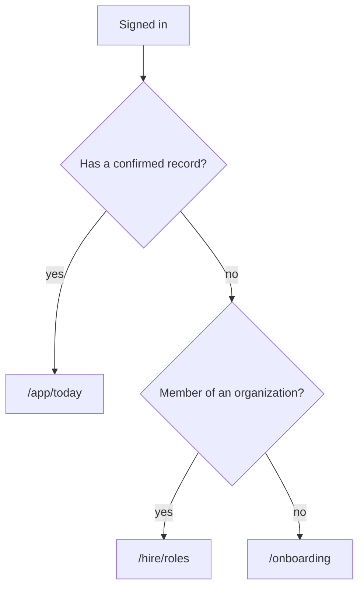
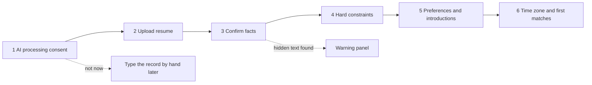
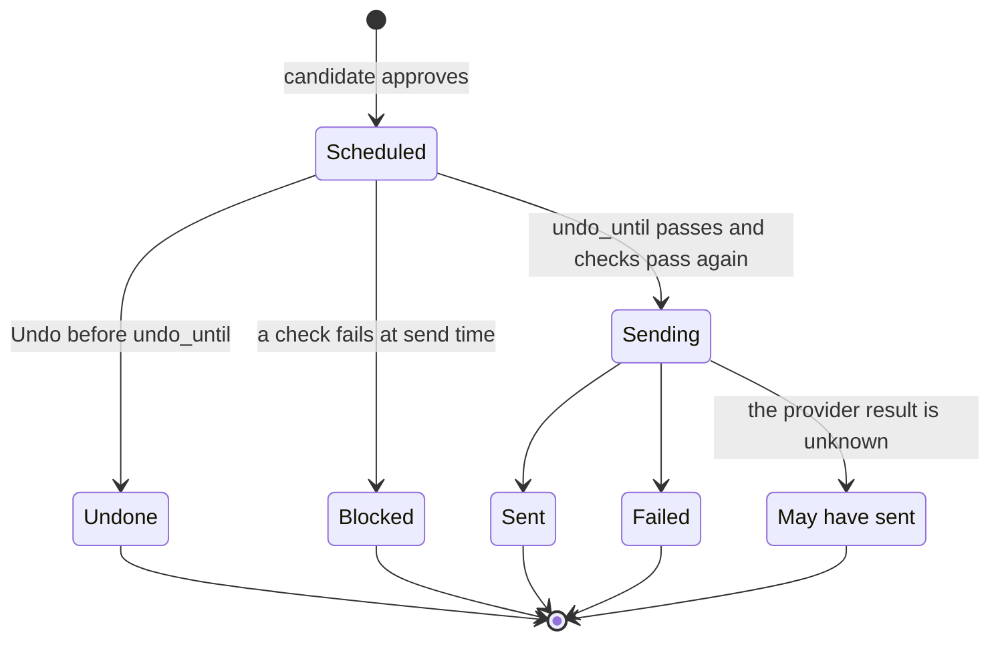
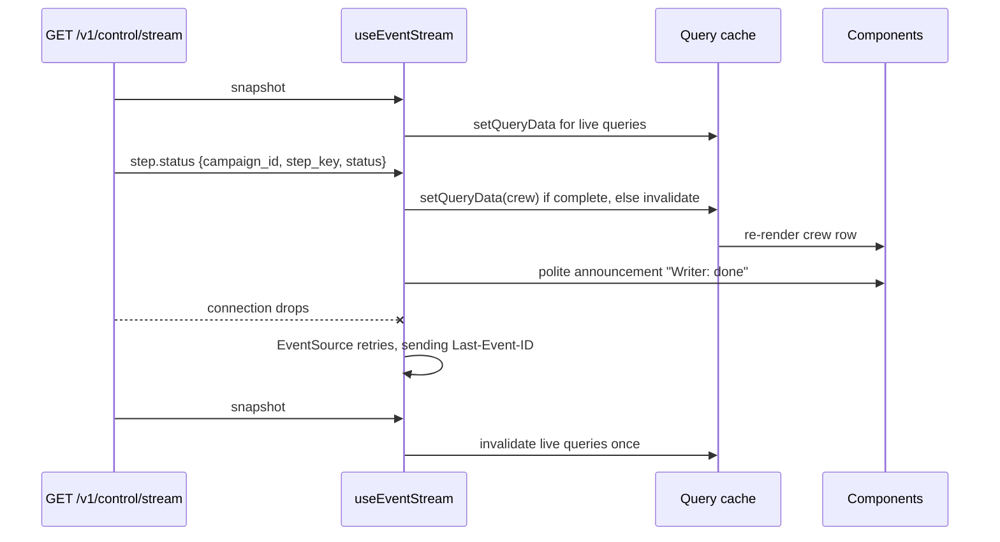

# Front-end and user interface design

| | |
|---|---|
| Status | Draft for review |
| Date | 2026-11-22 |
| Scope | The web app in `web/`: information architecture, every screen, interaction patterns, design system, content rules, accessibility, responsive behaviour, front-end architecture, budgets, testing and requirement traceability |
| Not in scope | Endpoint contracts (`API.md`), tables (`DATA_MODEL.md`), agent internals (`AI_SYSTEM.md`), backend flows (`ARCHITECTURE.md`) |
| Binding inputs | `OVERVIEW.md` (routes, entities, API groups, invariants), `REQUIREMENTS.md` (v1 ids), the design review (final vocabulary, routes and resolutions; it wins where this document once differed) |

OpenElip is a working name. The interface reads the product name from one constant so the public name can change in one place. The project is independent and not affiliated with Elip.

**About example content.** Every name in the wireframes below (Acme Co., Globex, Initech, Candidate A, Candidate B) is invented example content. Numbers in wireframes are placeholders that show layout, not measurements.

## Decisions at a glance

| Area | Decision | Why, in one line |
|---|---|---|
| Framework | Next.js 16.4 App Router, React 19.3, TypeScript strict | Fixed by OVERVIEW.md; current stable lines verified below |
| Styling | CSS Modules plus one global `tokens.css` of custom properties | The visual reference in earlier design notes (not published) is already written as CSS variables; zero added dependencies |
| Component primitives | React Aria Components | Accessible table, grid list, menu, dialog, radio group and tabs from one library |
| Server state | TanStack Query v5 on the client; Server Components for first paint | Cache, invalidation from live events, optimistic updates with rollback |
| API client | `openapi-typescript` types plus `openapi-fetch`, generated from the FastAPI schema | Typed calls with no hand-written client |
| Forms | React 19 `<form action>` with `useActionState`, native constraint validation, server errors mapped to fields | The API (Pydantic) is the single source of validation truth |
| Live updates | One native `EventSource` per tab on the per-user stream, plus one per chat reply; events update or invalidate queries | The browser's built-in client sends the session cookie and resumes after a drop |
| Charts, diffs, icons | Hand-written SVG bars, a small word-level diff, vendored SVG icons | Each is under a hundred lines; no library earns its weight |
| Tests | Vitest and Testing Library, Playwright, `@axe-core/playwright`, Playwright screenshots | One end-to-end tool for flows, accessibility and visual regression |

---

## 1. Design principles

Each principle is stated with the rule it imposes on screens. A design review checks the rules, not the slogans.

| Principle | What it means on screen | Rule a reviewer can check |
|---|---|---|
| Evidence is always one click away | Every claim the system makes (a verdict, a Twin answer, a resume edit, a dossier sentence, a number) carries a citation chip that opens the source | No claim text renders without a citation chip or an explicit "No evidence" label |
| Decisions before lists | A signed-in screen opens with what needs the person, then what was done, then everything else | The first focusable item on `/app/today`, `/hire/answers` and `/hire/shortlist/[roleId]` is a decision or an owed answer when one exists |
| Nothing happens silently | Every agent action appears in "what was done", in the campaign timeline and in the flight recorder; blocked actions are shown, not hidden | Each action type in the autonomy dial has a visible trace on at least one screen |
| Unknown is shown as unknown | Missing values are named ("Not stated", "No evidence", "Unknown", "Not measured yet"), never blank, zero or guessed | No component accepts `null` without a declared unknown label |
| Density with calm | Tables, mono labels and tight rows carry a lot of information; calm comes from one accent per view, no motion that loops, no badges that shout | At most one primary (filled) button per card and one accent element per view region |
| The person decides | The interface prepares; outside actions need the candidate's approval unless the candidate chose otherwise where allowed, and follow-up emails also wait in an undo window; the system never submits an application | No outgoing action fires from a default, a timer or a page load |
| Numbers come from records | A quality or performance number resolves to a recorded eval run; a cost, count or timing from the ledgers is labelled as measured operational data (invariant 8) | Every metric component takes a source reference prop and renders "Not measured yet" without one |

---

## 2. Information architecture

### 2.1 Surfaces and audiences

| Surface | Routes | Audience | Job |
|---|---|---|---|
| Public pages | `/`, `/jobs`, `/trust`, `/sign-in`, `/unsubscribe` | Anyone | Explain the product honestly, search the job index without an account, list providers and sub-processors, sign in, unsubscribe |
| Candidate app | `/onboarding`, `/app/*` | Every signed-in account (every account is a candidate) | Make decisions, read evidence, watch campaigns, own the record |
| Hiring desk | `/hire/*` | Organization members (role `member`, `admin` or `owner`) | Describe roles, read said-yes shortlists, ask Twins, answer every introduction |
| Mission control | `/control/*` | Every signed-in person, own data only; the eval scoreboard is readable by any signed-in user | Watch one's own agents, replay one's own steps, see one's own cost, read the scoreboard |

There is no operator or admin web view in v1. The instance operator (the person who runs an installation) works only through the command line and configuration, and has no access to candidate content. Instance-wide views are deferred to v2 (owner decision G8). In this document "the Operator role" always means the crew member that prepares application packets.

| Role (as agreed in the design review) | What the web app offers |
|---|---|
| Candidate | The candidate app and mission control for their own data |
| Organization member | The hiring desk for that organization |
| Organization admin | As member, plus members and organization agent tokens on `/hire/team` |
| Organization owner | As admin; the last owner cannot be removed |
| Agent token | No web access; tokens are accepted only at `/mcp` |
| Instance operator | No web access; command line and configuration only |

### 2.2 Route map

The route list is the one in OVERVIEW.md, as updated by the design review. Five routes (`/sign-in`, `/onboarding`, `/app/matches/[id]/tailor`, `/hire/team`, `/unsubscribe`) were first proposed by this document and are now canonical.

| Route | Surface | Purpose | Requirements |
|---|---|---|---|
| `/` | Public | What the product does, honest status, links to `/jobs` and `/trust` | DOC-01 (statement of independence), EVL-05 |
| `/jobs` | Public | Search open jobs with source and last-verified time | IDX-04, IDX-05, IDX-06 |
| `/jobs/[id]` | Public | One job: fields, source and verified-open time, requirements with highlighted spans | IDX-05, IDX-06, IDX-08 |
| `/trust` | Public | Model providers, sub-processors, data handling, invariants | TRU-04, PLT-05, TRU-05 |
| `/sign-in` | Public | Emailed one-time code | PLT-02 |
| `/unsubscribe` | Public | One-click brief unsubscribe from an email link | BRF-03 |
| `/onboarding` | Candidate | AI processing consent, resume upload, fact confirmation, constraints, preferences, time zone, first matches | TRU-05, REC-01 to REC-04, REC-06, REC-07 |
| `/app/today` | Candidate | Morning brief: decisions, introductions, what was done, today's matches, "why not" tab | BRF-01, BRF-02, MAT-02, MAT-06, MAT-07, HIR-04, TWN-02 |
| `/app/matches/[id]` | Candidate | Requirement evidence table with highlight, save, dismiss, start campaign | MAT-03 to MAT-05, MAT-07, MAT-08, CMP-01 |
| `/app/matches/[id]/tailor` | Candidate | Tailoring diff review and export | TLR-01 to TLR-03 |
| `/app/campaigns` | Candidate | Campaign board | CMP-01, CMP-07, APP-01 |
| `/app/campaigns/[id]` | Candidate | Timeline, packet, dossier, crew, prep, follow-ups, pause and cancel | CMP-02 to CMP-05, CMP-07, APP-02, GRD-04 to GRD-07 |
| `/app/record` | Candidate | One-page record with change log | REC-02 to REC-05, CHT-03 |
| `/app/twin` | Candidate | Twin topics, questions waiting for the candidate, every question and answer | TWN-02 to TWN-04 |
| `/app/settings` | Candidate | Autonomy dial, brief, introductions and blocked employers, agent tokens, privacy, theme | GRD-01, BRF-03, HIR-07, NET-01, NET-03, TRU-01 to TRU-03, TRU-05, UI-03 |
| `/hire/roles` | Hiring desk | Roles list, organization setup when none exists | HIR-01, HIR-02, HIR-06 |
| `/hire/roles/[id]` | Hiring desk | Role intake, confirmed requirements, pay range, anonymous preview, publish and close | HIR-02, HIR-03 |
| `/hire/shortlist/[roleId]` | Hiring desk | Candidates who accepted, with the shared preview; answer each | HIR-05, HIR-06, HIR-08, TWN-01 |
| `/hire/conversations` | Hiring desk | Ask a candidate's Twin | TWN-01, TWN-02 |
| `/hire/answers` | Hiring desk | Answer clock | HIR-06 |
| `/hire/team` | Hiring desk | Create organization, members, organization agent tokens | HIR-01, NET-01, NET-02 |
| `/control/runs` | Mission control | The person's own agent runs, including the nightly match run | GRD-06, GRD-02 |
| `/control/recorder` | Mission control | Step-by-step replay of the person's own runs with evidence, checks and cost | GRD-03, GRD-02, CHT-04, NET-03, TRU-03 |
| `/control/evals` | Mission control | Scoreboard of recorded eval runs only, for any signed-in user | EVL-01 to EVL-05 |
| `/control/costs` | Mission control | The person's own model cost per campaign and per month | GRD-05, PLT-04 |

State that belongs in the URL instead of a new route: the "why not" view (`/app/today?view=why-not`), the open decision or introduction (`/app/today?decision=<id>`, so an email link can open it), settings sections (`/app/settings?section=privacy`), recorder filters (`/control/recorder?campaign=<id>&step=<id>`), job search query and filters, board filters, and the selected evidence row (`/app/matches/[id]?req=<id>`), the selected requirement on a job page (`/jobs/[id]?req=<ordinal>`).

### 2.3 Navigation model

**Desktop (1024 px and wider).** A left rail, 220 px wide, holds the current surface's sections, a surface switcher at the top (Candidate app and Mission control for everyone, Hiring desk for organization members), and the account menu at the bottom. The candidate rail shows a count beside Today when decisions are waiting. An "Ask" button at the bottom of the candidate rail opens the chat panel on the right.

**Tablet (640 to 1023 px).** The rail collapses to 64 px icons with visible text labels underneath (labels are never hidden behind hover).

**Phone (below 640 px).** A bottom bar with the surface's sections. The candidate app has exactly five (Today, Campaigns, Record, Twin, Settings), the hiring desk four plus Team in the account menu, mission control four. Chat opens from a floating button above the bar on candidate screens and takes the full screen as a sheet.

```
Desktop shell (candidate)
+--------------------+-----------------------------------------------+
| [OpenElip]  v      |  Page title                      (o) Live     |
|  Candidate app     |-----------------------------------------------|
|--------------------|                                               |
|  Today         (4) |                                               |
|  Campaigns         |              page content                     |
|  Record            |                                               |
|  Twin          (1) |                                               |
|  Settings          |                                               |
|                    |                                               |
|  [ Ask the agent ] |                                               |
|  Account / theme   |                                               |
+--------------------+-----------------------------------------------+
```

### 2.4 Role-based entry



Every account is a candidate, so the candidate app and mission control are always available; the hiring desk appears for organization members. An organization member who never intends to job-hunt is not pushed through onboarding: the candidate app shows onboarding only when they open it. The surface switcher remembers the last surface per browser. Deep links always win over the default: a link to `/hire/answers` from an email lands there after sign-in.

---

## 3. Screen specifications

### 3.0 States every screen implements

To avoid repeating the same paragraph 25 times, these states are specified once. Each screen below lists only what differs. Error codes are those in `API.md` section 1.11.

| State | Behaviour |
|---|---|
| Loading | Server Components render the first paint with data, so most screens have no loading state on first visit. Client refetches show the previous data with a thin progress line at the top of the region. Skeletons appear only for regions that load after first paint, and they match the final layout so nothing shifts. |
| Empty | A sentence that says why it is empty and the one action that changes that. Never an illustration on its own. |
| Error | The region that failed shows an error panel with what failed, whether anything was lost, and a Retry button. The rest of the page keeps working. A route-level `error.tsx` catches render errors. |
| Partial | When some items fail (one match's evidence did not resolve, one step failed), the good items render and the failed ones show a labelled placeholder with the reason. |
| AI off on this server (`503 ai_disabled`) | Shown where a feature needs a model (resume extraction, requirement extraction, evidence scoring, chat, tailoring, campaigns, Twin). Text: "AI features are not set up on this server. Search and everything already saved still work." with a link to the public setup guide. Search, `/jobs`, the record and history stay available. The signed-in `capabilities` list from `GET /v1/me` lets the UI show this before a call fails. |
| AI processing not agreed (`403 consent_required`, purpose `ai_processing`) | "AI features are off because you have not agreed to AI processing." with "Review and agree", which opens the AI processing consent sheet listing the providers (TRU-05). Search, the record and history still work. |
| Other missing consent (`403 consent_required`, another purpose) | The matching consent sheet opens (introductions, agent access, brief email). |
| Conflict (`409 already_resolved`, `409 conflict`, `412 version_conflict`) | "This changed in another tab or by an agent. Showing the latest." The region refetches; nothing the person typed is discarded. |
| Signed out or session expired | `proxy.ts` (the Next.js request hook) redirects to `/sign-in?next=<path>`. An expired session mid-use (`401 unauthenticated`) opens a sign-in dialog over the page so unsaved text is kept. |
| Forbidden (`403 forbidden`) or not found (`404 not_found`) | The same page for both: "You do not have access to this, or it does not exist." with a link to the surface the person can use. |
| Live stream lost | The header indicator changes from "Live" to "Reconnecting". After 30 seconds without a connection it reads "Updates paused" with a Refresh button. Data on screen stays. |
| Demo data | When the server runs the seeded demo (DOC-02), a persistent banner reads "Demo data: every person and company here is invented." |

### 3.1 Sign-in (`/sign-in`)

**Purpose.** Sign in with an emailed one-time code (PLT-02). **Who.** Anyone. **Data.** `/v1/auth` (request a code, then create a session). The session is an `HttpOnly` cookie that lasts 30 days from last use and at most 90 days in total; sign-out revokes it.

```
+---------------------------------------------+
|  OpenElip                                   |
|                                             |
|  Sign in                                    |
|  We will email you a one-time code.         |
|                                             |
|  Email  [ you@example.com              ]    |
|         [ Send code ]                       |
|                                             |
|  -- after sending --                        |
|  Code sent to you@example.com. Change       |
|  Code   [ _ _ _ _ _ _ ]  (paste allowed)    |
|         [ Sign in ]   Resend in 0:45        |
+---------------------------------------------+
```

**Phone.** Same single column. The code field uses `inputmode="numeric"` and `autocomplete="one-time-code"` so phones offer the code from the message.

**Actions.** Send code; enter code; resend after a cooldown; change email. **States.** `401 code_invalid`: "That code does not match or has expired. Check it, or send a new one." `429 rate_limited`: "Too many attempts. Try again in a few minutes." (with the time when the response gives one). Email sending not set up on this server: "This server cannot send email yet. Ask the person who runs it." The page never says whether an email has an account. **Requirements.** PLT-02, WCAG 3.3.8 (pasting is allowed; no cognitive test).

### 3.2 Onboarding (`/onboarding`)

**Purpose.** Turn a resume and a short conversation into a confirmed record and show first matches in the same session. **Who.** A candidate without a confirmed record. **Data.** `/v1/privacy` (providers, consent), `/v1/me` (documents, facts, constraints, preferences, time zone), `/v1/chat` (session kind `onboarding`), `/v1/autonomy` and `/v1/twin` (only for the optional Twin switch), `/v1/matches`. The step is URL state (`?step=facts`) so refresh and back work.



**Step 1, AI processing (TRU-05).** A consent sheet (section 4.6) names each model provider from `/v1/privacy/subprocessors`, what is sent to it and why. "Agree" records the `ai_processing` consent. "Not now" continues without AI: the resume cannot be read automatically, so the candidate goes to step 4 and can type facts on `/app/record` later; search works. The sheet is shown again when the provider list changes.

**Step 2, upload.** A drop zone that is also a button ("Choose a PDF or DOCX, up to 10 MB"). Progress names the stage ("Reading text", "Extracting facts"), read by polling the long-running status (`queued`, `running`, `succeeded`, `failed`), not a fake bar. `413 payload_too_large` and `415 unsupported_media_type` show the limit and the accepted types.

**Step 3, confirm facts.**

```
+-----------------------------------------------------------------------+
| Step 3 of 6   Check what we read                         12 to review |
|-----------------------------------------------------------------------|
| ! We removed 2 pieces of hidden text from your file (white text,      |
|   off-page). They are not used. [See what was removed]               |
|-----------------------------------------------------------------------|
| FACT                              FROM YOUR RESUME           STATUS   |
| Backend engineer, Globex          L4  "Backend Engineer,      [Confirm]|
| 2021-03 to 2024-06                    Globex, Mar 2021 -      [Fix]    |
|                                       Jun 2024"               [Reject] |
| Python, 5 years                   L6-L9 "Built and ran ..."   Confirmed|
| Led 4 engineers                   L12 "Led a team of four"    [Confirm]|
|-----------------------------------------------------------------------|
| [Confirm all remaining]  (each still reviewable later)   [Continue ->]|
+-----------------------------------------------------------------------+
Example content.
```

Each fact shows the resume line that contains its source span (REC-01). "Fix" opens the fact inline with the source line beside it; saving creates a corrected fact with source `candidate_edit` and marks the old one superseded. Only confirmed facts are used anywhere (REC-02); the Continue button states how many facts remain "To review" and that they are ignored until confirmed. Hidden or off-page text is listed with what it said (REC-06).

**Step 4, hard constraints.** A guided intake, one constraint per card: location, remote policy, work authorization, salary floor (amount, currency, period), employment type, seniority, excluded companies (REC-03). Each card shows the agent's restatement ("You will never see jobs that pay less than INR 30,00,000 a year.") and a Confirm button. Skipping a constraint is allowed and shown as "Not set (not enforced)". A dealbreaker the API cannot enforce (`422 constraint_not_enforceable`) is offered as a preference instead, with the notice from step 5.

**Step 5, preferences and introductions.** Free text and chips for soft preferences, with the notice "We cannot check this in job data, so it is a preference, not a guarantee." (REC-04). If the candidate volunteers a protected characteristic (age, religion, health, family status and similar), a notice reads "We do not keep this in your record." and it is not saved to the Career Record (REC-07; the exact scope follows owner decision G4). Two explicit choices with nothing pre-selected:
- "Open to introductions from employers" (Yes or Not now), which records the `open_to_introductions` consent.
- Only if the owner accepts G2: "Let my Twin answer from my confirmed record" (default off). On, it sets the Twin answers dial row to Tell me after and the topics experience, skills, education and projects to Answer; current pay and contact details stay Never.

**Step 6, time zone and first matches.** The time zone is detected from the browser and confirmed ("Your brief arrives by 07:00 in Asia/Kolkata. Change"). Then up to five matches appear with the same cards as Today; they count toward today's five. Zero is valid: "Nothing in the current index meets your constraints well enough yet. Your first brief arrives tomorrow by 07:00."

**Phone.** One step per screen, sticky Continue button at the bottom; the facts table becomes one card per fact with the source line under the fact. **States.** Unreadable file ("We could not read text from this file. If it is a scanned image, upload a text PDF or a DOCX."); extraction partly failed (facts that were read are shown, the rest listed by section); AI not agreed (steps 2 and 3 are skipped with a note). **Requirements.** TRU-05, REC-01 to REC-04, REC-06, REC-07, BRF-01 (time zone).

### 3.3 Today (`/app/today`)

**Purpose.** The morning brief: decisions that need the candidate, introductions waiting for an answer, what was done since the last brief, and today's matches (BRF-02, MAT-02). **Who.** Candidate. **Data.** `/v1/briefs` (brief and its items of kind `match`, `approval`, `activity`, `introduction`; readiness is polled), `/v1/approvals` (pending approvals), `/v1/introductions` (asks waiting for the candidate), `/v1/matches`, `/v1/decisions` (the why-not ledger).

```
+---------------------------------------------------------------------------+
| Today, Sun 22 Nov                         Brief sent 06:58 IST   (o) Live |
| Four decisions need you.                                                 |
|---------------------------------------------------------------------------|
| [ Decisions (4) ]  [ Matches (3) ]  [ Why not ]                          |
|---------------------------------------------------------------------------|
| APPLICATION PACKET  Senior Backend Engineer, Acme Co.                     |
|              Meets 4 of 5 required. Packet ready for you to submit on    |
|              their site. Verified open 06:12.                             |
|              [Approve packet]  [Edit]  [Skip]                             |
|---------------------------------------------------------------------------|
| INTRODUCTION Globex asks about Platform Engineer                         |
|              See exactly what they would receive. Expires 29 Nov.         |
|              [Review and accept]  [Decline]                               |
|---------------------------------------------------------------------------|
| FOLLOW UP    Initech, no reply in 7 days. Two-line note to the address  |
|              you entered.        [Approve]  [Edit]  [Skip]                |
|---------------------------------------------------------------------------|
| TWIN ANSWER  Acme Co. asked: notice period? Not in your record.          |
|              [Reply]  [Decline to answer]                                 |
|===========================================================================|
| WHAT WAS DONE SINCE FRI 21 NOV, 07:00   (measured operational data)      |
|  Researched 3 companies           Drafted 2 follow-ups                   |
|  Prepared 1 packet                Blocked 1 action  -> see why            |
|  Scanned 1,240 open jobs  (match run 7f3a)                               |
+---------------------------------------------------------------------------+
Example content.
```

**Phone.** Tabs become a segmented control under the title. Decision cards stack full width with buttons in one row (wrapping when needed). "What was done" sits below the decisions as a two-column list.

**Matches tab.** Zero to five match cards (MAT-02): title, company, location (or "Location not stated"), the requirement summary ("Meets 4 of 5 required"), constraint notes ("Pay: not stated (unverified)"), source board and "Verified open 06:12" (IDX-05, IDX-07). A job shown again because it changed (reason `material_change`) carries a "Changed since you saw it" pill and a one-line summary of what changed (MAT-07).

**Why-not tab.** Withheld and filtered jobs grouped by reason code with counts and examples, using the labels in section 6.2 ("Filtered by your constraints (212)", "Withheld: a citation did not resolve (2)", "Below today's five (31)"). Each row opens the job and the specific rule (MAT-06, MAT-05).

**Actions.** Decision card actions (section 4.1); accepting or declining an introduction (section 4.6); open a match; open why-not; open the recorder from any "what was done" line. **States.** No brief yet (first day): "Your first brief arrives by 07:00 tomorrow." Brief paused: banner with "Resume brief". No decisions: the Matches tab is selected by default and the header reads "Nothing needs you today." **Requirements.** BRF-01, BRF-02, MAT-02, MAT-05, MAT-06, MAT-07, IDX-05, IDX-07, CMP-03, CMP-04, HIR-04, TWN-02.

### 3.4 Match detail (`/app/matches/[id]`)

**Purpose.** Show why a job fits, requirement by requirement, with every claim highlighted in the job text and the resume (MAT-03, MAT-04). **Who.** Candidate. **Data.** `/v1/matches` (match, evidence, constraint checks, change summary), `/v1/jobs` (job text with requirement spans), `/v1/me` (resume text by line).

```
+------------------------------------------------------------------------------+
| Senior Backend Engineer, Acme Co.          Greenhouse  Verified open 06:12   |
| Bengaluru or remote (India)          Pay: not stated in the posting          |
| [Start campaign]  [Tailor resume]  [Save]  [Dismiss...]                      |
|------------------------------------------------------------------------------|
| REQUIREMENT (from the job)        KIND      VERDICT       YOUR EVIDENCE       |
| > "5+ years of Python in prod"    required  [v Met]       L4-L9 Python, 5 yr  |
|   "PostgreSQL at scale"           required  [~ Partly met] L14 MySQL at scale |
|   "Kubernetes"                    preferred [? No evidence] Record is silent  |
|   "Owns on-call rotations"        required  [x Not met]   L12 states no on-call|
|------------------------------------------------------------------------------|
| JOB TEXT                               | YOUR RESUME                         |
| ...We are looking for an engineer with | 4  Backend Engineer, Globex          |
| [5+ years of Python in production]     | 5  Mar 2021 to Jun 2024              |
| who has run PostgreSQL at scale...     | 6  [Built and ran Python services]   |
|                                        | 7  [...]                             |
+------------------------------------------------------------------------------+
Example content.
```

Selecting a row (click, Enter, or Space) highlights the exact job sentence and the resume lines that contain the cited fact's span, and scrolls both panes to them (section 4.2). The selected row is URL state (`?req=`). Constraint checks appear in a small table under the requirements: each hard constraint the candidate set, with "Satisfied" or "Not stated (unverified)"; an unknown value passes a constraint and is shown that way. A job that violates a hard constraint never reaches this page (invariant 1); if a stale link points to one, the page shows "This job no longer meets your constraints" with the reason and no evidence table.

**Start campaign** approves the match and starts a campaign at Researching (CMP-01). **Dismiss with reason (MAT-08).** A menu of reasons ("Too senior", "Wrong location", "Not my field", "Company", "Other"). Some reasons return a proposed record change ("Add an excluded company: Acme Co.?"), shown as a proposal card that changes nothing until confirmed.

**Phone.** The requirement table becomes stacked rows (requirement, verdict pill, evidence line). Selecting a row opens a bottom sheet showing the job quote above the resume quote, each with its highlight and a "Show in full text" link. The two text panes become tabs ("Job text", "Your resume").

**States.** Job closed (`410 job_closed`): banner "This job closed on 21 Nov. Kept here for your records." and Start campaign disabled with that reason. Evidence withheld (MAT-05): the job does not appear as a match; a stale link shows "Withheld: a citation did not resolve". Job changed: "Changed since you saw it: pay range added." **Requirements.** MAT-03, MAT-04, MAT-05, MAT-07, MAT-08, IDX-05, IDX-08 (spans), CMP-01.

### 3.5 Tailoring review (`/app/matches/[id]/tailor`)

**Purpose.** Review proposed resume edits for one job, edit by edit, and export (TLR-01 to TLR-03). **Who.** Candidate. **Data.** `/v1/tailored-resumes` (proposals, verifier results, discarded count, export).

```
+-----------------------------------------------------------------------------+
| Tailored resume for Senior Backend Engineer, Acme Co.                      |
| 6 edits proposed. 2 discarded before you saw them  [why]                   |
| Approved 3   Rejected 1   Undecided 2          [Export PDF] [Export DOCX]  |
|-----------------------------------------------------------------------------|
| EXPERIENCE, Globex, bullet 2                                     Edit 1 of 6|
|  - Built Python services for payments                                      |
|  + Built and ran Python services for payments at 2,000 requests a second   |
|  Supported by: L6 "Built and ran ...", fact "Throughput 2,000 rps"        |
|  [Approve]  [Reject]                                          Approved v   |
|-----------------------------------------------------------------------------|
| SKILLS                                                           Edit 2 of 6|
|  - Python, Go, MySQL                                                       |
|  + Python, MySQL, Go                                                       |
|  Reordered to match the job's emphasis. No new skills.                     |
|  [Approve]  [Reject]                                                       |
+-----------------------------------------------------------------------------+
Example content.
```

The discarded count is always visible and links to the recorder entries that explain each discard (TLR-02). Export uses the approved edits only; undecided edits are left out, and the export button says so ("Export with 3 approved edits; 2 undecided are left out"). **Phone.** Unified diff only (removed line above added line), one edit per card, Approve and Reject as full-width buttons. **States.** Verifier still running (edits appear as they pass); all edits discarded ("Every proposed edit added something your record does not contain, so none are shown. Your resume is unchanged."); export failed (retry, edits kept). **Requirements.** TLR-01, TLR-02, TLR-03, invariant 3.

### 3.6 Campaign board (`/app/campaigns`)

**Purpose.** Every campaign on one board by stage (CMP-01). **Who.** Candidate. **Data.** `/v1/campaigns`, `/v1/applications`, `/v1/approvals` (pending counts for badges).

```
+----------------------------------------------------------------------------------+
| Campaigns                       Filter: [All] [Needs you]   Show closed [ ]      |
|----------------------------------------------------------------------------------|
| RESEARCHING(2)| NEEDS YOU (1) | APPLIED (2)  | TALKING (1) | INTERVIEW(1)| OFFER(1)|
| +-----------+ | +-----------+ | +----------+ | +---------+ | +---------+ | +------+|
| | Hooli     | | | Acme Co.  | | | Globex   | | | Wayne   | | | Umbrella| | |Soylent|
| | dossier   | | | packet    | | | day 7    | | | they    | | | Thu     | | |offer  |
| | 3 of 5    | | | ready     | | | [Needs   | | | said yes| | | 15:00   | | |logged |
| | [:]       | | | [:]       | | |  you]    | | | [:]     | | | prep [:]| | | [:]  |
| +-----------+ | +-----------+ | | [:]      | | +---------+ | +---------+ | +------+|
|               |               | +----------+ |             |             |         |
|               |               | | Initech  | |             |             |         |
|               |               | | from an  | |             |             |         |
|               |               | | intro.   | |             |             |         |
|               |               | | [Paused: | |             |             |         |
|               |               | |  budget] | |             |             |         |
+----------------------------------------------------------------------------------+
Example content.  [:] = "Record status..." menu
```

The stages are `researching`, `needs_you`, `applied`, `talking`, `interview`, `offer`, `closed` (labels in section 6.2). Approving a match starts a campaign at Researching; accepting an introduction starts one at Applied, tagged "From an introduction". Needs you is a stage only before Applied; after that, a pending approval (for example a drafted follow-up) shows as a "Needs you" badge on the card and the card does not move. A paused campaign stays in its column with a pill that names the reason: "You paused", "Budget reached" or "Possible scam". Closed campaigns are hidden by default and shown in a seventh column when "Show closed" is on, each with its closing reason: Rejected, No response, Cancelled, Job closed, Offer accepted, Offer declined.

**Recording a status.** Stages mostly move by themselves from campaign events. The candidate records application progress through each card's "Record status..." menu, using APP-01's statuses: Applied, Interview, Offer, Rejected, No response. Recording one moves the linked campaign (Applied to Applied, Interview to Interview, Offer to Offer, Rejected and No response to Closed with that reason). Talking is a campaign stage only and is reached when an employer says yes. There is no drag and drop in v1: these changes are rare and meaningful (Interview starts the Coach), a menu is the WCAG 2.5.7 single-pointer alternative anyway, and dropping drag removes a whole class of bugs.

**Phone.** One column at a time with a horizontally scrollable stage selector showing counts ("Needs you 1"). Cards are full width. **States.** No campaigns: "A campaign starts when you approve a match or accept an introduction. Today has 3 matches." with a link. **Requirements.** CMP-01, CMP-07, APP-01, GRD-07.

### 3.7 Campaign detail (`/app/campaigns/[id]`)

**Purpose.** Everything about one opportunity: what happened, what is being prepared, which agents are working on it, and the controls to stop it. **Who.** Candidate. **Data.** `/v1/campaigns` (timeline, dossier, steps, budget), `/v1/applications` (packet, status), `/v1/approvals`, `/v1/control` (cost and recorder rows for this campaign), `/v1/introductions` (for campaigns started by an introduction), `/v1/autonomy` (the default budget).

```
+------------------------------------------------------------------------------+
| Acme Co., Senior Backend Engineer            Stage: NEEDS YOU      (o) Live   |
| Started 18 Nov   Cost so far USD 0.41 of USD 0.75 budget  [Pause] [Cancel...] |
|------------------------------------------------------------------------------|
| [Timeline] [Packet] [Dossier] [Crew] [Prep] [Follow-ups]                     |
|------------------------------------------------------------------------------|
| CREW              STEP            STATUS              CHECKS                  |
|  RESEARCHER       research        Done                passed                  |
|    Dossier: 9 sources                                                         |
|  ANALYST          fit             Done                passed                  |
|    4 of 5 required met, citations valid                                       |
|  WRITER           packet_draft    Done                2 edits discarded       |
|    5 edits proposed                                                           |
|  OPERATOR ROLE    packet          Needs you                                   |
|    Waiting for you to approve the packet                                      |
|  CHASER           follow_up:1     Waiting until 2 Dec                         |
|  COACH            interview_prep  Queued                                      |
|  Each row opens its steps in the recorder.                                    |
+------------------------------------------------------------------------------+
Example content. The budget shown is an example; the default comes from GET /v1/autonomy.
```

The crew shown on a campaign is the Researcher, Analyst, Writer, Operator role, Chaser and Coach, each with the Guardian's check results for its step. The nightly match run (the Scout) is not part of a campaign and appears only in `/control/runs`. Step status labels are in section 6.2.

**Tabs.**
- **Timeline.** Every event newest first: stage changes, agent steps, approvals, follow-ups (with the undo countdown while one is Scheduled, section 4.5), blocked actions with reasons, and pauses with their reason.
- **Packet.** The application packet: tailored resume (link to its diff review), answers to common questions (each answer cites record facts; questions about pay, notice period or documents are left blank and marked "You answer this"), a short note, and the posting link. "Approve packet" approves the `submit_application` action (CMP-03). Approval releases the submit kit (download the resume, copy the answers, open the posting); the system never submits. When the candidate records Applied, the action is complete and the stage moves.
- **Dossier.** The one-page company dossier; each sentence carries a citation chip to its source URL, quote and fetch time (CMP-02).
- **Crew.** Live step status (GRD-06), as above.
- **Prep.** Coach output built from evidence gaps and the dossier (CMP-05); each point links to the gap row in the match evidence table.
- **Follow-ups.** At most two per campaign (`follow_up:1`, `follow_up:2`). Each draft names the recipient address the candidate typed; replies go to the candidate. Approve, Edit, Skip; nothing is sent without approval, and an approved follow-up waits in the undo window (CMP-04, GRD-04). Whether the platform sends at all is owner decision G1; if the owner chooses draft-only, Approve becomes "Copy and send it yourself".

A campaign started by an accepted introduction has only the research and interview-prep steps, so its Packet and Follow-ups tabs are absent; its header shows the employer's answer clock ("Acme Co. owes an answer by 25 Nov").

**Pause and cancel (CMP-07).** Pause stops all agent work and holds any scheduled follow-up; the header shows "Paused 22 Nov 09:14 (you paused)" and Resume. Cancel asks for confirmation and lists what will stop (pending approvals expire, a scheduled follow-up is cancelled, queued steps stop) and what cannot be undone (anything already sent); the campaign closes as Cancelled. A linked introduction is not withdrawn: the employer still owes an answer.

**Guardian pauses (GRD-07).** When the campaign reaches its budget the Guardian pauses it: "Paused: this campaign reached its USD 0.75 budget. Raise the budget and resume, or cancel." When a posting shows signs of a scam: "Paused: this posting shows signs of a scam." followed by the recorded reasons as plain sentences and "Resume anyway" or "Cancel". No scam score is shown. **Phone.** Tabs become a scrollable tab strip; crew rows drop the description to a second line. **Requirements.** CMP-02 to CMP-05, CMP-07, APP-02, GRD-02 to GRD-07.

### 3.8 Record (`/app/record`)

**Purpose.** The whole Career Record on one page, editable, with a change log (REC-05). **Who.** Candidate. **Data.** `/v1/me` (facts, constraints, preferences, documents, change log), `/v1/chat` (pending proposals).

```
+------------------------------------------------------------------------------+
| Your record                       Last changed 21 Nov 18:02    [Upload new]  |
|------------------------------------------------------------------------------|
| 1 change proposed by the agent: "Add excluded company: Acme Co."             |
|   [Confirm]  [Decline]                                                       |
|------------------------------------------------------------------------------|
| HARD CONSTRAINTS (enforced in code)                                          |
|   Location        Bengaluru, Pune, or remote in India         [Edit]         |
|   Salary floor    INR 30,00,000 a year                        [Edit]         |
|   Work auth.      India: citizen                               [Edit]         |
|   Seniority       Not set (not enforced)                       [Set]          |
| PREFERENCES (used for ranking, not guaranteed)                               |
|   "Small teams"   "No heavy travel" (could not be typed as a constraint)    |
| EXPERIENCE / SKILLS / EDUCATION                                              |
|   Backend engineer, Globex, 2021-03 to 2024-06    L4    Confirmed  [Edit]   |
|   ...                                                                        |
| DOCUMENTS   resume-2026-11.pdf (2 hidden text items removed)                 |
|------------------------------------------------------------------------------|
| CHANGE LOG                                                                   |
|  21 Nov 18:02  Salary floor  INR 28,00,000 -> INR 30,00,000  You, in chat    |
|  20 Nov 09:40  Fact "Led 4 engineers"  To review -> Confirmed  You         |
+------------------------------------------------------------------------------+
Example content.
```

Every change log row shows before, after, source (From your resume, Edited by you, Confirmed from chat) and time (REC-05). Agent proposals change nothing until confirmed (CHT-03). Editing a hard constraint shows what it will do ("From tomorrow's run, jobs below INR 30,00,000 are filtered out. Past matches are not rewritten."). **Phone.** Sections become collapsible groups with the change log last. **Requirements.** REC-02 to REC-05, CHT-03.

### 3.9 Twin (`/app/twin`)

**Purpose.** Set what the Twin may discuss, answer what it could not, and read every exchange (TWN-02 to TWN-04). **Who.** Candidate. **Data.** `/v1/twin` (topic settings, sessions, messages), `/v1/approvals` (pending `twin_answer` approvals), `/v1/autonomy` (the Twin answers dial row).

```
+------------------------------------------------------------------------------+
| Your Twin             Twin answers: Ask me first  [Change in Settings]       |
|------------------------------------------------------------------------------|
| WAITING FOR YOU (2)                                                          |
|  Acme Co. asked "Has the candidate led a team?"                              |
|   Draft: "Yes. Led four engineers on a payments migration." [resume L12]   |
|   [Approve]  [Edit]  [Skip]                                                  |
|  Acme Co. asked "What is your notice period?"  Not in your record.           |
|   [ Your reply .......................................... ]                  |
|   [ ] Also add this to my record (proposed change)                          |
|   [Send reply]  [Decline to answer]          Expires 25 Nov                  |
|------------------------------------------------------------------------------|
| WHAT YOUR TWIN MAY DISCUSS          Answer   Ask me   Never                 |
|  Experience                          ( )      (o)      ( )                   |
|  Skills                              ( )      (o)      ( )                   |
|  Availability                        ( )      (o)      ( )                   |
|  Expected pay                        ( )      ( )      (o)                   |
|  Current pay                         locked at Never                         |
|  Contact details                     locked at Never                         |
|  (12 topics in all)                                                          |
|------------------------------------------------------------------------------|
| CONVERSATIONS                                                                |
|  Acme Co. (Senior Backend Engineer)   6 questions   last 22 Nov   [Open]   |
|    Q "Has the candidate led a team?"                       Answered         |
|    A "Yes. Led four engineers on a payments migration."  [resume L12]      |
+------------------------------------------------------------------------------+
Example content.
```

Two settings with separate jobs. The topic list says what the Twin may discuss: each of the twelve topics (experience, skills, education, projects, availability, work authorization, location, expected pay, motivation, current pay, contact details, other) is Answer, Ask me or Never; with no setting a topic is Ask me; current pay and contact details are always Never and say why (TWN-03). The Twin answers row of the autonomy dial (Settings) says whether the candidate approves each answer; its default is Ask me first.

The Twin exists for an employer only after the candidate accepted an introduction (TWN-01), so conversations list only accepted employers. Everything in "Waiting for you" is a pending `twin_answer` approval: either a drafted answer with citations to approve, edit or skip, or a question the record cannot answer, which the candidate approves by writing a reply (TWN-02). A reply can also propose a record change. If an approval expires, the Twin tells the employer it declined. Approved answers are posted at once; there is no undo window for Twin answers, and the screen says so above the Send button. **Phone.** Waiting items first, topics in a collapsible group, conversations as a list that opens a full-screen transcript. **Requirements.** TWN-02, TWN-03, TWN-04.

### 3.10 Settings (`/app/settings`)

**Purpose.** Every control the candidate has over the system. Sections are URL state (`?section=`). **Who.** Candidate. **Data.** `/v1/autonomy`, `/v1/briefs` (frequency), `/v1/me` (time zone, blocked employers, agent tokens at `/v1/me/agent-tokens`), `/v1/privacy` (consents, export, delete, audit log, sub-processors).

| Section | Contents | Requirements |
|---|---|---|
| Autonomy | The autonomy dial (section 4.4) and the default campaign budget from `/v1/autonomy` (read only here; a campaign's own budget is raised on its page) | GRD-01, GRD-07 |
| Brief | Daily, weekly or paused; delivery time zone; brief email on or off (the `brief_email` consent); one-click unsubscribe status | BRF-01, BRF-03 |
| Introductions | "Open to introductions from employers" (the `open_to_introductions` consent); blocked employers: add a company by name (autocomplete from the index, free text allowed), list with remove | HIR-04, HIR-07 |
| Agent tokens | Create a token for your own agent: name, scopes ("Search my matches" `matches:read`, "Read explanations" `explanations:read`), lifetime 1 to 90 days (default 30). Creating the first token shows the agent-access consent sheet. The secret (prefix `agt_`) is shown once with Copy. List with state (Active, Revoked, Expired), last used, and Revoke. A refused-calls log per token; a token refused 20 times in an hour is rate-limited until the hour ends | NET-01, NET-03 |
| Privacy | AI processing: the providers named, the date agreed, Withdraw (AI features then turn off) and a prompt to agree again when the provider list changes. Export all data (a long-running job, polled; then a download link, kept 7 days). Audit log of every automated decision, filterable, each row linking to the recorder. Delete account | TRU-01, TRU-02, TRU-03, TRU-05 |
| Appearance | Theme: system, light, dark | UI-03 |

**Delete account.** A dialog lists what will be removed (record, documents, embeddings, campaigns, messages, introductions and Twin threads, tokens) and states that copies made outside the system, such as an email an employer already received, cannot be reached. Confirming requires a fresh one-time code emailed for this purpose. After deletion the person is signed out to a confirmation page. **Phone.** A section list that opens each section as its own screen. **Requirements.** As listed.

### 3.11 Chat panel (candidate surface, no route)

**Purpose.** Ask the agent about the record, matches and decisions; search on request; propose record changes (CHT-01 to CHT-03). **Who.** Candidate. **Data.** `/v1/chat` (session kind `open`; onboarding uses kind `onboarding`). Each reply streams over its own `EventSource` on the chat reply stream (`message.start`, `text.delta`, `tool.start`, `tool.result`, `citation`, `proposal`, `message.snapshot`, `message.end`, `error`); `proposal` events become proposal cards.

```
+--------------------------------------+
| Ask the agent         context: Acme  X|
|--------------------------------------|
| You: Why is Kubernetes "no evidence"?|
| Agent: Your record does not mention  |
|  Kubernetes. The job lists it as     |
|  preferred, not required.            |
|  [match 81c2, row 3] [record: skills]|
|                                      |
| Proposed change                      |
|  Add skill "Kubernetes (basic)"?     |
|  Source: what you said just now      |
|  [Confirm] [Decline]                 |
|--------------------------------------|
| [ Ask about your matches...    ] [>] |
+--------------------------------------+
Example content.
```

The panel knows the page it was opened from and says so ("context: Acme"); the context can be cleared. Search results inside chat say "Your hard constraints were applied" (CHT-02). Proposals are cards with Confirm and Decline; the record changes only on Confirm (CHT-03). Streaming text is announced once when complete, not token by token (section 7). If job text tried to instruct the agent, the answer is unaffected and the recorder shows the flagged text (CHT-04); the chat itself does not repeat injected text. **Phone.** Full-screen sheet; the composer sticks above the keyboard. **States.** No model key: the panel shows the standard notice and offers search instead. **Requirements.** CHT-01, CHT-02, CHT-03, CHT-04.

### 3.12 Roles (`/hire/roles`)

**Purpose.** List the organization's roles and what is owed. **Who.** Organization member. **Data.** `/v1/orgs` (organization, answer clock), `/v1/roles`, `/v1/introductions` (owed counts).

```
+---------------------------------------------------------------------------+
| Roles, Acme Co.                                        [New role]         |
| ! Paused: answers overdue. New introductions are paused for the whole    |
|   organization until you answer 1 overdue.             [Answer now]       |
|---------------------------------------------------------------------------|
| ROLE                         STATUS   SAID YES  ANSWERS OWED  UPDATED     |
| Senior Backend Engineer      Open     2         2 (1 overdue) 22 Nov      |
| Data Engineer                Draft    -         -             20 Nov      |
| Platform Engineer            Closed   1         -             19 Nov      |
+---------------------------------------------------------------------------+
Example content.
```

Role statuses are Draft, Open and Closed. "Paused: answers overdue" is an organization-wide badge, not a role status: while any answer is overdue, no role in the organization starts new asks. **Empty (no organization).** "Create your organization to post roles." with a form (name, website, time zone) that then leads to `/hire/team` (HIR-01). **Phone.** Rows become cards with status and owed answers on the first line. **Requirements.** HIR-01, HIR-02, HIR-06.

### 3.13 Role intake (`/hire/roles/[id]`)

**Purpose.** Describe a role, confirm extracted requirements, set the pay range, see the anonymous preview, and publish (HIR-02, HIR-03). **Who.** Organization member. **Data.** `/v1/roles` (role, requirements, preview counts).

```
+------------------------------------------------------------------------------+
| Senior Backend Engineer                         Draft        [Publish]       |
| Publishing needs: confirmed requirements v, pay range x                     |
|------------------------------------------------------------------------------|
| DESCRIBE THE ROLE                        | REQUIREMENTS WE EXTRACTED         |
| [ Paste a job description or write  ]    |  Python in production, 5+ yr      |
| [ in your own words...              ]    |    required v   [Edit] [Remove]   |
|                    [Extract]             |  PostgreSQL at scale              |
|                                          |    required ?   [Confirm] [Edit]  |
|                                          |  Kubernetes   preferred ?  [...]  |
|                                          |  [Add requirement]                |
|------------------------------------------------------------------------------|
| PAY RANGE (required to publish)  INR [ 30,00,000 ] to [ 45,00,000 ] a year   |
| LOCATION  Bengaluru  [x] Remote in India                                     |
|------------------------------------------------------------------------------|
| ANONYMOUS PREVIEW (counts only, no identities)                               |
|  People who would be asked: 14     Already accepted: 0                       |
|  Small counts show as "fewer than 5".                                        |
+------------------------------------------------------------------------------+
Example content.
```

Requirements show the sentence they were extracted from when the text was pasted. Publish is disabled until every requirement is confirmed and a pay range exists, and the reason is printed beside the button, not hidden in a tooltip; the API's `422 requirements_unconfirmed` and `422 pay_range_required` map to the same text (HIR-02). Publishing makes the role Open. The preview shows bucketed counts only (HIR-03); the "fewer than 5" floor is owner decision G6 (recommended 5). Closing a role asks for confirmation and states that open asks will be withdrawn. **Phone.** The description and requirements stack; the preview sits above Publish. **States.** AI off or not configured: the employer types requirements by hand; extraction is unavailable. **Requirements.** HIR-02, HIR-03.

### 3.14 Shortlist (`/hire/shortlist/[roleId]`)

**Purpose.** Candidates who accepted this role, each with exactly what they agreed to share, and an answer for each (HIR-05, HIR-06). **Who.** Organization member. **Data.** `/v1/roles`, `/v1/introductions` (shortlist entries, each equal to the frozen share preview), `/v1/signals`.

```
+------------------------------------------------------------------------------+
| Shortlist, Senior Backend Engineer            You owe 2 answers  (1 d, 3 d)  |
|------------------------------------------------------------------------------|
| Candidate A   Backend engineer, payments    accepted 12 Nov   Due in 1 day   |
|   [serious interest from candidate]                                          |
|   Meets 5 of 6 required, each with evidence.                                 |
|   [Shared details v] [Ask their Twin] [Yes, let's talk] [No, with reason]   |
|   [Send serious interest (2 of 3 left this week)]                           |
|   +--------------------------------------------------------------------+   |
|   | REQUIREMENT               VERDICT     EVIDENCE (shared)             |   |
|   | Python in production 5+   Met         "Built and ran Python ..."    |   |
|   | PostgreSQL at scale       Partly met  "MySQL at 2,000 rps"          |   |
|   | ROLES  Backend Engineer, Globex, 2021-03 to 2024-06                 |   |
|   | EDUCATION  B.Tech, Example Institute                                |   |
|   +--------------------------------------------------------------------+   |
|------------------------------------------------------------------------------|
| Candidate B   Platform engineer             accepted 13 Nov   Due in 3 days  |
+------------------------------------------------------------------------------+
Example content.
```

Only candidates who accepted appear (HIR-05, invariant 4). Each entry shows the share preview frozen when the candidate was asked: name, headline, evidence table, and confirmed role and education facts. No files are shared. **Answering (HIR-06).** "Yes, let's talk" and "No, with reason" both open a small dialog. The reason is required text; preset phrases (Strong fit, Skills gap, Experience gap, Location mismatch, Pay mismatch, Role filled, Role on hold, Other) fill the text, which the employer may edit. The reason is shown to the candidate. After a yes the entry shows the candidate's account email, as the preview told the candidate, and the candidate's campaign moves to Talking; after a no it closes as Rejected. **Signals (HIR-08).** A candidate's serious-interest signal shows as a badge once they have accepted. The employer can send one on an accepted introduction only (owner decision G7), three per organization per week (UTC, starting Monday); `422 quota_exhausted` disables the button with the reset date. **Phone.** One candidate per card; shared details expand as stacked rows. **States.** Nobody has accepted yet: "Nobody has accepted yet. 14 people were asked; each has 7 days to reply." **Requirements.** HIR-05, HIR-06, HIR-08, TWN-01.

### 3.15 Conversations (`/hire/conversations`)

**Purpose.** Ask an accepted candidate's Twin and read cited answers (TWN-01, TWN-02). **Who.** Organization member. **Data.** `/v1/twin` (sessions, messages), `/v1/introductions`.

```
+----------------------------+--------------------------------------------------+
| Candidate A  (Backend)  2  | Candidate A, Senior Backend Engineer             |
| Candidate B  (Backend)     | The Twin answers from the candidate's confirmed  |
|                            | record. It never answers current pay or contact  |
|                            | details.               Questions left: 34 of 40  |
|                            |--------------------------------------------------|
|                            | You: Has the candidate led a team?               |
|                            | Twin: Yes. Led four engineers on a payments      |
|                            |   migration.  [from their resume, line 12]       |
|                            |                                        Answered  |
|                            | You: What is the notice period?                  |
|                            | Twin: That is not in the record. I have asked    |
|                            |   them.                     Asked the candidate  |
|                            |--------------------------------------------------|
|                            | [ Ask a question...                     ] [Ask]  |
+----------------------------+--------------------------------------------------+
Example content.
```

Each question shows its state: Answered, Asked the candidate, Relayed (the candidate's own reply), or Declined ("The candidate has chosen not to share this through the Twin.", with no further detail). An answer may wait for the candidate's approval before it appears, depending on the candidate's settings; the employer sees "Asked the candidate" meanwhile. Citations show the quoted fact text the candidate agreed to share. A conversation allows 40 questions (`rate_limit`); the remaining count is shown. **Phone.** List, then a full-screen conversation. **Requirements.** TWN-01, TWN-02, TWN-03.

### 3.16 Answers (`/hire/answers`)

**Purpose.** The answer clock: every introduction the organization owes a yes or no with a reason (HIR-06). **Who.** Organization member. **Data.** `/v1/orgs` (answer clock), `/v1/introductions`.

```
+---------------------------------------------------------------------------+
| You owe 3 answers                                                         |
| ! Paused: answers overdue. New introductions are paused for the whole    |
|   organization until it is answered.                                     |
|---------------------------------------------------------------------------|
| CANDIDATE    ROLE                       ACCEPTED   DUE           CLOCK    |
| Candidate C  Platform Engineer          13 Nov     20 Nov 23:59  Overdue  |
| Candidate A  Senior Backend Engineer    12 Nov     23 Nov 23:59  1 day    |
| Candidate B  Senior Backend Engineer    13 Nov     25 Nov 23:59  3 days   |
|                                       [Yes, let's talk] [No, with reason] |
|---------------------------------------------------------------------------|
| Answered in the last 30 days: 4   (list: Answered yes, Answered no)       |
+---------------------------------------------------------------------------+
Example content.
```

Each answer is due five business days after the candidate accepted, counting Monday to Friday in the organization's time zone with no holidays (settled in the design review); the due time comes from the server. The clock pattern is defined in section 4.7. **Phone.** Cards sorted by due time, overdue first. **Empty.** "You owe no answers." **Requirements.** HIR-06.

### 3.17 Team (`/hire/team`)

**Purpose.** Create the organization, manage members and issue organization agent tokens (HIR-01, NET-01, NET-02). **Who.** Organization members see the member list; owners and admins can invite and remove members, change roles and manage tokens. **Data.** `/v1/orgs` (members, tokens at `/v1/orgs/{org_id}/agent-tokens`).

- **Members.** A table (name, email, role Owner, Admin or Member, joined) with Invite by email, Change role and Remove. Invitations show as pending and can be revoked. The last owner cannot be removed. If no owner remains, an admin sees "Claim ownership".
- **Organization agent tokens.** For the employer's own AI agent at `/mcp`: name, scopes ("Ask candidates' Twins" `twin:ask`, "Request introductions for an open role" `introductions:request`), lifetime 1 to 90 days (default 30). The secret (prefix `agt_`) is shown once. A token acts under the same rules as the hiring desk: it can ask a Twin only inside an accepted introduction, and a requested introduction runs the role's ordinary ask, so each candidate still decides. List with state (Active, Revoked, Expired), last used, Revoke, and a refused-calls log.

**Requirements.** HIR-01, NET-01, NET-02, NET-03.

### 3.18 Runs (`/control/runs`)

**Purpose.** Live list of the person's own agent runs (GRD-06). **Who.** The signed-in person, own runs only. **Data.** `/v1/control` (runs, live stream).

```
+------------------------------------------------------------------------------+
| My agent runs                  Campaign [All v]  Agent [All v]  (o) Live    |
|------------------------------------------------------------------------------|
| STARTED      CAMPAIGN         AGENT        STATUS      BLOCKED  COST    TIME |
| 09:14:02     Acme Co.         WRITER       running     0        USD 0.01 12 s|
| 09:13:40     Acme Co.         ANALYST      succeeded   0        USD 0.09 41 s|
| 09:02:11     Globex           CHASER       succeeded   1        USD 0.00 3 s |
| 08:55:00     Hooli            RESEARCHER   failed      0        USD 0.03 1 m |
| 02:00:04     (nightly)        SCOUT        succeeded   0        USD 0.12 4 m |
+------------------------------------------------------------------------------+
Example content.
```

Run statuses are `running`, `succeeded`, `failed`, `cancelled`. Blocked is a property of an action, so the Blocked column counts blocked actions inside the run. The nightly match run appears as SCOUT with no campaign. Each row opens the recorder at that run. **Phone.** Cards with agent, status and cost on one line. **Requirements.** GRD-06, GRD-02.

### 3.19 Flight recorder (`/control/recorder`)

**Purpose.** Replay any of the person's own agent steps with inputs, cited evidence, Guardian checks, policy decision, cost and outcome (GRD-03, GRD-02). **Who.** The signed-in person, own data only. **Data.** `/v1/control` (recorder).

```
+------------------------------------------------------------------------------+
| Recorder, Acme Co. campaign                [|<] [<] Step 6 of 9 [>] [>|]    |
|------------------------------------------------------------------------------|
| STEPS                       | STEP 6  CHASER  send_follow_up (outside action)|
|  1 RESEARCHER dossier       |  Proposed 22 Nov 09:02   Cost USD 0.00          |
|  2 ANALYST    fit check     |  Model: (provider and model from the ledger)   |
|  3 WRITER     5 edits       |-----------------------------------------------|
|  4 WRITER     2 discarded ! |  DRAFT     "Hello, following up on ..." [show] |
|  5 OPERATOR   packet        |  TO        recruiter@acme.example (you typed) |
| >6 CHASER     follow-up     |  POLICY    ask (your dial: Ask me first)       |
|  7 CHASER     blocked     ! |  CHECKS    citations  passed                   |
|                             |            consent    passed                   |
|                             |            scope      passed                   |
|                             |            budget     passed                   |
|                             |            rate_limit passed                   |
|                             |  OUTCOME   awaiting_approval -> scheduled ->  |
|                             |            executed (sent 22 Nov 09:24)        |
+------------------------------------------------------------------------------+
Example content.
```

Each outside action shows the policy decision (`allow`, `ask`, `deny`) and the six Guardian checks (`citations`, `consent`, `scope`, `budget`, `injection`, `rate_limit`) with pass or block and the reason code in plain words (section 6.2). Blocked actions are first-class rows with a filled red "Blocked" pill and the reason (GRD-02). Tailoring edits discarded by the verifier appear on the Writer's step with each discard reason. Injection attempts appear as a blocked row with the flagged source text quoted as data (CHT-04). Refused agent-token calls appear with the token name and the missing scope (NET-03). Step-through buttons and the step list move together; the selected step is URL state. **Phone.** The step list is the first screen; a step opens full screen with Previous and Next. **Requirements.** GRD-02, GRD-03, CHT-04, NET-03, TRU-03 (audit log rows link here).

### 3.20 Evals (`/control/evals`)

**Purpose.** The scoreboard, reading only recorded eval runs (EVL-04, EVL-05, invariant 8). **Who.** Any signed-in user (read only; runs start from CI or the command line). **Data.** `/v1/control` (evals).

```
+------------------------------------------------------------------------------+
| Evaluation scoreboard            Every number links to the run that made it. |
| Last live wind-tunnel run: 20 Nov (pull requests use recorded replays)      |
|------------------------------------------------------------------------------|
| GOLD SETS (run in CI)          RESULT        RUN       DATE     COMMIT       |
|  Resume extraction             Not measured yet                              |
|  Requirement extraction        [value]       run 4c1e  21 Nov   a1b2c3d      |
|  Evidence faithfulness         [value]       run 4c1e  21 Nov   a1b2c3d      |
|  Tailoring integrity           [value]       run 4c1e  21 Nov   a1b2c3d      |
|------------------------------------------------------------------------------|
| WIND TUNNEL (5 runs each, all must pass)                                     |
|  Cooperative (control)  5/5 passed    Silent       5/5 passed               |
|  Lowball                3/5 (failed) [see run 3]   Scam   5/5 passed        |
|  Hidden instruction     Not run yet                                          |
|  Human minutes per interview (a proxy)   [value]   run 9d2a                 |
|------------------------------------------------------------------------------|
| MATCHING BENCHMARK     method   quality   cost per 100 pairs   run           |
|                        (rows only for methods with a recorded run)          |
+------------------------------------------------------------------------------+
Wireframe placeholders. No values are implied.
```

Each value shows its run id, date, commit and model. A metric without a run renders "Not measured yet", never a dash or zero. Personas are `cooperative` (the control), `silent`, `lowball`, `scam` and `hidden_instruction`. "Human minutes per interview" is always labelled as a proxy. **Phone.** Each group becomes a list of cards. **Requirements.** EVL-01 to EVL-05.

### 3.21 Costs (`/control/costs`)

**Purpose.** The person's own model cost per campaign and per month (GRD-05). **Who.** The signed-in person, own costs only. **Data.** `/v1/control` (costs), `/v1/autonomy` (default campaign budget).

```
+------------------------------------------------------------------------------+
| My model cost                      Month [Nov 2026 v]     Total USD 1.12     |
| Measured operational data from the cost ledger.                              |
|------------------------------------------------------------------------------|
| BY CAMPAIGN              SPENT      BUDGET     USE                           |
|  Acme Co.                USD 0.41   USD 0.75   #######.....  55%             |
|  Globex                  USD 0.71   USD 0.75   ###########.  95%  near limit |
| BY TASK                  CALLS      TOKENS     SPENT                         |
|  evidence scoring        212        (ledger)   USD 0.48                      |
|  chat                    40         (ledger)   USD 0.32                      |
+------------------------------------------------------------------------------+
Example content.
```

Bars are SVG with the percentage printed beside them; colour shifts to amber above 80% and red at 100%, and the words "near limit" or "budget reached" appear too. Ledger figures are labelled as measured operational data, not eval results (invariant 8). **Requirements.** GRD-05, PLT-04.

### 3.22 Home (`/`)

**Purpose.** Explain the product plainly and honestly. **Who.** Anyone. **Data.** `/v1/control` (published eval summary, optional), static content. Sections: what it does for candidates and employers; the invariants in plain words; "what works today" listing only shipped features; links to `/jobs`, `/trust`, the repository; a footer stating independence ("Independent open-source project. Not affiliated with Elip."). No quality or performance number unless a recorded eval run produced it, linked to that run; any operational figure is labelled as measured from the ledgers (EVL-05). **Requirements.** DOC-01 (statement), EVL-05.

### 3.23 Jobs (`/jobs`)

**Purpose.** Search open jobs without an account (IDX-04 to IDX-06). **Who.** Anyone. **Data.** `/v1/jobs`. Query and filters are URL state, so a search is a link.

```
+------------------------------------------------------------------------------+
| Search open jobs  [ backend python                     ] [Search]            |
| Country [India v]  Remote [Any | Remote only | On-site]   9,996 open jobs    |
|------------------------------------------------------------------------------|
| Senior Backend Engineer, Acme Co.                                             |
|   Bengaluru, India   Hybrid                                                   |
|   Source: Greenhouse   Verified open 22 Nov 06:12 IST   [View posting ->]    |
|------------------------------------------------------------------------------|
| Platform Engineer, Globex                                                     |
|   Location: unknown   Remote: not stated                                      |
|   Source: Lever   Verified open 21 Nov 23:40 IST       [View posting ->]     |
|------------------------------------------------------------------------------|
|                          [Load more]                                         |
+------------------------------------------------------------------------------+
Example content. The total count is read from the API at request time.
```

Search works with no model key (local embeddings). When the response's `meta.mode` says results are keyword-only, a note says "Keyword results only right now." Unknown location stays "unknown" (IDX-06). Every result shows its source and last-verified time (IDX-05). Pagination is "Load more" with a cursor; the URL keeps the query, not the cursor. **Requirements.** IDX-04, IDX-05, IDX-06.

**Job page (`/jobs/[id]`).** Public, no account; each result's title opens it. It shows the job's fields (place, work arrangement, employment type, pay), saying "Not stated in the posting" where the posting does not say and "Location: unknown" where the place could not be read, then the source board and "Verified open" time (IDX-05) and the posting text. The requirements are listed under Required and Preferred with their counts, as buttons that toggle. Selecting one marks the exact words it quotes in the posting (the highlight in 4.2, built as `HighlightedText` in `web/src/ui/patterns/`), scrolls the mark into view, announces "Job sentence highlighted." and writes `?req=<ordinal>` to the address, so a reload or a shared link lands on the same highlight; a `?req=` that matches no requirement is ignored. Spans are counted in Unicode code points, the unit Python and PostgreSQL use, so the page cuts the text with `Array.from` and never with JavaScript's UTF-16 string indexes, which are wrong after any emoji. A requirement whose text is not found at its span shows "Withheld: citation did not resolve", marks nothing and cannot be selected. A job whose current version has not been read for requirements says "Requirements have not been extracted for this version yet." (with no model key none are), and one that was read and held none says "No requirements were found in this posting." A closed job shows "Closed" with its date and no link to the posting. An id the API does not know, a job that is not listed, and an address that is not an id all show the not-found page. **Requirements.** IDX-05, IDX-06, IDX-08.

### 3.24 Trust (`/trust`)

**Purpose.** List every model provider and sub-processor in use on this server (TRU-04). **Who.** Anyone. **Data.** `/v1/privacy/subprocessors` (public). A table: name, purpose, data sent, region (or "Not stated by the operator"), in use since. The same list is what the AI processing consent names (TRU-05), and a change to it asks candidates to agree again. Below the table: what is never sent to a model (contact details, protected characteristics); whether provider batch processing is turned on (owner decision G9; off by default); how deletion works, including the statement that deletion removes a person from every store this system controls, and that copies made outside the system (for example an email an employer already received) are beyond its reach; and a link to the eval scoreboard. Because the list reflects the instance operator's configuration (PLT-05), it renders at request time. **Requirements.** TRU-04, TRU-05, PLT-05.

### 3.25 Unsubscribe (`/unsubscribe`)

**Purpose.** One click from an email turns the brief off (BRF-03). **Who.** The email recipient, signed in or not; the link (`/unsubscribe?t=`) carries a signed single-purpose token. The page has one button, "Stop the morning brief email", which posts to `POST /v1/briefs/unsubscribe` and withdraws the `brief_email` consent. The same `POST` is the target of the email's `List-Unsubscribe` one-click header, so mail clients can unsubscribe without the page. Nothing happens on page load, so link scanners in mail systems do not unsubscribe people. The result reads "You will not receive the morning brief by email. Decisions still appear in the app." with "Undo" and "Choose weekly instead". **Requirements.** BRF-03.

---

## 4. Interaction patterns

These patterns are built once in `web/src/ui/patterns/` and reused. Screens must not re-implement them.

### 4.1 Decision card

A card that asks one question and offers at most three actions. Approval cards are pending approvals; the card's kind is the linked action's type.

| Kind label | Source | Primary action and what it does |
|---|---|---|
| APPLICATION PACKET | Approval of a `submit_application` action | Approve packet: releases the submit kit; the candidate submits on the employer's site and records Applied |
| FOLLOW UP | Approval of a `send_follow_up` action | Approve: schedules the email into the undo window (4.5) |
| TWIN ANSWER | Approval of a `twin_answer` action | Approve (a drafted answer) or Send reply (a question the record cannot answer): posted to the employer at once, no undo |
| INTRODUCTION | Brief item of kind `introduction`; the candidate's own action, not an approval | Review and accept: opens the consent sheet (4.6) |

| Part | Rule |
|---|---|
| Title | What and who, in one line |
| Body | Why now and what is ready, one or two lines, with citation chips |
| Primary action | The only filled button |
| Edit | Opens the full object. Saving an edit rejects this approval with the note `edited` and creates a new action that passes both checks again; the card shows "Edited: checking again" until the new card arrives |
| Skip | Rejects the approval (`POST /v1/approvals/{id}/reject`, optional note from a small menu); the receipt reads "Skipped" |
| Decline (introductions) | Declines the ask; the employer learns only that the person did not accept |

Rules. Approve sends the `payload_hash` of what the card displayed, so the server can refuse an approval of content the candidate did not see. A decision that expires shows its expiry ("Expires 29 Nov"). After an action the card collapses to a one-line receipt ("Approved 09:14. Sends at 09:24. Undo" for a follow-up, "Approved. Your submit kit is ready." for a packet) for the rest of the session, so the list does not jump. `409 already_resolved` turns the card into the receipt of the earlier decision. Each action sends an idempotency key created when the card rendered, reused on retry (PLT-03).

### 4.2 Evidence highlight

The link between a table row and two texts.

1. The job text is rendered from the stored content version with requirement character spans (IDX-08). The resume is rendered line by line with line numbers; a fact's span is a character range in the extracted text, and the UI highlights the lines that contain it.
2. Selecting a row wraps the cited job span and resume lines in `<mark>` elements and scrolls each pane so the mark is in view (`scrollIntoView({ block: "center" })`, or `"nearest"` with reduced motion and no smooth scroll).
3. A visually hidden live region announces "Job sentence and resume line 12 highlighted."
4. If a span no longer resolves (content changed), the row shows "Withheld: citation did not resolve" and nothing is highlighted. The UI never guesses a nearby sentence.

Marks use the accent-soft background plus a 2 px outline, so they remain visible in forced-colours mode (where background colours are dropped) and are not signalled by colour alone.

### 4.3 Diff viewer with discarded-edit count

| Element | Rule |
|---|---|
| Header | "N edits proposed. M discarded before you saw them [why]". M is always shown, including 0 |
| Edit block | Section label; removed text struck through on a red-soft background; added text underlined on a green-soft background; word-level marks inside each line |
| Support line | Citation chips to the record facts that support the edit (invariant 3) |
| Decision | Approve and Reject as a two-option radio group; current state printed in text |
| Desktop | Side-by-side for blocks wider than 60 characters a side, otherwise unified |
| Phone | Always unified |

The word-level diff is a small longest-common-subsequence over words in `web/src/lib/wordDiff.ts` (about 40 lines). Edits are single bullets, so the quadratic cost is negligible. Removed and added text also carry "Removed:" and "Added:" prefixes for screen readers, so the change is not signalled by colour or strike-through alone.

### 4.4 Autonomy dial and locked rows

One row per outside action type, each a radio group (GRD-01). The levels are Ask me first (`ask_first`), Tell me after (`tell_me_after`) and Never (`never`).

```
Send follow-up emails      (o) Ask me first                 ( ) Never
   Follow-ups always wait for your approval.
Twin answers               (o) Ask me first  ( ) Tell me after  ( ) Never
   What your Twin may discuss is set per topic on the Twin page.
Submit applications        Ask me first (locked)
   We prepare the packet; you submit it yourself.
Share my profile           Only when you accept an introduction
   No agent can share your profile.
```

The rows, the allowed levels for each and the text of every lock come from `/v1/autonomy`; the UI renders them and never decides a lock itself. A level that is not allowed is not offered, and the reason is printed under the row, not in a tooltip; if the API still refuses a change (`422 autonomy_not_allowed`), the row reverts and shows the reason. Research and drafting are internal work, controlled by pause, cancel and the campaign budget, so they are not dial rows. Changing a level saves immediately with an optimistic update (4.9) and a receipt line ("Saved. Applies to new actions from now."). Keyboard: Tab moves between rows, arrow keys move within a row (native radio group behaviour from React Aria).

### 4.5 Undo window for follow-up emails

The undo window applies to follow-up emails only (GRD-04). Twin answers are posted when approved, and accepting an introduction has no undo; its safeguard is the consent sheet (4.6).



| Label | Underlying state (agent action statuses, `API.md` section 1.12) |
|---|---|
| Scheduled, sends at 09:24 | action `scheduled`, `undo_until` in the future |
| Undone | action `cancelled` |
| Sending | outbox `sending` |
| Sent 09:24 | outbox `sent`, action `executed` |
| Blocked | action `blocked`, or outbox `cancelled` with a reason after the send-time recheck |
| Failed | outbox `failed`; final |
| May have sent | outbox `unknown` |

- The countdown counts to `undo_until` from the server, not from the click, so two tabs agree. The default window is ten minutes.
- A toast appears for the first 10 seconds ("Sends at 09:24. Undo"); after that the follow-up stays undoable from the campaign timeline and the Today receipt line until it starts sending.
- Undo after sending has started returns a conflict and the UI shows the real state. The UI never shows Undone until the server confirms.
- Failed is final. "Try again" creates a new follow-up that needs approval again.
- The page states that closing the tab does not stop the send, because sending happens on the server.

### 4.6 Consent sheet

The consent sheet is the safeguard for every candidate action that releases data or allows processing. It has three variants: accepting an introduction (HIR-04, invariant 4), agreeing to AI processing (TRU-05), and agent access for the candidate's own token (NET-01). The introduction variant:

```
+---------------------------------------------------------------+
| Share with Acme Co. for Senior Backend Engineer?              |
|---------------------------------------------------------------|
| WHAT THEY WILL RECEIVE (exactly this)                         |
|   Your name and headline                                      |
|   Requirement table with your evidence (5 rows)  [preview]    |
|   Confirmed roles and education (4 facts)        [preview]    |
|   If they answer yes, they receive your account email         |
|   (you@example.com).                                          |
| WHAT THEY WILL NOT RECEIVE                                    |
|   Files, current pay, other contact details                   |
| THEIR PAY RANGE  INR 30,00,000 to 45,00,000 a year            |
| THEY MUST ANSWER  yes or no with a reason within 5 business   |
|                   days of your acceptance                     |
|                                                               |
| [ ] Send a serious-interest signal (2 of 3 left this week)    |
|                                                               |
| [Accept and share]       [Not now]       [Decline]           |
| Accepting cannot be undone. No reply by 29 Nov counts as no.  |
+---------------------------------------------------------------+
Example content.
```

The sheet shows the introduction's `share_preview` exactly as frozen when the candidate was asked; it is rendered from the server's copy, not assembled in the browser, so what the candidate sees is what the employer gets. Accepting sends the preview's hash; if the server answers `409 preview_changed`, the sheet reloads with "What would be shared changed. Review it again." No checkbox is pre-ticked. Accepting starts a campaign at Applied and the employer's answer clock. The sheet is a modal dialog on desktop and a full-height sheet on phone; focus starts on the title, not on Accept.

The AI processing variant lists each provider, what is sent and why, with Agree and Not now. The agent-access variant names the token's scopes and lifetime, with Allow and Cancel.

### 4.7 Answer clock

Each owed answer shows its due time and the business time left, computed by the server and displayed by the client.

| Time left | Tone | Text |
|---|---|---|
| More than 2 business days | Neutral | "3 days" |
| 2 business days or less | Amber | "2 days" or "1 day" |
| Under 1 business day | Red | "Due today 18:00" |
| Past due | Red, filled pill | "Overdue" |

Each answer is due five business days after acceptance (Monday to Friday in the organization's time zone, no holidays). When any answer is overdue, the organization-wide badge "Paused: answers overdue" appears on every hiring-desk page with "New introductions are paused for the whole organization until you answer N overdue." The clock re-renders once a minute, not once a second, and changes are not announced by screen readers unless the state crosses a tone boundary.

### 4.8 Live status over server-sent events

One `EventSource` per tab connects to the per-user stream at `GET /v1/control/stream`, authenticated by the session cookie. It carries only what the person may read. A small hook maps events to query-cache actions. Event names are the ones agreed in the design review (section 9.7).

| Event | The UI uses it to |
|---|---|
| `snapshot` | Reset live state on connect and reconnect: campaigns (stage, pause, spend, budget), current steps, pending approval count |
| `campaign.stage` | Move a board card; update the campaign header, pause pill and closed reason |
| `step.status` | Update a crew row, timeline, runs list |
| `recorder.step` | Append to an open recorder view |
| `approval.status` | Add a decision card (`pending`) or turn it into a receipt; update rail counts and the Twin page |
| `action.status` | Update a follow-up's state and `undo_until`; show blocked actions |
| `cost.updated` | Update campaign spend and the costs page |
| `introduction.status` | Update the shortlist, answer clock, Today and the campaign header |
| `twin.message` | Update `/app/twin` and `/hire/conversations` |
| `error` | Show the region's error state; reconnect if `is_retryable` |



Rules: events that come from a recorder row carry the `agent_actions.id` as their event id; others carry none, and a reconnect always starts with `snapshot`. The stream closes when the tab is hidden and reopens when visible, which keeps the browser's per-origin connection limit from being exhausted by many tabs on HTTP/1.1. Not streamed, read by polling only while a screen waits for them: brief ready, match run finished, document extraction progress, export ready, eval run finished. Chat replies use their own stream (section 3.11).

### 4.9 Optimistic updates and rollback

| Action kind | Optimistic | Why |
|---|---|---|
| Local and reversible: save or dismiss a match, confirm or reject a fact, approve or reject one tailoring edit, change a dial row or a Twin topic | Yes | Low risk; instant feedback matters for a decision tool |
| Final or reaching someone else: approve, edit or skip an approval, accept or decline an introduction, start a campaign, publish or close a role, answer an introduction, send a signal, delete | No: pending state, then the server-confirmed state | These are recorded decisions, and outside actions pass the policy engine and the Guardian, which can block them |

Rollback: on failure the previous cache value is restored, the control returns to its prior state, and an inline message names what failed with Retry. The idempotency key is kept for the retry.

### 4.10 Citation chip and unknown values

A citation chip is a mono label in info blue ("resume L12", "job: requirement 3", "acme.example/about, fetched 21 Nov"). It is a button that opens the source in a popover (desktop) or sheet (phone) with the quoted text. Unknown values use the `Unknown` component, which takes a reason code and renders the wording from section 6.

---

## 5. Design system

### 5.1 Character

The look continues the mock-ups in earlier design notes (not published) and should not read as a component-library template. The choices that give it character:

- **Warm paper, not white.** The light background is a warm off-white with a cream surface, and dark mode is a blue-black, not neutral grey.
- **One vermilion accent, used sparingly.** It marks the primary action, the focus ring, "needs you" and the brand mark. Status colours do the rest of the work.
- **Mono for the machine, sans for the person.** JetBrains Mono for kind labels, statuses, citations, ids, times and numbers in tables; Inter for everything a person reads as prose.
- **Ledger tables.** Hairline rules, no zebra stripes, mono uppercase headers, quoted text in the first column. Evidence reads like a ledger, which is what it is.
- **Outlined pills.** Status pills are outlined in their tone with an icon; only "Overdue" and "Blocked" are filled, because those are the states that must interrupt.
- **Flat surfaces, shadows only for things that float.** Cards are bordered, not shadowed.

### 5.2 Colour tokens

Base values come from the earlier design notes. Values marked "changed" were adjusted because the original failed WCAG 2.2 AA for small text (4.5:1) on at least one surface. Ratios were computed with the WCAG relative-luminance formula on 2026-11-22; each cell gives the ratio on `bg`, `surface` and `surface-2`.

**Light theme**

| Token | Value | Use | Contrast (bg / surface / surface-2) |
|---|---|---|---|
| `--bg` | `#f6f3ec` | Page | n/a |
| `--surface` | `#fffdf8` | Cards, panels | n/a |
| `--surface-2` | `#efeadf` | Table headers, columns, inset areas | n/a |
| `--line` | `#ddd5c4` | Decorative rules and card borders | 1.32 / 1.44 / 1.22 (decorative only) |
| `--line-strong` (new) | `#857a65` | Input and control borders | 3.81 / 4.16 / 3.52 (meets 3:1 non-text) |
| `--text` | `#1b1f24` | Body text | 14.94 / 16.29 / 13.80 |
| `--muted` | `#56616d` | Secondary text, captions | 5.70 / 6.21 / 5.26 |
| `--faint` | `#8a929b` | Disabled controls only (exempt) | 2.84 / 3.10 / 2.63 |
| `--accent` | `#d9480f` | Brand mark, large accents, focus ring on dark areas | 3.88 / 4.23 / 3.58 (large text and non-text only) |
| `--accent-strong` (new) | `#b93d0c` | Small accent text, primary button fill (white text 5.62), focus ring | 5.07 / 5.53 / 4.69 |
| `--accent-soft` | `rgba(217,72,15,.10)` | Highlight marks, selected rows | n/a |
| `--ok` (changed from `#0f8a5f`) | `#0b7550` | Met, done, passed; approve fill (white text 5.71) | 5.16 / 5.62 / 4.76 |
| `--warn` (changed from `#a96a00`) | `#8f5a00` | Partly met, near limit, needs you | 5.22 / 5.69 / 4.82 |
| `--bad` (changed from `#c92a3a`) | `#b8283a` | Not met, blocked, overdue, failed | 5.57 / 6.07 / 5.14 |
| `--info` | `#1c64d1` | Citations, running, links | 5.00 / 5.45 / 4.62 |
| `--unk` (changed from `#6b7480`) | `#5f6873` | No evidence, not stated, unknown, queued | 5.10 / 5.56 / 4.71 |

**Dark theme**

| Token | Value | Contrast (bg / surface / surface-2) |
|---|---|---|
| `--bg` | `#0d1015` | n/a |
| `--surface` | `#151a21` | n/a |
| `--surface-2` | `#1c232c` | n/a |
| `--line` | `#29313c` | decorative only |
| `--line-strong` (new) | `#6b7686` | 4.14 / 3.80 / 3.44 |
| `--text` | `#e8ecf1` | 16.06 / 14.73 / 13.35 |
| `--muted` | `#9ca8b6` | 7.89 / 7.23 / 6.55 |
| `--faint` | `#69747f` | disabled only (4.00 / 3.67 / 3.32) |
| `--accent` and `--accent-strong` | `#ff7a45` | 7.37 / 6.76 / 6.12; filled buttons use dark text `#0d1015` (7.37), never white (2.59 fails) |
| `--ok` | `#3ddc97` | 10.78 / 9.89 / 8.96 |
| `--warn` | `#f5b53d` | 10.49 / 9.62 / 8.72 |
| `--bad` | `#ff5d6c` | 6.38 / 5.85 / 5.30 |
| `--info` | `#6aa9ff` | 7.92 / 7.27 / 6.58 |
| `--unk` | `#8b95a3` | 6.28 / 5.76 / 5.22 |

Two corrections to the earlier design notes that the implementation must carry: the light "approve" button used near-black text on green (4.37, fails) and now uses white text on `--ok`; dark-theme accent fills used white text (2.59, fails) and now use `--bg` text. Captions that used `--faint` now use `--muted`.

**Theme switching.** Tokens are defined on `:root`, overridden under `@media (prefers-color-scheme: dark)` for `:root:not([data-theme="light"])`, and again under `:root[data-theme="dark"]`, exactly as in the earlier design notes. With no stored choice the theme follows the system with no JavaScript. A stored choice is applied by a three-line inline script in the document head before first paint (allowed by a CSP hash). Forced-colours mode is respected: components use system colours for borders and marks under `@media (forced-colors: active)`.

### 5.3 Typography

Fonts are loaded with `next/font/google`, which downloads them at build time and serves them from the app, so no request goes to a font service at run time (relevant to `/trust`). Inter for text; JetBrains Mono for labels and data. Tables use `font-variant-numeric: tabular-nums` so columns of numbers align.

| Role | Font | Size / line height | Weight | Use |
|---|---|---|---|---|
| Display | Inter | clamp(32px, 5vw, 56px) / 1.05, tracking -0.03em | 800 | Public page headline only |
| Page title | Inter | 24px / 1.2, tracking -0.02em | 750 | One per screen |
| Section title | Inter | 17px / 1.3 | 700 | Card groups, tabs content |
| Card title | Inter | 14.5px / 1.35 | 650 | Decision cards, rows |
| Body | Inter | 15px / 1.55 | 400 | Default |
| Small | Inter | 13px / 1.45 | 400 | Secondary text |
| Label | JetBrains Mono | 11.5px / 1.2, uppercase, tracking 0.05em | 600 | Kind labels, table headers |
| Data | JetBrains Mono | 12.5px / 1.4 | 500 | Times, ids, citations, costs |
| Pill | JetBrains Mono | 11px / 1 | 600 | Status pills |
| Stat | Inter | 20px / 1.1, tabular | 700 | Counts in "what was done" |

The minimum rendered size is 11px for mono labels and 12px for any prose (the earlier design notes' 10.5px pills and 11.5px tiny text are raised). Text can be resized to 200% without loss of content: all sizes are in `rem` in the implementation; pixel values above are at the default 16px root.

### 5.4 Spacing, radius, elevation

| Scale | Values |
|---|---|
| Space (4 px base) | 2, 4, 8, 12, 16, 20, 24, 32, 44, 64 |
| Rhythm | 8 inside rows, 12 to 16 inside cards, 16 to 20 between cards, 32 to 44 between page sections |
| Radius | `--r-sm` 6 (chips, inputs inner), `--r-md` 8 (buttons, inputs), `--r-lg` 12 (cards), `--r-xl` 14 (sheets, dialogs), `--r-pill` 999 |
| Elevation 0 | Border `--line`, no shadow: cards, tables, panels |
| Elevation 1 | `0 6px 18px -10px rgb(0 0 0 / .35)`: popovers, menus, toasts |
| Elevation 2 | `0 18px 40px -18px rgb(0 0 0 / .5)` plus a scrim: dialogs, sheets |

### 5.5 Motion

| Rule | Value |
|---|---|
| Durations | 120 ms (hover, press), 200 ms (popover, row expand), 280 ms (sheet, dialog) |
| Easing | `cubic-bezier(.2, .8, .2, 1)` for entering, linear fade for leaving |
| What may move | Opacity and transform only; nothing animates layout properties |
| Live changes | A changed crew row or board card gets a one-time 600 ms background fade from `--accent-soft`; nothing loops or pulses |
| Reduced motion | Under `prefers-reduced-motion: reduce`, transforms are removed, fades drop to 0 ms, scrolling is instant, the live dot is static |

### 5.6 Iconography

About 30 icons are needed (check, half circle, cross, question, clock, pause, play, stop, undo, lock, link, external, search, filter, upload, download, chevron, menu, close, warning, shield, eye-off, user, building, chat, spark for agent, bar chart, settings, sun, moon). They are copied as SVG from Lucide (ISC licence, noted in `web/src/ui/icons/LICENSE`) into one module, 1.75 px stroke at 16 and 20 px. Icons never carry meaning alone: every status icon sits next to text, and icon-only buttons have an accessible name.

### 5.7 Component inventory

| Component | Variants | States | Notes |
|---|---|---|---|
| Button | primary, secondary, quiet, danger; sizes sm (32 px) and md (40 px) | default, hover, active, focus-visible, disabled (with reason), pending | Pending keeps the label and adds a spinner; width does not change |
| IconButton | quiet, secondary | as Button | Minimum target 24 px with spacing, 40 px on touch layouts |
| Pill | tones ok, warn, bad, info, unk, acc; outline or filled | static | Always icon plus text |
| CitationChip | job, record, source URL, run | default, focus, open | Opens a popover or sheet |
| Unknown | reason codes from section 6 | static | Never renders empty |
| Card | plain, inset | default, selected | |
| DecisionCard | per kind | open, acted (receipt), expired, error | Section 4.1 |
| StatTile | count with label | value, "Not measured yet" | Takes a source reference |
| EvidenceTable | candidate view, employer view | row selected, withheld row | Built on React Aria Table |
| TextPane | job text, resume lines | highlighted span | Section 4.2 |
| DiffEdit | unified, split | undecided, approved, rejected | Section 4.3 |
| DialRow | free, locked option, fully locked | saving, saved, error | Section 4.4 |
| Board, Column, CampaignCard | stage tones | default, paused, closed, updated | Section 3.6 |
| CrewRow | per agent role | Queued, Running, Needs you, Waiting until, Done, Failed, Skipped, Cancelled (section 6.2) | Shows the Guardian check results for the step |
| Timeline | event kinds | scheduled message with countdown | |
| Tabs | page, inset | | URL-synced when a page uses them |
| Sheet | side (desktop), bottom (phone) | open, closing | React Aria Modal |
| Dialog | default, destructive | | Destructive dialogs require typing or a second explicit choice |
| ConsentSheet | introduction acceptance, AI processing, agent access | | Section 4.6 |
| Toast | info, undo (follow-up emails only) | | Polite live region; undo toasts never auto-dismiss before 10 s |
| AnswerClock, CountdownPill | | tones by time left | Section 4.7 |
| EmptyState, ErrorState | | | Sentence plus one action |
| ModelKeyNotice, DemoBanner, LiveIndicator | | live, reconnecting, paused | |
| TextField, TextArea, Select, Checkbox, RadioGroup, FileDrop | | default, focus, invalid with message, disabled | Labels always visible |
| DataTable | sortable columns where useful | loading more, empty | "Load more" cursor pagination |
| Bar | single value against a limit | under, near, at limit | SVG, value printed |
| NavRail, BottomBar, SurfaceSwitcher, ChatPanel, ProposalCard | | | |


---

## 6. Content rules

### 6.1 Voice

- Plain, short sentences in the second person ("You owe two answers."). Agents are named by role in mono labels (WRITER, GUARDIAN), never given personalities.
- State what happened and what happens next. "Sent at 09:24." not "Success!".
- No exclamation marks, no praise, no urgency language that the facts do not support.
- The system does not claim to know things it inferred. "The posting does not state pay." not "This job pays well."
- Employers and candidates see the same words for the same states.

### 6.2 Labels for verdicts and statuses

The API sends the codes agreed in the design review (`API.md` sections 1.11 and 1.12); the front end maps each code to one label in `web/src/lib/labels.ts`. A unit test fails if any code in the generated API types has no label.

| Domain | Code | Label | Tone and icon |
|---|---|---|---|
| Requirement verdict | `met`, `partly_met`, `not_met`, `no_evidence` | Met, Partly met, Not met, No evidence | ok check, warn half circle, bad cross, unk question |
| Constraint check | satisfied, unverified | Satisfied, Not stated (unverified) | ok check, unk question |
| Match outcome | `shown`, `introduced`, `withheld`, `filtered` | Shown, Introduced, Withheld, Filtered | |
| Match reason | `top_ranked`, `material_change`, `selected_for_role`, `weak_fit`, `required_not_met`, `below_daily_cap`, `citation_unresolved`, `already_shown`, `job_closed`, `liveness_unverified`, `not_scored`, `not_retrieved`, `hard_constraint`, `injection_suspected` | Top ranked, Changed since you saw it, Selected for a role, Weak fit, A required item is not met, Below today's five, Withheld: a citation did not resolve, Already shown, Job closed, Could not confirm it is still open, Not scored, Not found by search, Filtered by your constraints, Withheld: the posting tried to instruct the AI | |
| Fact | `unconfirmed`, `confirmed`, `rejected`, `superseded` | To review, Confirmed, Rejected, Replaced | warn, ok, unk, unk |
| Fact source | `resume`, `candidate_edit`, `confirmed_proposal` | From your resume, Edited by you, Confirmed from chat | |
| Tailoring edit | verifier `passed`, `discarded`; decision `pending`, `approved`, `rejected` | Shown, Discarded; Undecided, Approved, Rejected | |
| Record proposal | `proposed`, `applied`, `declined`, `expired` | Proposed, Applied, Declined, Expired | |
| Campaign stage | `researching`, `needs_you`, `applied`, `talking`, `interview`, `offer`, `closed` | Researching, Needs you, Applied, Talking, Interview, Offer, Closed | Needs you uses the accent; others neutral |
| Campaign pause reason | `candidate`, `budget_exhausted`, `scam_suspected` | You paused, Budget reached, Possible scam | unk pause, warn, bad |
| Closed reason | `cancelled`, `rejected`, `no_response`, `job_closed`, `offer_accepted`, `offer_declined` | Cancelled, Rejected, No response, Job closed, Offer accepted, Offer declined | neutral |
| Step status | `pending`, `running`, `waiting` (with approval), `waiting` (with `due_at`), `done`, `failed`, `skipped`, `cancelled` | Queued, Running, Needs you, Waiting until 2 Dec, Done, Failed, Skipped, Cancelled | unk, info, warn, unk clock, ok, bad, unk, unk |
| Agent run | `running`, `succeeded`, `failed`, `cancelled` | Running, Succeeded, Failed, Cancelled | info, ok, bad, unk |
| Approval kind | `submit_application`, `send_follow_up`, `twin_answer` | Application packet, Follow up, Twin answer | |
| Approval status | `pending`, `approved`, `rejected`, `expired` | Waiting for you, Approved, Skipped (or "Replaced by your edit" when the note is `edited`), Expired | |
| Follow-up (action and outbox) | see section 4.5 | Scheduled, Sending, Sent, Undone, Blocked, Failed, May have sent | info, info, ok, unk, bad filled, bad, warn |
| Autonomy level | `ask_first`, `tell_me_after`, `never` | Ask me first, Tell me after, Never | |
| Policy decision | `allow`, `ask`, `deny` | Allowed, Needs your approval, Denied | |
| Guardian check | `citations`, `consent`, `scope`, `budget`, `injection`, `rate_limit`; result passed or blocked | Citations, Consent, Scope, Budget, Injection, Rate limit; Passed, Blocked | ok, bad filled |
| Guardian reason | `citation_unresolved`, `unsupported_claim`, `consent_missing`, `constraint_conflict`, `employer_blocked`, `topic_not_open`, `restricted_data`, `budget_exhausted`, `injection_suspected`, `limit_reached` | A citation did not resolve, Not supported by your record, Consent missing, Conflicts with your constraints, Employer blocked, Topic not open to the Twin, Restricted data, Budget reached, Possible injection, Limit reached | |
| Introduction (candidate side) | `asked`, `accepted`, `declined`, `expired`, `withdrawn` | Waiting for you, You accepted, You declined, Expired (no reply in 7 days), Withdrawn (role closed) | |
| Introduction (employer side, derived) | owed, overdue, `employer_answer` `yes` or `no` | Owed, Overdue, Answered yes, Answered no | section 4.7 |
| Role | `draft`, `open`, `closed` | Draft, Open, Closed | |
| Organization member role | `owner`, `admin`, `member` | Owner, Admin, Member | |
| Twin topic permission | `answer`, `ask_me`, `never` | Answer, Ask me, Never | |
| Twin question (derived) | `answered`, `waiting_for_candidate`, `relayed`, `declined` | Answered, Waiting for you (candidate) or Asked the candidate (employer), Relayed, Declined | |
| Agent token | `active`, `revoked`, `expired` | Active, Revoked, Expired | |
| Signal side | `candidate`, `organization` | From the candidate, From the employer | |
| Long-running work | `queued`, `running`, `succeeded`, `failed` | Queued, Running, Done, Failed | |
| Eval | passed, failed, not run | 5/5 passed, 3/5 (failed), Not run yet | |

### 6.3 Uncertainty and "not stated"

| Situation | Wording | Never |
|---|---|---|
| The job posting does not say | "Not stated in the posting" | "N/A", a dash, a guessed value |
| The record has nothing for it | "No evidence in your record" | "Missing", "You lack" |
| The system could not determine it (location parse) | "Unknown" | Defaulting to a country |
| A constraint the candidate did not set | "Not set (not enforced)" | Treating it as "any" without saying so |
| A metric with no recorded run | "Not measured yet" | 0, a placeholder number |
| A check that has not run | "Not checked yet" | A green tick |
| A preference that cannot be enforced | "A preference, not a guarantee" | Silence |

### 6.4 Error messages

Pattern: what failed, what was kept, what to do. "Could not save the follow-up. Your draft is kept. Try again." Error codes are those in `API.md` section 1.11; each maps to a message in `labels.ts`.

| Code | Message (or behaviour) |
|---|---|
| `400 invalid_request`, `422 validation_failed` | Field errors attach to the named fields; a summary at the top of the form receives focus |
| `401 unauthenticated` | Sign-in dialog over the page (section 3.0) |
| `401 code_invalid` | "That code does not match or has expired." |
| `403 consent_required` | The consent sheet for `details.purpose` (section 3.0) |
| `403 forbidden`, `404 not_found` | "You do not have access to this, or it does not exist." |
| `409 already_resolved` | The card or row shows the earlier decision |
| `409 preview_changed` | "What would be shared changed. Review it again." |
| `409 budget_exhausted` | "This campaign reached its budget. Raise the budget to continue." |
| `409 conflict` with `details.state` `answers_overdue` | "New introductions are paused until overdue answers are given." |
| `409 conflict` (other), `412 version_conflict` | "This changed in another tab or by an agent. Showing the latest." |
| `409 request_in_progress` | The control stays pending; the client retries with the same idempotency key |
| `410 job_closed` | "This job has closed." |
| `413 payload_too_large`, `415 unsupported_media_type` | The limit or accepted types, stated |
| `422 constraint_not_enforceable` | Offer to save it as a preference (section 3.2) |
| `422 violates_constraint` | "That conflicts with one of your hard constraints." with the constraint named |
| `422 pay_range_required`, `422 requirements_unconfirmed` | The publish requirement, stated beside Publish |
| `422 autonomy_not_allowed`, `422 topic_locked` | The row reverts and shows its lock reason |
| `422 quota_exhausted` | "No serious-interest signals left this week. They reset on Monday (UTC)." |
| `429 rate_limited` | "Too many requests. Try again in a few minutes." |
| `500 internal_error`, unknown codes | "Something went wrong on the server. Nothing was sent. Try again, and if it repeats, the request id is r_8f2c." |
| `503 ai_disabled` | The AI-off state (section 3.0) |
| `503 dependency_unavailable` | "A service this needs is unavailable. Try again shortly." |

The request id comes from the API envelope's `meta` and lets the instance operator find the trace without the message text (PLT-07).

### 6.5 Numbers, money and units

- Formatting uses `Intl.NumberFormat` with the person's locale, so `en-IN` groups as 30,00,000 and `en-US` as 3,000,000.
- Money always carries its currency code ("INR 30,00,000 a year", "USD 0.41"). Pay ranges state the period. Model cost shows two decimals, or three below USD 0.01.
- Counts are exact up to 9,999, then compact ("12.4K") with the exact value available on focus.
- Durations: "41 s", "3 m", "2 h 10 m", "3 days". Business days are labelled as such when they differ from calendar days ("3 business days").
- Percentages appear only beside the values they come from ("USD 0.41 of USD 0.75, 55%", example values).

### 6.6 Dates and time zones

- Times display in the viewer's time zone with its short name when it could be ambiguous: "22 Nov 06:12 IST". The candidate's brief time zone is stored with the record (captured in onboarding) and shown wherever "07:00" is promised.
- Relative times are used only under 24 hours and only beside the absolute time in detail views ("3 h ago, 22 Nov 06:12"). Every time is a `<time datetime="...">` element with the full ISO value.
- Dates use day, short month, and year when not the current year: "22 Nov", "3 Mar 2025". No numeric-only dates (03/04 is ambiguous across locales).
- Due times on the answer clock show the employer organization's time zone, which the employer sees, and the candidate sees their own.

---

## 7. Accessibility

Target: WCAG 2.2 level AA on every screen (UI-02). Success-criterion numbers below are from the W3C WCAG 2.2 Recommendation (https://www.w3.org/TR/WCAG22/); the text was not re-fetched on 2026-11-22.

### 7.1 Rules per pattern

| Pattern | Requirement | Criteria |
|---|---|---|
| All pages | One `h1` per page; landmarks `header`, `nav`, `main`; a skip link to `main`; page titles name the screen and the item ("Acme Co. match, OpenElip") | 1.3.1, 2.4.1, 2.4.2 |
| Sticky header and phone bottom bar | `scroll-padding-top` and `scroll-padding-bottom` equal to their heights so a focused element is never hidden behind them | 2.4.11 Focus Not Obscured (Minimum) |
| Focus ring | 2 px solid `--accent-strong` (light) or `--accent` (dark) with 2 px offset, on every focusable element, via `:focus-visible` | 2.4.7, 1.4.11 |
| Targets | At least 24 by 24 px with spacing; 40 px on phone layouts | 2.5.8 Target Size (Minimum) |
| Decision card | Card is an `article` labelled by its title; actions are real buttons in reading order: primary, edit, skip | 1.3.2, 4.1.2 |
| Evidence table | React Aria Table with row selection; arrow keys move between rows, Enter or Space selects; selecting announces the highlight through a polite live region; the text panes are labelled regions | 2.1.1, 4.1.3 |
| Highlights | `<mark>` with outline as well as background; a text prefix "Cited:" for screen readers | 1.4.1, 1.4.11 |
| Diff viewer | "Removed:" and "Added:" prefixes as visually hidden text; decisions are radio groups with visible state text | 1.4.1, 1.3.1 |
| Campaign board | Each column is a React Aria GridList labelled with the stage and count; Tab moves between columns, arrow keys within a column; every card has a "Move to..." menu, so no drag is needed | 2.1.1, 2.5.7 Dragging Movements |
| Autonomy dial | Each row is a radio group with a visible group label; locked options are disabled and their reason is visible text tied by `aria-describedby` | 1.3.1, 3.3.2 |
| Undo window (follow-up emails) | The countdown text updates without announcements; the toast is in a polite live region announced once; Undo is reachable by keyboard before the toast hides and remains on the timeline | 2.2.1, 4.1.3 |
| Consent sheet | Modal dialog with focus trapped and returned to the trigger on close; initial focus on the title; Escape equals "Not now" | 2.4.3, 2.1.2 |
| Answer clock | Tone plus text ("Overdue", "1 day"); announcements only on crossing a tone boundary | 1.4.1, 4.1.3 |
| Live status | Crew changes and stage changes are summarised in a polite live region at most once every 5 seconds; chat answers are announced once when complete, not per token | 4.1.3 |
| Chat panel | The "Ask the agent" control is in the same place on every candidate screen | 3.2.6 Consistent Help |
| Sign-in | Paste allowed into the code field; `autocomplete="one-time-code"`; no puzzles | 3.3.8 Accessible Authentication (Minimum) |
| Onboarding | Facts read from the resume are not asked for again in the intake | 3.3.7 Redundant Entry |
| Forms | Visible labels; errors in text next to the field and in a focused summary; required fields marked in text | 3.3.1, 3.3.2, 3.3.3 |
| Colour | Every status has text and an icon; all text pairs meet the ratios in section 5.2 | 1.4.1, 1.4.3, 1.4.11 |
| Reflow and zoom | No horizontal scrolling at 320 CSS px except the data tables, which scroll inside their own region with a visible label | 1.4.10, 1.4.4 |
| Shortcuts | No single-character keyboard shortcuts | 2.1.4 |
| Motion | Reduced motion honoured (section 5.5); nothing flashes | 2.3.1, 2.3.3 (AAA, followed anyway) |

### 7.2 How it is tested

1. **Automated, every route, both themes.** Playwright visits every route in the seeded demo and runs `@axe-core/playwright` with the WCAG 2.0, 2.1 and 2.2 A and AA tags. Any violation fails CI.
2. **Keyboard pass, scripted.** For each pattern in 7.1 a Playwright test drives it with the keyboard only (Tab, arrow keys, Enter, Space, Escape) and asserts focus position and outcome: approve a decision, select an evidence row, move a board card through its menu, change a dial row, undo a message, accept a consent sheet.
3. **Component checks.** Testing Library queries by role and accessible name, so a component without a proper name fails its own test.
4. **Manual, per release.** One pass with NVDA on Windows and VoiceOver on iOS through onboarding, Today, a match, and the consent sheet, recorded as a checklist in the pull request. Automated tools catch only part of WCAG; this pass covers announcements and reading order.
5. **Zoom and reflow.** Visual tests at 320 px width and at 200% text size.

---

## 8. Responsive behaviour

### 8.1 Breakpoints

| Name | Width | What changes |
|---|---|---|
| Phone | below 640 px | Bottom bar; single column; tables become stacked rows; sheets come from the bottom; diff is unified; board shows one column at a time |
| Tablet | 640 to 1023 px | Icon rail with labels; two-pane views become tabs; board scrolls horizontally with columns at 240 px |
| Desktop | 1024 to 1439 px | Full rail; two-pane evidence view; chat opens as a 380 px side panel that narrows the content |
| Wide | 1440 px and up | Content max width 1280 px; chat panel sits beside content without narrowing it |

Components that change shape (evidence table, diff edit, crew row, decision card) respond to their container width with CSS container queries, not the viewport, so the same component works in a page, in the chat panel and in a sheet. Container queries are supported by every browser in the Next.js 16 support list (Chrome 111, Edge 111, Firefox 111, Safari 16.4 and later).

### 8.2 Phone layouts for the three hard views

```
Board (phone)                 Evidence table (phone)        Diff viewer (phone)
+------------------------+    +------------------------+    +------------------------+
| Campaigns              |    | Acme Co.  Verified 06:12|   | 6 proposed, 2 discarded|
| <Researching 2|NEEDS   |    | [Start campaign]  [...] |   | Approved 3  Undecided 2|
|  YOU 2|Applied 1|...>  |    |------------------------|    |------------------------|
|------------------------|    | "5+ yrs Python in prod"|    | Experience, bullet 2   |
| Acme Co.               |    | required    [v Met]    |    | Removed: Built Python  |
| packet ready     [:]   |    | L4-L9 Python, 5 yr     |    |  services for payments |
|------------------------|    |------------------------|    | Added: Built and ran   |
| Initech                |    | "PostgreSQL at scale"  |    |  Python services ...   |
| note ready       [:]   |    | required  [~ Partly]   |    | Supported by: L6       |
|                        |    | L14 MySQL at scale     |    | [ Approve ] [ Reject ] |
|                        |    |------------------------|    |------------------------|
|                        |    | tap a row: bottom sheet|    | [Export PDF] [DOCX]    |
|                        |    | with job quote above   |    |                        |
|                        |    | resume quote           |    |                        |
| Today Camp Rec Twin Set|    | Today Camp Rec Twin Set|    | Today Camp Rec Twin Set|
+------------------------+    +------------------------+    +------------------------+
Example content.
```

---

## 9. Front-end architecture

### 9.1 Verified versions (checked 2026-11-22)

| Package | Version | Source |
|---|---|---|
| `next` | 16.4.6 (16.4 released 2026-10-06; patch releases since, including the November security release) | https://registry.npmjs.org/next/latest, https://nextjs.org/blog |
| `react`, `react-dom` | 19.3.1 (19.3.0 released 2026-09-09) | https://registry.npmjs.org/react/latest, https://react.dev/versions |
| `react-aria-components` | 1.22.1 | https://registry.npmjs.org/react-aria-components/latest |
| `@tanstack/react-query` | 5.108.2 | https://registry.npmjs.org/@tanstack/react-query/latest |
| `openapi-typescript` (dev) | 7.13.0 | https://registry.npmjs.org/openapi-typescript/latest |
| `openapi-fetch` | 0.17.0 | https://registry.npmjs.org/openapi-fetch/latest |
| `vitest` (dev) | 5.1.1 | https://registry.npmjs.org/vitest/latest |
| `@testing-library/react` (dev) | 16.3.3 | https://registry.npmjs.org/@testing-library/react/latest |
| `@playwright/test` (dev) | 1.65.1 | https://registry.npmjs.org/@playwright/test/latest |
| `@axe-core/playwright` (dev) | 4.14.0 | https://registry.npmjs.org/@axe-core/playwright/latest |

Facts verified from official pages on 2026-11-22:
- Next.js 16 renamed `middleware.ts` to `proxy.ts`, which runs on the Node.js runtime; Turbopack is the default bundler; the minimum Node.js version is 20.9 (the machine runs Node 22); supported browsers are Chrome 111+, Edge 111+, Firefox 111+, Safari 16.4+; `params`, `searchParams`, `cookies()` and `headers()` are async; React Compiler support is stable but off by default (https://nextjs.org/blog/next-16).
- The Next.js authentication guide recommends only optimistic, cookie-only checks in `proxy.ts` and secure checks close to the data; session cookies `HttpOnly`, `Secure`, `SameSite=Lax`; and warns that layouts do not re-run auth checks on navigation (https://nextjs.org/docs/app/guides/authentication, page last updated 2026-09-16).
- TanStack Query's App Router pattern: create a `QueryClient` in a Server Component, fetch, wrap client components in `HydrationBoundary` with `dehydrate(queryClient)`, and set a default `staleTime` above zero (the guide's example is 60 seconds) to avoid an immediate refetch on the client (https://tanstack.com/query/latest/docs/framework/react/guides/advanced-ssr).
- React Aria supports keyboard and screen-reader drag and drop in ListBox, GridList, Tree and Table (https://react-aria.adobe.com/dnd). It is not used in v1 (section 3.6) but remains available.

Unverified, to check in the platform phase: whether the reverse proxy passes server-sent events through without buffering (Phase 1); whether React Aria's Toast is stable (the plan below does not depend on it); the shipped size of `openapi-fetch` and of the React Aria components used (measured with the bundle analyzer, not assumed).

### 9.2 Choices and the alternative each one beat

| Need | Choice | Alternative considered | Why this one |
|---|---|---|---|
| Styling | CSS Modules plus `tokens.css` | Tailwind CSS | The design system is already CSS variables; modules are built into Next.js; no class-name vocabulary to learn; one less dependency. Cost: more CSS files, solved by sharing tokens and a few layout utilities in `base.css` |
| Primitives | React Aria Components | Radix Primitives, Base UI | Covers table with row selection, grid list, radio group, menu, dialog and tabs with tested keyboard and screen-reader behaviour in one package; Radix has no table or grid list |
| Server state | TanStack Query | Server Components with `router.refresh()` only; SWR | Live-event invalidation, optimistic updates with rollback and polling fallback are built in |
| API client | `openapi-typescript` + `openapi-fetch` | Hand-written fetch wrappers; heavier generators | Types come from FastAPI's schema, so a changed endpoint fails the type check; the runtime is a thin fetch wrapper |
| Forms | React 19 form actions, native validation, server field errors | React Hook Form with Zod | The API validates with Pydantic and returns field errors; a second schema in TypeScript would drift. Revisit if a form grows beyond about 15 fields |
| Global client state | None (React context for theme and the event stream only) | Zustand, Redux | Server state lives in the query cache; URL state in the URL; what remains is local |
| Charts | Hand-written SVG bars | A chart library | Only single bars against a limit and small tables are needed |
| Dates | `Intl.DateTimeFormat`, `Intl.RelativeTimeFormat` | date-fns, Day.js | The platform covers formatting; date arithmetic (due times) happens on the server |

### 9.3 Folder structure (by feature)

```
web/
  proxy.ts                     optimistic auth redirect (cookie present or not)
  next.config.ts               build settings only (the reverse proxy routes /v1/*)
  src/
    app/                       routes only; thin files that compose features
      layout.tsx               fonts, theme script, providers
      global-error.tsx  not-found.tsx
      (public)/page.tsx  jobs/  trust/  unsubscribe/  sign-in/
      onboarding/
      app/                     URL prefix /app (candidate shell layout)
        today/  matches/[id]/  matches/[id]/tailor/  campaigns/  campaigns/[id]/
        record/  twin/  settings/
      hire/                    roles/  roles/[id]/  shortlist/[roleId]/
                               conversations/  answers/  team/
      control/                 runs/  recorder/  evals/  costs/
    features/                  one folder per backend module the UI talks to
      brief/  match/  record/  tailor/  campaigns/  guardian/  twin/  chat/
      hiring/  control/  trust/  jobs/  auth/
        each has: components/  queries.ts (query keys and hooks)  *.test.tsx
    ui/
      primitives/              thin styled wrappers over React Aria
      patterns/                DecisionCard, EvidenceTable, DiffEdit, DialRow,
                               ConsentSheet, AnswerClock, UndoToast, CitationChip
      icons/                   vendored SVG icons and their licence
    lib/
      api/                     schema.d.ts (generated), client.ts, errors.ts
      events/                  useEventStream.ts, eventMap.ts
      format/                  dates.ts, money.ts, counts.ts
      labels.ts                code to label maps (section 6.2)
      wordDiff.ts
    styles/                    tokens.css, base.css
  tests/
    e2e/                       Playwright flows, keyboard passes, axe checks
    visual/                    screenshot specs
```

The `app/app/` folder produces the `/app` URL prefix required by OVERVIEW.md; it looks odd but is plain Next.js routing. Features never import from each other's `components/`; shared pieces move to `ui/patterns/`.

### 9.4 State-management rules

| Kind | Where it lives | Rule |
|---|---|---|
| Server state (anything the API owns) | TanStack Query cache | One query-key factory per feature in `queries.ts`; the event map invalidates by key, never by string literal |
| URL state | Search params and route segments | Anything a person might want to reload, share or go back to: tab, filter, selected row, open decision, step, search query |
| Form state | The form element and `useActionState` | Not mirrored into other stores |
| Local UI state | `useState` in the component | Open or closed, hover, which pane is visible on phone |
| Cross-cutting client state | Two React contexts: theme and event-stream status | Nothing else is global |

Derived values (counts, "meets 4 of 5") are computed from server data during render, not stored.

### 9.5 Server and client rendering

| Renders on the server | Renders on the client |
|---|---|
| Public pages (`/`, `/jobs` results, `/trust`) | Anything that changes after first paint: crew rows, timelines, countdowns, the chat panel |
| Each signed-in page's first paint: the page is a Server Component that fetches through the typed client (forwarding the session cookie), prefetches into a `QueryClient`, and passes it down with `HydrationBoundary` | Interactive patterns: decision cards, evidence table selection, diff decisions, dial rows, sheets and dialogs |
| Static text panes (job text, resume lines) where no interaction is needed | Highlight marks are applied on the client over the server-rendered text |

`/` and `/trust` are rendered at request time if their content depends on configuration (the provider list does). Cache Components (`cacheComponents`) stay off in v1: almost every page is per-person, and the simpler default (dynamic when it reads cookies) is easier to explain. The React Compiler also stays off in v1 because it adds Babel to the build; it can be turned on later without code changes.

### 9.6 Authentication on the client

1. Sign-in uses `/v1/auth`; the API sets an `HttpOnly`, `Secure`, `SameSite=Lax`, `Path=/` session cookie and returns no token. The browser never sees a token. Sessions last 30 days from last use and at most 90 days.
2. One reverse proxy in Docker Compose routes `/v1/*` and `/mcp` to the API and everything else to the web app, so the browser calls the API on the same origin. There is no Next.js rewrite. `EventSource` sends the cookie with no extra work.
3. `proxy.ts` (Next.js's request hook, unrelated to the reverse proxy) only checks that a session cookie exists and redirects to `/sign-in?next=` if not. It never decides access.
4. Server Components call a `getSession()` helper in `lib/api` that asks `GET /v1/me` (forwarding the cookie); the result carries the person's surfaces (candidate, organization memberships with their roles) and the `capabilities` list used for the AI-off state.
5. CSRF protection is `SameSite=Lax`, JSON-only writes and the required `Idempotency-Key` header, which a cross-site form post cannot send.
6. `401` opens the sign-in dialog over the current page; `403` shows the forbidden state or a consent sheet (section 6.4).

If the reverse proxy buffers server-sent events (to verify in Phase 1), the fix is the proxy's buffering setting, not cross-origin calls from the browser.

### 9.7 Live events the UI needs

The names were fixed in the design review and are used in section 4.8.

| Stream | Events |
|---|---|
| Per-user stream, `GET /v1/control/stream` | `snapshot`, `campaign.stage`, `step.status`, `recorder.step`, `approval.status`, `action.status`, `cost.updated`, `introduction.status`, `twin.message`, `error` |
| Chat reply stream, `GET /v1/chat/sessions/{session_id}/messages/{message_id}/stream` | `message.start`, `text.delta`, `tool.start`, `tool.result`, `citation`, `proposal`, `message.snapshot`, `message.end`, `error` |
| Polled, not streamed | Brief ready, match run finished, document extraction progress, export ready, eval run finished |

### 9.8 Data the screens expect that is easy to miss

Agreed in the design review and listed here so the screens can be checked against `API.md` and `DATA_MODEL.md`:

- `capabilities` (tasks with a configured provider) in `GET /v1/me`; `/jobs` reads `meta.mode` from `/v1/jobs` to know whether results are keyword-only; `/trust` reads `/v1/privacy/subprocessors`.
- Reason codes for every withheld or filtered job and for every Guardian block (`API.md` section 1.12).
- Requirement character spans tied to a job content version; fact spans as character ranges into the extracted resume text, from which the UI finds the containing line.
- The count of discarded tailoring edits with their discard reasons and recorder references.
- Server-computed `answer_due_at` for introductions and `undo_until` for follow-ups.
- For each autonomy action type: allowed levels and the lock text, plus the default campaign budget, from `GET /v1/autonomy`.
- The frozen `share_preview` and its hash for each introduction, used for both the consent sheet and the shortlist.
- Source board and last-verified time on every job; unknown location as "unknown", never a guess.
- The person's time zone (`users.timezone`, confirmed at onboarding) and the organization's (`organizations.timezone`). There is no locale column: the browser's locale formats dates and numbers.
- Remaining serious-interest signals this week from `GET /v1/signals`.
- Eval results with run id, date, commit and model; costs from the ledger by campaign, task and month.
- A request id in every error envelope.

### 9.9 Error boundaries

- `app/global-error.tsx` replaces the root layout when it fails; it shows a plain page with the request id if any.
- Each surface layout has an `error.tsx` so a failure in one route keeps the rail and navigation working.
- Data errors inside a page are not exceptions: query errors render the `ErrorState` in the affected region (section 3.0), with Retry calling the query's `refetch`.
- `not-found.tsx` handles unknown routes and ids; a 404 from the API on an item the person cannot see renders the same page, so existence is not revealed.

---

## 10. Performance budgets

All values are **targets**, not measurements. They are checked on the seeded demo (DOC-02).

| Metric | Target | How it is measured |
|---|---|---|
| Largest Contentful Paint, `/` and `/jobs` | 2.5 s or less at the 75th percentile, mobile profile | Lighthouse mobile run on each release against the compose stack |
| Largest Contentful Paint, `/app/today` | 2.5 s or less, mobile profile | Same, signed in with a seeded candidate |
| Interaction to Next Paint | 200 ms or less | Lighthouse timespan on decision approve, evidence row select, dial change |
| Cumulative Layout Shift | 0.1 or less | Lighthouse; skeletons match final layout |
| First-load JavaScript, public routes | 130 kB gzipped or less (assumption to revisit after the first build) | Next.js bundle analyzer (introduced in 16.1) per release |
| First-load JavaScript, signed-in routes | 220 kB gzipped or less (assumption) | Same |
| Live event to visible change | 1 s or less after the server emits | Playwright test that triggers a step change and times the crew row update |
| `/jobs` search response shown | 500 ms or less from submit on a local stack | Playwright timing; the API's own search time is measured by the backend |

When a budget is missed, the release notes say so with the measured value. No budget number is published as achieved until measured (invariant 8).

---

## 11. Testing

| Layer | Tool | What it covers |
|---|---|---|
| Unit | Vitest 5 | `wordDiff`, formatters (money, counts, dates, time zones), label maps (every API code has a label), the event-to-query map, countdown display rules |
| Component | Vitest with Testing Library React and jsdom | Every pattern in section 4 in each state: decision card actions and receipts, evidence selection, diff decisions and discarded count, dial locks, consent sheet contents, answer clock tones, unknown labels. Queries by role and accessible name. The API client is replaced by a fake `fetch` passed to `openapi-fetch`, so no mocking library is needed |
| Type contract | `tsc` over the generated `schema.d.ts` | CI regenerates the schema from the backend and fails if it differs from the committed file or if code no longer type-checks |
| End to end | Playwright 1.65 against `docker compose up` with the seeded demo and the gateway's deterministic fake model provider | Journeys: sign-in with a code from the test mailbox, AI processing consent and onboarding to first matches, approve a packet and record Applied, accept an introduction through the consent sheet, undo a follow-up inside the window, cancel a campaign, Guardian budget pause and resume, employer intake to publish, shortlist answer with reason, Twin question answered by the candidate's reply, export, and delete with an emailed code |
| Accessibility | `@axe-core/playwright` 4.14 plus scripted keyboard passes | Section 7.2 |
| Visual regression | Playwright `toHaveScreenshot` | Every route at 360, 768, 1024 and 1440 px wide, in light and dark, with reduced motion on and live data frozen by the seeded demo. Baselines are committed and reviewed in pull requests |
| Invariant checks in the UI | Playwright | No job that violates a seeded hard constraint appears on any candidate page; no candidate identity appears on `/hire/roles/[id]` preview; every number on `/control/evals` links to a run |

Flaky-test rule: a test that fails without a code change is fixed or deleted within the week; it is not retried silently.

---

## 12. Requirement traceability

Every v1 requirement is listed, including the two added by the design review (TRU-05, GRD-07). "No screen" means the requirement is met outside the web app; the reason is given.

| Id | Screen | Control or element |
|---|---|---|
| PLT-01 | `/` | The app loads at the compose stack's web address; no dedicated control |
| PLT-02 | `/sign-in`, account menu | Code form; Sign out |
| PLT-03 | All writes | Idempotency key per decision and form submit (4.1, 9.6) |
| PLT-04 | `/control/costs` | The person's cost by task and model from the ledger |
| PLT-05 | `/trust` | Provider list reflects the instance operator's configuration |
| PLT-06 | No screen | Queue internals; a failed step shows as Failed in `/control/runs` |
| PLT-07 | No screen | Errors show request ids, never content (6.4) |
| PLT-08 | No screen | CI; the front-end jobs are listed in section 11 |
| IDX-01 to IDX-03 | `/jobs` | Validated; results are open, de-duplicated jobs |
| IDX-04 | `/jobs` | Search box, country and remote filters |
| IDX-05 | `/jobs`, `/jobs/[id]`, Today, match detail | Source and "Verified open" time |
| IDX-06 | `/jobs`, `/jobs/[id]`, match detail | "Location: unknown" |
| IDX-07 | Today | "Verified open" time on brief matches |
| IDX-08 | `/jobs/[id]`, match detail | Highlight spans (4.2) |
| IDX-09 | No screen | The instance operator's command line |
| REC-01 | `/onboarding` step 3 | Fact list with source lines |
| REC-02 | Onboarding, `/app/record` | Confirm, Fix, Reject |
| REC-03 | Onboarding step 4, `/app/record` | Guided constraint cards with restatement and Confirm |
| REC-04 | Onboarding steps 4 and 5, `/app/record` | "A preference, not a guarantee" notice |
| REC-05 | `/app/record` | Edit any field; change log |
| REC-06 | Onboarding step 3, `/app/record` documents | Hidden-text warning with what was removed |
| REC-07 | Onboarding, chat | "We do not keep this in your record." notice (scope per G4) |
| MAT-01 | Today, match detail, why-not | Violating jobs never rendered; why-not shows "Filtered by your constraints" |
| MAT-02 | Today | At most five match cards; zero state |
| MAT-03 | Match detail, shortlist | Evidence table with four verdicts |
| MAT-04 | Match detail | Row selection highlights both texts |
| MAT-05 | Why-not, match detail | "Withheld: a citation did not resolve" |
| MAT-06 | Today `?view=why-not` | Reason-code groups |
| MAT-07 | Today, match detail | "Changed since you saw it" with summary |
| MAT-08 | Match detail | Save; Dismiss with reason; proposal card |
| BRF-01 | Today, onboarding step 6, Settings | Brief time and time zone; "Brief sent" line |
| BRF-02 | Today | Decisions, introductions and "What was done" |
| BRF-03 | Settings, `/unsubscribe` | Daily, weekly, paused; one-click unsubscribe |
| CHT-01 | Chat panel | Answers with ledger citations |
| CHT-02 | Chat panel | "Your hard constraints were applied" |
| CHT-03 | Chat panel, `/app/record` | Proposal cards, Confirm or Decline |
| CHT-04 | `/control/recorder` | Blocked row with flagged text quoted as data |
| TLR-01 | `/app/matches/[id]/tailor` | Per-edit diff |
| TLR-02 | Tailoring | Discarded count with "why" link |
| TLR-03 | Tailoring | Approve or Reject per edit; Export PDF and DOCX |
| APP-01 | `/app/campaigns` | "Record status..." menu with the five statuses; timestamps on the timeline |
| APP-02 | Campaign detail, Packet tab | Packet contents; Approve packet; submit kit |
| HIR-01 | `/hire/roles` empty state, `/hire/team` | Create organization; invite, change role, remove; claim ownership |
| HIR-02 | `/hire/roles/[id]` | Requirement confirmation; pay range; Publish disabled with reason |
| HIR-03 | `/hire/roles/[id]` | Anonymous preview, bucketed counts only |
| HIR-04 | Today introduction card, consent sheet, Settings | Exact `share_preview`; "No reply by ... counts as no"; Open to introductions |
| HIR-05 | `/hire/shortlist/[roleId]` | Accepted candidates with the shared preview |
| HIR-06 | Shortlist, `/hire/answers`, roles badge | Yes or No with reason; answer clock; "Paused: answers overdue" badge |
| HIR-07 | Settings, Introductions | Blocked employers: add and remove |
| HIR-08 | Consent sheet, shortlist | Candidate signal when accepting; employer signal on accepted introductions; weekly remaining count |
| CMP-01 | `/app/campaigns`, match detail, consent sheet | Board with the seven stages; Start campaign; accepting an introduction starts at Applied |
| CMP-02 | Campaign detail, Dossier tab | Cited dossier |
| CMP-03 | Campaign detail, Today | Approve packet (one action) |
| CMP-04 | Campaign detail, Follow-ups tab; Today | Draft to a typed address with Approve, Edit, Skip |
| CMP-05 | Campaign detail, Prep tab | Coach points linked to gaps |
| CMP-06 | No screen | Backend test; waiting campaigns look unchanged after restarts |
| CMP-07 | Campaign detail | Pause, Resume, Cancel |
| GRD-01 | Settings, Autonomy | Dial rows with allowed levels and lock text |
| GRD-02 | Recorder, runs, timeline | Blocked rows with reason |
| GRD-03 | `/control/recorder` | Step replay with inputs, evidence, checks, cost, outcome |
| GRD-04 | Timeline, toast, Today receipt | Undo for follow-up emails within the window |
| GRD-05 | `/control/costs`, campaign header | Cost per campaign and per month |
| GRD-06 | Campaign detail Crew tab, `/control/runs` | Live step status |
| GRD-07 | Campaign detail, board | Guardian pause banners (budget reached, possible scam); raise budget and resume, or cancel |
| TWN-01 | `/hire/conversations`, shortlist | Ask their Twin; cited answers |
| TWN-02 | `/app/twin`, Today, conversations | Pending `twin_answer` approval answered with a reply |
| TWN-03 | `/app/twin` | Topic rows; current pay and contact locked at Never |
| TWN-04 | `/app/twin` | Full transcript per employer |
| NET-01 | Settings, Agent tokens; `/hire/team` | Candidate token (`matches:read`, `explanations:read`); organization token (`twin:ask`, `introductions:request`) |
| NET-02 | `/hire/team`, Today | Organization token's request runs the ordinary ask; each candidate decides on an introduction card |
| NET-03 | Settings and `/hire/team` refused-calls logs, recorder | Refused call rows |
| EVL-01 | `/control/evals` | Gold-set rows with run links |
| EVL-02 | `/control/evals` | Benchmark table (methods with recorded runs only) |
| EVL-03 | `/control/evals` | Wind-tunnel rows for the five personas, including the cooperative control |
| EVL-04 | `/control/evals` | "5/5 passed" rule and scoreboard |
| EVL-05 | All metric components, `/` | "Not measured yet" without a run; ledger figures labelled as measured operational data |
| TRU-01 | Settings, Privacy | Export and download link |
| TRU-02 | Settings, Privacy | Delete account with an emailed code |
| TRU-03 | Settings, Privacy | Audit log linked to recorder |
| TRU-04 | `/trust` | Providers and sub-processors table |
| TRU-05 | Onboarding step 1, Settings Privacy, AI-off state | AI processing consent naming providers; withdraw; features explain why they are off |
| UI-01 | Navigation (2.3) | Rails and bottom bars with the named sections |
| UI-02 | All | Sections 7, 8, 11 |
| UI-03 | Settings, Appearance | System, light, dark |
| DOC-01 | `/` footer | Independence statement; README is outside the app |
| DOC-02 | All | Demo banner; the seeded demo drives E2E and visual tests |

---

## 13. Open questions and resolutions

The twelve issues this document raised were settled in the design review. Each is listed with the resolution this document now follows.

| # | Issue as raised | Resolution |
|---|---|---|
| 1 | Routes missing for sign-in, onboarding, tailoring review, unsubscribe and organization members | Adopted. `/sign-in`, `/onboarding`, `/app/matches/[id]/tailor`, `/unsubscribe` and `/hire/team` are canonical (route list in OVERVIEW.md) |
| 2 | No operator or admin role for mission control | One instance operator with no column and no web surface; command line and configuration only. Instance-wide views are v2 (owner decision G8). Operator branches and redacted views were removed from this document |
| 3 | Mission control has two audiences | Mission control shows the signed-in person's own runs, recorder and costs; the eval scoreboard is readable by any signed-in user |
| 4 | Two status vocabularies (APP-01 and CMP-01) | Applications keep APP-01's five statuses; Talking is a campaign stage only; recording an application status moves a linked campaign (section 3.6) |
| 5 | The consent preview must equal what the employer receives | `share_preview` is frozen when the candidate is asked: name, headline, evidence table, confirmed role and education facts; the account email on a yes; no files. The consent sheet and shortlist both render it (sections 4.6, 3.14) |
| 6 | Employer serious-interest signals before consent | Three signals per side per UTC week; candidate signals are seen after acceptance; employer signals only on accepted introductions. Signals before acceptance are owner decision G7 (recommended: not in v1) |
| 7 | Small counts in the anonymous preview could identify a person | Counts below a threshold show as "fewer than 5"; the threshold is owner decision G6 (recommended 5) |
| 8 | No API group for public `/trust` data and capability flags | `capabilities` in `GET /v1/me`; `/jobs` reads `meta.mode`; `/trust` reads `/v1/privacy/subprocessors`. No new endpoint |
| 9 | Sessions and the event stream (`EventSource` cannot send a header; rewrite buffering unverified) | Cookie sessions behind one reverse proxy that routes `/v1/*` and `/mcp`; no Next.js rewrite; Phase 1 verifies the proxy does not buffer server-sent events (section 9.6) |
| 10 | Time zones missing from the entities | `users.timezone` detected at onboarding, confirmed and editable; `organizations.timezone`; no locale column. Business days are Monday to Friday in the organization's time zone, no holidays |
| 11 | No API group for agent-token management | Candidate tokens under `/v1/me/agent-tokens` (Settings); organization tokens under `/v1/orgs/{org_id}/agent-tokens` (`/hire/team`), with the scopes agreed in the design review |
| 12 | Public product name pending | One `PRODUCT_NAME` constant in the web app and `APP_PRODUCT_NAME` in the backend; the name itself remains the owner's call |
